# 基于站内多关系图与机制诊断的充电节点短期负荷预测研究

# 摘  要

场站内充电节点负荷稀疏且异质，全局误差未必反映活跃片段表现。本文以公开会话记录重构的15 min节点代理负荷为对象，检验站内关系与节点级门控的预测增量，并据此讨论模型选择与误差报告。主要比较采用Caltech事件时刻协议与JPL另一场站重新拟合协议，均假定行为计数在时间片末可见。

本文构建负荷耦合、行为共现和轮廓相似关系图，以多关系门控图卷积网络（MRG-GCN）融合时间表示与节点关系；并以三层机制诊断协议（MDP）分别检验冻结参数敏感度、受检时序学生的替代表现和事件—规则四格误差构成。主要贡献是对站内关系增量及其解释范围进行受控检验，不主张基础图卷积、门控或时序网络组合为算法首创。

Caltech事件时刻协议下，MRG-GCN整体MAE为0.03890 kWh/15 min，较容量近似TCN低16.1%，但完整AGCRN更低，且MRG-GCN在非零目标和标签事件组均未优于TCN。JPL中MRG-GCN整体MAE较三项预登记基线低2.64%—3.36%，但TCN的RMSE、标签事件及非零目标误差更低。节点级门控在两场站相对同参数节点共享门控的整体MAE分别低2.69%和2.71%；节点共享门控各有一个种子触及60轮上限，结论限于该预算。

JPL关系替换重训支持负荷耦合和轮廓相似关系相对自环的条件性整体MAE增量（1.82%和1.52%），行为共现关系仍不确定。负荷关系相对自环的非零组正向差异属于未校正事后分层；完整MRG-GCN非零组仍未胜过TCN。完成时刻截断后，MRG-GCN相对容量近似TCN的整体MAE排序保持，但非零组MAE仍较高。在同一批预测的12种配置中，先对三种子MAE取均值再排序的全局Spearman相关为0.993；按评价标签定义的非零组相关为0.420，说明整体排序不能代表活跃片段排序。以上补充分析复用已查看测试期。

MDP分别解释参数敏感度、受检学生的替代表现和误差构成，修正了关系取舍、替代性判断与分层报告重点。现有结果可支持节点代理负荷模型筛选和后续采数安排；实测功率效度、输入到达时延和运行收益仍需同步量测及现场评价。

关键词：充电节点短期负荷预测；LRE；MRG-GCN；MDP；节点代理负荷

# Abstract

Charging-node proxy energy is sparse and heterogeneous, so aggregate error can conceal performance on active intervals. This thesis studies 15-minute node proxy energy reconstructed from public charging sessions. It tests whether within-station relations and node-specific gates add predictive value, and what model-selection and error-reporting decisions those comparisons support. Main analyses use Caltech's event-time protocol and a separately refitted JPL site, assuming behavioral counts are available at interval end.

MRG-GCN combines temporal representations with load-coupling, behavioral co-occurrence, and profile-similarity relations. The contribution is a controlled test of within-station relation gains and their interpretive scope, not a claim of novelty for the underlying graph convolution, gating, or temporal-network components. At Caltech, its overall MAE is 0.03890 kWh/15 min, 16.1% below a capacity-near TCN, but full AGCRN performs better and MRG-GCN does not lead on nonzero or labeled-event targets. At JPL, its overall MAE is 2.64%–3.36% below three preregistered baselines, while TCN has lower RMSE and lower nonzero- and labeled-event-target errors. Node-specific gates reduce overall MAE by 2.69% and 2.71% relative to parameter-matched shared gates at Caltech and JPL, respectively; one shared-gate seed per site reaches the 60-epoch limit, so this result is budget-bound.

JPL relation-replacement retraining supports conditional overall-MAE gains over self-loop replacements for load coupling (1.82%) and profile similarity (1.52%); the behavioral relation remains uncertain. An uncorrected post-hoc nonzero-target difference for load coupling is exploratory and does not imply that the complete model beats TCN on nonzero targets. With the completion-time-truncated target, MRG-GCN retains its overall-MAE ranking relative to the capacity-near TCN, while its nonzero-target MAE remains higher. Across 12 configurations, the Spearman correlation of rankings based on seed-averaged overall MAE is 0.993, but it is 0.420 for nonzero targets defined by each evaluation label; aggregate ranking therefore does not establish ranking on active intervals. These supplements reuse inspected test periods.

MDP separates parameter sensitivity, a tested student's replacement performance, and error composition. The distinctions refine relation choice, model replacement claims, and subgroup reporting, but do not show that diagnosis-guided model changes improve prediction. The findings can guide node-proxy-load model screening and data collection; meter validity, reporting delays, and operational benefits require synchronized measurements and field evaluation.

Keywords: short-term charging-node load forecasting; LRE; MRG-GCN; MDP; node proxy load

# 目  录

# 第1章  绪论

## 1.1 研究背景与意义

### 1.1.1 电动汽车充电负荷增长与节点级预测需求

我国电动汽车保有量及配套充电设施持续增长。截至2024年底，全国公共充电桩保有量达到357.9万台[1]。用户到达时刻、停留时长和充电需求的不确定性，使充电负荷呈现随机性、间歇性与空间不均衡性[2-4]。充电负荷预测因而成为配电容量配置、场站运行管理和有序充电调度的基础。

现有研究多以区域、站群或单个充电站的聚合负荷为预测对象，其结果能够支持电网侧调度和站级容量规划，但难以直接回答场站内部各充电节点在未来时段的负荷分配问题[2-3]。对于站内运行而言，不同充电节点的活跃水平、峰值时段和负荷波动并不一致。以节点为粒度的短期预测可为多桩负荷均衡、局部容量约束识别、设备利用率分析以及有序充放电优化提供更细粒度的信息[5-6]，其空间分辨率更接近场站实际控制与运维对象。

节点级预测也比聚合负荷预测面临更突出的数据困难。多个用户行为在聚合后能够相互平滑，而单个节点通常包含大量零负荷时段和少量突变时段，负荷序列的稀疏性、非平稳性与节点异质性更加明显。若仅依赖单节点历史序列进行外推，模型可能难以利用同一场站内其他节点的同步变化和互补信息。因此，本文首先要解决的问题是：在明确数据物理口径的前提下刻画站内节点关系，并建立适合稀疏负荷的短期预测方法。

### 1.1.2 离散会话记录与节点代理负荷预测问题

充电运营平台的数据通常以离散会话记录形式保存，每条记录包含充电节点标识、接入时刻、离站时刻和充电电量等字段，而不是连续采样的电表功率序列。利用这类运营数据预测时，需先将会话在统一时间网格上展开或聚合，形成可供时序模型处理的等间隔负荷序列[7-9]。本文以15 min为时间粒度，将原始充电会话重构为“时间步—节点”二维序列，并将每个时间片内由会话记录分配得到的能量定义为节点代理负荷。

节点代理负荷是按会话起止时间和总电量重构的时间片能量，电表功率则来自实际充电过程的计量。能量分配假设会改变时间形态，因此本文结论限定于节点代理负荷；二者的对应关系须经同步量测验证。

会话重构既解决了模型输入的时间对齐问题，也限定了后续分析的统计边界。节点在无充电会话时对应大量零值，常用百分比误差指标可能因分母接近零而失真；不同节点的会话数量、活跃月份和负荷水平也存在差异。因此，数据重构、节点筛选、评价指标选择与模型设计需要在统一数据口径下协同确定。

### 1.1.3 站内节点关系建模与事件窗口预测意义

同一场站内的充电节点共享用户到达过程和运行环境，其负荷变化并非完全独立，可能呈现长期负荷同步、充电行为共同出现及日内轮廓相似等统计联系[10-11]。图神经网络将节点表示与关系结构结合，通过邻居信息传播补充单节点时序缺失的横向信息，已用于充电站群和多节点负荷预测[10,12-13]。本文的图边由训练期数据统计得到，表示站内节点间的统计交互，而非配电网电气连接或充电设施物理拓扑。

多类关系的预测作用需分别检验。本文为负荷耦合、行为共现和轮廓相似关系设置独立变换，以逐层关系权重和节点级门控融合消息，并通过重训练对照与冻结参数干预评价其作用；由于权重与变换共同决定消息，学习权重能否优于等权设置仍须实验判断。

除周期性变化外，充电节点还会出现接入、离站、活跃会话变化或负荷跳变构成的稀疏变化窗口，本文统称事件窗口，并在第2章区分目标侧标签事件与冻结规则触发。此类窗口不同于可提前获知的节假日或特殊日[14-17]：其发生可事后标记，预测时行为字段的可获取时点仍须核验。少量高误差样本易被大量稳定样本稀释，仅报告全局平均误差难以揭示其误差水平和总量贡献。因此，本文依次检验站内关系的预测增量、解释诊断证据，并界定区间与运行使用条件。

## 1.2 国内外研究现状

### 1.2.1 电动汽车充电负荷时间序列预测

电动汽车充电负荷预测已形成从统计方法、机器学习到深度学习和组合预测的方法谱系。相关综述总结了数据来源、影响因素、预测尺度和模型类型[2-4,18-19]。经典统计方法以ARIMA及其扩展模型为代表，具有结构清晰、参数含义明确等优点，适用于趋势和周期相对稳定的序列，但其线性与平稳性假设难以充分描述用户行为驱动的非线性波动。以LightGBM[20]和XGBoost[21]为代表的集成学习方法能够利用多维人工特征刻画非线性映射，在中小规模数据上具有训练效率优势，但对长时间依赖的利用通常依赖显式滞后特征和特征工程。

随着深度学习在时序预测中的应用，LSTM[22]、GRU[23]、时间卷积网络[24]和Transformer[25]成为充电负荷建模的重要基础。相关研究通过双向循环网络、卷积—循环组合、注意力机制和Transformer结构增强时序特征提取能力[7,26-30]；另一些工作将分时电价、气象条件、用户意愿和多源交互信息纳入模型输入，以提高对外部扰动的响应能力[5,11,29,31]。针对负荷序列的非平稳性，分解—预测—重构和误差修正也被广泛用于降低不同频段或不同状态下的预测误差[32-35]。此外，区间预测开始用于表达点预测之外的不确定性[36]，表明评价目标正由单一平均误差逐步扩展至风险和可靠性刻画。

近年来，相关研究还从多时间尺度深度学习、规模化行为建模、半监督学习、场景聚类和在线辨识等路径细化充电负荷预测[37-41]。从行为变量的利用看，已有工作将实时出行需求、引导策略、排队与SOC、路网拥堵和用户决策更新纳入区域或站群预测[42-46]。这些工作扩展了不同时间尺度与运行状态下的预测思路，但其图节点多数并非同一场站内部的充电节点；相关行为信息的可见性、时效性也与本文站内规则触发并不相同。

总体而言，现有时间序列方法为充电负荷预测提供了较成熟的建模工具，但研究对象仍以站级或区域聚合序列为主。对站内单个充电节点而言，负荷零值比例更高、节点间差异更强，单序列模型难以直接利用其他节点提供的横向信息。同时，许多工作主要报告全局预测指标，对模型收益来源及高误差窗口的表现讨论有限。这些特点促使研究进一步从单序列预测转向多节点关系建模与分层评价。

### 1.2.2 多节点负荷与时空图预测

图神经网络为多节点时序预测提供了统一的关系建模框架。GCN[47]通过邻接矩阵上的特征传播聚合邻居信息，GAT[48]进一步以注意力机制学习邻居贡献，RGCN[49]则将消息传递扩展至多关系场景。在时空预测领域，STGCN[50]将图卷积与时间卷积结合，Graph WaveNet[51]通过自适应邻接和扩张卷积联合学习空间与时间依赖，AGCRN[52]使用节点自适应参数和可学习图结构刻画节点异质性。这些方法最初主要用于交通流预测[53-55]，随后被引入居民负荷、区域负荷和多节点短期负荷预测[56-63]。

EV充电负荷预测中亦可见站群多图、区域负荷与概率建模等研究[6,8,64-70]。表1-1比较直接EV近邻[12,13,67,70,76]及站间图[10]、住宅图方法[71]，并标明证据来源和字段核验边界。

**表1-1 充电负荷预测及方法近邻研究比较**

| 文献 | 节点粒度与关系来源 | 模型路径 | 已报告的验证范围及本文比较边界 |
|---|---|---|---|
| 黄健等[13] | 以城市充电站为节点，按地域分布描述站间关系 | 原文摘要：GCN提取站点及邻站空间依赖，将各时刻表征输入LSTM作时间预测 | 官方期刊摘要及已核查的第59—64页索引正文片段；对象是城市场站负荷，非单场站内节点。本文未从该文可核实数据划分、预测时输入到达时刻及参数共享细节，故不作跨文数值比较 |
| 张延宇等[12] | 可读摘要确认充电站负荷时空相关与自适应关联图；摘要未说明节点粒度及建边字段 | 多头注意力与自适应关联图提取表征，再以Chebyshev图卷积和多尺度时间卷积建模时空耦合 | 国家科技期刊平台可读摘要报告两个真实数据集及Palo Alto四种波动条件的结果；未据摘要外推输入可见性、数据划分或门控细节 |
| 黄南天等[10] | 13座公共充电站为节点；Rapid-MIC特征与自适应动态图 | AST-GCN差异化空间聚合、节点自适应参数学习与GRU | 公开正文报告13站小时负荷和随机抽取32天，并含动态图及节点参数模块消融；研究对象为站间负荷，模块删除消融不等同于冻结β参数干预 |
| Xie等[70] | 城市充电站群；距离、交通网络与交通密度图 | 出版社全文索引说明采用MGAT-MIC-LSTM，融合多图、ResNet/GAT/LSTM及天气、典型日、价格等因素 | 出版社页面的图构建与数据处理段报告西安10站、30 min采样、2021年7—9月；其节点是站群站点。全文可读范围未明确精确切分和预测时外生变量到达权限 |
| Liang[76] | 主要实验使用加工后的配电负荷代理；Boulder扩展以公开交易记录重构EV负荷序列 | PARC以持续性预测为锚，使用预测时可用的滞后、滚动、爬坡和周期特征学习残差；在相同特征边界下比较直接预测与残差校正 | 出版社全文报告滚动起点、日块重采样及配对检验；Boulder序列上持续性/季节混合在sMAPE、正负荷MAPE较优，HistGBR在MAE、加权绝对百分比误差（WAPE）较优，PARC-ExtraTrees在RMSE、R²较优。该文覆盖会话重构EV负荷预测，但未报告本文式站内关系替换重训或MDP；两者不作数值排名 |
| Feng等[71] | 住宅个体及聚合负荷为预测对象；自适应邻居与时间相似邻居构图 | STGNet以节点特定GCN提取空间表示，经自适应图门控融合后接BiGRU | 原文§4.1.1、§4.1.3及§5.5（表3—5）报告节点特定参数化、图分支消融；含三套真实数据及15户设置。该研究可证明图门控和节点特异参数化已有先例，不能作为EV充电任务的同键对照 |
| Huang等[67] | Palo Alto、Boulder、韩国等站群数据；构造站间因果感知关系与关键站动态关系 | 作者稿§III（PDF第4—6页）描述CAGLM、CRGLM及时间表示融合 | 作者稿§IV（第7—8页、表II起）报告27/40/14站、逐小时数据、72 h输入、3/6/12 h预测、7∶1∶2切分及5次随机初始化；数据说明将会话起止与总电量按分钟分配后聚合为小时负荷，表明会话重构代理已有先例。其“因果感知”是模型构造术语，不等于外部因果识别；节点仍是站点 |
| Wang等[72] | 住宅用户为节点；Pearson同步图与传递熵方向信息图 | RLF-MGNN逐时刻以多图GCN提取关系表征，再送入LSTM学习时间特征 | 出版社摘要可读，未据此核实完整建图细节、切分、容量或消融；住宅用户节点不同于场站内充电节点，传递熵图不等同物理因果拓扑 |
| Zhang等[73] | 住宅用户为节点；构造时空融合图 | STFAG-GCN报告自适应门控图卷积（AFG-Conv）、门控TCN及多层STFGCN组合 | PubMed收录的原文摘要可读，未取得全文核实图构造、参数共享、切分和消融细节；因此仅作为方法结构先例，不作数值比较 |

表1-1显示，已有研究覆盖站间图预测、住宅用户图门控，也包括会话交易重构EV负荷后的直接与残差预测[12-13,67,70-73,76]。因此，本文不把一般EV代理负荷预测、图卷积、多关系融合或门控时序模型组合视为研究空白或算法首创。与近邻[76]相比，本文关注的问题更窄：在单场站会话重构代理任务中，站内统计关系相对自环替换是否具有条件增量，以及参数干预、受检学生和误差分层分别能改变哪些研究判断。当前结果支持两类关系的条件性整体增量，第三类仍不确定；尚未证明诊断指导改模可提升预测。节点粒度、目标和评价协议不同，不作跨文数值排名。

### 1.2.3 充电行为特征与事件建模

用户接入、离站、停留和充电需求是充电负荷波动的直接行为来源，现有研究通常将其与历史负荷、日期、气象和价格等变量一并送入时序模型[5,7,9,11,26,31]。针对可提前获知的特殊日期，已有研究通过节假日增长率修正、春节影响期划分、日期映射和特殊事件组合模型改善预测[14-17]。这类方法利用已知日历信息，其对象仍不同于运行中临时出现的接入、离站与负荷跳变。

在非日历事件方面，已有研究关注事件数据与极端误差[74]，并提出风险时段识别及选择性残差修正[75-76]。近邻[76]的会话代理重构与残差预测比较见表1-1。本节关注事件定义、信息可见时点和阈值确定：须避免测试期信息进入判定，并分别评价事件与常态样本。

本文据此区分目标侧标签事件与冻结规则触发：前者用于事后分层评价，后者用于回溯规则路由和诊断。冻结阈值不等于输入实时可见，旧规则中的代理负荷差分仍依赖会话最终字段。事件窗口兼作评价与误差溯源单元；本文不预设事件机制必然改善点预测，而是检验双口径分层的差异及事件窗口的区间表现。

### 1.2.4 模型可解释性与机制诊断

负荷预测模型的解释研究主要包括外部归因和内部信号分析两类路径。外部归因通常利用SHAP[77]等方法衡量输入特征对预测结果的贡献；内部分析则通过注意力权重、门控值或隐状态可视化理解模型的表示过程[62,78]。这类方法能够提供直观线索，但观察到较大的权重并不必然意味着对应组件具有决定性功能。注意力权重与模型实际决策路径之间可能存在偏离[79]，能源预测领域的可解释性综述也指出，解释结果仍需要进一步的稳定性和有效性验证[80]。

误差价值分析提供了另一条相关路径。Guastavino等[81]针对二分类事件预测提出价值加权技能评分，按误报、漏报与事件时序赋予不同价值；本文处理的是连续代理负荷的预测误差，不设置运营代价权重，而用事件标签与规则触发的四格统计还原误差构成。该分解描述样本数和绝对误差分布，不代表错误的实际经济或运行价值。

本文围绕单场站节点代理负荷，将受控预测比较与机制诊断结合：同参数重训练检验节点门控和关系邻接增量，MDP分别检验联合配置敏感度、受检学生替代表现和误差构成。其贡献由这些任务内证据支撑，相关工具的既有来源见前述文献。

## 1.3 现有研究不足

现有研究已覆盖会话重构EV负荷的残差预测[76]、站间关系建模和住宅用户图门控。本文因此将研究缺口限定为：在会话重构的站内节点代理负荷任务中，哪些统计关系相对自环具有可复核的条件增量，以及参数干预、替代学生和误差分层能够支持何种机制判断。围绕这一范围，本文回答三个相互关联的问题。

（1）如何表示并检验站内节点差异。多类统计关系可刻画负荷同步、行为共现和轮廓相似，但关系图本身不保证预测增益，关系融合与节点差异门控的作用须在明确协议下比较。

（2）如何区分观察信号、功能依赖和性能增量。门控权重描述参数分配，冻结替换检验既有配置的敏感度，蒸馏检验特定学生设置的替代尝试；三者回答的问题不同，均不能单独确立因果机制。整体误差还须拆至事件与稳定窗口，以说明改进发生于哪些样本。

（3）如何界定行为信息和可靠性结论。目标侧事件标签、回溯规则与预测时可见行为输入的信息条件不同。代理负荷中的零值和稀有高误差窗口要求分别报告总体误差与事件表现，否则事后分层或全局均值都可能掩盖模型的适用边界。

上述三项研究问题及其与相关研究方向的对应关系见图1-1。

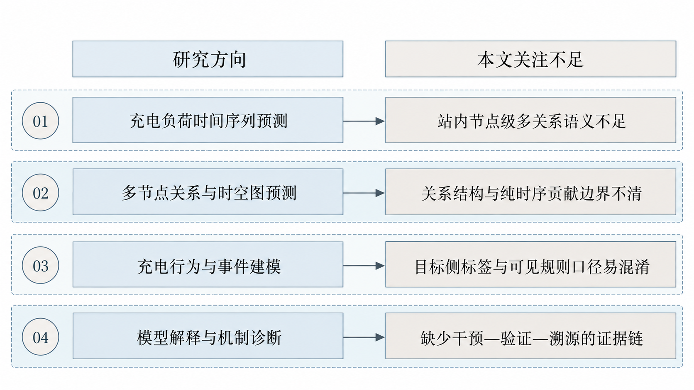

**图1-1 研究方向与本文关注不足的对应关系**  从时间序列预测、多节点关系建模、行为事件建模和机制解释四个方向，归纳本文所关注的站内节点关系语义、结构贡献边界、双事件口径和诊断证据链问题。

## 1.4 研究目标与主要内容

本文以MRG-GCN为验证载体，检验站内关系与节点差异门控的预测增量，并以MDP区分模型依赖和误差构成。主要发现是：在JPL所检设置下，负荷耦合与轮廓相似关系相对自环具有条件性整体增量，行为共现关系仍不确定；完整模型的整体优势未延伸至非零目标组。本文据此区分组件价值、模型排序与诊断判断，主要研究内容如下。

（1）数据与协议。审计会话字段和节点标识，重构15 min节点代理负荷，明确输入可见时点、标签成熟条件和时间切分；分析稀疏性与节点异质性，为关系构建和分层评价提供依据。

（2）预测与受控增量。构建负荷—行为—轮廓关系编码（LRE）三关系图，由MRG-GCN融合时间表示与关系消息；在Caltech事件时刻和JPL重拟合协议中比较节点级与共享门控，在JPL逐一以自环替换关系邻接，在Caltech改用完成时刻截断目标重训，并比较两套代理标签下12种既有配置的排序。分别检验整体表现、组件增量和目标敏感性，并以非零组和事件组约束总体结论。

（3）机制诊断。以L1的冻结β替换及重参数化分析、L2的受检时序学生蒸馏和L3的事件—规则四格分解，区分联合配置依赖、特定替代尝试与误差来源，并在JPL既有检查点上事后复核L1/L3；据此修订关系解释、学生替代结论和分层报告重点。诊断指导改模的收益尚待检验。

（4）可靠性与使用条件。开展方向性候选筛查、独立校准与成熟标签滚动回放，并用固定预测轨迹和合成约束例检查运行接口。结果按代理目标、固定测试期和计量材料边界解释；场站间比较限于ACN同源、时期重叠的重新拟合任务。

## 1.5 技术路线

图1-2概括本文主线与补充验证。

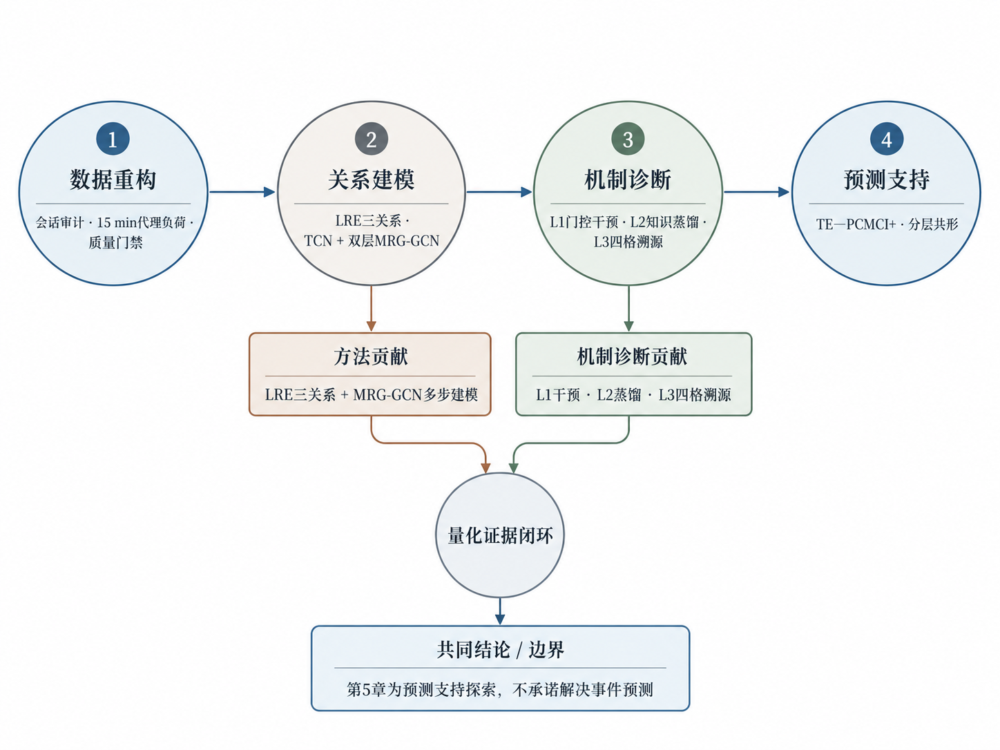

**图1-2 本文总体技术路线与双贡献主线**  Caltech主线完成代理序列重构、LRE构图、MRG-GCN预测及MDP诊断；JPL重新筛选节点、构图和训练，补充点预测与门控比较。固定测试期的关系替换、目标敏感性、代理标签排序敏感性及JPL既有检查点复核分别见3.7.2、3.8.4、3.8.5和4.6节。

第一阶段审计会话字段、时间和节点标识，重构15 min节点代理负荷，依训练集和验证集筛选10个节点，为构图和分层评价提供数据。

第二阶段以训练期统计量构建并稀疏化三类LRE关系图，经TCN和双层多关系门控图卷积预测未来1 h的四个目标片；以统一预测键和指标比较已登记基线及组件变体。部分文献方法仅用于定位，未重跑。

第三阶段以MDP检查冻结β替换、当前TCN学生蒸馏和事件—规则四格误差，分别形成参数敏感度、受检替代性及误差构成判断。

第四阶段筛查方向性统计候选，评价分层区间覆盖，并通过固定预测轨迹和合成线性规划定义运行核查接口，界定后续验证条件。

## 1.6 论文组织结构

本文正文由五章组成，正文之后为结论和参考文献。各章按“界定任务—检验预测—解释证据—分析适用条件”展开。

第1章界定研究对象，梳理相关工作，提出研究问题、主要贡献和技术路线。

第2章说明Caltech和JPL数据、代理目标重构、节点筛选及时间划分，归纳数据特征对建模与评价的约束。

第3章介绍LRE关系图与MRG-GCN，报告Caltech和JPL的协议内模型比较、组件对照及目标敏感性。

第4章通过MDP分析参数敏感度、受检学生替代表现和四格误差构成，并以JPL既有产物事后复核L1与L3。

第5章分析方向性候选、Caltech与JPL区间可靠性和预测支持接口，界定应用验证条件。

结论归纳受控增量证据和MDP引起的研究判断，汇总适用条件与后续工作。事件残差修正与预警比较属于已终止探索，不列为贡献。

## 1.7 本章小结

本章将研究问题归纳为站内关系预测、组件增量辨识和分层诊断。后续章节依次完成数据与时点定义、受控预测比较、诊断判断及可靠性分析，重点考察总体收益是否延伸至非零目标与事件样本。

# 第2章  充电行为数据与特征分析

本章回答两个问题：充电会话记录如何转化为可建模的节点序列，以及该序列的统计特征如何约束模型与评价。研究对象不是在线电表连续功率，而是由离散会话重构的节点代理负荷。下文依次说明数据来源与重构口径、节点筛选和质量门禁，再分析负荷稀疏性、节点异质性、周期性、事件窗口及特征相关性，并据此确定多关系图建模和分层评价要求。

## 2.1 数据来源与重构口径

本文采用公开的ACN-Data电动汽车充电数据集。该数据集由加州理工学院发布，记录会话接入、断开、充电完成时间和总交付电量等信息[82]。本文下载使用`siteID=2`的单场站会话归档，含31,424条记录和11个字段，不包含连续电流量测；这不意味着ACN-Data接口本身不提供电流序列。接入时间从2018年4月25日11:08:04延续至2021年9月14日1:52:37，最晚断开时间为2021年9月14日3:05:10，覆盖约3.39年。接入与断开时间全部可解析，充电完成时间可解析29,369条；完成时间不是式（2-1）主目标重构所需字段，其缺失不影响该主目标的时间片能量分配。

原始数据只给出会话总交付电量，不包含可直接用于节点级短期预测的连续功率序列。本文以15 min为固定时间间隔，将每条会话的总交付电量均匀分配至该会话从接入时刻到断开时刻所覆盖的全部时间片。设第\(s\)条会话的总交付电量为\(E_s\)，所属节点为\(i_s\)，覆盖的15 min时间片集合为\(\mathcal{B}_s\)，则节点\(i\)在时间片\(t\)上的节点代理负荷定义为

\[
y_{t,i}=\sum_{s:i_s=i,\,t\in\mathcal{B}_s}\frac{E_s}{|\mathcal{B}_s|}.
\tag{2-1}
\]

式中，\(|\mathcal{B}_s|\)为会话覆盖的时间片数。同一节点同一时间片若有多条会话，则对其分摊电量求和。由此形成2018年4月25日11:00至2021年9月14日3:15的规则时间网格，共118,818个时间步；相邻时间戳间隔均为15 min，无缺步。本文将\(y_{t,i}\)记作“节点代理负荷”，单位写作kWh/15 min，表示每个15 min离散时间片内由会话总电量分摊得到的电能量。该量不是瞬时功率或电表实测功率，也不用于还原时间片内部的真实充电曲线。

分摊的数值一致性与实际充电过程的真实性需要分别核查。10个主分析节点11,085条会话的交付电量合计92,650.017 kWh，与全部节点代理时间片的电量之和一致，逐节点守恒差均小于$10^{-8}$ kWh。这说明电量分配没有造成总量丢失，但不能证明分配时刻正确。若车辆完成充电后继续保持连接，当前方法仍向这一停留区间分配电量；每条会话的实际功率起伏也被均匀分摊所替代，可能平滑尖峰或改变峰值时刻。2.1.2节通过完成时刻和有限电流样本进一步核查这种时间形态差异；预测误差仍只相对于式（2-1）的代理目标定义。

节点标识审计显示，原始数据的场站字段`siteID`只有1个取值（2），该场站内包含55个候选充电节点。设备字段`stationID`、`EVSEID`与`spaceID`均有55个唯一值且不存在缺失，其中`stationID`与`EVSEID`逐行一致，`stationID`到`spaceID`为一对一映射。由此可知，`stationID`在该数据接口中是设备标识而非场站数量字段。本文统一使用`spaceID`作为节点标识，并以CA-303等编号表示站内空间充电单元；该标识不被解释为独立的配电网母线或物理拓扑节点。后续关系图的边仅描述节点负荷与充电行为的统计联系，而非站内配电线路的电气连接。

如图2-1所示，原始会话记录依次转换为模型输入张量。旧协议的节点选择、目标与特征z-score统计以及规则触发阈值分别由训练期或验证期确定，但上游占用率分母采用全时期节点最大活跃数，负荷跳变标记采用全时期正差分的90%分位数。因此，不能把后续训练期标准化概括为全部预处理与测试时期隔离。数据来源、时间跨度和关键审计结果汇总于表2-1。

**图2-1 数据重构与数据划分流程**  原始归档含31,424条会话；10个主分析节点对应11,085条会话，均匀分配至覆盖的15 min时间片以形成节点代理负荷。节点筛选、z-score参数和冻结触发阈值分别由训练期或验证期确定；旧上游占用率分母与跳变标记阈值另使用全时期统计，范围见2.1.1节。本图不表示在线电表功率测量。

**表2-1 原始数据形态与审计结果**

| 项目 | 审计结果 | 口径说明 |
|---|---:|---|
| 数据形态 | ACN-Data中`siteID=2`的充电会话记录 | 本文使用的归档不含连续电流或电表功率序列 |
| 原始记录数 | 31,424条 | 共11个字段 |
| 候选节点数 | 55个 | 统一以`spaceID`标识 |
| 原始接入时间范围 | 2018-04-25 11:08:04—2021-09-14 01:52:37 | 最晚断开时间为2021-09-14 03:05:10 |
| 重构时间网格 | 2018-04-25 11:00—2021-09-14 03:15 | 共118,818个时间步 |
| 采样间隔 | 15 min | 118,817个相邻间隔均一致 |
| 节点代理负荷单位 | kWh/15 min | 表示时间片分摊电量，不是瞬时功率 |
| 标识映射 | `stationID`=`EVSEID`，且与`spaceID`一一对应 | 三者均为设备标识；场站字段为`siteID` |
| 时间字段解析 | 接入、断开各31,424条；充电完成29,369条 | 重构使用接入、断开与总交付电量 |

### 2.1.1 三套评估协议的任务边界

三套协议使用15 min规则时间网格。时间戳$s_k$表示第$k$片的左端；预测输入含索引$k-95$至$k$的96片，最后一片为$[s_k,s_k+15\,\mathrm{min})$。其结束时刻$\tau_o=s_k+15\,\mathrm{min}$为预测发布时刻。四个目标依次为$k+1$至$k+4$片，片起点相对发布时刻为0、15、30和45 min，覆盖$[\tau_o,\tau_o+60\,\mathrm{min})$。因此首个目标片从发布时刻开始，四片共同覆盖未来1 h。行为计数按片末可见处理，但原始归档没有上报到达时间戳，通信延迟和丢失率未核验；目标代理标签可能在后续会话结束后才成熟。

Caltech回溯协议（`SG-DATA-005`）在固定节点、时间切分和统一预测键上，比较不同模型在事后均摊代理序列上的预测及诊断结果。历史片值由会话最终交付电量和断开时间构造；在发布时刻仍未结束的会话，其最终字段可能尚未确定。因此，历史窗口时间戳早于发布时刻，并不足以证明片值当时可获得。该协议支持事后重构序列上的离线回溯比较，0.01376 kWh/15 min及相应基线降幅均按这一任务解释。旧上游全时期统计的处理范围见2.1节。

Caltech事件时刻协议（`SG-DATA-006-eventtime-v1`）以接入、离站、活跃计数和当地日历编码为输入，移除旧代理负荷及其派生特征，目标仍为事后会话能量代理。计数特征按片末可见的假设构造；因此该协议收紧了输入字段权限，但不代表行为上报延迟已验证。现有`SG-EXP-019`的36次运行及同参数门控对照分别见3.6.2和3.7.1节。该协议与Caltech回溯协议的输入、切分和测试键不同，误差应在各自协议内解释。

Caltech事件时刻协议沿用旧筛选的10个节点，并要求训练、调参、校准和测试的完整窗口留段；测试时期仍已查看。旧回溯协议则存在边界跨段：训练与验证各有4个原点的目标窗口跨段，验证与测试各有95个原点的历史窗口进入前一段。使用过去历史本身不等于未来泄漏，但旧划分不满足完整窗口留段约定。JPL独立筛选节点并采用四段留窗，定义见2.1.3节。三套协议的回答范围见表2-2。

**表2-2 三套数据与评价协议的回答范围**

| 协议 | 预测时输入 | 目标与评价 | 主要回答的问题 | 不支持的结论 |
|---|---|---|---|---|
| Caltech回溯协议（`SG-DATA-005`） | 旧代理负荷及其派生通道、行为通道 | 事后重构代理负荷；共同测试键 | 离线回溯口径下MRG-GCN相对时间和图基线的表现及机制诊断 | 在线可执行精度、实测功率等价性 |
| Caltech事件时刻协议（`SG-DATA-006-eventtime-v1`） | 接入、离站、活跃计数及当地日历编码 | 仍为事后代理目标；完整窗口留段 | 片末可见假设下行为输入的相对价值与协议敏感性 | 与回溯协议MAE直接合并、证明实际上报无延迟或证明实测部署性能 |
| JPL重拟合协议（`SG-DATA-007-JPL`） | JPL接入、离站、活跃计数及当地日历编码 | JPL会话总电量的事后均匀分摊代理；独立场站四段留窗 | 在同属ACN体系的另一场站独立筛选节点、构图和训练后，核验整体MAE及节点级门控相对共享门控的差异能否重现 | 零样本迁移、未来时期或不同数据家族泛化、实测功率精度及真实运行收益 |

### 2.1.2 分摊支持范围与实测形态核查

为检验均摊终点的影响，先核对10节点的充电完成时刻。11,085条会话中，10,399条的完成时刻位于接入与断开之间，420条缺失，266条不满足这一顺序条件。合法记录从完成充电到断开的停留时间中位数为62.67 min。6,967条会话在完成之后仍包含完整15 min时间片，原分摊规则向这些片分配了28,403.239 kWh，占10节点总交付电量的30.66%。

该比例描述单会话分摊超出记录充电完成时刻的范围，不代表节点实测误差、模型MAE偏差或预测输入可见性风险；多个会话的重叠也使它不能直接说明节点在相应片内没有充电。

仅当`connectionTime <= doneChargingTime <= disconnectTime`时，才以充电完成时刻替代断开时刻作为分摊终点；完成时刻缺失或不满足该区间条件时，回退至`disconnectTime`。替代重构与原重构的总电量均为92,650.017 kWh，最大逐节点守恒差为$4.91\times10^{-10}$ kWh，但对应节点时间片的平均绝对差为0.0477816 kWh/15 min。该值只表示同一批会话在两种标签分配规则下的逐节点时间片平均绝对差，不是模型误差、真实负荷不确定度上限，也不与模型MAE作大小比较。

SG-EXP-032随后在Caltech事件时刻协议的固定测试键上使用这一替代目标重新训练预测模型；预测输入、原图、切分和起点键保持不变，仅依替代目标的新训练前缀重算目标标准化参数。该敏感性结果见3.8.4节。

完成时刻也不是连续功率测量，不能将替代序列认定为真实负荷。

此外，利用ACN-Data公开历史静态快照[82-83]核查同一节点会话的电流形态。固定主10节点各一个2018年5月正电量会话的匹配清单，其中8条通过电流非负、时间递增、首末覆盖误差和采样间隔门禁，CA-315与CA-327的两条记录因零积分或长采样间隙未通过。CA-303试探样本在固定完整清单前已查看，因此该组属于探索性便利样本，不能代表全站或独立确认数据。

对通过门禁的8条记录，以分段左常数积分计算各15 min片的电流积分，再除以该会话积分总量，得到无量纲片份额，与原等片份额比较。两种份额分布的总变差距离为0.0645～0.5957，实际电流积分的最大片份额为均匀份额的1.10～4.38倍。这些读数表明部分会话的过程集中程度会被均摊压低。

由于所匹配记录的电压、功率列均缺失，电流积分未换算为kWh，也不用于估计场站功率峰值或模型实测误差。完成时刻核查与电流形态检查共同说明：代理负荷保留能量总量，但对充电过程作了近似。原始归档仍缺事件接收时间戳，采样间隔门禁不能代替实际通信延迟验证。

另以EPFL Level-3两CCS端口记录作探索性形态参照[84]。以端口及会话首末时间连接，不以电量或跨表会话编号作键，1,878条会话全部一一匹配；经连续一分钟覆盖、非负功率与正能量等检查后，1,620条时长不少于15 min的会话纳入，258条短会话排除。将表内P字段作梯形积分，以会话接入为锚分为15 min片，并与按时长均匀分配的电量各自归一化，总变差距离中位数为0.0736，四分位数为0.0308、0.1276。

P积分与会话电量之比中位数为1.1492，累计电量首末差与会话电量之比为0.9943，计量边界尚不明确。该核查描述外部直流快充记录中的形态差异；其会话锚定分箱、按时长分配口径也不同于本文固定时钟等片目标，不能据此校准ACN标签或评价模型实测精度。

### 2.1.3 JPL另一场站数据与验证口径

为检验模型比较能否在另一充电场站重现，本文依据ACN官方JPL普通会话数据建立独立的训练与评价张量[82]。全量必要元数据包含33,638条会话，stationID和spaceID各有52个唯一值并稳定一一映射；记录接入时间覆盖2018年9月5日至2021年9月14日。根据训练边界前已成熟会话筛选10个车位节点（AG-1F08、AG-1F10、AG-1F06、AG-1F13、AG-1F02、AG-1F04、AG-1F01、AG-1F12、AG-1F07、AG-1F03），涉及11,041条会话。连续UTC 15 min网格共106,096个时间片，按时间顺序分为训练70%、调参7.5%、独立校准7.5%和测试15%，合法预测原点分别为74,168、7,826、7,828和15,816；每个96片历史窗与4片目标窗均完整留在所属分段内。

JPL输入只含接入数、离站数、活跃数和当地日历编码，不含由未来最终电量构造的历史代理负荷。目标仍将会话总电量均匀分配至接入至断开所覆盖的时间片，单位为kWh/15 min；零会话时间格表示无已记录会话贡献，不证明设备在线或实际需求为零。完成时间缺失2,037条，另有3,211条完成时间落在接入—断开区间之外；标签成熟时刻保守取断开时间与非空完成时间的较晚者，输入事件时刻不随之改变。2020年9—10月没有会话记录，未据此删去时间段。JPL与Caltech会话键、设备和车位标识无交集，但同属ACN数据体系且年份重叠。因此，本节对应另一场站重新筛选、构图和训练的比较，不是零样本迁移、不同数据家族或未来时期验证；两站标签也都不是连续电表功率。

JPL验证流程汇总见图2-13，点预测比较结果见3.6.3节。

## 2.2 节点可用性筛选与质量门禁

55个候选节点的记录密度差异较大。为减少近乎无活动序列造成的估计不稳定性，本文在训练前固定主分析与敏感性分析两级筛选门槛。节点入选只依据训练集和验证集，测试集仅标记后续可评价性。

数据按时间顺序划分为训练集、验证集和测试集，预测原点数量分别为83,103、17,807和17,809，占比约为70%、15%和15%。原点索引所对应的最后输入片左端时间戳范围依次为2018年4月26日10:45至2020年9月8日2:15、2020年9月8日2:30至2021年3月12日14:00，以及2021年3月12日14:15至2021年9月14日2:15；按2.1.1节定义，实际发布时刻为这些时间戳各加15 min。三部分时间连续、互斥且顺序固定；按日历月份计，训练、验证和测试阶段分别涉及30、7和7个自然月，其中各段首尾月份并非完整月份。

节点筛选从会话活跃度、时间覆盖和负荷稳定性三个方面设置六项条件，具体门槛见表2-3。主分析门槛要求训练期接入事件不少于100次、验证期不少于10次，训练期非零负荷时间片不少于200片，训练期和验证期活跃月份比例均不低于0.50，且训练期月度能量变异系数不高于2.5。较宽松门槛另生成15节点敏感性候选集合，目前只核验筛选覆盖，尚未完成该集合的模型重训练，不能据此证明预测结论对节点范围稳健。按主分析门槛，验证期接入事件数和活跃月份比例分别使44个和42个候选节点未通过，这两项条件是节点减少的主要原因；训练期各条件造成的未通过数量相对较少。

**表2-3 节点筛选门槛及主分析条件下的未通过数量**

| 筛选条件 | 主分析门槛 | 敏感性门槛 | 主分析条件下未通过节点数 |
|---|---:|---:|---:|
| 训练期接入事件数 | ≥100次 | ≥40次 | 7 |
| 验证期接入事件数 | ≥10次 | ≥5次 | 44 |
| 训练期非零负荷时间片数 | ≥200片 | ≥80片 | 2 |
| 训练期活跃月份比例 | ≥0.50 | ≥0.25 | 7 |
| 验证期活跃月份比例 | ≥0.50 | ≥0.25 | 42 |
| 训练期月度能量变异系数 | ≤2.5 | ≤3.5 | 2 |

六项条件联合筛选后，55个候选节点中有10个进入主分析集合，且均可在测试期评价；敏感性候选集合包含这10个节点及另外5个节点，共15个，其中14个在测试期可评价。图2-2展示各候选节点在训练、验证和测试阶段的活跃月份比例以及筛选归属。图中测试期覆盖仅描述冻结节点集合的后续可评价性，并未反向参与筛选，也不代表15节点预测实验已完成。

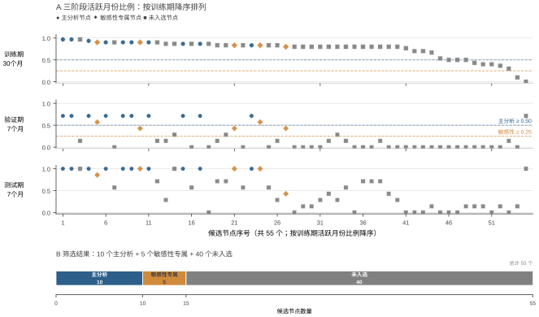

**图2-2 候选节点覆盖率与筛选结果**  （a）55个候选节点在训练、验证和测试阶段的活跃月份比例，横向参考线给出主分析门槛0.50和敏感性门槛0.25；（b）主分析节点、敏感性专属节点和未入选节点的筛选结果。按日历月份计，三个阶段分别涉及30、7和7个自然月，首尾月份可能不完整。节点清单只依据训练期与验证期统计量冻结，测试期覆盖率仅用于可评价性检查。该图为全量描述性统计，不含抽样误差棒。

除节点筛选外，本文还检查了时间片数量、时间戳间隔、标识映射、张量维度、时间划分连续性与互斥性、节点顺序以及测试边界等数据质量条件，9项门禁均通过。上述检查保证了进入后续实验的数据在时间轴和节点轴上一致，但并不把统计筛选结果解释为物理充电设施的完备清单。

## 2.3 节点负荷统计特征

主分析集合由CA-303、CA-304、CA-305、CA-307、CA-311、CA-315、CA-317、CA-321、CA-327和CA-489共10个节点组成。对118,818个时间步、10个节点的节点代理负荷进行统计，全量样本均值为0.0780 kWh/15 min，标准差为0.2186 kWh/15 min，最大值为2.9671 kWh/15 min；非零样本占21.59%，即零值约占78.41%。在后续模型使用的测试集预测键上，非零目标占12.75%，零值约占87.25%。因此，该数据同时具有大量零值和非零部分长尾波动两种特征。

连续四周的节点负荷热力图如图2-3所示。各节点按累计负荷排序，并按节点自身最大值归一化以突出时间结构；右侧条带表示同期累计负荷的相对规模。稀疏负荷片段主要随日内时段成组出现，不同节点的活跃程度和持续模式并不一致。图2-4进一步展示三个代表性节点的自相关函数，在96片和672片滞后位置附近均出现局部峰值，分别对应24 h和168 h周期。由于数据中存在大量并列零值，这些图形用于描述周期性线索，不据此作平稳性或因果判断。

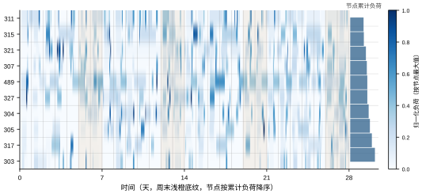

**图2-3 连续四周节点负荷热力图**  颜色表示各节点相对于自身最大负荷的归一化值，节点自上而下按同期累计负荷降序排列，右侧条带表示同期累计负荷的相对规模。横轴为距首个样本的时间，周末底纹按America/Los_Angeles当地日历对齐。图中使用所示四周的完整时间片，不含误差棒，节点排序不表示物理拓扑。

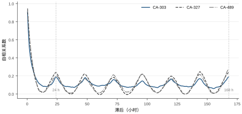

**图2-4 代表性节点代理负荷的自相关函数**  展示CA-303、CA-327和CA-489在不同滞后片数下的样本自相关，虚线标示96片（24 h）和672片（168 h）。三节点在两个周期位置均呈正相关，但相关系数约为0.19～0.27，因此仅说明日、周滞后具有可利用的统计依赖，不表示强确定性周期。

由表2-4可见，节点间存在明显异质性。CA-303的均值为0.1323 kWh/15 min、非零率为31.45%，均为主分析节点中的较高水平；CA-321的均值最低，为0.0562 kWh/15 min；CA-311的非零率最低，为14.62%。最高与最低非零率相差超过2倍，最高与最低均值约相差2.35倍。峰均比则介于约22.4和44.4之间，说明低平均负荷节点也可能出现相对突出的局部峰值。该差异提示模型训练与误差分析应保留节点维度，避免仅用全站聚合量掩盖节点表现。

**表2-4 主分析节点代理负荷统计**

| 节点 | 均值/(kWh/15 min) | 非零率/% | 最大值/(kWh/15 min) | 标准差/(kWh/15 min) | 峰均比 |
|---|---:|---:|---:|---:|---:|
| CA-303 | 0.1323 | 31.45 | 2.967 | 0.2885 | 22.4 |
| CA-304 | 0.0650 | 15.84 | 2.747 | 0.2188 | 42.2 |
| CA-305 | 0.1078 | 27.40 | 2.849 | 0.2585 | 26.4 |
| CA-307 | 0.0798 | 19.09 | 2.663 | 0.2332 | 33.4 |
| CA-311 | 0.0614 | 14.62 | 2.725 | 0.2059 | 44.4 |
| CA-315 | 0.0684 | 21.27 | 2.803 | 0.1968 | 41.0 |
| CA-317 | 0.0724 | 21.33 | 2.241 | 0.2071 | 30.9 |
| CA-321 | 0.0562 | 17.89 | 1.983 | 0.1662 | 35.3 |
| CA-327 | 0.0735 | 27.46 | 1.761 | 0.1856 | 24.0 |
| CA-489 | 0.0629 | 19.54 | 2.350 | 0.1852 | 37.3 |

三个代表性节点在日、周滞后位置的自相关系数列于表2-5。

**表2-5 代表性节点日、周滞后自相关系数**

| 节点 | 96片（24 h） | 672片（168 h） |
|---|---:|---:|
| CA-303 | 0.187 | 0.189 |
| CA-327 | 0.237 | 0.236 |
| CA-489 | 0.200 | 0.273 |

三个代表性节点的日内起伏和工作日—周末差异见图2-5，非零节点代理负荷的经验分布见图2-6。后者使用对数纵轴，仍可观察到随负荷增大而逐渐变稀的右尾。两图与表2-4共同说明：多数时间片没有充电活动，但发生充电时的幅度和持续模式具有较大差异。

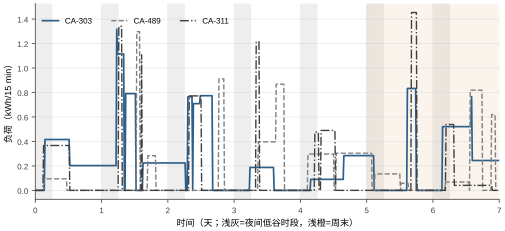

**图2-5 代表性节点典型周负荷曲线**  曲线为CA-303、CA-489和CA-311自第2,880个时间片起连续7日的实际代理负荷序列，并非跨周聚合均值。横轴为距该段首个样本的时间；浅灰表示当地00—06时，浅橙表示当地周末，时区为America/Los_Angeles。图中不含误差棒，用于描述所选时段的节点差异，不代表全年平均节律。

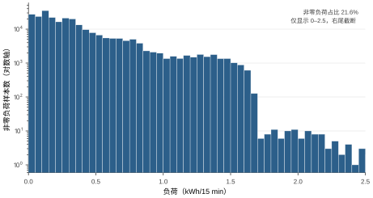

**图2-6 非零节点代理负荷经验分布**  统计对象为10个主分析节点全时段的非零节点代理负荷，横轴单位为kWh/15 min，纵轴采用对数刻度以展示低频右尾。图中为完整样本的经验频数，不含误差棒；横轴显示范围用于突出主要分布区域，不改变表2-4中的全量最大值统计。

## 2.4 事件分数构成与事件窗口统计

为描述会话接入、离站、活跃状态突变和负荷突变共同形成的短时行为变化，本文构造节点级规则事件分数。设节点\(i\)在时间片\(t\)的新接入数、离站数、活跃会话数和节点代理负荷分别为\(a_{t,i}\)、\(d_{t,i}\)、\(c_{t,i}\)和\(y_{t,i}\)，相应分量的训练期标准差为\(\sigma_{a,i}\)、\(\sigma_{d,i}\)、\(\sigma_{\Delta c,i}\)和\(\sigma_{\Delta y,i}\)，则事件分数定义为

\[
q_{t,i}=\frac{a_{t,i}}{\max(\sigma_{a,i},\varepsilon)}+
\frac{d_{t,i}}{\max(\sigma_{d,i},\varepsilon)}+
\frac{|c_{t,i}-c_{t-1,i}|}{\max(\sigma_{\Delta c,i},\varepsilon)}+
\frac{|y_{t,i}-y_{t-1,i}|}{\max(\sigma_{\Delta y,i},\varepsilon)},
\tag{2-2}
\]

式中，\(\varepsilon\)为防止分母为零的极小常数。四个标准差均按节点在训练集上计算，使不同活跃度节点和不同量纲的行为分量能够在同一规则中比较。对于每个节点，在验证集非零事件分数上取95%分位数作为阈值；超过阈值的时间片记为规则触发点，并只向未来扩展2个时间片。阈值和扩展规则一经确定便保持不变，测试集不参与阈值估计，相邻或重叠的触发窗口合并为连续窗口。该规则属于含事后代理负荷差分的回溯诊断，不解释为发布时刻可用的在线触发。完整生成流程见图2-7。

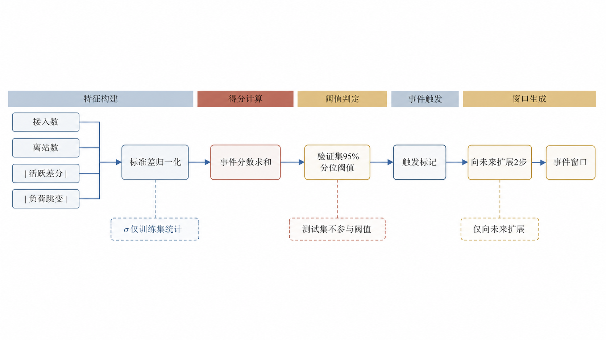

**图2-7 事件分数与冻结规则事件窗口生成流程**  接入、离站、活跃变化和负荷变化四个分量经逐节点标准差归一化后求和，采用验证集95%分位阈值触发，并仅向未来扩展2个时间片。标准差来自训练集，测试集不参与阈值估计。

标签事件时间步的日内分布见图2-8，事件并非在一天内均匀出现。图2-9展示冻结规则窗口中四个标准化分量的节点平均贡献。该图描述旧回溯规则分数的构成，负荷变化分量仍依赖事后重构，不表示实时行为识别或分量对预测误差的因果贡献。

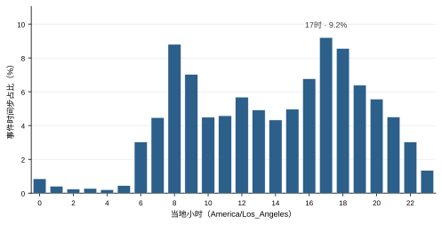

**图2-8 标签事件时间步的日内分布**  在全部118,818个时间步中，将任一主分析节点具有目标侧事件标签的时间步按America/Los_Angeles当地小时汇总；柱高表示该小时事件时间步数占全部事件时间步数的比例，峰值标记由同一统计数组计算。该图不区分事件类型，柱高也不是分类准确率或条件事件概率；全量描述性统计不含误差棒。

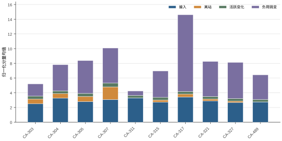

**图2-9 冻结规则事件窗口的分量构成**  对测试集冻结规则事件窗口内的接入、离站、活跃变化和负荷变化四个标准化分量按节点取平均。事件窗口包含原始阈值触发点及其向未来扩展的两个时间片；阈值由验证集冻结，测试集仅执行规则。图中为完整窗口样本的描述性均值，不含误差棒。

事件统计必须区分“目标侧标签事件”和“冻结规则触发”两种口径。内部字段`target_event`由未来4个目标片中的接入、离站或负荷突变标签定义，直接作用于形状为\([S,H,N]\)的预测评价键；它是按目标侧观测构造的事后评价标签，不是人工核验的现实事件真值。测试集中共有10,160个标签事件样本，占712,360个预测键的1.426%，约为1.43%。旧字段`rule_trigger`取每个预测原点对应的回溯规则状态，原始形状为\([S,N]\)，在四格诊断和规则路由时广播到4个目标片；测试集中共有3,060个触发预测键，占0.430%，约为0.43%。该状态依赖事后代理负荷差分，不能解释为发布时刻可用的触发信息。前者用于评价模型在标签事件窗口上的误差，后者用于第4章四格诊断和第5章冻结规则路由。两者定义和信息时点不同，但广播后的上述比例具有相同预测键分母；不得把原始节点—起点数与广播后预测键数直接混算，定义与用途对照见图2-10。

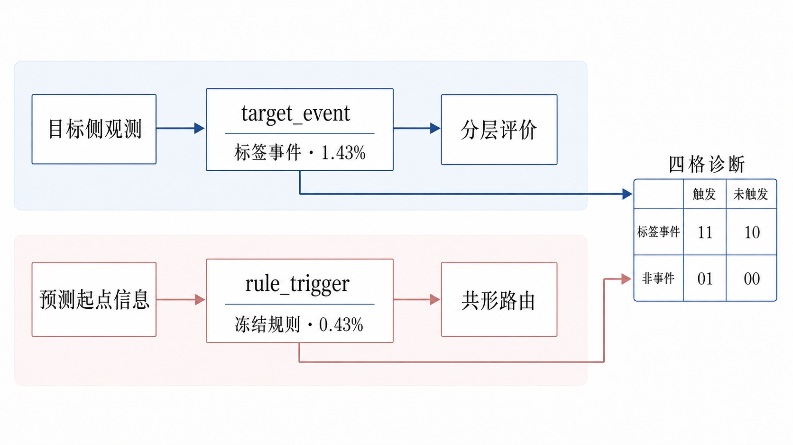

**图2-10 标签事件与冻结规则触发的双口径对比**  `target_event`用于事后评价，旧`rule_trigger`用于回溯分层及规则路由；两者共同定义四格诊断，标签事件不进入规则路由。原始张量分别为[S,H,N]与[S,N]，后者广播到各目标片后，1.43%和0.43%均以712,360个测试预测键为分母。旧标签的负荷跳变阈值采用全时期统计，旧规则含事后重构负荷差分，均不能解释为实时事件识别效果。

逐节点验证统计见表2-6。验证集非零事件分数占比为0.20%～1.06%，冻结阈值为18.9～32.5；原始触发点占节点时间片的0.011%～0.056%，向未来扩展后占0.034%～0.168%。在测试集上，规则共产生254个连续窗口，其中253个长度为3个时间片，1个因相邻触发合并为6个时间片。

**表2-6 逐节点冻结规则事件统计**

| 节点 | 验证集非零分数占比/% | 冻结阈值 | 验证集触发点占比/% | 验证集前向窗口占比/% |
|---|---:|---:|---:|---:|
| CA-303 | 0.82 | 18.9 | 0.045 | 0.135 |
| CA-304 | 0.37 | 22.7 | 0.022 | 0.067 |
| CA-305 | 0.61 | 25.5 | 0.034 | 0.101 |
| CA-307 | 0.27 | 29.2 | 0.017 | 0.051 |
| CA-311 | 0.79 | 23.5 | 0.045 | 0.135 |
| CA-315 | 0.20 | 22.1 | 0.011 | 0.034 |
| CA-317 | 0.25 | 32.5 | 0.017 | 0.051 |
| CA-321 | 1.06 | 22.4 | 0.056 | 0.168 |
| CA-327 | 1.04 | 27.7 | 0.056 | 0.168 |
| CA-489 | 0.44 | 24.5 | 0.022 | 0.067 |

规则在训练、验证和测试三个数据段内分别执行，因此每段最前面的两个预测起点不会继承上一数据段的触发状态。该处理避免跨划分传递信息，最多影响测试评价键中的80个位置，即2个起点×4个目标片×10个节点，占712,360个测试预测键的约0.011%，属于保守的边界处理。

## 2.5 特征构成与协议输入

以下表2-7描述的是Caltech回溯协议（`SG-DATA-005`）的七项输入：节点代理负荷、新接入会话数、离站会话数、活跃会话数、占用率、需求强度和负荷突变标志。其中，节点代理负荷、活跃会话数、占用率和需求强度的非零率均为21.59%；接入和离站计数的非零率约为0.93%，负荷突变标志的非零率约为0.14%。需求强度在当前处理中与节点代理负荷取值一致，活跃会话数与占用率之间也存在确定的比例联系，故这些变量是状态的相关表征，不应被视为相互独立的信息源。

**表2-7 Caltech回溯协议输入特征的全量描述性统计**

| 特征 | 含义 | 非零率/% | 均值 | 最大值 |
|---|---|---:|---:|---:|
| `load` | 节点代理负荷 | 21.589 | 0.0780 | 2.9671 |
| `access_count` | 新接入会话数 | 0.933 | 0.0093 | 2 |
| `departure_count` | 离站会话数 | 0.933 | 0.0093 | 2 |
| `active_count` | 活跃会话数 | 21.589 | 0.2164 | 2 |
| `occupancy_rate` | 占用率 | 21.589 | 0.1082 | 1 |
| `demand_intensity` | 需求强度 | 21.589 | 0.0780 | 2.9671 |
| `load_jump_flag` | 负荷突变标志 | 0.135 | 0.0014 | 1 |

7项特征在全部时间步和节点上展平后的Spearman秩相关系数见图2-11。Spearman秩相关用于描述单调关联，不要求变量服从正态分布或满足线性关系；但本数据存在大量并列零值，因此系数仅作描述性比较。节点代理负荷、活跃会话数、占用率和需求强度之间相关程度较高，而三项稀疏事件特征与主体状态特征的相关程度相对较低。这一结果说明输入同时包含状态表征冗余和低频行为信号，后续需要通过模型对比和消融而非仅凭相关矩阵判断各特征的预测作用。

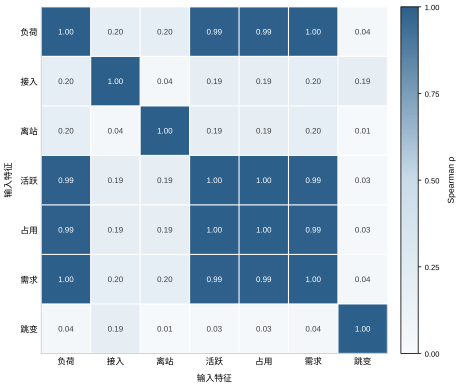

**图2-11 输入特征Spearman秩相关矩阵**  相关系数由118,818个时间步、10个主分析节点的7维特征展平计算，颜色和单元格数字共同表示相关方向与大小。该图为全量描述性统计，不含误差棒；大量零值造成并列秩，因而不将相关系数解释为独立贡献或因果关系。

按星期和小时聚合10个节点代理负荷所得结果见图2-12。不同星期类别在白天和晚间呈现不同的负荷强度，周末与工作日的分布也有差异，与2.3节的自相关结果相互印证。后续模型据此选取连续96片、即完整24 h的历史信息作为基本输入窗口，并通过图结构补充同一时段节点之间的统计联系。

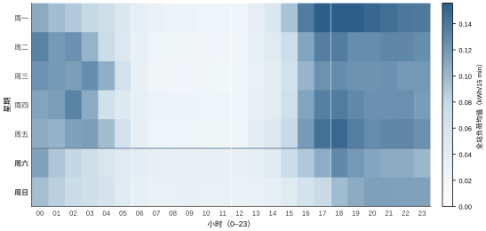

**图2-12 全站节点代理负荷的星期—小时聚合热力图**  每个单元格为10个主分析节点在对应当地星期和小时上的平均节点代理负荷，并非节点负荷之和；时区为America/Los_Angeles。色阶覆盖完整聚合值范围，周末以分隔线区分。该图由全时段样本直接聚合，不含误差棒，颜色不表示事件发生概率。

该回溯协议的模型输入形状为\(96\times10\times7\)，输出为\(4\times10\)。归一化参数仅由训练集估计，验证集和测试集沿用冻结参数。严格事件时刻协议虽然也是7通道，但语义完全不同：只含`access_count`、`departure_count`、`active_count`及当地小时、星期的正余弦编码，不含`load`、`demand_intensity`、`occupancy_rate`或`load_jump_flag`。它仍使用96片历史与4片代理目标，时间边界统一按2.1.1节定义；不得因张量形状相同而将旧输入、检查点或模型结果移入新协议。

## 2.6 数据特征对建模的启示

数据特征提出四项建模要求。其一，零值与长尾并存，宜使用MAE、RMSE和WAPE，并分别评价事件、稳定和非零样本。其二，节点异质性与多类统计联系为LRE构图提供动机，但其有效性须由消融检验。其三，标签事件与规则触发错位，需用四格诊断及区间覆盖分别分析。其四，状态特征相关、行为信号稀疏，故保留7维统一输入，不凭相关矩阵直接删除特征或主张预测贡献。

JPL补充实验将这些建模要求落实为固定的数据与评价协议（图2-13）。行为输入和回顾性目标分别构造，节点筛选仅使用训练边界前已成熟的记录，标准化参数与LRE关系图仅由训练段拟合。调参集用于选择检查点，所有检查点锁定后，各运行才导出一次测试预测；整体与分层比较使用共同的预测键。

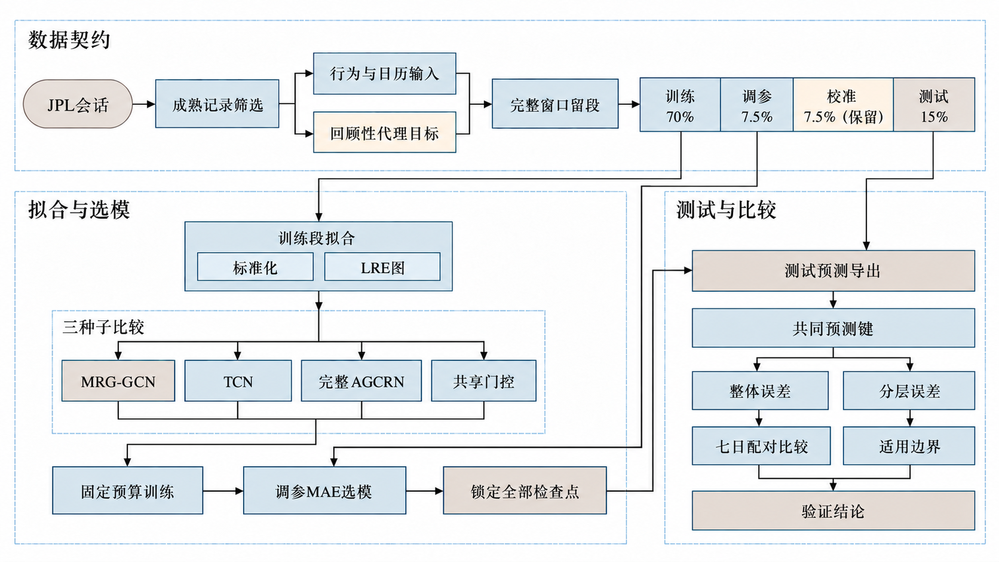

**图2-13 JPL固定协议重新拟合验证流程**  输入为接入、离站、活跃计数及当地日历编码，假定行为计数在所属时间片结束时可见；实际接收延迟未核实。目标为会话电量在接入至断开区间内均匀分摊的代理能量。训练、调参、校准和测试按时间分段，96片历史窗与4片目标窗完整留段，目标片起点按2.1.1节统一口径解释。四种模型各运行三个种子，以调参集原单位MAE选择检查点；全部检查点锁定后，每次训练运行仅导出一次测试预测，在632,640个共同预测键上评价，整体MAE另按24个七日块进行配对比较。训练预算与早停规则见3.6.3节。校准段在预登记点预测比较时保留，后续独立区间评价见5.3.5节；该流程对应另一ACN场站的重新拟合验证。

## 2.7 本章小结

本章将覆盖约3.39年的31,424条会话重构为118,818步、55个候选节点的15 min代理序列，筛选后的10个主节点涉及11,085条会话。六项筛选和九项质量门禁约束节点集合及张量一致性；旧上游全时期统计与跨段窗口的限制见2.1.1节。新协议另行收紧输入字段和窗口划分，代理目标仍须与电表功率区分。

统计分析表明，主分析节点的全量负荷零值约占78%，测试预测键零值约占87%，节点非零率和平均负荷均存在较大差异，并呈现日内与周内滞后依赖。事件分析进一步区分了目标侧标签事件与冻结规则触发：二者在测试预测键上分别占1.43%和0.43%，用于不同的评价与路由场景。7维输入中，主体状态特征存在较高相关性，而接入、离站和负荷突变信号高度稀疏。

这些特征为下一章的LRE关系构建和分层评价提供依据。完成时刻截断目标的预测敏感性见3.8.4节；JPL另按2.1.3节独立筛选节点、划分数据和建模，两站预测键不混合。

# 第3章  基于多关系门控图卷积的节点短期负荷预测

## 3.1 引言

第2章揭示了节点代理负荷的稀疏性、周期依赖和节点异质性，也表明站内节点存在多类统计联系。单节点时序模型无法直接聚合其他节点的信息，单一关系图又难以区分负荷耦合、行为共现和轮廓相似。为此，本章构建负荷—行为—轮廓关系编码（load–event–pattern relation encoding，LRE），并提出多关系门控图卷积网络（multi-relational gated graph convolutional network，MRG-GCN）。模型先由时间卷积网络编码历史信息，再以关系级权重和节点级门控完成两层图传播，最后融合不同深度的表示并输出未来1 h的节点代理负荷。

本章先定义任务、关系图与模型，再以Caltech事件时刻预测和JPL重拟合为主要比较，回溯结果为补充。随后分别报告同参数门控、关系邻接及其他组件对照，并综合训练预算和目标敏感性证据。三套协议的输入、切分与预测键不同，误差仅在各自协议内比较；完成时刻截断实验固定Caltech事件时刻协议的测试键。模型整体架构见图3-1。

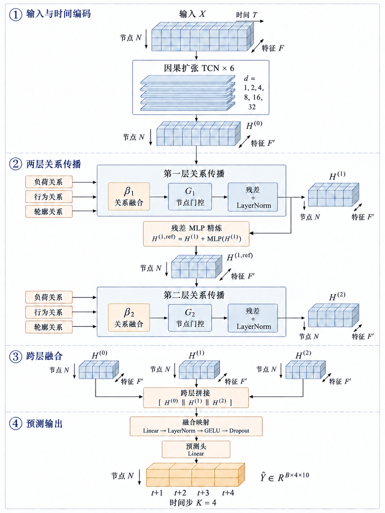

**图3-1 MRG-GCN整体架构**  历史输入依次经过因果扩张TCN、第一层多关系传播、残差MLP精炼和第二层多关系传播。原始H⁽⁰⁾、H⁽¹⁾与H⁽²⁾经跨层拼接、融合映射和线性预测头输出未来4个连续15 min目标片的节点代理负荷，片起点按2.1.1节定义；精炼表示不直接参与跨层拼接。三类固定关系仅由训练集构建。分区中重复的状态符号指同一表示而非额外计算层；张量网格为示意，隐藏状态的实际形状均为[B,N,32]。

为避免在整体图中堆叠局部运算，图3-2单独展开多关系传播单元，图3-3补充时间编码与跨层融合路径；相关符号在3.2～3.5节依次定义。

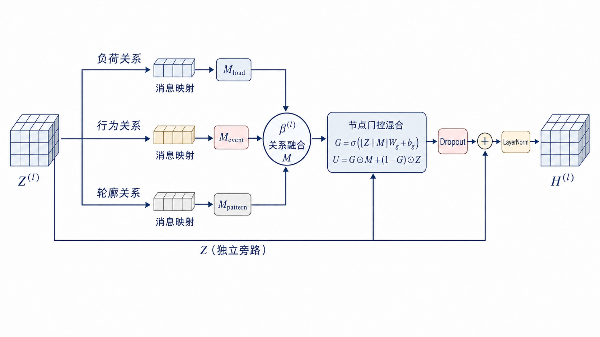

**图3-2 多关系门控传播单元**  三类关系消息经关系级权重融合后，由节点级门控与该层实际输入混合，并通过残差连接与层归一化形成层输出。两层传播单元结构相同、参数独立；第二层实际输入为精炼表示$H^{(1,\mathrm{ref})}$。

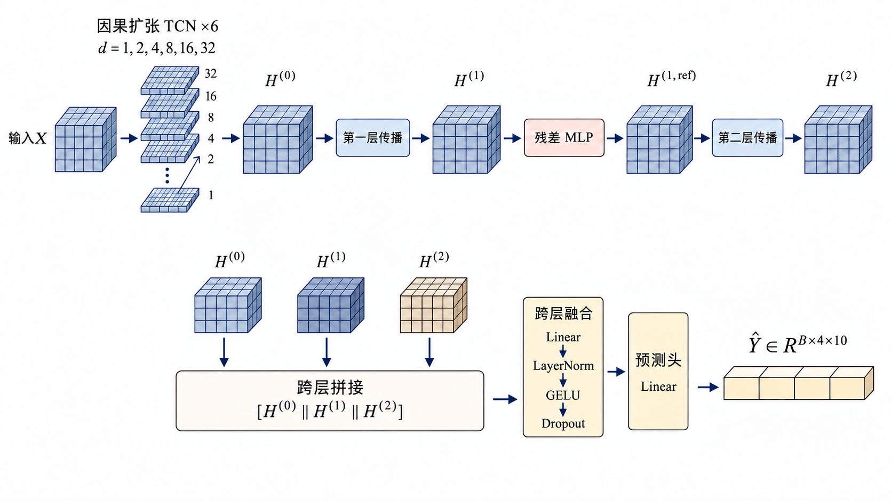

**图3-3 时间编码与跨层融合预测结构**  上部展示时间编码与两层传播，下部以同名状态重复展示拼接输入，不表示新增模型分支。跨层融合使用原始$H^{(0)}$、$H^{(1)}$和$H^{(2)}$，经融合映射与线性预测头得到4个连续15 min目标片的输出；精炼状态$H^{(1,\mathrm{ref})}$仅作为第二层传播输入，目标片起点按2.1.1节定义。

## 3.2 预测任务形式化定义

设主分析节点集合为$\mathcal{V}=\{v_1,\ldots,v_N\}$，其中$N=10$。令$s_k$为末个输入时间片的左端时间戳，时间片宽度$\Delta t=15$ min，发布时刻为$\tau_o=s_k+\Delta t$。预测输入为索引$k-95$至$k$的96片历史特征：

$$
\mathbf{X}_o\in\mathbb{R}^{H\times N\times F},\qquad H=96,\ F=7, \tag{3-1}
$$

预测目标为未来$P=4$个目标片的节点代理负荷：

$$
\widehat{\mathbf{Y}}_o=f_\theta(\mathbf{X}_o,\mathcal{A}),\qquad
\widehat{\mathbf{Y}}_o,\mathbf{Y}_o\in\mathbb{R}^{P\times N},\ P=4, \tag{3-2}
$$

其中，$\mathcal{A}$为训练集构建的关系矩阵集合，$f_\theta$为待学习模型。模型输出$P=4$个连续目标片，记为$\widehat{\mathbf{Y}}_o=(\hat y_{k+1},\ldots,\hat y_{k+4})$，对应真实值$\mathbf{Y}_o=(y_{k+1},\ldots,y_{k+4})$，共同覆盖$[\tau_o,\tau_o+60\,\mathrm{min})$；各片起点相对发布时刻依次为0、15、30、45 min。输入覆盖发布前完整24 h；“未来1 h”指从发布时刻到第四片结束的覆盖范围，不表示首个目标片起点延后15 min。每个评价单元由“协议—发布时刻—目标片编号—节点”唯一标识，所有同协议模型按共同预测键比较。标准化参数由训练集估计并冻结；标签事件`target_event`和规则触发`rule_trigger`不作为模型输入。

## 3.3 场景驱动的LRE三关系图构建

LRE从训练期数据中构建负荷耦合、行为共现和轮廓相似三类无向统计关系。三类图使用相同节点集合，但刻画不同语义；测试数据不参与关系估计。构建与稀疏化流程见图3-4。

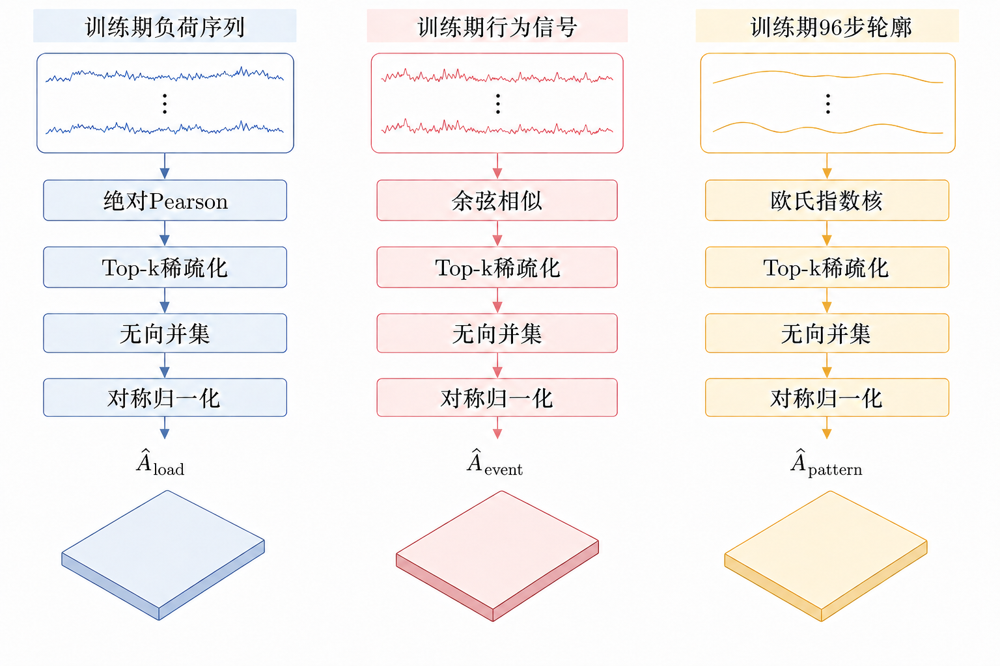

**图3-4 LRE三关系构建流程**  训练期负荷序列、行为信号和96片轮廓分别形成负荷耦合、行为共现和轮廓相似关系，随后经Top-k稀疏化、无向并集和对称归一化得到三类固定邻接矩阵。

### 3.3.1 负荷耦合关系图

设$\mathbf{l}_i\in\mathbb{R}^{T}$为节点$i$的训练期节点代理负荷序列。节点$i$与$j$的负荷耦合强度定义为绝对Pearson相关系数：

$$
A^{\mathrm{load}}_{ij}=\left|
\frac{(\mathbf{l}_i-\bar l_i)^{\mathsf T}(\mathbf{l}_j-\bar l_j)}
{\|\mathbf{l}_i-\bar l_i\|_2\,\|\mathbf{l}_j-\bar l_j\|_2}
\right|. \tag{3-3}
$$

绝对值表示耦合强度，不保留正负方向；任一序列方差为零时，对应权重置零。该关系描述节点负荷在训练期的同步程度，不解释为物理连线或因果联系。

### 3.3.2 行为共现关系图

对节点$i$构造行为序列
$\mathbf{b}_i=\mathbf{x}^{\mathrm{access}}_i+\mathbf{x}^{\mathrm{departure}}_i+|\Delta\mathbf{x}^{\mathrm{active}}_i|$，再以余弦相似度定义行为共现关系：

$$
A^{\mathrm{event}}_{ij}=
\frac{\mathbf{b}_i^{\mathsf T}\mathbf{b}_j}
{\|\mathbf{b}_i\|_2\,\|\mathbf{b}_j\|_2}. \tag{3-4}
$$

分母为零时权重置零。该关系侧重接入、离站与活跃变化在时间上的共同出现，对行为规模差异相对不敏感。

### 3.3.3 轮廓相似关系图

训练序列从数据起点按固定相位切分为96步窗口，对各窗口同一相位位置取均值，得到节点轮廓$\mathbf{p}_i\in\mathbb{R}^{96}$，其元素单位为kWh/15 min。数据首时刻为11:00，因此这是固定相位的96步窗口轮廓，不是自然日00:00起算的日曲线。记节点轮廓均值为$\bar p_i$，中心化轮廓为$\tilde p_{iq}=p_{iq}-\bar p_i$；以节点对中心化轮廓的均方根距离表征形状差异，再以指数核转换为相似度：

$$
\bar p_i=\frac{1}{96}\sum_{q=1}^{96}p_{iq},\qquad \tilde p_{iq}=p_{iq}-\bar p_i,\\
d_{ij}=\sqrt{\frac{1}{96}\sum_{q=1}^{96}(\tilde p_{iq}-\tilde p_{jq})^2},\qquad
s=\begin{cases}
\operatorname{median}\{d_{uv}:u<v,\ d_{uv}>0\}, & \text{若存在正距离},\\
1, & \text{否则},
\end{cases}\\
A^{\mathrm{pattern}}_{ij}=\exp\!\left[-\frac{d_{ij}}{\max(s,10^{-6})}\right]. \tag{3-5}
$$

式中，$i,j,u,v$为节点索引，$q$为96个固定相位位置之一；$d_{ij}$与$s$的单位均为kWh/15 min。中心化去除节点轮廓均值，故该关系反映相对形状而非负荷水平。尺度$s$取所有无序节点对$(u,v)$中正距离的中位数；若无正距离则回退为$1$ kWh/15 min。为避免分母过小，指数核分母下限为$10^{-6}$ kWh/15 min。该关系与负荷耦合关系表达不同的统计信息。

### 3.3.4 top-k稀疏化与对称归一化

三类关系矩阵分别进行稀疏化。首先在每行保留权重最大的$k$个非自身邻居，随后以$\max(\mathbf A,\mathbf A^{\mathsf T})$取得无向并集。因此，某节点最终的非零邻居数可能略多于$k$。Caltech回溯协议主模型（`SG-DATA-005`、`SG-EXP-003`）冻结为$k=3$；后文另行报告的$k=5$、$k=7$属于不同登记实验的稀疏度敏感性，不能改写该主结果的配置。Caltech事件时刻协议（`SG-DATA-006-eventtime-v1`）另行冻结为$k=5$，两套Caltech结果不直接比较。在加入单位自环后，采用对称归一化：

$$
\widehat{\mathbf A}_r=\widetilde{\mathbf D}_r^{-1/2}
(\mathbf A_r+\mathbf I)\widetilde{\mathbf D}_r^{-1/2},
\qquad r\in\{\mathrm{load,event,pattern}\}. \tag{3-6}
$$

三类关系矩阵见图3-5。它们均为训练期统计关系，颜色只表示关系权重，不表示地理距离、配电拓扑或因果方向。

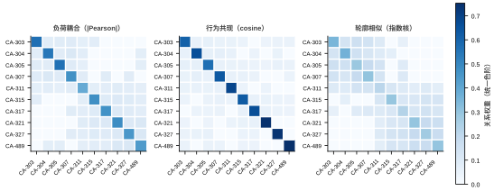

**图3-5 LRE三类站内关系矩阵**  三个面板依次表示负荷耦合、行为共现和轮廓相似关系，并采用统一色阶。矩阵由训练集一次性构建，不含跨种子误差棒。

## 3.4 时间基线：TCN

时间骨干采用TCN[24]。对每个节点独立处理96片历史输入，六层一维卷积的膨胀率依次为$1,2,4,8,16,32$，卷积核宽度为3。网络使用因果填充并裁去右侧多余输出，使时刻$t$的表示只依赖$t$及其历史。其感受野为

$$
R=1+(K-1)\sum_{l=0}^{L-1}2^l=1+2(1+2+4+8+16+32)=127, \tag{3-7}
$$

能够覆盖96片历史窗口。每层在通道维执行逐时间步LayerNorm，不跨时间汇总统计量；最终时刻的隐藏状态作为节点初始表示$\mathbf H^{(0)}\in\mathbb{R}^{B\times N\times D}$。主实验取隐藏维$D=32$、dropout为0.1。TCN既作为MRG-GCN的时间编码器，也作为无图基线。

## 3.5 双层多关系门控图卷积网络（MRG-GCN）

### 3.5.1 总体架构

MRG-GCN由时间编码、两层多关系图卷积、层间特征精炼、跨层融合和预测头组成。TCN输出$\mathbf H^{(0)}$；第一层图卷积得到$\mathbf H^{(1)}$；中间残差MLP生成精炼表示$\mathbf H^{(1,\mathrm{ref})}$，并作为第二层图卷积的输入，得到$\mathbf H^{(2)}$。最后拼接$\mathbf H^{(0)}$、$\mathbf H^{(1)}$和$\mathbf H^{(2)}$，经线性映射、层归一化（LayerNorm）、GELU激活和随机失活融合，预测未来4个目标片的负荷。该结构同时保留纯时序、一阶邻域和二阶传播信息。为统一两层记号，定义$\mathbf Z^{(1)}=\mathbf H^{(0)}$、$\mathbf Z^{(2)}=\mathbf H^{(1,\mathrm{ref})}$，即$\mathbf Z^{(l)}$表示第$l$层传播的实际输入。

### 3.5.2 单关系消息传递

对第$l$层输入$\mathbf Z^{(l)}$，关系$r$的消息为

$$
\mathbf M_r^{(l)}=\widehat{\mathbf A}_r\mathbf Z^{(l)}\mathbf W_r^{(l)}, \tag{3-8}
$$

其中，$\mathbf W_r^{(l)}\in\mathbb{R}^{D\times D}$为关系专属变换矩阵。邻接聚合沿节点维进行，不改变批次维和隐藏维。

### 3.5.3 关系级门控

每层设置独立的未归一化权重参数（logit）$\mathbf a^{(l)}$，经Softmax得到三类关系的全局融合权重：

$$
\beta_r^{(l)}=\frac{\exp(a_r^{(l)})}{\sum_{s=1}^{3}\exp(a_s^{(l)})},\qquad
\mathbf M^{(l)}=\sum_{r=1}^{3}\beta_r^{(l)}\mathbf M_r^{(l)}. \tag{3-9}
$$

$\boldsymbol\beta^{(l)}$在同一层内由全部节点共享，用于表示该层的关系混合偏好，不是逐节点贡献度，也不等同于因果效应。两层参数相互独立，允许不同传播深度采用不同关系组合。

### 3.5.4 节点级门控

关系消息聚合后，模型按样本、节点和特征维计算门值：

$$
\begin{aligned}
\mathbf G^{(l)}&=\sigma\!\left([\mathbf Z^{(l)}\Vert\mathbf M^{(l)}]\mathbf W_g^{(l)}+\mathbf b_g^{(l)}\right),\\
\widetilde{\mathbf H}^{(l)}&=\mathbf G^{(l)}\odot\mathbf M^{(l)}+
(1-\mathbf G^{(l)})\odot\mathbf Z^{(l)}.
\end{aligned} \tag{3-10}
$$

$$
\mathbf H^{(l)}=\operatorname{LayerNorm}\!\left[
\mathbf Z^{(l)}+\operatorname{Dropout}(\widetilde{\mathbf H}^{(l)})\right]. \tag{3-11}
$$

关系级$\boldsymbol\beta$与各关系变换共同缩放聚合消息，节点级$\mathbf G$在自身表示和邻域消息间分配门值。β不能脱离关系变换的尺度单独解释为重要性，详见4.2.5节。Caltech回溯协议未对$\mathbf G$单独重训练消融；Caltech事件时刻协议的固定门值结果只作为受限功能证据，详见3.7.2节及附表A-1。

### 3.5.5 关系随机失活

关系随机失活（relation dropout）在训练时按关系类型采样掩码，并对保留关系的$\boldsymbol\beta$重新归一化；若三类关系均被屏蔽，则随机恢复其中一类，以保证消息传播路径非空。该机制只在$p>0$时启用，主模型配置$p=0$，因此不是主结果中的有效正则项；其$p=0.2$和$p=0.4$设置仅用于3.7.2节敏感性检验。

### 3.5.6 逐层关系选择与跨层融合

第一层输出$\mathbf H^{(1)}$经残差MLP精炼后输入第二层，但跨层融合使用原始$\mathbf H^{(1)}$，而非精炼后的$\mathbf H^{(1,\mathrm{ref})}$。最终表示为

$$
\mathbf H^{\mathrm{fuse}}=
\operatorname{Dropout}\!\left(
\operatorname{GELU}\!\left\{
\operatorname{LayerNorm}\!\left[
\mathbf W_f(\mathbf H^{(0)}\Vert\mathbf H^{(1)}\Vert\mathbf H^{(2)})
\right]\right\}\right). \tag{3-12}
$$

预测头将每个节点的融合表示映射为4个目标片。图3-1给出整体数据流，图3-2和图3-3分别展开关系传播单元与跨层融合路径。

### 3.5.7 目标函数与训练策略

训练目标采用标准化空间中的L1损失：

$$
\mathcal L(\theta)=\frac{1}{BPN}\sum_{b=1}^{B}\sum_{p=1}^{P}\sum_{i=1}^{N}
\left|\widehat Y_{bpi}-Y_{bpi}\right|. \tag{3-13}
$$

式中，$Y_{bpi}$和$\widehat Y_{bpi}$分别为由训练段拟合的标准化参数变换后的目标值与模型预测值。事件时刻协议及JPL重拟合实验使用标准化L1训练，以调参集原单位MAE选择检查点；连续8轮未改善时早停，最多训练60轮。正式结果采用2024、2025和2026三个随机种子；校准集和测试集不参与选模。回溯协议的历史选模口径另见表3-14注。

### 3.5.8 与现有方法的区别

相关方法先例及本文的任务化定位见1.2.2节。Graph WaveNet[51]和AGCRN[52]作为统一协议下的模型对照；整体预测结果与受控组件比较分别见3.6—3.8节。

### 3.5.9 节点门控与残差更新的分工

图3-6给出$\boldsymbol\beta$与$\mathbf G$的计算位置。冻结替换改变$\boldsymbol\beta$而保留关系变换，检验联合配置敏感度；节点维门控增量则由同参数共享门控训练比较，见3.7.1节。两类权重均不作物理因果解释。

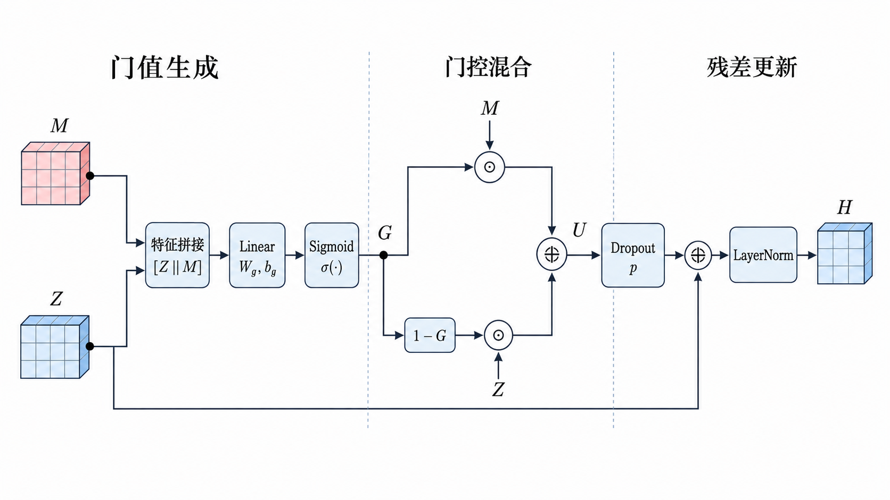

**图3-6 节点门控与残差更新细节**  三类关系消息先形成融合消息$\mathbf M^{(l)}$，再与层输入$\mathbf Z^{(l)}$共同生成节点门值；门控混合后通过残差更新和LayerNorm得到$\mathbf H^{(l)}$。底部身份路径表示输入状态直接参与残差更新，不表示额外的关系边。

### 3.5.10 跨层表示的使用原则

第一层输出$\mathbf H^{(1)}$经残差MLP精炼后仅作为第二层传播入口；预测头拼接$\mathbf H^{(0)}$、原始$\mathbf H^{(1)}$和$\mathbf H^{(2)}$。该跨层路径未单独进行重训练消融，不能将整体MAE差异归因于拼接本身。数据流见图3-7。

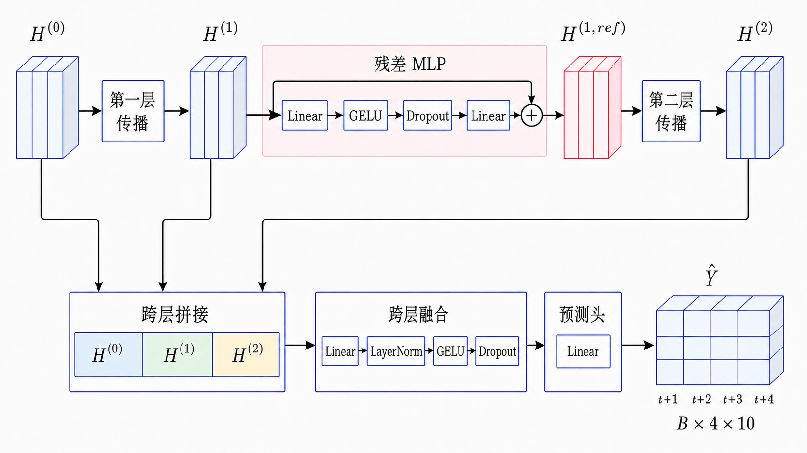

**图3-7 跨层表示路径**  第一层输出$\mathbf H^{(1)}$经残差MLP得到$\mathbf H^{(1,\mathrm{ref})}$后进入第二层传播；跨层拼接仅接收$\mathbf H^{(0)}$、原始$\mathbf H^{(1)}$和$\mathbf H^{(2)}$。图中下方重复的状态块表示三层原始状态分别作为拼接输入，不表示新增模型分支，也不将$\mathbf H^{(1,\mathrm{ref})}$接入跨层拼接。

## 3.6 主要预测结果与回溯补充

### 3.6.1 评价协议与指标

本章以Caltech事件时刻预测和JPL重新拟合作为主要证据，分别检验行为输入条件下的模型比较及另一场站的站内适用性。Caltech回溯结果保留为历史配置和MDP诊断依据。三套协议的输入权限、切分和预测键不同，比较均在协议内部进行，基本设置见表3-1。

**表3-1 三套协议的任务与评价设置**

| 协议 | 输入与用途 | 正式配置/实验 | 测试预测键 |
|---|---|---|---:|
| Caltech事件时刻 | 行为计数及日历；主要预测比较 | SG-EXP-019；节点门控配对SG-EXP-027 | 708,560 |
| JPL重新拟合 | 本站行为输入、节点筛选与构图；另一场站比较 | SG-EXP-028；事后关系替换SG-EXP-031 | 632,640 |
| Caltech回溯 | 含事后会话代理负荷；历史与诊断补充 | SG-EXP-003 StaticGraph及既有对照 | 712,360 |

注：各协议均用10节点、96片历史预测4个连续15 min目标片，发布与目标起点见2.1.1节。随机初始化采用2024、2025、2026三种子，报告样本标准差。种子是训练重复，预测键是误差单元，时间块描述固定期变化；三者均不是独立场站样本。输入、容量和选模预算统一列于3.8.3节。回溯配置按7∶1.5∶1.5切分；两套行为输入协议另设独立调参、校准段。

完整的训练、预测与分层评价流程见图3-8。主指标为MAE，并辅以RMSE和WAPE：

$$
\operatorname{MAE}=\frac{1}{M}\sum_{m=1}^{M}|\hat y_m-y_m|,\quad
\operatorname{RMSE}=\sqrt{\frac{1}{M}\sum_{m=1}^{M}(\hat y_m-y_m)^2}, \tag{3-14}
$$

$$
\operatorname{WAPE}=\frac{\sum_{m=1}^{M}|\hat y_m-y_m|}{\sum_{m=1}^{M}|y_m|}. \tag{3-15}
$$

MAE和RMSE单位为kWh/15 min，WAPE无量纲。MAE为主要比较指标；零目标、非零目标及事件MAE用于检验收益分布，RMSE用于检查大误差权衡。高零值比例使MAPE不适用。事件标签为事后评价标记，分层结果不追认为新的预登记主终点。

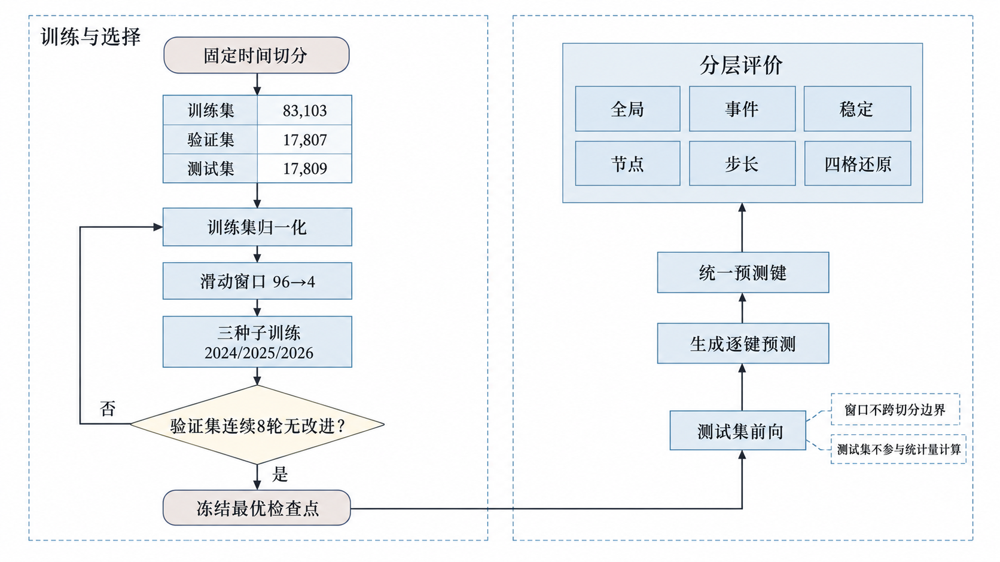

**图3-8 训练—预测—评价流程**  数据按固定时间边界划分后构造96片历史输入与4片目标输出窗口，采用2024、2025和2026三个种子训练；事件时刻及JPL协议以调参集原单位MAE选取检查点，最多60轮、早停耐心8轮。校准集不参与选模，测试集仅用于冻结预测和评价。标准化参数及LRE图由训练集拟合；结果按全局、事件、稳定、节点、目标片和四格口径报告。目标片起点见2.1.1节；旧协议限制亦见该节。

冻结预测与检查点已逐键复核；除三个旧AdaptiveGraph运行外，原CPU前向及指标复算通过。AdaptiveGraph在匹配PyTorch 2.4.1/CUDA 12.1环境下恢复逐键匹配，原生CPU差异定位于top-k并列选边；固定CUDA邻接后CPU亦通过。训练Git标识缺失及历史Mac环境差异仍是来源限制，详见3.6.4节。

### 3.6.2 Caltech事件时刻协议的预测结果

Caltech事件时刻协议（`SG-DATA-006-eventtime-v1`，`SG-EXP-019`）检验更严格行为输入条件下的关系与组件价值。接入、离站和活跃计数按片末可见处理，与当地日历组成七通道输入；目标仍为事后会话代理负荷。训练、调参、校准和测试按完整窗口分段，以96片历史预测4个目标片，时间定义见2.1.1节。该协议与回溯代理输入及实测功率任务具有不同解释范围。

该协议共完成12种配置、每种配置3个随机种子，采用共同训练预算上限与模型选择规则。表3-2并列报告整体与关键分层误差，完整组件结果及训练轮次见附表A-1。`tcn_wide`与`mrg_full`分别含32,674和32,714个参数，差约0.12%，用于容量近似匹配的无图比较；完整AGCRN含199,912个参数，用于检验更大模型规模下的预测表现。参数量描述模型规模，训练成本与推理效率还需实测。

**表3-2 Caltech事件时刻协议的整体与关键分层误差**

| 模型 | 全局MAE | 零目标MAE | 非零目标MAE | 标签事件MAE | 参数量 |
|---|---:|---:|---:|---:|---:|
| 完整AGCRN | 0.03743±0.00022 | 0.00385±0.00016 | 0.26723±0.00076 | 0.37743±0.00078 | 199,912 |
| MRG-GCN | 0.03890±0.00010 | 0.00403±0.00024 | 0.27751±0.00244 | 0.38101±0.00090 | 32,714 |
| 容量近似TCN | 0.04634±0.00029 | 0.01312±0.00007 | 0.27365±0.00267 | 0.37463±0.00188 | 32,674 |
| TCN | 0.04629±0.00019 | 0.01312±0.00015 | 0.27323±0.00189 | 0.37506±0.00069 | 16,996 |

注：误差单位为kWh/15 min，三种子均值±样本标准差。四种模型使用708,560个共同测试键；零目标与非零目标依据目标值划分，标签事件依据冻结`target_event`划分，两种分组可重叠。零目标比例87.25%。12种完整配置及训练轮次见附表A-1，预算见表3-14。

表3-2显示，MRG-GCN较容量近似TCN低16.1%全局MAE；完整AGCRN误差更低，参数量约为MRG-GCN的6.1倍。该结果反映所检配置在误差表现与模型规模之间的取舍，不能据参数量推断效率或单一组件作用。

分层结果显示，零目标键占87.25%，MRG-GCN的零目标MAE低于TCN；其非零目标和标签事件MAE则较高。零目标组的误差减少相当于全局净改善的106.6%，说明总体增益由零目标组驱动，未转化为活跃或事件样本优势。现有比较也未覆盖行为GRU及容量匹配AGCRN，架构结论限于表3-2所列模型。

节点门控和关系增量的受控证据见3.7.1—3.7.3节。

### 3.6.3 JPL重拟合协议：另一场站的点预测比较

为检验MRG-GCN的整体误差优势和节点级门控增量是否只出现在Caltech场站，本文依据2.1.3节冻结的JPL数据与输入协议重新筛选节点、拟合关系图并训练模型。比较对象为MRG-GCN、参数量近似匹配的TCN、完整AGCRN及参数量相同的共享门控MRG-GCN；每种配置均使用2024、2025、2026三个种子。12次运行在同一张RTX 4090 D上完成，统一采用AdamW、batch size 256、最多60轮、patience 8和调参集原单位MAE选模；未进行额外超参数搜索。所有模型均在相同的15,816个测试原点、4个目标片和10个节点上评分，共632,640个预测键。主要结果见表3-3。

**表3-3 JPL另一场站的点预测比较**

| 模型 | MAE（kWh/15 min） | RMSE（kWh/15 min） | 可训练参数 |
|---|---:|---:|---:|
| MRG-GCN | 0.081067±0.000304 | 0.210353±0.001390 | 32,714 |
| TCN | 0.083888±0.000180 | 0.206888±0.000451 | 32,674 |
| AGCRN（完整） | 0.083268±0.000552 | 0.210973±0.002195 | 199,912 |
| 共享门控 | 0.083325±0.000713 | 0.211498±0.000730 | 32,714 |

注：数值为2024、2025、2026三个种子的均值±样本标准差。参数量为模型可训练参数总数；TCN与MRG-GCN参数量相差0.12%，共享门控模型与MRG-GCN参数量相同。各配置训练轮数按“实际停止/验证集最佳”列出：MRG-GCN为35/27、33/25、32/24，TCN为19/11、18/10、23/15，完整AGCRN为13/5、13/5、12/4，共享门控为60/59、41/33、56/48。共享门控seed-2024在最佳轮次后仅继续1轮即触及60轮上限，8轮耐心值未耗尽；因此相同上限和早停规则不证明各配置已达到相同优化充分度。MAE为预登记主要指标，RMSE和分层误差用于说明整体优势的适用范围。

MRG-GCN的三个种子整体MAE均低于三个对照，平均MAE较参数量近似匹配的TCN、完整AGCRN和同参数共享门控分别低3.36%、2.64%和2.71%。其中节点门控对照虽保持相同参数量、输入和预登记训练规则，但共享门控seed-2024在验证集最佳轮次后未满早停耐心便达到训练上限；因此2.71%应解释为该配对预算下的观测增量，尚未检验延长预算后差异是否保持。

按UTC预测原点划分24个非重叠七日块，在三组主要比较上进行10,000次配对重采样，并用Bonferroni方法校正后，基线减MRG-GCN的Bonferroni校正98.33%置信区间分别为TCN [0.001240, 0.004937]、完整AGCRN [0.000313, 0.005495]、共享门控 [0.001517, 0.002976] kWh/15 min，均高于零，达到预登记整体MAE判据。区间以块内三种子逐键绝对误差均值为基础，反映这一固定测试期的时间块差异，不涵盖场站抽样和全部训练随机性。

JPL的12个锁定检查点全部通过上述逐键复核，每运行覆盖632,640个测试键；CPU重放与归档GPU预测的最大绝对差为2.7×10⁻⁶，全局MAE最大差为4.11×10⁻⁹，均低于预设容差。表3-3的复算链及检查点锁登记于项目复核附件。

整体MAE及时间块配对比较见图3-9。

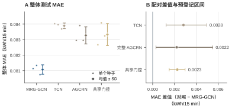

**图3-9 JPL整体MAE与七日时间块配对比较**  左侧显示四种模型在2024、2025、2026三个种子下的整体MAE，汇总为均值±样本标准差；右侧显示基线减MRG-GCN的MAE差及Bonferroni校正98.33%置信区间。时间块分析基于24个非重叠七日块和10,000次配对重采样，差值为正表示MRG-GCN误差较低。两类误差棒分别反映种子离散度与固定测试期的时间块差异，不作相同统计解释。

分层结果限定了这一优势的范围（图3-10）。零目标键占72.75%，标签事件键占2.08%。相对TCN，MRG-GCN的零目标MAE和稳定窗口MAE较低（分别为0.007361对0.012034、0.073820对0.076763 kWh/15 min）；TCN的RMSE、事件MAE和非零目标MAE较低（0.206888对0.210353、0.419209对0.422111、0.275718对0.277839 kWh/15 min）。因此，MRG-GCN取得的是整体MAE优势，并非所有指标或样本层面的全面领先。

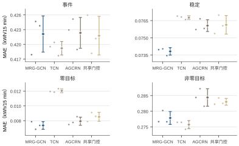

**图3-10 JPL分层MAE比较**  四个面板分别显示标签事件、稳定、零目标与非零目标预测键上的MAE，散点为三个种子，汇总为均值±样本标准差；各模型使用相同的冻结分层掩码。各面板纵轴独立设置范围，下限均不为零，跨面板比较须依据刻度。分层结果用于界定整体MAE优势的范围，不表示各层均由MRG-GCN取得最低误差。

Caltech与JPL同参数门控比较方向一致，但分别受各自协议和预算约束，不合并为跨站效应。统一输入、容量和预算说明见3.8.3节，JPL独立区间校准见5.3.5节。

JPL关系替换训练是另一项补充实验，配置与配对误差见3.7.2节表3-10。它使用同一固定测试期，但不属于表3-3的预登记模型与基线比较；其结果用于判断三关系配置中各邻接相对于自环替代的条件性增量，不改变表3-3的整体—分层误差权衡。

### 3.6.4 回溯补充：完整配置与复算状态

**表3-4 Caltech回溯协议全局预测指标对比**

| 模型 | MAE/(kWh/15 min) | MAE标准差 | RMSE/(kWh/15 min) | WAPE |
|---|---:|---:|---:|---:|
| Persistence | 0.07828 | — | 0.23946 | 1.6270 |
| LightGBM | 0.03758 | — | 0.11998 | 0.7811 |
| XGBoost | 0.03873 | — | 0.12063 | 0.8051 |
| ARIMA | 0.02260 | — | 0.13229 | — |
| MLP | 0.02112 | 0.00019 | 0.10112 | 0.4390 |
| GRU | 0.02965 | 0.00003 | 0.10838 | 0.6162 |
| TCN | 0.02952 | 0.00014 | 0.10831 | 0.6136 |
| GWN（简化变体） | 0.01773 | 0.00054 | 0.10023 | 0.3685 |
| AGCRN（简化变体） | 0.02057 | 0.00029 | **0.09820** | 0.4276 |
| AdaptiveGraph | 0.01396 | 0.00017 | 0.09920 | 0.2902 |
| EventResidual（探索记录） | 0.01390 | 0.00015 | 0.09925 | 0.2889 |
| **MRG-GCN（StaticGraph）** | **0.01376** | 0.00023 | 0.09918 | **0.2860** |

注：MAE与RMSE单位为kWh/15 min，WAPE无量纲。随机初始化模型为三种子均值，标准差为$n=3$样本标准差，计算时分母为$n-1$，对应自由度为2；确定性基线标“—”。ARIMA正式结果未提供WAPE。各列加粗值为该指标的最小值。

本节保留包括ARIMA[85]在内的回溯历史比较，供配置追溯及第4章诊断使用。GWN仅作一步图聚合，AGCRN共享门参数且未实现节点参数池，两者均为简化变体；EventResidual只作探索记录。

AdaptiveGraph的三个既有检查点在匹配PyTorch 2.4.1/CUDA 12.1环境下通过逐键复算，与归档预测的最大绝对差为7.47×10⁻⁷，低于5×10⁻⁶容差。原生CPU有7、8、9行邻接选择与CUDA不同，均位于top-k截断并列候选；固定CUDA邻接后，CPU预测最大差低于9.27×10⁻⁷。这支持并列选边解释本轮后端偏差。历史macOS/PyTorch 2.13失败记录和缺失训练Git标识仍保留，不将检查点重放称为从头训练复现。

表3-4中MRG-GCN的MAE为0.01376 kWh/15 min，AGCRN简化变体的RMSE最低。该表描述回溯代理序列的历史配置表现；主要预测结论以3.6.2—3.6.3节的行为输入比较为依据。

MRG-GCN、EventResidual和AdaptiveGraph的MAE差仅为0.00014～0.00020，与三者的跨种子标准差处于同一量级，三次重复不足以建立稳定次序，正文不使用“显著优于”。EventResidual保留在表中，是为了完整记录已执行的探索路线，并不将其列为正式方法贡献。各模型的MAE及其离散度见图3-11。

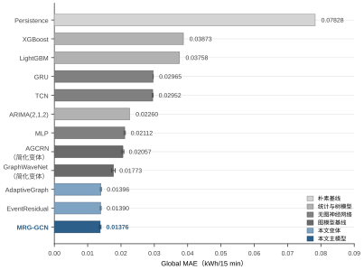

**图3-11 不同模型的全局MAE**  随机初始化模型显示三种子均值和标准差；确定性基线无误差棒。所有结果使用相同预测键和kWh/15 min口径。

由图3-12可见，各模型MAE随目标片向后移动而增加。MRG-GCN在第1至第4个目标片（h1—h4，对应[0,15)、[15,30)、[30,45)、[45,60) min）的MAE分别为0.00432、0.01072、0.01697和0.02302 kWh/15 min。

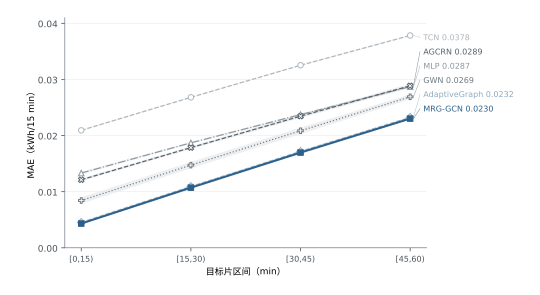

**图3-12 不同模型的逐目标片MAE**  横轴区间以预测发布时刻为0，依次为[0,15)、[15,30)、[30,45)和[45,60) min；曲线为三种子均值，阴影为跨种子样本标准差。实心方形表示MRG-GCN（StaticGraph）；GWN和AGCRN为本文所检简化变体。

以预测键为重采样单元的Bootstrap分析见图3-13，该分析对三种子预测结果进行点级合并。结果可描述大量测试键上的误差差异，但预测键存在时间、节点和种子内相关性，因此95%区间和单侧比例不作为跨种子统计显著性证据。

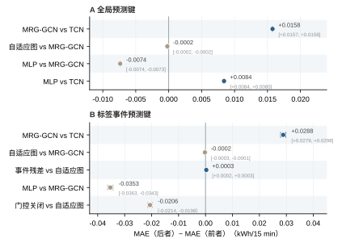

**图3-13 模型误差差的点级Bootstrap**  每行纵轴按“前者vs后者”列出比较模型，点为MAE(后者)−MAE(前者)，正值表示前者误差更低；并非所有行都以MRG-GCN为比较对象。误差棒为10,000次重采样的95%百分位区间。预测键存在时间、节点及种子内相关性，该区间仅作点级误差差描述，不作跨种子显著性判断。

为避免将点级重采样误差棒误读为时间序列证据，本文进一步对同一批原始预测执行时间块复核。具体做法是：对每个共同预测键计算“基线绝对误差−MRG-GCN绝对误差”，按预测原点的UTC日聚合，并在相同键上先取三种子的逐键平均；随后分别以1日和7日为重采样单元进行10,000次有放回百分位Bootstrap。这里的种子平均是误差序列的算术平均，不是将三个模型输出组成集成预测。区间仅描述锁定测试期内的时间块稳定性，不替代跨场站或未见时期验证。

**表3-5 原主实验时间块误差差复核**

| 对照（基线−MRG-GCN） | 平均误差差 | 1日块95%区间 | 正差块 | 7日块95%区间 | 正差块 |
|---|---:|---:|---:|---:|---:|
| TCN | 0.01576 | [0.01517, 0.01640] | 187/187 | [0.01495, 0.01662] | 27/27 |
| AdaptiveGraph | 0.00020 | [0.00016, 0.00025] | 166/187 | [0.00015, 0.00026] | 27/27 |

表3-5中正值表示MRG-GCN误差较低。MRG-GCN相对TCN的优势在全部日块和周块中保持为正；相对AdaptiveGraph的优势幅度很小，1日块中有21个块并不为正，但种子平均的时间块区间仍为正，因而只能表述为“在本测试期内具有小幅、总体稳定的优势”，不使用显著优于或必然优于的措辞。

### 3.6.5 回溯补充：分层与节点误差

分层结果见表3-6：依据目标侧标签事件`target_event`划分事件与稳定窗口，并另行报告非零负荷子集。事件窗口占测试预测键的1.43%，冻结规则触发率0.43%不用于本表分层。

**表3-6 Caltech回溯协议分层MAE对比**

| 模型 | 事件窗口 | 稳定窗口 | 非零负荷 |
|---|---:|---:|---:|
| Persistence | 0.4382 | 0.0731 | 0.3640 |
| LightGBM | 0.3074 | 0.0337 | 0.1402 |
| XGBoost | 0.3084 | 0.0348 | 0.1411 |
| ARIMA | 0.2939 | 0.0187 | 0.0909 |
| MLP | 0.3114 | 0.0169 | 0.1292 |
| GRU | 0.3042 | 0.0257 | 0.1274 |
| TCN | 0.3049 | 0.0255 | 0.1264 |
| **GWN（简化变体）** | **0.2732** | 0.0140 | **0.0693** |
| AGCRN（简化变体） | 0.2924 | 0.0166 | 0.0995 |
| AdaptiveGraph | 0.2763 | 0.0102 | 0.0720 |
| EventResidual | 0.2760 | 0.0101 | 0.0715 |
| **MRG-GCN（StaticGraph）** | 0.2761 | **0.0100** | 0.0711 |

注：单位为kWh/15 min；随机初始化模型为三种子均值。事件与稳定窗口分别含10,160和702,200个预测键。

事件窗口中GWN的MAE最低，非零负荷子集同样如此；MRG-GCN在稳定窗口最低。MRG-GCN的事件窗口MAE约为稳定窗口的28倍，表明全局优势主要来自占比98.57%的稳定窗口，而稀有事件仍是共同难点。该结果也说明，全局最优不能直接等同于事件窗口最优；不同评价窗口的量级对比见图3-14。

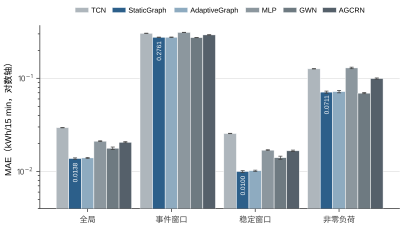

**图3-14 不同评价窗口的MAE**  柱高为三种子均值，误差棒为跨种子标准差；纵轴采用对数尺度，以同时显示事件和稳定窗口的量级差异。

MRG-GCN的逐目标片和逐节点误差列于表3-7。

**表3-7 Caltech回溯协议下MRG-GCN目标片区间与逐节点MAE**

| 目标片区间（min） | MAE | 节点 | MAE | 节点 | MAE |
|---|---:|---|---:|---|---:|
| h1 [0,15) | 0.00432 | CA-303 | 0.02582 | CA-315 | 0.00616 |
| h2 [15,30) | 0.01072 | CA-304 | 0.01171 | CA-317 | 0.00686 |
| h3 [30,45) | 0.01697 | CA-305 | 0.02234 | CA-321 | 0.00642 |
| h4 [45,60) | 0.02302 | CA-307 | 0.01863 | CA-327 | 0.01318 |
| — | — | CA-311 | 0.01810 | CA-489 | 0.00839 |

注：目标片区间均以预测发布时刻为0，采用左闭右开表示；各MAE单位为kWh/15 min。

节点MAE从0.00616至0.02582，相差约4.2倍。CA-303和CA-305误差较高，CA-315、CA-317和CA-321较低，与第2章的节点负荷规模差异相符。由于绝对误差受节点负荷幅值影响，这一结果用于刻画评价难度，不据此判断某节点的相对预测质量。六种模型的逐节点对比见图3-15。

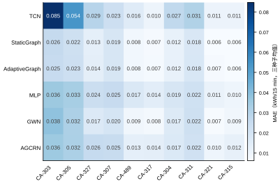

**图3-15 不同模型的逐节点MAE**  热力图为10个节点和6个模型的三种子均值；节点按主张量测试预测起点对应时刻的累计代理负荷降序排列。颜色与数值使用同一节点映射，颜色表示误差大小，不表示节点间关系；GWN与AGCRN为原主实验的简化变体。

### 3.6.6 回溯补充：模型规模与训练记录

回溯配置的规模与训练耗时列于表3-8。

**表3-8 模型规模与正式训练耗时**

| 模型 | 可训练参数量 | 单种子训练耗时均值/min | 全局MAE |
|---|---:|---:|---:|
| GRU | 4,068 | 1.7 | 0.02965 |
| AGCRN（简化变体） | 4,252 | 51.9 | 0.02057 |
| TCN | 16,996 | 2.9 | 0.02952 |
| MRG-GCN（StaticGraph） | 32,714 | 7.7 | 0.01376 |
| AdaptiveGraph | 35,005 | 5.4 | 0.01396 |
| GWN（简化变体） | 40,084 | 9.3 | 0.01773 |
| MLP | 228,968 | 1.3 | 0.02112 |

注：耗时取三种子正式运行记录均值。MLP来自Apple Silicon/MPS环境；TCN、MRG-GCN、AdaptiveGraph、GWN、AGCRN和GRU来自Linux/CUDA 12.1环境，GPU具体型号未写入相应实验元数据。耗时包含训练与验证早停，不含数据预处理；因硬件与软件栈不同，不作跨模型速度排名。

表3-8记录所检实现的参数规模和训练耗时，硬件、图聚合及早停轮次均影响读数。相同协议下的完整配置差异不能直接归为单一图算子的贡献；同参数节点门控与关系邻接增量由3.7节的受控比较判断。现有记录未提供统一端到端推理时延。

## 3.7 组件增量与协议敏感性

本节按待检验问题组织组件证据：先报告跨协议同参数门控对照，再讨论关系路径和关系子集，继而说明关系级参数干预、组合消融与评价还原检查。各组结果保留自身协议和内部基线，不合并为一套消融排序。

### 3.7.1 同参数节点级门控配对对照

固定门值消融同时改变参数量，无法单独检验节点门值差异。为此，在事件时刻输入协议下另设节点共享门控：两层均先对节点门控网络的线性输出沿节点维求均值，再经Sigmoid并广播至全部节点；其门值仍随样本和特征变化。完整模型保留逐节点门值。两组骨干、关系变换及预测头相同，可训练参数均为32,714；在同一RTX 5090上，以2024、2025、2026三个种子配对训练，逐参数初始化相同，最多60轮、早停耐心8轮、优化器、批量和选模规则一致。该对照只改变门值是否保留节点维差异。

六次正式运行均完成训练和预测导出，并在相同708,560个测试预测键上核对原点、节点、目标片编号、真值及掩码。结果见表3-9。节点级门控的平均整体MAE比节点共享门控低0.001067 kWh/15 min，按共享门控均值计低2.69%；三个种子的配对差分别为0.000685、0.001309和0.001207 kWh/15 min，方向一致。事件组的绝对差仅0.001239，仍需结合其高基线误差判断实际意义。

**表3-9 Caltech事件时刻协议下同参数节点门控配对结果**

| 模型 | 整体MAE | 标签事件MAE | 稳定MAE |
|---|---:|---:|---:|
| 节点级门控 | 0.038677±0.000289 | 0.379462±0.000556 | 0.033698±0.000300 |
| 节点共享门控 | 0.039744±0.000142 | 0.380701±0.000604 | 0.034762±0.000146 |

注：单位为kWh/15 min，均值±样本标准差来自三个配对种子。两组参数量和训练预算上限相同；实际停止轮次分别为节点级门控38/22/22、共享门控60/40/54，最佳轮次分别为30/14/14与52/32/46。Caltech共享门控seed-2024同样达到60轮上限，故配对差支持的是当前预算和选模规则下的节点差异门控增量；对更长训练预算下的稳定性尚无证据，不据此声称各配置已充分收敛。这六次运行单独报告，不替换表3-2中的原36次结果。

为核查时间相关性，先在每个预测键上取三个配对种子的绝对误差差均值，再按发布时刻的洛杉矶当地日期划分27个七日非重叠块，块内保留全部节点和四个目标片。对块进行10,000次配对有放回重采样，以累计误差差除以累计键数计算MAE差，避免将长短不同的末尾块等权平均。七日块整体差的描述性95%区间为[0.000747, 0.001378] kWh/15 min；185个一日块的敏感性区间为[0.000799, 0.001334]，方向一致。该分析在结果已查看后制定，是锁定历史测试期、固定三种子平均误差上的条件区间，不包含跨站、未见时期或重新抽取训练种子的全部不确定性。

为检查总体门控增量是否由单个节点主导，另对SG-EXP-027和JPL的测试键逐一剔除一个节点，并按保留节点重新计算三种子平均MAE。十次留一在两个协议下的差值均为正：Caltech节点级门控MAE降幅为2.25%～2.89%，JPL为2.13%～3.20%。这是基于已查看测试期的事后节点构成敏感性分析；它说明点估计不依赖某一个被评价节点，但不增加独立样本，也不构成新时期或跨站确认。

七日块下，非零组差为0.005305 [0.002869, 0.007861]，事件组为0.001239 [0.000045, 0.002413]；均为未作多终点校正的描述性区间。相同参数控制了模型规模，但训练轮次和优化轨迹不同；结果仅支持当前协议与预算下的节点差异增量。

### 3.7.2 关系路径、关系子集与敏感性

**JPL受控关系替换。** 本节的主检验为SG-EXP-031同参数自环替换：保留全部关系分支和参数，仅将指定邻接矩阵替换为单位自环并从头重训。该检验复用已查看测试期，属于事后补充分析。结果见表3-10。

**表3-10 JPL三关系图自环替换的配对重训练结果**

| 替换配置 | 替换配置MAE−完整模型MAE（kWh/15 min） | 完整模型MAE降幅/% | Bonferroni 98.333%七日块区间（kWh/15 min） | 同向种子 | 结论 |
|---|---:|---:|---:|---:|---|
| 负荷耦合关系→自环 | 0.001501 | 1.82 | [0.000048, 0.002689] | 3/3 | 支持当前设置下的条件性整体MAE增量 |
| 行为共现关系→自环 | 0.000120 | 0.15 | [-0.000432, 0.000728] | 2/3 | 区间跨零，增量尚不确定 |
| 轮廓相似关系→自环 | 0.001252 | 1.52 | [0.000167, 0.002275] | 3/3 | 支持当前设置下的条件性整体MAE增量 |

注：每个替换配置均保留三个关系分支和32,714个可训练参数，仅将指定邻接矩阵替换为单位自环，再按同一规则从头训练；每配置三个种子，共12次运行，同一种子各配置的非图参数初始值一致。差值定义为“替换配置MAE−完整模型MAE”，正值表示完整模型误差较低。降幅以替换配置MAE为分母。区间对三项比较作Bonferroni校正，基于固定JPL测试期24个当地七日块及10,000次配对重采样；测试期已查看，本结果为事后补充分析。

负荷耦合和轮廓相似关系对应的整体MAE差三种子均为正，Bonferroni校正区间下限均高于零；行为共现关系的区间跨零。因此，前两类关系在本架构、协议和预算下具有相对自环替代的条件性整体增量证据，第三类仍不确定。事件组中，行为或轮廓关系替换后的MAE反而分别低0.005142和0.003677，表明整体改善不必然延伸至事件样本。

负荷邻接的事后分层显示，替换为自环后的配置非零组MAE较完整模型高0.004893 kWh/15 min，三个种子方向均为正；该结果来自已查看测试期，未作多重校正。它比较的是当前图模型内的关系组件，而非不同模型。JPL完整MRG-GCN非零组MAE为0.277839，高于TCN的0.275718 kWh/15 min；Caltech事件时刻和完成时刻截断目标也呈相同方向。因此，“负荷关系相对自环改善非零组”与“完整模型非零组尚未胜过TCN”可以同时成立：前者支持在所检架构内保留并复核该关系，后者要求按分层表现选择模型。

SG-EXP-031四种配置的最佳与停止轮次均低于60轮上限，降低了触顶对这组关系比较的影响，但不能据此认定充分收敛；027及028共享门控的触顶限制属另一项对照。各组结果均按各自架构、预算和测试期解释。

**其他关系子集与配置敏感性。** 旧Caltech回溯协议的关系子集见表3-11：单关系配置与三关系基线MAE接近，但删去分支同时改变参数量和传播路径，不能据此识别条件增量，故作为历史补充单独解释。

**表3-11 关系子集与超参数敏感性**

| 实验组 | 配置 | 全局MAE | 组内结论 |
|---|---|---:|---|
| 关系子集 | 三关系 | 0.01412 | 组内基线 |
| 关系子集 | 仅负荷 | 0.01415 | 与基线接近 |
| 关系子集 | 仅行为 | 0.01415 | 与基线接近 |
| 关系子集 | 仅轮廓 | 0.01401 | 数值略低 |
| 稀疏度 | top-$k=5$ | 0.01391 | 组内基线 |
| 稀疏度 | top-$k=7$ | 0.01448 | +4.1% |
| 关系随机失活 | $p=0.2$ | 0.01391 | 变化不足0.03% |
| 关系随机失活 | $p=0.4$ | 0.01391 | 变化不足0.03% |

附表A-1中单关系变体均值高于三关系模型，但参数量与路径同时变化，不能证明每类关系必需；固定门值变体亦受参数量与部分种子触顶混淆，节点门值增量以3.7.1节的同参数比较为准。去除跨层拼接和精炼的变化较小。top-$k$实验中，$k=5$和$k=7$的MAE分别为0.01391和0.01448，较密的$k=7$配置上升4.1%；该结论不外推到未正式比较的其他稀疏度。关系随机失活概率取0、0.2和0.4时，MAE均为0.01391，差异不足0.03%，未观察到实质收益。因此，主模型保持$p=0$。这些已完成的小网格实验不构成输入长度、15节点范围或规则阈值/扩展长度的全面敏感性验证；后几项尚未完成，不声称模型对其稳健。

Caltech事件时刻协议下，等权$\beta$重训练取得略低的全局MAE，现有证据不支持学习$\beta$具有正向精度净增益。该设置允许各关系变换重新适应等权约束，检验参数化选择；旧协议L1固定其他参数、仅在推理时替换$\beta$，检验既有模型的功能依赖。二者差异由4.2.5节结合关系变换的尺度解释。

按预测发布的当地日期划分27个连续七日非重叠时间块，保留全部节点、目标片和三种子，对种子平均的同键误差差作2,000次配对Bootstrap。以“对照MAE减MRG-GCN MAE”为正向改善，等宽TCN与自环对照的全局MAE差分别为0.00744和0.00720 kWh/15 min，描述性95%区间分别为[0.00693, 0.00798]和[0.00664, 0.00773]；相对等宽TCN的标签事件差为−0.00638，区间为[−0.00847, −0.00444]。这些结果把关系路径的证据范围限定在本测试时期和样本组成上。该区间反映固定三种子平均后的时间段变动，不包含重新抽取训练种子的全部不确定性，且未作多终点校正。

时间块分析中，等权β比完整模型低0.000277 kWh/15 min，“等权减完整”区间为[−0.000470, −0.000089]；这是已查看时期的条件差异，尚不足以证明等效或普遍更优。跨层拼接差异区间跨零；精炼去除的差异较小。

### 3.7.3 关系级参数干预

该实验对Caltech回溯协议的训练模型仅替换β，保持关系变换及其他参数不变，检验已训练配置的功能依赖。详细权重、七种替换结果及β与关系变换的共同作用见第4章L1。Caltech事件时刻协议的等权变体重训结果见附表A-1与3.7.2节，用于评价重训练后的参数化选择。

### 3.7.4 组合配置消融与事件残差探索

在MRG-GCN之外，本文还检验了固定主模型参数、联合更新主模型参数、容量调整和阈值调整等事件残差修正实现。各实现均未获得可复现的事件窗口改进，未达到预设的正式纳入标准。因此，正式方法止于MRG-GCN；表3-4保留EventResidual行用于记录实验事实，完整设置、结果和终止依据保留于实验登记表及归档材料。本结论只是否定所检实现，不推断事件预测问题本身不可改进。

该组结构消融以事件残差修正实验组的完整配置作为内部基线，其MAE为0.01390。该基线包含TCN、图模块和事件门控残差路径，与表3-4的正式MRG-GCN不是同一比较基准。表3-12显示，无图变体MAE升至0.02960，是该组配置中退化最大的变体；这一结果只支持图增强结构在该组合配置中具有较强功能影响。仅固定图和仅自适应图相对内部基线分别上升2.5%和2.3%，差异较小。

“门控关闭”同时取消选择性触发、联合更新主模型参数并将修正作用于全样本，属于复合重训练变体；其90.5%的退化不能归因于某一个门变量，只能说明该复合配置不适合替代原配置。各结构消融项的三种子汇总见图3-16。

**表3-12 组合配置下的结构消融结果**

| 配置 | 全局MAE | 相对内部基线 |
|---|---:|---:|
| 完整配置（内部基线） | 0.01390 | — |
| 仅自适应图 | 0.01422 | +2.3% |
| 仅固定图 | 0.01425 | +2.5% |
| 门控关闭（复合变体） | 0.02648 | +90.5% |
| 无图 | 0.02960 | +113.0% |

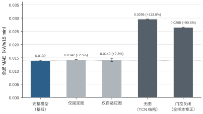

**图3-16 结构消融结果**  柱高为三种子均值，误差棒为跨种子标准差。百分比仅相对于消融套件内部基线0.01390计算；该配置与表3-4正式MRG-GCN结果不同，不作直接比较。

### 3.7.5 四格评价的加权还原检查

目标侧标签事件`target_event`与冻结规则`rule_trigger`含义不同。本文按二者的0/1组合将测试预测键划分为四格，并验证

$$
\operatorname{MAE}_{\mathrm{global}}=
\frac{\sum_{a=0}^{1}\sum_{b=0}^{1}n_{ab}\operatorname{MAE}_{ab}}
{\sum_{a=0}^{1}\sum_{b=0}^{1}n_{ab}}. \tag{3-16}
$$

原正式MRG-GCN的三个种子分别按四格样本量和绝对误差之和加权还原全局MAE，最大数值差低于$10^{-9}$；对应的712,360个测试键均完整分配到四格。本章将其作为评价接口的一致性检查，逐格误差与贡献见4.4节，不将算术闭合当作机制证明。

## 3.8 证据综合与适用范围

本章主比较限定于三套协议及其各自的预测键；SG-EXP-032则在已查看的Caltech事件时刻测试键上固定输入、图和切分，单独检验另一代理目标构造下的模型比较。它不构成新的独立测试期。组件层面的证据强弱和协议边界分别汇总如下。

### 3.8.1 方法组件与目标敏感性证据综合

表3-13按对照类型归纳组件证据及其权限。节点门控和两类关系的整体增量证据均限于所检协议、预算与基线；负荷关系的非零组差异仍属探索性结果。基础图卷积、TCN和门控算子沿用已有方法。

**表3-13 方法组件与目标敏感性证据、贡献范围**

| 组件 | 直接证据及定位 | 可以支持的判断 | 尚未建立的判断 |
|---|---|---|---|
| LRE三关系图 | 表3-2主要比较、附表A-1单关系及同参数自环；表3-11旧协议关系子集；表3-10 JPL同参数关系自环替换 | 跨节点关系路径在事件时刻协议下有整体MAE价值；JPL同参数重训练支持负荷耦合和轮廓相似关系相对自环替换的条件性整体MAE增量 | 行为关系增量尚不确定；负荷关系非零组结果属未校正事后描述，不等同完整模型胜过TCN；旧协议子集仍受容量差异限制，也未证三类关系普遍必要 |
| 完成时刻截断目标（032） | 表3-15、表3-16及图3-17；训练后更换标签评价并在固定测试键上交叉复评 | 全局模型排序在两套代理标签间相关较高；同一批预测的标签敏感性已按总体、零目标、固定非零与评价标签非零分层 | 非零排序对标签和子集定义更敏感；不确认实测功率效度、活跃负荷优势、替代拓扑下端到端稳健性或未见时期泛化 |
| 关系级$\beta$ | 表4-2、表4-3冻结替换；3.7.2节等权重训练；4.2.5节重参数化 | 已训练$\beta$与关系变换的联合配置有功能敏感度 | $\beta$独立正增益、权重大小等同关系贡献或关系不可替代 |
| 节点级$G$ | 表3-9 Caltech同参数配对；表3-3 JPL同参数配对 | 当前预算及选模规则下，保留节点差异使整体MAE分别低2.69%和2.71% | 更长预算下差异仍保持、所有样本层面占优或站点普遍优势 |
| 精炼与跨层融合 | 附表A-1删除变体及3.7.2节时间块分析 | 描述所检配置的优化响应；跨层拼接去除的差异区间跨零 | 所有模块分别必需或均有稳定独立增量 |
| 关系随机失活 | 表3-11的$p=0/0.2/0.4$比较 | 所检小网格未见实质收益，主配置关闭 | 对其他数据与失活设置普遍无效 |
| MDP诊断组织 | 第4章参数干预、受检学生与四格还原；表4-6判断变化 | 修正关系解释、替代性判断与误差报告口径 | 新的预测收益、现实因果机制或已验证的运行收益 |

注：组件证据来自不同实验协议，表中不把冻结参数替换、删除后重训练和同参数配对合并解释；本文新增价值按任务化构造、所检增量及诊断判断分别陈述。

### 3.8.2 三套协议的回答范围与比较边界

Caltech回溯、Caltech事件时刻和JPL重拟合分别使用712,360、708,560和632,640个测试预测键。前者比较事后重构序列上的历史配置，后两者比较行为输入条件下的预测；输入权限、切分和节点来源不同，绝对MAE不跨协议相减。回溯AGCRN与GWN为简化变体；行为输入协议的模型设置见3.6.2—3.6.3节。JPL重新筛选节点、构图和训练，不代表零样本迁移或未来时期验证。

SG-EXP-032复用Caltech事件时刻协议的输入、图、切分及708,560个测试键，仅更换代理目标并重算目标标准化参数。它检验固定拓扑下的标签构造敏感性；替代目标下重建图的全流程仍未验证，详见3.8.4节。

### 3.8.3 输入、容量与训练选模预算

表3-14汇总主要模型对照、同参数门控及关系替换训练的输入、容量和实际训练记录。各行均使用96片历史、4片目标和2024/2025/2026三个种子，但不同协议的输入权限、选模指标及预测键不同。预算上限相同并不保证优化充分度相同。

**表3-14 主要比较的输入、模型容量与训练选模预算**

| 协议/配置 | 输入 | 可训练参数 | 上限/耐心；选模指标 | 最佳轮次；停止轮次 |
|---|---|---:|---|---|
| Caltech回溯：AdaptiveGraph | A | 35,005 | 60/8；标准化MAE | 17/13/13；25/21/21 |
| Caltech回溯：MRG-GCN | A | 32,714 | 60/8；标准化MAE | 22/29/25；30/37/33 |
| Caltech回溯：TCN | A | 16,996 | 60/8；标准化MAE | 8/6/5；16/14/13 |
| Caltech事件时刻（019）：mrg_full | B | 32,714 | 60/8；原单位MAE | 27/19/19；35/27/27 |
| Caltech事件时刻（019）：tcn_wide | B | 32,674 | 60/8；原单位MAE | 11/4/3；19/12/11 |
| Caltech事件时刻（019）：agcrn_full | B | 199,912 | 60/8；原单位MAE | 1/1/1；9/9/9 |
| Caltech门控配对（027）：mrg_full | B | 32,714 | 60/8；原单位MAE | 30/14/14；38/22/22 |
| Caltech门控配对（027）：mrg_shared_gate | B | 32,714 | 60/8；原单位MAE | 52/32/46；60/40/54 |
| JPL（028）：mrg_full | B | 32,714 | 60/8；原单位MAE | 27/25/24；35/33/32 |
| JPL（028）：tcn_wide | B | 32,674 | 60/8；原单位MAE | 11/10/15；19/18/23 |
| JPL（028）：agcrn_full | B | 199,912 | 60/8；原单位MAE | 5/5/4；13/13/12 |
| JPL（028）：mrg_shared_gate | B | 32,714 | 60/8；原单位MAE | 59/33/48；60/41/56 |
| JPL关系替换（031）：完整模型 | B | 32,714 | 60/8；原单位MAE | 27/25/24；35/33/32 |
| JPL关系替换（031）：负荷耦合→自环 | B | 32,714 | 60/8；原单位MAE | 42/41/28；50/49/36 |
| JPL关系替换（031）：行为共现→自环 | B | 32,714 | 60/8；原单位MAE | 23/41/32；31/49/40 |
| JPL关系替换（031）：轮廓相似→自环 | B | 32,714 | 60/8；原单位MAE | 34/41/22；42/49/30 |
| Caltech目标敏感性（032）：mrg_full | B | 32,714 | 60/8；原单位MAE | 16/12/14；24/20/22 |
| Caltech目标敏感性（032）：tcn_wide | B | 32,674 | 60/8；原单位MAE | 6/12/4；14/20/12 |

注：输入A为回溯七通道（代理负荷、接入数、离站数、活跃数、占用率、需求强度、负荷跳变标志）；输入B为事件时刻七通道（接入数、离站数、活跃数及当地小时、星期的正余弦编码），假定行为计数在片末可见。两类输入均按相应训练段统计量标准化。所有列示运行采用AdamW、学习率0.001、权重衰减0.0001、batch size 256和标准化L1训练损失，最多60轮、早停耐心8轮。回溯协议按验证集标准化MAE选模；019、027、028、031及032按调参集原单位MAE选模，校准和测试不参与选模。轮次依seed-2024/2025/2026列出；表内参数和日志已逐项复核。019与027分别保留自身正式运行，不以027的较低点估计替换019结果；031的四种配置均未达到60轮上限，且仅替换指定邻接、保留其余关系分支和模型参数。031未触及上限只说明训练在耐心规则下提前停止，未检验更长预算或不同收敛判据，不能单独证明优化已充分收敛。032使用替代目标重算目标标准化参数，但固定B输入、原训练前缀图、切分及预测起点键。完整AGCRN的199,912个参数未与MRG-GCN容量匹配。AdaptiveGraph匹配CUDA复算、原生CPU选边差异及来源限制见3.6.4节。

Caltech门控配对及JPL共享门控seed-2024触及60轮上限（JPL最佳59轮、停止60轮）；门控增量因此限于该预算。参数量相近不代表推理时延或能耗相同。

SG-EXP-031/032的训练源码、逐运行配置与环境、检查点和预测文件已按哈希清单封存。两项源码包分别核验67、91项，18次运行的已有预测指标复算通过。031入口未受历史Git记录覆盖，032缺可验证的历史提交号，源码身份依冻结文件清单确定。本轮复算不加载检查点，也不重建训练过程。

### 3.8.4 完成时刻截断目标敏感性（SG-EXP-032）

SG-EXP-032仅改变代理目标：有效完成时刻作为分摊终点，缺失或非法时回退至断开时刻，并保持会话电量守恒。输入、原图、切分和预测键固定，目标标准化参数按新训练前缀重算；两个近似等参数模型各训练三种子。测试期已查看，本实验属于事后敏感性分析。

表3-15显示，替代目标下MRG-GCN全局MAE仍低于容量近似TCN；同键误差差为0.008302 kWh/15 min，95%七日块区间为[0.007757, 0.008797]，27/27个区块为正。因此，MRG-GCN相对容量近似TCN的整体MAE排序在该目标下保持；新旧目标的绝对MAE不可直接相减。

替代目标的零值比例为94.27%。MRG-GCN零目标组MAE低于TCN，非零组则高0.013938 kWh/15 min；全局差异仍由零目标组驱动。RMSE近乎持平并略偏向TCN。按原`target_event`划分的事件组均值略低，但仅2/3个种子方向一致，且该标签未随目标重建；不据此声称事件组稳定改善。零值与事件标签是边际分层，未作联合误差贡献分解。

**表3-15 完成时刻截断代理目标下的Caltech测试结果**

| 指标 | MRG-GCN | 容量近似TCN |
|---|---:|---:|
| 可训练参数 | 32,714 | 32,674 |
| 全局MAE | 0.043401±0.000303 | 0.051703±0.000074 |
| RMSE | 0.193411±0.000728 | 0.193320±0.000349 |
| 零目标组MAE | 0.008700 | 0.018353 |
| 非零目标组MAE | 0.614498 | 0.600560 |
| 冻结原事件标签组MAE | 0.480282 | 0.484651 |
| 冻结原非事件组MAE | 0.037018 | 0.045377 |

注：误差单位为kWh/15 min；全局MAE与RMSE为三种子均值±样本标准差，其余为种子平均描述值。共同测试键708,560个，替代目标零值比例94.27%；事件标签仍为原SG-DATA-006的冻结分组，未据新目标重建。分析固定原关系图，属于已查看测试期上的目标构造敏感性；新旧目标绝对MAE不直接相减。

### 3.8.5 代理标签定义下的模型排序敏感性

为区分目标构造变化与模型预测变化，本文在同一组708,560个Caltech测试键上固定12种配置的预测，仅将均匀分摊标签替换为完成时刻截断标签。两套标签的会话总电量一致，但零值率由87.25%升至94.27%；49,768个均匀标签下为正的键在截断标签下变为零，未出现反向迁移。逐键绝对差均值为0.033530 kWh/15 min，95分位数为0.266875 kWh/15 min。该差异反映代理分配规则，不是实测误差。

表3-16按两种标签分别评价相同预测。先对每个配置的三种子MAE取均值，再对12个配置排序，得到全局Spearman相关0.993；逐种子相关均值为0.974，二者不是同一统计量。按各自评价标签定义的非零组，前一统计量降至0.420，逐种子相关均值为0.000；事件组为0.559，固定均匀标签非零键为0.671。全局排序基本保持，不能据此推断活跃片段排序稳定。固定均匀非零键与按评价标签动态筛选的非零键分母不同，相关系数只描述本已查看测试期的12种配置，不设通过阈值。

**表3-16 代理标签定义下的模型排序敏感性**

| 评价口径 | 三种子平均MAE排序的Spearman（先平均MAE再排序） | 逐种子Spearman均值 | 逐种子范围 |
|---|---:|---:|---:|
| 全局MAE | 0.993 | 0.974 | 0.972–0.979 |
| 稳定窗口MAE | 0.993 | 0.974 | 0.965–0.986 |
| 零目标MAE | 0.951 | 0.907 | 0.874–0.965 |
| 固定均匀非零键MAE | 0.671 | 0.671 | 0.629–0.727 |
| 标签事件MAE | 0.559 | 0.324 | 0.007–0.608 |
| 非零目标MAE（按评价标签定义） | 0.420 | 0.000 | −0.112–0.098 |

注：12个配置均在均匀标签上训练；评价时仅替换标签，预测不变。事件掩码沿用冻结的`target_event`。逐种子范围为三次相关系数的最小值—最大值，不是置信区间。排名与均值均限于已查看Caltech测试期，不代表未见时期或实测功率效度。完整配置排名见附表A-2。

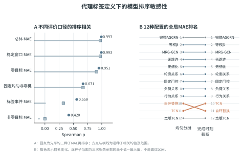

**图3-17 代理标签定义下的模型排序敏感性**  A比较均匀分摊标签与完成时刻截断标签下的排序相关：圆点为先平均三种子MAE再排序所得的Spearman，方点与横线为逐种子相关均值及范围；B显示12种配置的全局MAE排名，橙色表示名次变化。图中排序仅基于同一批预测和已查看测试期，不表示代理标签与实测负荷等价。

对既有训练标签与评价标签的交叉复评显示，MRG-GCN相对容量近似TCN的全局MAE差在四种组合下均为正（11.44%–16.06%）；这是两组既有训练产物的交叉评价，不是四项独立确认。节点门控相对共享门控的三种子平均优势由均匀标签下的2.69%降至截断标签下的1.65%，其中seed-2024由+1.73%变为−0.91%。因此，截断目标下MRG-GCN全局排序保持、门控单种子方向反转和非零组排序敏感可以同时成立；这些结果不能替代不同目标上的重新训练或未查看时期验证。

## 3.9 本章小结

Caltech与JPL结果均显示MRG-GCN在所检配置下具有整体MAE优势，但该优势没有稳定延伸至非零和事件样本；Caltech完整AGCRN的整体MAE更低。受控比较支持节点门控在当前预算下的整体增量，以及JPL负荷耦合和轮廓相似关系相对自环替换的条件性整体增量；行为关系仍不确定。完成时刻截断后，12种配置的总体MAE排序相关为0.993，按评价标签定义的非零组相关降至0.420；完整MRG-GCN的非零组MAE仍高于TCN。上述排序敏感性为同一批既有预测的事后分析。回溯结果与参数干预作为补充证据，由第4章解释。

# 第4章  三层机制诊断协议（MDP）与模型可解释性分析

## 4.1 引言：MDP协议的定义与设计原则

预测精度与权重画像不能完整解释关系使用及误差来源[80]，本文据此建立三层机制诊断协议（mechanism diagnosis protocol，MDP）：L1替换关系级$\boldsymbol\beta$以检查功能敏感度；L2检验指定TCN学生在给定蒸馏设置下能否逼近StaticGraph教师；L3交叉标签事件与规则触发，描述样本误差构成。操作、实验和边界见图4-1及表4-1。三层均属模型诊断，不识别现实负荷的因果机制。

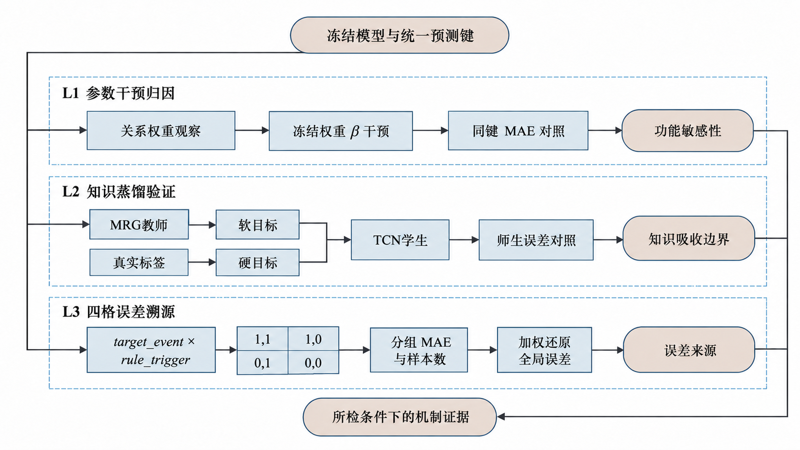

**图4-1 三层机制诊断协议**  L1关系参数干预、L2受检学生蒸馏和L3四格误差溯源依次对应参数干预、蒸馏训练和误差还原。图中“溯源”指对预定义样本组的误差构成作描述性分解，不表示因果归因；图示呈现三层诊断的操作顺序与证据汇合关系。L2只评价所检学生架构、蒸馏目标和权重范围，具体读数见表4-1及相关结果表。

**表4-1 MDP三层机制画像**

| 层次 | 研究问题 | 操作与证据 | 本文判定及边界 |
|---|---|---|---|
| L1 干预归因 | 当前模型对所学关系分配是否敏感？ | 两层$\boldsymbol\beta$观察＋7种冻结模型前向干预×3种子 | 所检替换均退化，显示对联合参数配置的功能依赖；不能单独识别$\boldsymbol\beta$的正向增益 |
| L2 蒸馏验证 | 指定纯时序学生能否在所检设置下逼近教师？ | StaticGraph→TCN；4个蒸馏权重×3种子 | 学生未弥合差距；不能据此证明图知识不能由时序模型吸收 |
| L3 四格误差溯源 | 全局误差在标签与规则分组中如何分布？ | 目标侧标签事件×冻结规则触发；样本量加权还原 | 事件窗口单键误差较高；四格还原全局MAE，但不构成事件级因果归因 |

## 4.2 L1干预归因层（IA）：关系分配的功能依赖

### 4.2.1 观察操作

从Caltech回溯协议主模型的三个随机种子检查点中，提取两层关系级门控的Softmax输出$\boldsymbol\beta^{(1)}$和$\boldsymbol\beta^{(2)}$。它们是层内共享的三关系混合权重，分别对应负荷耦合、行为共现和轮廓相似；并非逐节点贡献，也不能解释为物理因果强度。

### 4.2.2 干预操作

基于上述Caltech回溯协议检查点，在同一测试预测键上保持其余模型参数不变，将两层$\boldsymbol\beta$强制替换为指定组合，仅作前向推理。设置包括两层固定为单一关系、两层等权、两层学习值交换，以及保留一层学习值而固定另一层，共7种干预组合；学习值作为第8种基线配置。该操作属于模型内部的参数干预敏感度分析，借鉴“改变内部单元并观察输出”的解释思路[86]，不识别数据生成过程中的因果效应。

### 4.2.3 观察证据

三个种子的第一层均以行为共现权重最高（表4-2）。第二层负荷耦合均值最高，但seed-2025中行为共现略高。因此，第一层排序在三个种子中一致，第二层只呈现均值差异。

**表4-2 两层关系级$\boldsymbol\beta$门控权重**

| 层次 | 关系 | seed-2024 | seed-2025 | seed-2026 | 均值 | 样本标准差 |
|---|---|---:|---:|---:|---:|---:|
| GCN1 | 负荷耦合 | 0.3433 | 0.3386 | 0.3481 | 0.3433 | 0.0047 |
| GCN1 | 行为共现 | 0.4053 | 0.4030 | 0.3985 | 0.4022 | 0.0035 |
| GCN1 | 轮廓相似 | 0.2514 | 0.2584 | 0.2534 | 0.2544 | 0.0036 |
| GCN2 | 负荷耦合 | 0.3537 | 0.3465 | 0.3573 | 0.3525 | 0.0055 |
| GCN2 | 行为共现 | 0.3026 | 0.3506 | 0.3133 | 0.3222 | 0.0252 |
| GCN2 | 轮廓相似 | 0.3437 | 0.3029 | 0.3294 | 0.3253 | 0.0207 |

注：数值由三个随机种子的正式模型权重文件提取，标准差为$n=3$样本标准差，分母为$n-1$，对应自由度为2；不进行统计显著性检验。

### 4.2.4 干预证据

两层三关系\(\boldsymbol\beta\)的种子离散度与均值见图4-2。图4-3显示，学习值基线的全局MAE为0.01376 kWh/15 min；7种干预的MAE均升高，范围为0.02695至0.04591。最小退化来自“第一层保持学习值、第二层固定为轮廓相似”，退化幅度为95.9%；两层等权和交换两层学习值分别退化143.8%和148.4%。这些数值均为三种子均值，误差棒为跨种子标准差。

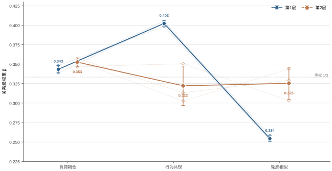

**图4-2 两层关系级β门控权重画像**  StaticGraph正式三种子中，空心点表示各随机种子的Softmax权重，实心点与误差棒表示均值±跨种子样本标准差。每层三类固定关系权重之和为1；该图为观察性参数画像，不等同于节点级门控或关系因果效应。

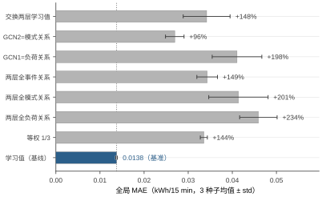

**图4-3 关系级门控参数干预结果**  Caltech回溯协议下，蓝色为学习值基线，其他配置强制替换两层$\boldsymbol\beta$后仅作前向推理。柱高为三种子均值，误差棒为跨种子标准差；百分比相对于学习值基线，正值表示退化。

### 4.2.5 L1判定结论

L1说明，在关系变换及其他参数固定时，所检7种β替换破坏了已训练联合配置，不能无代价地替代原值。这不是β本身不可替代的证明。每层消息由β与各关系变换共同决定，可写为$M=\sum_r\beta_r W_r(\widehat A_rH)$。本实现为每类关系配置独立无偏置线性变换，且主配置关系随机失活为0；令$\beta'_r=1/3$、$W'_r=3\beta_rW_r$，即可保持每类加权消息及其总和不变。因此，β大小不能脱离$W_r$的尺度单独解释为关系重要性，等权参数化也不必缩小该消息函数的表达范围。

上述重参数化不等于两个训练过程相同：权重衰减、梯度尺度和初始化会改变优化轨迹。旧干预固定$W_r$、只替换β，回答既有配置的功能依赖；新协议等权变体从头训练，允许$W_r$重新适应，回答另一参数化能否达到接近的误差。结合3.7.2节等权重重训及历史时间块分析，本文不主张β具有独立的正向精度净增益，也不把观察权重转换为关系因果贡献。

节点级$G$的增量由表3-9单独检验：两组均含32,714个参数，仅改变门值是否保留节点维差异，整体MAE差为2.69%。该结果及时间块区间支持当前预算下的节点差异价值；冻结β替换则只回答联合配置敏感度，两类证据分别解释。

### 4.2.6 分层敏感度：关系分配干预的样本响应

#### 4.2.6.1 方法与指标

本节沿用4.2.2节冻结模型、预测键及7种$\boldsymbol\beta$替换，只补充标签事件窗口、稳定窗口和逐节点汇总。对评价层$c$计算相对变化：

$$
\Delta\operatorname{MAE}^{(c)}
=\frac{\operatorname{MAE}^{(c)}_{\mathrm{intervention}}
-\operatorname{MAE}^{(c)}_{\mathrm{learned}}}
{\operatorname{MAE}^{(c)}_{\mathrm{learned}}}. \tag{4-1}
$$

其中$c$可取全局、标签事件窗口、稳定窗口或节点。该量描述冻结模型对参数替换的功能敏感度，不等同于关系贡献或因果效应；它与4.2.3节的权重画像、4.2.4节的整体干预和4.4节的样本误差分解回答不同问题。

#### 4.2.6.2 分层敏感度结果

三种子汇总结果见表4-3。所有干预在全局、事件和稳定窗口的MAE均高于学习值基线。全局退化范围为95.9%至233.6%；稳定窗口的相对变化为132.1%至316.6%，高于标签事件窗口的5.5%至35.6%。这一差异说明不同样本层面对同一参数替换的相对响应不同；仅凭该相对变化不能识别其由何种数据机制导致。

**表4-3 分层参数干预敏感度**

| 干预配置 | 全局$\Delta$MAE | 标签事件窗口$\Delta$MAE | 稳定窗口$\Delta$MAE |
|---|---:|---:|---:|
| 第一层学习值、第二层固定为轮廓相似 | +95.9% | +5.5% | +132.1% |
| 两层固定为行为共现 | +149.3% | +17.6% | +202.1% |
| 两层学习值交换 | +148.4% | +21.6% | +199.2% |
| 两层等权 | +143.8% | +21.3% | +192.9% |
| 第一层固定为负荷耦合、第二层学习值 | +198.4% | +35.6% | +263.7% |
| 两层固定为轮廓相似 | +200.7% | +17.1% | +274.4% |
| 两层固定为负荷耦合 | +233.6% | +26.6% | +316.6% |

注：基线为学习值；数值为三种子汇总。当前分层汇总结果未保留逐种子离散度，故本表与图4-4不报告误差棒。

逐节点最大相对退化从CA-327的171.3%至CA-303的409.2%。CA-317、CA-315和CA-304的最大退化也分别为361.2%、351.6%和349.8%。这些数值说明节点对所检关系替换的敏感程度不同；因未对节点差异进行独立统计检验，正文不据此划分固定的“高敏感”或“低敏感”节点类别。

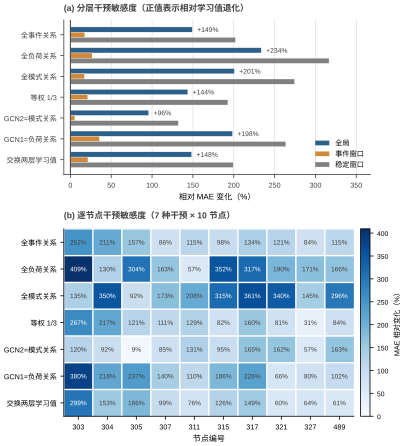

**图4-4 分层参数干预敏感度**  左图比较全局、标签事件窗口和稳定窗口的相对MAE变化，右图展示7种干预在10个节点上的相对变化。正值表示相对学习值基线退化；三种子分层汇总结果未提供离散度，因此无误差棒。

#### 4.2.6.3 解释边界

相对变化同时受基线大小、节点负荷尺度、事件比例和关系连接影响，故分层敏感度不能直接用来设定节点优先级或删除关系。新协议的等权β及关系子集重训练结果见3.7.2节，与本节冻结β替换分别回答参数化选择和既有配置依赖。

## 4.3 L2蒸馏验证层（DV）：受检时序学生的替代性分析

### 4.3.1 协议操作

L2采用知识蒸馏[87]检验图模型预测信号能否被纯时序学生吸收。教师为冻结的StaticGraph，学生为不含图输入的TCN；教师参数在训练期间始终固定。目标值、教师预测和学生预测均处于训练集目标标准化空间，学生损失为$\mathcal L_{\mathrm{KD}}=\mathcal L_1(\hat y_s,y)+\alpha\operatorname{MSE}(\hat y_s,\hat y_t)$，其中$\hat y_s$和$\hat y_t$分别为学生与教师预测。蒸馏权重取$\alpha\in\{0.1,0.5,1.0,2.0\}$，每一权重重复三种子，共12次训练；模型选择仍依据验证集目标值MAE。该层检验的是“所检学生和目标能否逼近教师”，而不是图结构在任何模型中是否可替代。

### 4.3.2 诊断实验

四个蒸馏权重下，学生的全局MAE均接近无蒸馏TCN的0.02952，且远高于教师的0.01376；结果见表4-4。数值最低的$\alpha=2.0$仍约为教师MAE的2.1倍。

**表4-4 GCN→TCN知识蒸馏结果**

| 蒸馏权重$\alpha$ | seed-2024 | seed-2025 | seed-2026 | 均值±SD | 相对教师倍数 |
|---:|---:|---:|---:|---:|---:|
| 0.1 | 0.02946 | 0.02938 | 0.02920 | 0.02934±0.00013 | 2.13× |
| 0.5 | 0.02955 | 0.02921 | 0.02918 | 0.02931±0.00021 | 2.13× |
| 1.0 | 0.02957 | 0.02932 | 0.02934 | 0.02941±0.00014 | 2.14× |
| 2.0 | 0.02914 | 0.02925 | 0.02923 | 0.02921±0.00006 | 2.12× |

注：教师StaticGraph的三种子全局MAE为0.01376，纯TCN无蒸馏基线为0.02952；均值与标准差按3个种子计算。结论限定于给定学生架构、蒸馏目标与$\alpha$范围。

### 4.3.3 L2判定结论

在本实验的TCN学生、预测值蒸馏目标和四个$\alpha$取值下，蒸馏未弥合师生差距，但至少有三种尚未排除的解释。首先，学生缺少教师的邻居传播路径，软标签不能自动增加其输入信息；其次，教师与学生分别有32,714和16,996个可训练参数，当前实验没有容量匹配；再次，硬标签L1与软标签MSE对大残差的惩罚不同，有限权重范围和训练预算不保证找到更合适的折中。结果不能区分这些因素各自的贡献。

若进一步用L2检验图信息的可替代性，须控制学生容量、可用输入、蒸馏目标与训练选模预算；现有差距尚不能归因于图结构。

## 4.4 L3四格溯源层（FET）：全局误差构成

### 4.4.1 协议操作

L3将测试预测键按目标侧标签事件`target_event`与冻结规则触发`rule_trigger`交叉为四组：标签事件/规则触发、标签事件/规则未触发、非标签事件/规则触发和非标签事件/规则未触发。本文沿用“四格溯源”这一层名，但此处仅按预定义标签与回溯规则描述误差构成，不表示因果归因。目标侧事件是旧定义下的事后评价标签，冻结规则含代理负荷差分；二者并非分类器的预测与真值，因而不采用混淆矩阵或分类错误术语。

### 4.4.2 诊断实验

L3使用原正式StaticGraph三个种子的逐键预测重建四格，各格样本量在三个种子间一致：标签事件/规则触发235个，标签事件/规则未触发9,925个，非标签事件/规则触发2,825个，非标签事件/规则未触发699,375个。表4-5报告MAE均值及描述种子波动的标准差。

**表4-5 原正式MRG-GCN三种子四格误差分解**

| 分组 | target_event | rule_trigger | 样本量 | 占比 | MAE（均值±SD） |
|---|---:|---:|---:|---:|---:|
| 标签事件/规则触发 | 1 | 1 | 235 | 0.0330% | 0.21723±0.00598 |
| 标签事件/规则未触发 | 1 | 0 | 9,925 | 1.3933% | 0.27747±0.00098 |
| 非标签事件/规则触发 | 0 | 1 | 2,825 | 0.3966% | 0.07254±0.00591 |
| 非标签事件/规则未触发 | 0 | 0 | 699,375 | 98.1772% | 0.00971±0.00019 |
| 合计 | — | — | 712,360 | 100.0000% | 0.01376±0.00023 |

注：四格MAE为三种子均值±样本标准差；原四格RMSE和WAPE未在本次三种子锁定汇总中重建，故不填入未经核验的数值。

同一四格的样本组成、三种子MAE和误差贡献见图4-5。图4-6的三模型残差密度、图4-7的事件分数分箱结果仍为seed-2024的描述性诊断：事件相关样本的残差分布更宽，强事件分数档的平均绝对误差最高。二者补充四格中的样本量—误差关系，但不替代三种子主四格证据。

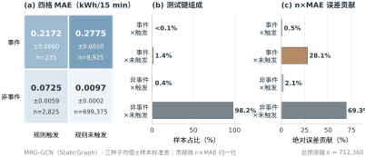

**图4-5 事件标签与规则触发的四格诊断**  A为原正式MRG-GCN三种子四格MAE热图及数值标注，B展示各格样本占比，C展示绝对误差贡献。贡献先逐种子按各格$n\times\mathrm{MAE}$占总绝对误差的比例计算，再汇总均值及离散度；四格计数来自共同预测键，标签与规则均沿用旧协议定义。

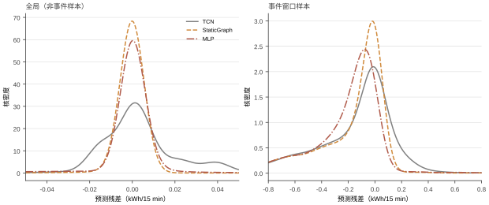

**图4-6 不同模型的残差分布**  曲线为seed-2024中TCN、StaticGraph和MLP的预测残差密度；左、右面板分别为非事件与事件窗口。该图为描述性比较，不含误差棒。

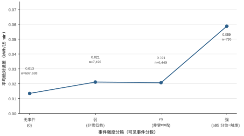

**图4-7 误差与回溯事件分数的关系**  使用AdaptiveGraph的seed-2024测试预测键，按预测起点的旧代理事件分数分为零分数和三个非零组；非零分界为测试期非零分数的50%和95%分位数，仅用于描述，不用于规则拟合。A展示组内MAE；B以对数坐标对照样本占比与绝对误差贡献，后者按各组$n\times\mathrm{MAE}$占总绝对误差的比例计算，行标注为预测键数。两面板按相同分箱顺序排列，不含跨种子误差棒。零分数不等于目标侧非事件，最高分数组不等于冻结触发组；该图不证明实时可见性或因果作用。

### 4.4.3 还原校验

四格诊断以样本量加权恒等式作为有效性检查：

$$
\operatorname{MAE}_{\mathrm{global}}=
\frac{\sum_{a=0}^{1}\sum_{b=0}^{1}n_{ab}\operatorname{MAE}_{ab}}
{\sum_{a=0}^{1}\sum_{b=0}^{1}n_{ab}}. \tag{4-2}
$$

式中，$a$和$b$分别表示target_event和rule_trigger，$n_{ab}$为对应格样本量。原正式MRG-GCN三个种子的加权还原差均小于$10^{-9}$；逐键记录覆盖全部712,360个测试键。本次锁定汇总还检查了三种子四格计数、误差贡献与源文件哈希；没有对其他模型作相同的四格还原声明。

### 4.4.4 L3判定结论

以每格绝对误差之和占总绝对误差的比例定义贡献$C_g$，三种子均在逐种子归一化后汇总。标签事件/规则未触发格仅占1.3933%的预测键，却贡献28.0995%±0.3654%的绝对误差，是稀有困难样本的集中来源；非标签事件/规则未触发格占98.1772%，贡献69.2907%±0.2234%，其单键误差较低，但因样本众多仍构成主要总量。其余两格分别贡献0.5208%±0.0059%和2.0891%±0.1362%。因此，评价时需分别报告稀有困难样本误差与常态格总误差贡献；仅凭误差占比不能推断改善稀有事件会降低实际运行风险。

四格恒等还原只验证键分组与算术闭合，不验证因果机制。规则与标签的错位提示回溯分层不能等价替代目标事件；第5章据此检查区间半宽路由与覆盖失配的关系，不将规则触发率解释为在线识别性能。

## 4.5 MDP诊断结果与适用边界

MDP修正了三项判断：L1将$\beta$敏感度解释为$\beta$与关系变换共同决定的联合配置变化；L2将图结构不可替代收窄为当前受检学生未逼近教师；L3要求并列报告困难格单键误差和常态格总误差贡献。表4-6据此列出论文报告与后续研究取舍。

**表4-6 MDP证据引起的研究判断与后续决策**

| 层次 | 原解释 | 诊断结果 | 修订后的研究判断与可支持的决策 |
|---|---|---|---|
| L1 | 较大$\beta$代表关系更重要；冻结替换退化证明其独立增益 | 冻结替换显示联合配置敏感；函数保持重参数化说明$\beta$单独不具可识别的“重要性”；JPL未重训等权配置 | 不按$\beta$删减关系，也不称其独立增益。关系取舍另依据3.7.2节自环替换：负荷与轮廓关系获条件增量证据，行为关系仍不确定；支持后续复核这三种关系，而非按权重排序 |
| L2 | 蒸馏学生未逼近教师，说明图结构不可替代 | 当前TCN学生未弥合差距；参数量、输入路径及损失设置不匹配；JPL未复做L2 | 结论限于所检学生。当前主张不涉及图结构普遍必要性，故无需据此扩大训练矩阵；若要主张不可替代，须先匹配容量、输入、目标和预算 |
| L3 | 全局MAE足以代表各类样本表现 | 四格中稀有事件键单键误差较高，常态未触发格贡献多数总误差 | 主结果并列报告全局与事件/非零分层，后续模型筛选同时检查两类指标；误差份额仅用于确定研究评价重点，不转换为风险或报警阈值 |

这些判断支持安排关系对照、学生配置核验和分层评价；它们对改模决策及预测性能的实际收益仍需受控实验检验。

## 4.6 JPL的L1/L3复核与适用范围

### 4.6.1 复核材料与计算口径

为检验诊断判断是否只出现在Caltech，本节使用SG-EXP-028既有三个正式MRG-GCN检查点和冻结测试数据，追加L1关系参数替换及L3四格复核。分析在JPL测试结果已查看后开展，属于事后诊断；不重新训练、不改变输入、关系图、标签、阈值或选模。基线先按原冻结源码在CPU前向重放，每种子632,640个预测键的原点、节点、真值、目标时间及掩码均与原导出一致；最大逐键预测差为2.08×10⁻⁶，低于5×10⁻⁶的既定容差。独立算术复核覆盖三个种子的24组基线/替换输出及3组重参数化对照，四格加权还原最大差为1.39×10⁻¹⁷ kWh/15 min。

L1沿用4.2.2节七种操作。“近单一关系”使用相应关系logit为10、其余为0，Softmax主权重为99.9909%，因此不是严格只保留一种关系的结构消融。L3直接读取原冻结目标侧标签和发布原点规则触发；原点触发广播至四个目标片，阈值仍由原训练/调参流程确定，未依据此次测试分析重新拟合。

### 4.6.2 L1：整体配置敏感度及样本层面差异

**表4-7 JPL冻结关系参数替换的分层结果**

| 配置 | 整体MAE | 标签事件MAE | 稳定MAE | 整体变化/% |
|---|---:|---:|---:|---:|
| 学习值 | 0.081067±0.000304 | 0.422111±0.003682 | 0.073820±0.000324 | — |
| 第一层近负荷；第二层学习值 | 0.103703±0.008997 | 0.453735±0.048255 | 0.096266±0.008235 | 27.92 |
| 第一层学习值；第二层近轮廓 | 0.097843±0.001102 | 0.417682±0.003894 | 0.091047±0.001052 | 20.69 |
| 两层近负荷 | 0.123434±0.022627 | 0.501144±0.041952 | 0.115408±0.022271 | 52.26 |
| 两层近行为 | 0.104072±0.024635 | 0.427197±0.025078 | 0.097206±0.025649 | 28.38 |
| 两层近轮廓 | 0.106241±0.003802 | 0.476894±0.007734 | 0.098365±0.003718 | 31.05 |
| 两层等权 | 0.088149±0.002406 | 0.419897±0.004949 | 0.081100±0.002471 | 8.74 |
| 交换两层学习值 | 0.092807±0.007848 | 0.419053±0.001792 | 0.085875±0.007996 | 14.48 |

注：单位为kWh/15 min，均值±样本标准差来自2024、2025、2026三个种子；整体变化以学习值基线三种子均值为分母。表中替换仅改变冻结模型的两层关系logit，其他参数保持；近单一权重的定义见4.6.1节。不同种子共享同一测试期，标准差不表示跨场站不确定性；本节不作确认性显著性判断。

七种替换的整体MAE在三个种子下均高于各自学习值基线；三种子均值的整体增幅为8.74%～52.26%。但“第二层近轮廓”、两层等权及交换学习值的标签事件MAE均值分别为0.417682、0.419897和0.419053，略低于基线0.422111。这与旧Caltech的分层响应不同，说明联合配置的整体敏感度可以在JPL观察到，样本层面的响应方向与幅度仍受协议及场站条件影响。

进一步令两层$\beta'_r=1/3$，同时将相应无偏置关系变换改为$W'_r=3\beta_rW_r$，冻结其余参数，仅执行前向。三个种子的重参数化预测与各自学习值预测最大逐键差分别为1.55×10⁻⁶、1.55×10⁻⁶和1.20×10⁻⁶，均在同一容差内。该检查在JPL已有权重上落实了4.2.5节的函数保持关系：只替换$\beta$引起退化，仍不能单独证明$\beta$有独立正增益；此处也没有进行JPL等权重训练。

### 4.6.3 L3：困难样本与总误差组成

**表4-8 JPL原正式MRG-GCN三种子四格误差分解**

| 样本格 | 预测键数 | 样本占比/% | MAE（均值±样本标准差） | 绝对误差份额/% |
|---|---:|---:|---:|---:|
| 标签事件／规则触发 | 831 | 0.1314 | 0.464647±0.010446 | 0.7529 |
| 标签事件／规则未触发 | 12,332 | 1.9493 | 0.419245±0.003322 | 10.0810 |
| 非标签事件／规则触发 | 26,185 | 4.1390 | 0.167867±0.000881 | 8.5708 |
| 非标签事件／规则未触发 | 593,292 | 93.7803 | 0.069670±0.000331 | 80.5953 |

注：单位为kWh/15 min；预测键数和掩码在三个种子间完全一致，误差份额为各种子“格内绝对误差和／全体绝对误差和”的均值。四格加权MAE还原原正式三种子整体均值0.081067。目标侧事件仅用于事后评价，规则触发是发布原点的既有分组信号，二者不组成同一时刻的事件检测混淆矩阵。

标签事件／规则未触发格占1.9493%的预测键，贡献10.0810%的绝对误差，格内MAE为0.419245；非标签事件／规则未触发格占93.7803%，格内MAE为0.069670，却贡献80.5953%的绝对误差。JPL同样要求兼顾稀有困难格的单键误差和常态格的累计误差，不能用一个总体指标替代两者。Caltech旧协议相应稀有格的误差份额为28.0995%，与JPL不同；两协议的输入、标签和规则不同，不对格内绝对误差作直接跨协议效应比较，也不把误差份额解释为运行风险。

### 4.6.4 复核结论与剩余验证范围

JPL复核表明，L1整体配置敏感度与L3四格误差结构可在另一ACN场站的既有检查点上复算，样本格响应与Caltech不同；该复核未覆盖L2，也未检验诊断指导改模的预测收益。SG-EXP-031为邻接替换后重训，本节则冻结门控权重作前向干预，两者回答不同问题，不能合并解释。

# 第5章  模型结构与可靠性边界分析

## 5.1 引言

第4章揭示了整体指标与困难样本表现的差异。本章进一步按“结构候选—区间可靠性—运行条件”检验证据：训练段TE候选经家族校正后无一保留；Caltech与JPL冻结预测的整体覆盖不能代表事件覆盖；固定代理轨迹与合成线性规划仅用于核验接口及其条件。

## 5.2 方向性统计候选与结构对照

本节用同一训练段序列开展传递熵（TE）筛查与PCMCI+条件独立检验，并按有向节点对比较历史名义结果，流程见图5-1。

**图5-1 TE候选生成与PCMCI+条件独立检验流程**  两法均使用训练期10节点序列；44/32/6分别为两法均、仅TE、仅PCMCI+达到名义阈值的有向对数（未经多重校正）。该对照基于同一序列，不构成独立复现；TE候选经家族校正后无一保留。

### 5.2.1 问题与动机

第3章的LRE三关系图均为无向对称统计量，可描述节点间耦合强度，却不含先后方向与候选时滞；若一个节点的历史变化能为另一节点的后续负荷提供附加信息，这种不对称性便会被无向图压缩。本节据此提出待验证假设：站内节点间可能存在方向性、滞后的统计依赖，其中方向仅表示信息先后。

### 5.2.2 传递熵方向性检验

采用传递熵（transfer entropy，TE）[88]衡量给定目标历史后，源节点滞后取值对目标当前值提供的条件信息：

$$
\operatorname{TE}_{X\rightarrow Y}(\ell)
=H(Y_t\mid Y_{t-\ell})
-H(Y_t\mid Y_{t-\ell},X_{t-\ell})
=I(X_{t-\ell};Y_t\mid Y_{t-\ell}). \tag{5-1}
$$

对10个节点的90条有向对，在滞后$\ell\in\{1,2,4\}$下进行8分位分箱估计，并以每个“有向对×滞后”100次循环平移置换构造零分布。循环平移尽量保留单序列自相关，但不消除共同驱动或滞后选择的不确定性。归档程序先在三个滞后中按最小置换$p$值选择滞后，再以$p<0.05$标记候选；此选择使完整检验族包含90×3=270项。每个检验的最小可达$p$值为1/101≈0.00990，故未经校正的候选只作探索性筛查。

### 5.2.3 传递熵名义候选与双向读数不对称

在90条有向节点对中，76条通过未经校正的名义阈值（84.4%）；按45个无向节点对汇总，其中31对双向通过、14对单向通过。对双向选定滞后下的TE读数，定义描述性不对称度

$$
\operatorname{ASYM}_{ij}=
\frac{|\operatorname{TE}_{i\rightarrow j}-\operatorname{TE}_{j\rightarrow i}|}
{\operatorname{TE}_{i\rightarrow j}+\operatorname{TE}_{j\rightarrow i}+\epsilon}, \tag{5-2}
$$

其中$\epsilon$仅避免分母为零。以$\operatorname{ASYM}>0.3$作描述性标记，得到20对（44.4%）；两个方向各自按其滞后$p$值选择TE，因此该指标不是共享滞后下的效应差，也未检验不对称性的统计显著性。对完整270项检验族作Bonferroni校正后，76条候选均未达到0.05；最小校正$p$值为1.00。故图5-2和图5-3呈现的是未校正候选及读数差异，不支持“存在显著方向效应”的结论。

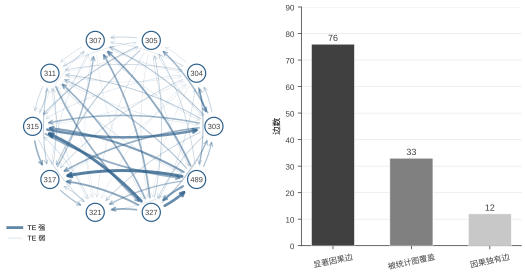

**图5-2 传递熵方向性候选结构**  基于seed-2024训练期数据，左图展示TE值较高的15条候选边，右图汇总候选边被三类统计关系覆盖的情况。箭头表示方向性候选，线宽表示TE强度；100次循环平移置换未做多重比较校正，无误差棒。

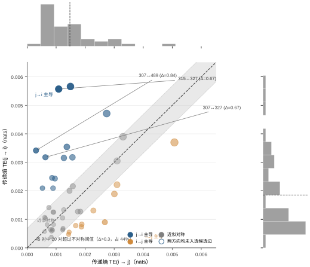

**图5-3 双向传递熵与描述性不对称度**  每个点对应一个无向节点对，坐标为两个方向各自选定滞后的TE读数，虚线表示双向读数相等。灰带对应$|F-B|/(F+B)\leq0.30$；蓝、橙点分别表示较大的读数来自横轴或纵轴方向。45对中20对（44.4%）超过该描述性界值；此比例不检验方向差异的统计显著性。图中TE名义候选未经多重比较校正，完整270项检验族校正后无候选保留。

### 5.2.4 有向候选边与统计关系图的互补性

76条TE候选对应45个无向节点对，其中33对被至少一类LRE图覆盖，12对未覆盖。覆盖统计统一采用top-k=3，但不保证对称化后的实际边数相同；这一探索性设置与旧回溯主模型一致，事件时刻协议另用top-k=5。TE候选与负荷耦合、行为共现和轮廓相似图的Jaccard系数分别为0.444、0.489和0.378，TE强度与三类关系权重的Spearman系数分别为0.27、−0.15和0.26。两者部分重叠，未覆盖候选也仍需校正与验证。覆盖统计见表5-1，逐边对应见图5-4。

**表5-1 TE候选与LRE统计关系的覆盖情况**

| 项目 | 数值 | 说明 |
|---|---:|---|
| 通过名义阈值的有向TE候选 | 76/90 | 未做多重比较校正 |
| Bonferroni校正后保留的TE候选 | 0/90 | 对90条有向对×3个滞后的270项检验族校正；最小校正$p$值为1.00 |
| 对应无向节点对 | 45 | 31对双向候选，14对单向候选 |
| 至少被一类统计图覆盖的节点对 | 33/45 | 探索性比较统一采用top-k=3 |
| 未被统计图覆盖的节点对 | 12/45 | 仅指当前统计图未覆盖 |
| 与负荷耦合图的Jaccard系数 | 0.444 | 探索性比较 |
| 与行为共现图的Jaccard系数 | 0.489 | 探索性比较 |
| 与轮廓相似图的Jaccard系数 | 0.378 | 探索性比较 |

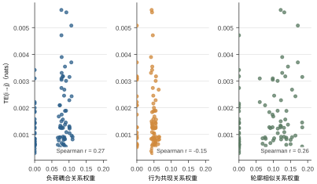

**图5-4 TE与统计关系权重的对应**  90条有向节点对分别与三类固定统计关系权重比较，Spearman系数标注于图内。灰色叉号表示TE为零的边；该图为单种子、未校正的探索性比较。

### 5.2.5 PCMCI+条件独立检验与版本敏感性

为检查TE候选与条件独立检验是否给出相近的方向对，进一步采用PCMCI+[89-90]。历史归档输入为训练段10个节点的83,198个原始时间观测，而非窗口化后的83,103个预测起点；采用ParCorr、最大滞后4片和$\alpha=0.05$。归档记录80个达到名义阈值的滞后单元；按有向节点对汇总，76条TE候选中44条同时出现在PCMCI+名义结果中（57.9%），32条未出现。PCMCI+另记录16个TE汇总中未出现的有向对，包括6个节点间对和10个自回归对；这些都是未校正历史计数，同一节点对可对应多个滞后，不能将对数与滞后单元数等同。图5-5仍按历史归档结果绘制。

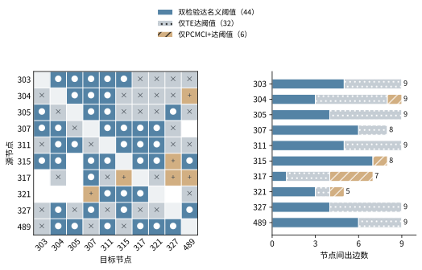

**图5-5 PCMCI+条件独立检验与TE名义候选对照**  A以行为源节点、列为目标节点，区分历史归档中两法均达名义阈值的44对、仅TE达到阈值的32对和仅PCMCI+达到阈值的6对，空白格表示两者均未达到阈值。B按相同节点顺序汇总82个至少被一种检验列为名义候选的节点间有向对的出边与入边构成，各行上条为出边、下条为入边。全部90个节点间有向对中，两法共同支持44对、仅TE支持32对、仅PCMCI+支持6对、均未达阈值8对。10个自回归对均排除，对角线短横线表示不纳入本图比较。输入为训练段83,198个原始时间观测，采用ParCorr、最大滞后4个时间片和$\alpha=0.05$，历史结果未进行多重比较校正。

历史PCMCI+汇总缺少完整$p$值矩阵及Tigramite版本，无法对其80个入选滞后单元追溯多重校正。为评估环境版本敏感性，使用当前锁定张量和Tigramite 5.2.10.1对全部360个非对角有向对×滞后单元（90×4）重算：65个达到名义阈值，Holm校正后22个滞后单元、对应21个有向节点对仍低于0.05。该复算与历史80个名义单元不一致，故仅作为当前环境下的敏感性结果，未替换图5-5或历史交叉计数；它也不消除PCMCI+数据驱动筛选与共同驱动问题，不应解释为物理因果边。TE没有任何候选通过270项家族校正。

### 5.2.6 方向性证据的解释边界与复核路径

本文将TE与PCMCI+结果保留为训练段候选筛查，未回灌MRG-GCN，也不解释为因果边。后续若纳入有向关系，须预先固定构图规则，并在统一数据划分、预测键、模型容量、种子及训练与选模预算下检验增量；若仍使用本研究已查看的时期，结果只能称为探索性。独立时期确认须待取得兼容的新时期数据后开展，本文目前尚无此类数据。

## 5.3 事件感知的区间预测：分层共形预测

### 5.3.1 问题与动机

整体点预测误差不足以判断区间可靠性。本节依次报告独立校准、成熟标签滚动更新和回溯规则设置下Caltech与JPL的区间表现，并用标签事件参照检查覆盖失配[91-93]。

### 5.3.2 分层共形方法

对冻结模型的校准绝对残差$r=|y-\hat y|$，以$\alpha=0.1$构造目标覆盖率90%的区间。独立校准采用第$\lceil(n+1)(1-\alpha)\rceil$个顺序统计量；回溯历史实现保留原经验分位数，二者按协议区分。标准共形对每个节点估计全局半宽$q_n$；规则路由分层共形则将预测键按冻结规则分为触发层和未触发层：触发层样本稀少，使用跨节点统一半宽$q_{\mathrm{trig}}$；未触发层样本较多，使用逐节点半宽$q_{\mathrm{stable},n}$。测试区间为

$$
[\hat y-q,\hat y+q],\qquad
q=\begin{cases}
q_{\mathrm{trig}}, & \text{rule\_trigger}=1,\\
q_{\mathrm{stable},n}, & \text{rule\_trigger}=0.
\end{cases} \tag{5-3}
$$

目标侧事件标签仅用于分组评价；按其选择半宽的oracle为事后参照。各路径均以冻结点预测和校准期绝对残差确定半宽，校准段及更新方式按协议区分。图5-6仅展示旧回溯协议的规则路由：旧规则含事后代理负荷差分，验证段参与模型选择，且采用未修正经验分位数，均属于历史实现限制。当前事件时刻协议下的行为输入独立校准、成熟标签滚动校准及JPL校准见5.3.3—5.3.5节；重叠窗口与分布变化仍需经验评价。

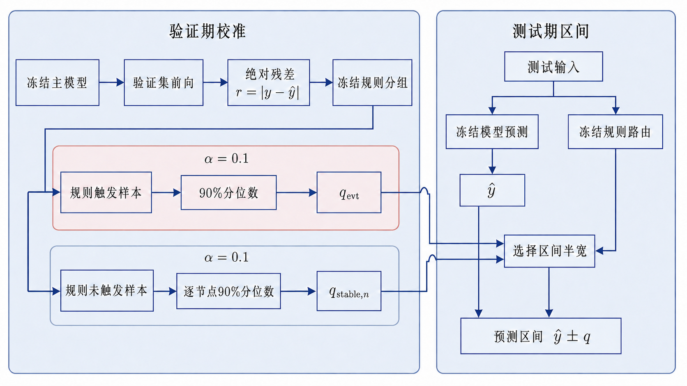

**图5-6 冻结规则路由的分层共形方法**  左侧为验证期校准：冻结主模型生成绝对残差，触发层合并节点估计90%经验分位数，未触发层逐节点校准。右侧为测试期回溯路由：冻结旧规则选择半宽$q$，与点预测$\hat y$共同形成区间。目标侧标签事件不参与规则路由；旧规则含事后代理负荷差分，不表述为在线可见，90%经验分位数不等同于测试覆盖保证。

### 5.3.3 事件时刻输入协议下的独立校准补充

本分析复用三种子冻结预测；模型由调参段选定，校准和测试完整窗口、目标时间片互不重叠。标准路径逐节点校准，行为分层路径将触发组跨节点汇聚、未触发组逐节点校准，目标事件标签仅用于评价。半宽取秩$k_g=\lceil(n_g+1)(1-\alpha)\rceil$的残差，$\alpha=0.1$；各节点标准组含35,220个校准键，触发组含2,964个[92]。重叠窗口依赖与分布变化仍可能影响测试覆盖，独立校准段本身不保证90%覆盖[93]。

**表5-2 新协议独立校准的覆盖与区间质量**

| 路径 | 整体覆盖率/% | 事件覆盖率/% | 稳定覆盖率/% | 平均宽度 | 区间分数 |
|---|---:|---:|---:|---:|---:|
| 标准逐节点 | 79.55±0.23 | 3.87±0.09 | 80.66±0.23 | 0.02757±0.00040 | 0.74551±0.00563 |
| 行为规则分层 | 80.04±0.26 | 5.92±0.15 | 81.13±0.26 | 0.03951±0.00037 | 0.73214±0.00548 |

注：三种子均值±样本标准差；测试共708,560键，其中标签事件10,204键。宽度与区间分数单位为kWh/15 min。区间分数为区间宽度加$2/\alpha$倍越出区间的距离，越小越好；保留原预测及未截零的对称区间端点。本文未按测试覆盖调整半宽。该表属于新协议，不能与表5-4相减来估计独立校准的因果收益。

两条路径整体覆盖均低于90%。行为分层较标准路径将整体覆盖提高0.49个百分点、事件覆盖提高2.05个百分点，但区间宽度增加43.3%，事件覆盖仍不足。校准与测试的标签分布发生变化，测试事件中多数未触发行为规则并使用较窄半宽；结果提示分布失配和路由错位需要并列检查，尚未验证实际上报时延。

### 5.3.4 成熟标签约束下的滚动校准回放

为缓解独立校准的覆盖失配，保持点预测、行为规则和$\alpha=0.1$不变，改用随时间更新的历史残差。事先固定14天为主要回看窗口、28天为窗口敏感性，每个洛杉矶当地零点更新一次；回看长度按经过的14或28个24 h计算。残差纳入须满足：预测已发布、目标片已结束、关联会话断开后节点标签已成熟，且目标片起点位于回看窗口内。若无合格样本，回退至原独立校准半宽；有限样本秩超过样本数时取无穷大，本次回放未出现无穷区间。

每种窗口均报告逐节点标准路径和行为分层路径，规则触发仅用于后者的分组与路由，目标事件标签仅用于事后评价。结果见表5-3。更新只利用发布时刻前已经成熟的标签，这是遵守时间先后的历史回放；由于测试时期已查看，且序列与重叠目标具有依赖性，不将其称为未见时期验证或具有交换性保证的独立样本实验[92-93]。

**表5-3 新协议成熟标签滚动校准回放结果**

| 校准方式 | 整体覆盖/% | 事件覆盖/% | 平均宽度 | 区间分数 |
|---|---:|---:|---:|---:|
| 冻结逐节点 | 79.55 | 3.87 | 0.02757 | 0.74551 |
| 冻结行为分层 | 80.04 | 5.92 | 0.03951 | 0.73214 |
| 14天逐节点 | 89.03 | 26.44 | 0.17223 | 0.67844 |
| 14天行为分层 | 89.01 | 26.71 | 0.17649 | 0.66952 |
| 28天逐节点 | 88.83 | 24.99 | 0.15437 | 0.68014 |
| 28天行为分层 | 88.88 | 25.18 | 0.15916 | 0.66979 |

注：三种子均值，同一708,560个测试键；宽度与区间分数单位为kWh/15 min，分数越小越好。14天行为分层整体覆盖为89.01%±0.05%，事件覆盖为26.71%±0.12%，标准差只描述种子波动。窗口固定后报告全部方案，不按测试覆盖挑选最优配置。

14天滚动更新较冻结行为分层提高整体覆盖8.97个百分点、事件覆盖20.79个百分点，区间分数下降约8.6%；平均宽度扩大至4.47倍。逐节点路径整体覆盖相近（89.03%），尚无行为分层独有增益证据。事件覆盖仍仅26.71%，且测试期已查看，故该回放只支持其缓解所检时期失配的可能性，不支持可靠事件防护；成熟标签等待、事件稀疏和规则漏触发的作用尚未分开。

### 5.3.5 JPL既有预测的独立校准补充

JPL预留校准段可用于检查另一场站的经验覆盖。本文复用SG-EXP-028的三种子冻结预测，保持5.3.3节的两条路径和$\alpha=0.1$：标准路径逐节点汇聚四个目标片的残差，行为分层路径将触发键跨节点汇聚，未触发键逐节点计算。半宽仅由313,120个校准键的有限样本顺序统计量确定，632,640个测试键只用于评价；两段原点及目标时刻集合无交集。该分析在测试期已查看后开展，未调节规则、模型或半宽以迎合测试覆盖。

标准逐节点与行为分层路径的整体覆盖分别为90.08%和90.11%，事件覆盖分别为46.43%和45.88%，非零目标覆盖为65.82%和66.01%。行为分层未提高事件覆盖。该结果只描述已查看的固定测试期；现有区间不足以支持事件预警或保护动作，业务可接受的区间宽度也尚未确定。

### 5.3.6 回溯补充：覆盖与路由错位

表5-4显示，标准与规则路由的事件覆盖仅1.9%和3.9%，远低于90%目标；事后按标签事件路由可达86.1%，但该标签预测时不可见，不能代表部署表现。

**表5-4 不同共形口径的经验覆盖率**

| 校准与路由方式 | 整体覆盖率 | 标签事件窗口覆盖率 | 稳定窗口覆盖率 | 解释 |
|---|---:|---:|---:|---|
| 标准共形 | 69.6%±1.7% | 1.9%±0.5% | 70.5%±1.8% | 全局逐节点校准 |
| 规则路由分层共形 | 69.8%±1.8% | 3.9%±0.5% | 70.7%±1.8% | 旧冻结规则回溯路由，覆盖未达标 |
| 标签事件事后参照（oracle） | 70.1%±1.8% | 86.1%±0.0% | 69.9%±1.9% | 标签路由，预测时不可用 |

注：均值和标准差来自2024、2025、2026三种子；覆盖率为测试集经验值，未作有限样本秩修正。

测试键中规则触发占0.43%，标签事件占1.43%；3,060个触发键中仅235个属于标签事件，多数事件因此进入较窄的未触发层。该错位可解释部分覆盖不足，但不能排除残差分布变化和有限样本影响。

三类覆盖口径见图5-7，触发层半宽相对全局半宽的膨胀见图5-8。规则触发层的统一半宽为0.651±0.005 kWh/15 min，远大于逐节点全局残差半宽，反映触发层残差分布更宽。

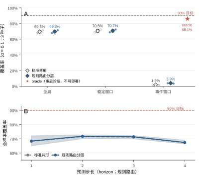

**图5-7 共形覆盖率比较**  A在统一的覆盖率坐标下比较三个口径（全局、稳定窗口、标签事件窗口）的标准共形与规则路由分层结果，红色星号为事件窗口的oracle事后诊断参照（不可部署），虚线为90%目标；B为规则路由下第1—4个目标片的全样本覆盖率。散点为单种子读数，误差棒为跨种子标准差，B中阴影为min–max范围。

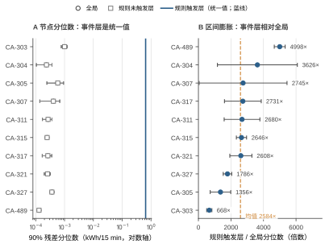

**图5-8 分层残差分位数与区间膨胀**  白点为逐节点全局90%残差分位数（三种子均值±标准差），蓝色竖线为规则触发层的统一分位数（所有节点共享），点与竖线之间的引导线标注触发层相对该节点全局分位数的倍数（三种子均值）。规则未触发层分位数与全局分位数逐节点几乎一致，图中不重复绘制。

规则路由下各节点的平均区间宽度列于表5-5。

**表5-5 规则路由分层共形的节点级区间宽度**

| 节点 | 区间宽度/(kWh/15 min) |
|---|---:|
| CA-303 | 0.0105±0.0005 |
| CA-311 | 0.0091±0.0001 |
| CA-327 | 0.0091±0.0001 |
| CA-489 | 0.0071±0.0001 |
| CA-321 | 0.0069±0.0002 |
| CA-305 | 0.0064±0.0006 |
| CA-315 | 0.0051±0.0001 |
| CA-304 | 0.0040±0.0002 |
| CA-307 | 0.0028±0.0006 |
| CA-317 | 0.0025±0.0002 |

注：数值为三种子均值±样本标准差。区间宽度受节点残差与规则触发层分位数共同影响，不将其解释为节点风险的唯一度量。

### 5.3.7 回溯补充：残差失配诊断

为区分路由错位与校准失配，保持原模型、冻结规则和验证期分位数不变，重新前向验证集并核对归档测试预测。三种子的原校准半宽均在浮点容差内复现，各覆盖指标与旧汇总的最大差异为0.0064个百分点，不改变表5-4的显示值。新增统计只作事后失效诊断，不利用测试分位数重新校准或选择阈值。

**表5-6 冻结区间的覆盖失效诊断**

| 诊断量 | 验证期或标准路径 | 测试期或规则路径 | 解释 |
|---|---:|---:|---|
| 全体绝对残差p50 | 0.000178 | 0.000220 | 测试/验证为1.24倍 |
| 全体绝对残差p90 | 0.000716 | 0.002507 | 测试/验证为3.50倍 |
| 全体绝对残差p95 | 0.000912 | 0.008759 | 测试/验证为9.60倍 |
| 标签事件/触发（235键）覆盖率 | 0.85% | 86.52% | 触发半宽增宽，但该组很少 |
| 标签事件/未触发（9,925键）覆盖率 | 1.95% | 1.95% | 大多数标签事件仍接受窄区间 |
| 非标签事件/触发（2,825键）覆盖率 | 5.83% | 96.07% | 增宽也覆盖非标签事件键 |
| 非标签事件/未触发（699,375键）覆盖率 | 70.80% | 70.63% | 大样本稳定组同样未达目标 |

注：前三行为每种子先跨预测键计算分位数，再取三种子均值，单位kWh/15 min；不是逐节点校准半宽的均值。后四行为相同四格内标准与规则路径的测试经验覆盖率，先逐种子计算再取均值。预测窗口重叠，不作独立样本显著性推断。

覆盖不足首先表现为路由错位。235个标签事件/触发键的规则覆盖为86.52%，9,925个标签事件/未触发键仅为1.95%；区间增宽没有惠及多数标签事件。同时，2,825个非标签事件/触发键的覆盖为96.07%，说明半宽路由与目标标签分层并不一致。两者属于不同定义的分组，不等同于分类漏报和误报。

第二条证据链是校准失配。测试残差p90和p95分别为验证期的3.50倍和9.60倍；按3种子、10节点和4个目标片分别计算的120组p90，测试期均高于验证期。规则整体覆盖率的月度三种子均值从2021年3月79.34%降至9月59.13%，目标标签事件占比从0.83%升至2.28%；首末月仅覆盖部分日期，不据此推断单调趋势。

该事后诊断表明残差尾部变化与冻结半宽失配并存，但未识别成因，也不是预登记漂移检验；分层样本稀疏及节点、目标片汇聚仍可能影响读数。旧协议未设独立校准段，且测试时期已查看；新协议独立校准结果见5.3.3节。

## 5.4 节点负荷预测的决策接口与验证条件

### 5.4.1 预测量与运行量的对应

本节将节点预测汇总为集合代理需求，定义容量核查与充电协调的输入接口。设$t$为发布时刻，预测对象为$[t,t+60\mathrm{\,min})$内的4个连续15 min目标片；以目标片左端时刻$\tau$标记时间片，$h=1,\ldots,4$依次对应左端$t$、$t+15$、$t+30$和$t+45$ min；$\mathcal N$为10个研究节点。首片虽以发布时刻为左端，预测量仍是该片完整区间的能量。集合代理需求及预测值为

$$
D_{\tau}=\sum_{n\in\mathcal N}y_{\tau,n},\qquad
\widehat D^{(m,s)}_{t,h}=\sum_{n\in\mathcal N}\widehat y^{(m,s)}_{t,h,n}. \tag{5-4}
$$

其中，$m$和$s$分别表示模型配置与随机种子。$D_{\tau}$和$\widehat D_{t,h}$的单位为kWh/15 min，表示会话最终交付电量按接入至断开期间均匀分配后得到的区间能量代理；后文省略模型和种子上标。对$\Delta t=0.25$ h的时间片，除以时间长度可得到区间平均代理功率：

$$
\widehat P^{\mathrm{proxy}}_{t,h}=\frac{\widehat D_{t,h}}{\Delta t}=4\widehat D_{t,h}. \tag{5-5}
$$

该换算仍是代理平均功率，不能恢复片内波动。预测仅覆盖10个研究节点；与全站限额比较前，还需校准同步电表并补入其他节点和非充电负荷。

### 5.4.2 从预测曲线到运行核查

预测进入运行核查前，需先核对时间戳、节点映射、输入可见性和目标片；校准后可作为影子运行中的需求提示，与其他负荷、限额和备用裕度合并计算余量：

$$
M_{t,h}=P_{\mathrm{lim}}-P_{\mathrm{other},t,h}-\widehat P^{\mathrm{cal}}_{\mathrm{EV},t,h}-R_{t,h}. \tag{5-6}
$$

各项单位为kW，依次表示有功限额、非充电负荷、校准后的全站充电预测及规程裕度。15 min平均量不能检验瞬时尖峰、三相不平衡或热约束，正余量也不代表安全认证。当前缺少完整运行输入，式（5-6）仅定义核查接口；若开展影子运行，还需同步记录数据更新时间、复核结果和电表读数，输入缺失或校准失效时停止使用预测。

### 5.4.3 固定发布时刻的四目标片算例

为展示预测曲线，选取测试记录中按时间顺序出现的首个合格代理需求过程，不依据模型误差选例。发布时刻为2021年3月16日13:00，过程起点为13:45，故提前量为45 min；60 min是第四片终点。表5-7列出MRG-GCN三个种子的该原点预测及离散度，不代表集成预测或区间预测。

**表5-7 固定发布时刻下的节点集合四目标片预测示例**

| 目标片起点 | 目标片起点相对发布时刻/min | 预测代理需求/实际代理需求（kWh/15 min） | 预测/实际区间平均代理功率（kW） |
|---|---:|---:|---:|
| 13:00 | 0 | 0.7624±0.1041 / 0.8080 | 3.05 / 3.23 |
| 13:15 | 15 | 0.7262±0.0894 / 0.8080 | 2.90 / 3.23 |
| 13:30 | 30 | 0.6879±0.0767 / 0.8080 | 2.75 / 3.23 |
| 13:45 | 45 | 0.6548±0.0728 / 1.1505 | 2.62 / 4.60 |

注：预测均值与样本标准差基于3个独立种子；功率为代理能量除以0.25 h所得的区间平均等效值，不是实测功率。目标时间片以左端时刻标记。

预测呈回落趋势，未捕捉13:45的代理需求跃升，末片低估0.4957 kWh/15 min（43.1%）。该固定案例提示需单独评价局部低估；它不代表实测越限或安全验证。

为将预测误差与可用实测材料分开解释，表5-8归纳两场站既有模型比较在全局、非零和事件目标上的表现。所有误差均以会话电量均匀分摊代理为评价目标，不是实测功率误差。Caltech的全局和非零目标误差由完整AGCRN更低，标签事件误差由容量近似TCN更低。JPL的全局MAE低于TCN、完整AGCRN和共享门控三项基线；其非零目标和标签事件仅报告MRG-GCN与TCN的两模型比较，TCN较低，不对AGCRN及共享门控的分层表现作排名。因此，模型筛选应并列考察整体与分层指标，不能把整体MAE优势解释为活跃充电预测优势。

**表5-8 两场站模型在不同代理评价目标上的误差比较**

| 场站 | 评价目标 | MRG-GCN MAE | 所列对照模型 | 对照MAE | 较低误差配置 |
|---|---|---:|---|---:|---|
| Caltech | 全局 | 0.03890 | 完整AGCRN | 0.03743 | 完整AGCRN |
| Caltech | 非零目标 | 0.27751 | 完整AGCRN | 0.26723 | 完整AGCRN |
| Caltech | 标签事件 | 0.38101 | 容量近似TCN | 0.37463 | 容量近似TCN |
| JPL | 全局 | 0.081067 | 完整AGCRN | 0.083268 | MRG-GCN |
| JPL | 非零目标 | 0.277839 | TCN | 0.275718 | TCN |
| JPL | 标签事件 | 0.422111 | TCN | 0.419209 | TCN |

注：单位为kWh/15 min，数值为三种子均值；事件标签仅作事后分层。两套协议均以均匀分摊代理为标签，不能据此判断模型对电表实测值的误差。JPL非零目标与标签事件仅列出已报告的MRG-GCN与TCN两模型比较，不对AGCRN、共享门控等其他JPL基线作分层排名。完整指标和离散度见表3-2、表3-3及图3-10。

图5-9进一步比较同一Caltech站点八条预定会话样本的归一化实测电流份额与等片代理份额。该便利样本仅用于描述单会话内的充电形态差异：样本缺少电压和功率列，电流积分不能换算为kW或kWh，且处于既有训练年代；该图不比较模型预测，不能作为MRG-GCN对实测功率或电量的验证。

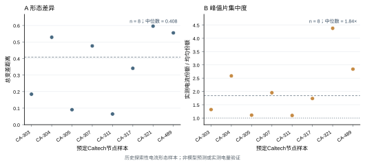

**图5-9 ACN实测电流形态与均匀分摊代理的差异**  A为每条会话实测电流归一化片份额与均匀分摊份额的总变差距离；B为最大电流份额相对均匀份额的比值。每个点代表预定便利样本中的一条有效会话（8条）；横虚线分别表示八条样本的中位数，B中的点虚线为等片基准1。电流积分未换算为kW或kWh；该图不比较模型预测，也不作总体推断。

### 5.4.4 有限时域充电分配与合成决策算例

为说明预测如何进入有限时域充电分配，构造如下线性规划。令$p_{j,h}$为车辆$j$在时间片$h$的计划功率，$\pi_h$为单位电量记账价格，目标是在满足车辆请求的前提下降低计划成本：

$$
\min_{\{p_{j,h}\}}\ \sum_{h=1}^{K}\pi_h\Delta t\sum_j p_{j,h}. \tag{5-7}
$$

每辆车具有服务窗、剩余电量需求和功率上限，并满足能量请求及站点容量约束。容量式中的不可调充电基线须经计量校准；若全站预测已含可调车辆，再将同一车辆请求加入会重复计量。当前模块只输出供复核的计划；采用无损、连续功率假设，未建模V2G、三相约束、离散电流、效率和执行偏差。超出四片时域的请求还需扩展时域或验证终端可行性。

合成算例设置一辆车在四片内请求1 kWh、功率上限3 kW；不可调充电与其他负荷各1 kW，站点限额6 kW、备用1 kW，价格为4、3、2、1。参数均为人工设定。求解结果见表5-9。

**表5-9 合成四片充电分配的影子计划**

| 项目 | 第1片 | 第2片 | 第3片 | 第4片 |
|---|---:|---:|---:|---:|
| 单位电量记账价格 | 4 | 3 | 2 | 1 |
| 不可调充电/kW | 1 | 1 | 1 | 1 |
| 非充电负荷/kW | 1 | 1 | 1 | 1 |
| 可调车辆功率/kW | 0 | 0 | 1 | 3 |
| 合计计划功率/kW | 2 | 2 | 3 | 5 |

计划满足1 kWh请求，合计功率加备用不超过6 kW，成本为1.25个记账单位；整数网格枚举得到相同最优值。该核验仅说明求解器在合成输入下满足约束，不证明预测带来节约。

### 5.4.5 证据边界与应用验证要求

目前可复算的同站实测证据仅为八条Caltech历史便利会话的归一化电流形态（图5-9）：样本缺少电压和功率列，也不覆盖独立测试期。请求字段方面，本地快照未保存`userInputs`，源端字段覆盖率与请求更新时间仍属未知，尚待认证接口普查核实；这属于本地证据缺口，不等于源端零覆盖，也不能据此假定请求在发布时已可见。EPFL虽有站级限额和功率字段，但其站点、端口与计量边界无法映射到ACN十节点。

因此，现有证据支持的决策限于模型筛选与采数优先级安排：模型比较仍限于代理目标（表5-8），运行算例仅核验合成约束的可行性（表5-9）。评价预测对实测负荷的误差，需取得同一测试时段、映射到研究节点的同步kW或kWh及计量边界；评价告警或调度价值，还需保留请求更新时间、设备限额、其他负荷和电价，并按发布时可见信息冻结基线。取得这些数据后，先做不调度的测量回放，再决定是否开展影子调度；在此之前，不支持现场越限、服务改善或成本节约结论。

## 5.5 本章小结

表5-10汇总本章三类分析：方向性候选、区间可靠性和运行接口。

**表5-10 第5章探索结果汇总**

| 问题 | 操作 | 主要观察 | 结论边界 |
|---|---|---|---|
| 分离模型选择与校准后能否达标？ | 新协议冻结三种子、独立校准段与有限样本秩修正 | 行为分层整体覆盖80.04%，事件5.92%；平均宽度较标准增加43.3% | 测试时期已查看；存在时间依赖与失配，不能报告90%保证或与旧覆盖直接计算收益 |
| 滚动残差更新能否缓解失配？ | 14/28天成熟标签历史回放 | 14天行为分层整体覆盖89.01%，事件26.71%；宽度为冻结分层的4.47倍 | 已查看时期的条件回放，未达90%，不证明分层独有优势 |
| JPL独立校准能否覆盖困难样本？ | 复用冻结三种子预测，按原两条路径校准 | 标准/行为分层整体覆盖90.08%/90.11%，事件46.43%/45.88% | 固定已查看测试期；总体接近目标不等于事件可靠性 |
| 点预测能否给出可靠区间？ | 旧标准共形、回溯规则路由与oracle对比 | 标签事件覆盖率1.9%→3.9%；oracle为86.1% | 旧规则不具备已验证实时可见性，覆盖未达标；oracle仅为事后参照 |
| 统计关系能否呈现方向信息？ | TE候选筛查与PCMCI+条件独立分析 | TE有76/90个未经校正的名义候选，270项Bonferroni后为0；当前环境PCMCI+为22/360个Holm校正滞后单元 | 历史PCMCI+的80个名义单元缺版本和完整p矩阵；方向统计不是物理因果边 |
| 节点预测如何进入运行决策？ | 代理需求回放及合成充电分配线性规划 | 实例末步低估43.1%；合成计划满足1 kWh请求与容量限制 | 真实预测与合成约束来源不同，尚无计量映射或实际调度收益 |

# 结  论

## 研究工作总结

本文围绕站内节点代理负荷，完成关系建模、受控预测比较和MDP诊断。新增证据支持所检JPL设置下负荷耦合与轮廓相似关系相对自环的条件性整体MAE增量，并说明组件价值、完整模型表现和参数敏感度须分别判断。

## 主要研究结论

（1）整体误差优势未延伸至困难样本。Caltech事件时刻协议下，MRG-GCN整体MAE为0.03890 kWh/15 min，较容量近似TCN低16.1%，但完整AGCRN更低，且MRG-GCN非零目标与标签事件误差均未优于TCN。JPL重新拟合后，其整体MAE为0.081067 kWh/15 min，较三项预登记对照低2.64%—3.36%，校正时间块区间为正；TCN的RMSE及困难样本误差更低。因此，模型选择应并列考察整体与分层指标。

（2）组件增量具有明确边界。节点级门控相对同参数共享门控在Caltech、JPL的整体MAE分别低2.69%和2.71%；每站一个共享门控种子触及60轮上限，结果限于该训练预算。JPL同参数自环替换显示，负荷耦合和轮廓相似关系的整体MAE增量分别为1.82%和1.52%，Bonferroni校正区间下限均为正；行为共现关系的区间跨零。事后分层中，负荷邻接换为自环后非零组MAE较完整模型高0.004893 kWh/15 min，三种子同向，但该结果未经多重校正。它是组件内差异，不是模型间排名：完整MRG-GCN在Caltech、JPL及完成时刻截断目标下的非零组均未胜过容量近似TCN。

（3）目标敏感性与MDP改变了证据解释。完成时刻截断下，MRG-GCN相对容量近似TCN的整体MAE排序保持（0.043401对0.051703 kWh/15 min），但新目标零值占比为94.27%，MRG-GCN非零组MAE高0.013938 kWh/15 min，整体优势仍由零目标组驱动；该实验固定关系图并复用已查看测试期。对12种冻结预测配置，基于三种子平均MAE排名的全局Spearman为0.993，按评价标签定义的非零组为0.420，说明总体选模与活跃片段选模需分别评价。MDP区分联合参数敏感度、受检学生替代表现和误差组成：关系权重本身未显示独立增益，当前学生未弥合差距，四格结果要求并列报告稀有困难格误差与常态格总误差。它支持修订研究判断和评价重点，尚未证明诊断指导改模可提升预测。

（4）可靠性与应用证据仍有限。Caltech 14天成熟标签滚动分层覆盖为89.01%，事件覆盖为26.71%，区间宽度达到冻结方案的4.47倍；JPL标准独立校准整体覆盖为90.08%，事件覆盖仅46.43%。TE候选经270项家族校正后均未保留。固定轨迹和合成线性规划只核验了代理接口与约束求解；缺少计量映射及实际运行资料，尚不能评价现场风险或经济收益。

## 研究判断与使用条件

在会话重构的站内节点代理负荷任务中，可优先复核负荷耦合和轮廓相似关系，将行为共现关系保留为待确认候选；若关注活跃片段，应按非零组和事件组表现选模，不以整体MAE或关系权重排序单独决定关系取舍。现有证据可用于安排模型复核与数据采集，不能支持现场设备选型、容量控制或收益估算。

## 研究局限与后续工作

后续工作优先核验代理目标与实际充电过程的对应关系：采集同步电表和输入到达时间戳，校准计量映射与信息可见性，并取得兼容数据开展独立验证。ACN时间范围核验未发现晚于既有时期的记录，Office 1仍待节点、字段及既有使用史核查。方法补验分别针对三项问题：在替代目标下重建关系图以检验全流程稳健性；以共同延长的预算比较节点级与共享门控，排查预算解释；匹配学生容量、输入、目标和训练预算，评价图信息的可替代性。运行评价需设备与车辆约束、成熟标签和实时可见信号，先开展影子回放，再评价事件覆盖、漏报、执行效果与成本。

# 致  谢

[待写：由作者在终稿阶段填写。]

# 参考文献
[1] 中国电动汽车充电基础设施促进联盟. 2024年全国电动汽车充换电基础设施运行情况[EB/OL]. (2025-01-23)[2026-10-22]. https://www.evcipa.org.cn/newsinfo/8137834.html.
[2] 陈丽丹, 张尧, FIGUEIREDO A. 电动汽车充放电负荷预测研究综述[J]. 电力系统自动化, 2019, 43(10): 177-197.
[3] 张夏韦, 梁军, 王要强, 等. 电动汽车充电负荷时空分布预测研究综述[J]. 电力建设, 2023, 44(12): 161-173.
[4] 崔一诺, 罗配明, 李攀硕, 等. 电动汽车充放电负荷时-空分布预测研究综述[J]. 电气工程学报, 2026, 21(2): 371-385.
[5] 韩林阳, 叶承晋, 朱超, 等. 高温天气下计及用户意愿的城市充电负荷空间引导策略[J]. 电力系统自动化, 2024, 48(10): 139-150.
[6] 田礼彬. 电动汽车负荷时空预测及有序充放电优化调度[D]. 吉林: 东北电力大学, 2025.
[7] 王哲, 万宝, 凌天晗, 等. 基于谱聚类和LSTM神经网络的电动公交车充电负荷预测方法[J]. 电力建设, 2021, 42(6): 58-66.
[8] 陈闯. 基于图卷积网络及排队论的电动汽车充电负荷预测研究[D]. 深圳: 哈尔滨工业大学(深圳), 2022.
[9] 奚圣宽. 基于深度学习的电动汽车充电桩负荷预测方法研究[D]. 北京: 华北电力大学, 2023.
[10] 黄南天, 孙赫宏, 王圣元, 等. 计及多公共充电站差异化耦合关联的电动汽车充电负荷时-空短期预测[J]. 中国电机工程学报, 2025, 45(4): 1424-1436. DOI: 10.13334/j.0258-8013.pcsee.231589.
[11] 张美霞, 孙铨杰, 杨秀. 考虑多源信息实时交互和用户后悔心理的电动汽车充电负荷预测[J]. 电网技术, 2022, 46(2): 632-641.
[12] 张延宇, 张智铭, 刘春阳, 张西镚, 周毅. 基于动态自适应图神经网络的电动汽车充电负荷预测[J]. 电力系统自动化, 2024, 48(7): 86-93. DOI: 10.7500/AEPS20230611001.
[13] 黄健, 陈建红, 何剑杰, 等. 基于GCN-LSTM的电动汽车负荷预测方法[J]. 浙江电力, 2024, 43(12): 59-67. DOI: 10.19585/j.zjdl.202412006.
[14] 陈培垠, 方彦军. 基于卡尔曼滤波预测节假日逐点增长率的电力系统短期负荷预测[J]. 武汉大学学报(工学版), 2020, 53(2): 139-144.
[15] 潘良军, 王楷, 赵宏炎, 等. 基于春节影响时期分析的中期负荷智能预测[J]. 智慧电力, 2020, 48(9): 75-80,117.
[16] 陈梓行, 金涛, 郑熙东, 等. 基于新型日期映射法和ISGU混合模型的短期电力负荷预测[J]. 电力系统保护与控制, 2022, 50(15): 72-80.
[17] 巫朝越. 考虑特殊事件影响的单体用户短期负荷预测组合模型[D]. 南京: 东南大学, 2024.
[18] 韩富佳, 王晓辉, 乔骥, 等. 基于人工智能技术的新型电力系统负荷预测研究综述[J]. 中国电机工程学报, 2023, 43(22): 8569-8591.
[19] 黄运有, 詹剑锋. 基于深度学习的短期负荷预测综述[J]. 高技术通讯, 2021, 31(3): 240-248.
[20] KE G, MENG Q, FINLEY T, et al. LightGBM: a highly efficient gradient boosting decision tree[C]//Advances in Neural Information Processing Systems (NeurIPS). 2017: 3146-3154.
[21] CHEN T, GUESTRIN C. XGBoost: a scalable tree boosting system[C]//Proceedings of the 22nd ACM SIGKDD International Conference on Knowledge Discovery and Data Mining. 2016: 785-794.
[22] HOCHREITER S, SCHMIDHUBER J. Long short-term memory[J]. Neural Computation, 1997, 9(8): 1735-1780.
[23] CHO K, VAN MERRIËNBOER B, GULCEHRE C, et al. Learning phrase representations using RNN encoder-decoder for statistical machine translation[C]//Proceedings of EMNLP. 2014: 1724-1734.
[24] BAI S, KOLTER J Z, KOLTUN V. An empirical evaluation of generic convolutional and recurrent networks for sequence modeling[J/OL]. arXiv, 2018[2026-10-22]. https://arxiv.org/abs/1803.01271. DOI: 10.48550/arXiv.1803.01271.
[25] VASWANI A, SHAZEER N, PARMAR N, et al. Attention is all you need[C]//Advances in Neural Information Processing Systems (NeurIPS). 2017: 5998-6008.
[26] 王华彪, 李小勇. 基于融合注意力机制改进双向长短时记忆网络在电动汽车充电负荷中的预测研究[J]. 电网与清洁能源, 2022, 38(6): 104-112.
[27] 王琨, 高敬更, 张勇红, 等. 基于LSTM神经网络的复合变量电动汽车充电负荷预测方法技术研究[J]. 工业仪表与自动化装置, 2019(1): 27-31.
[28] 张昌鸿, 曾祥智. 基于拉丁超立方及CNN-LSTM-ATTENTION的电动汽车负荷预测[J]. 电工技术, 2025(10): 125-129.
[29] 顾玮, 段敬, 张栋, 等. 分时电价下的充电站负荷预测[J]. 计算机应用, 2024, 44(S1): 337-342.
[30] 袁溪, 张邵欣, 张超, 等. 基于Transformer的电动汽车充电站能耗预测研究[J]. 计算机技术与发展, 2025, 35(2): 213-220.
[31] 王强, 毕宇豪, 高超, 等. 融合多方信息的电动汽车充电负荷时空分布预测[J]. 电力建设, 2025, 46(6): 24-37. DOI: 10.12204/j.issn.1000-7229.2025.06.003.
[32] 赵子鋆, 彭清文, 邓铭, 等. 考虑多因素影响与误差修正的充电站负荷预测[J]. 浙江电力, 2024, 43(4): 21-28.
[33] 温子健, 李伟风, 刘泽晖, 等. 基于时间特征分类与误差修正的电动汽车充电负荷预测[J]. 浙江电力, 2026, 45(5): 69-78. DOI: 10.19585/j.zjdl.202605007.
[34] 蒋建东, 韩文轩, 赵云飞, 等. 基于优化VMD二次分解的短期电力负荷预测[J]. 郑州大学学报(工学版), 2026, 47(1): 124-130.
[35] 张翾, 李红月. 基于优化VMD与TCN-ISE-Pyraformer的短期电力负荷预测[J]. 安徽工业大学学报(自然科学版), 2025, 42(3): 263-275. DOI: 10.12415/j.issn.1671-7872.25006.
[36] 韩宇昊, 刘鸿鹏. 基于FMD-LSTM-Bootstrap的电动汽车充电负荷区间预测[J]. 东北电力大学学报, 2025, 45(6): 51-59.
[37] 朱俊丞. 基于深度学习的多时间尺度电动汽车充电负荷预测模型设计[D]. 郑州: 郑州大学, 2020.
[38] 陈勇, 江颖达, 徐刚, 等. 规模化电动汽车充电负荷预测[J]. 电力需求侧管理, 2022, 24(5): 71-77. DOI: 10.3969/j.issn.1009-1831.2022.05.012.
[39] 闫威, 李南, 沈月秀, 等. 基于CNN-GAN与半监督回归的电动汽车充电负荷预测[J]. 浙江电力, 2023, 42(2): 83-89. DOI: 10.19585/j.zjdl.202302011.
[40] 赵伟博, 范旭东, 孙胜博, 等. 电动汽车充电负荷场景化分析与超短期预测方法[J]. 电力信息与通信技术, 2025, 23(2): 28-37. DOI: 10.16543/j.2095-641x.electric.power.ict.2025.02.04.
[41] 毛建斌, 杨少兵, 杨湘彦, 等. 基于有限混合模型的规模化电动汽车充电负荷在线预测方法[J]. 电网技术, 2025, 49(5): 1931-1940. DOI: 10.13335/j.1000-3673.pst.2024.0241.
[42] 吴钉捷, 李晓露. 基于实时出行需求和交通路况的电动汽车充电负荷预测[J]. 电力建设, 2020, 41(8): 57-67. DOI: 10.12204/j.issn.1000-7229.2020.08.008.
[43] 丁乐言, 柯松, 张帆, 等. 考虑出行需求和引导策略的电动汽车充电负荷预测[J]. 电力建设, 2024, 45(6): 10-26. DOI: 10.12204/j.issn.1000-7229.2024.06.002.
[44] 张琳娟, 李文峰, 许长清, 等. 计及充电排队与实时SOC的电动汽车充电负荷时空分布预测[J]. 电力建设, 2025, 46(8): 54-66. DOI: 10.12204/j.issn.1000-7229.2025.08.006.
[45] 李宏伟, 宋玉峰, 李帅兵, 等. 基于ArcGIS路网结构与交通拥挤度分析的电动汽车充电负荷预测方法[J]. 电网技术, 2025, 49(5): 1920-1930. DOI: 10.13335/j.1000-3673.pst.2023.1420.
[46] 葛乐, 陆颖, 王明深, 等. 考虑用户决策更新的电动汽车充换电负荷预测[J]. 浙江电力, 2025, 44(10): 152-164. DOI: 10.19585/j.zjdl.202510013.
[47] KIPF T N, WELLING M. Semi-supervised classification with graph convolutional networks[C]//Proceedings of the 5th International Conference on Learning Representations (ICLR). Toulon, 2017.
[48] VELIČKOVIĆ P, CUCURULL G, CASANOVA A, et al. Graph attention networks[C]//Proceedings of the 6th International Conference on Learning Representations (ICLR). 2018.
[49] SCHLICHTKRULL M, KIPF T N, BLOEM P, et al. Modeling relational data with graph convolutional networks[C]//European Semantic Web Conference (ESWC). 2018: 593-607.
[50] YU B, YIN H, ZHU Z. Spatio-temporal graph convolutional networks: a deep learning framework for traffic forecasting[C]//Proceedings of the 27th International Joint Conference on Artificial Intelligence (IJCAI). 2018: 3634-3640.
[51] WU Z, PAN S, LONG G, et al. Graph WaveNet: deep spatial-temporal graph modeling[C]//Proceedings of the 28th International Joint Conference on Artificial Intelligence (IJCAI). 2019: 1907-1913.
[52] BAI L, YAO L, LI C, et al. Adaptive graph convolutional recurrent network for traffic forecasting[C]//Advances in Neural Information Processing Systems (NeurIPS). 2020: 17804-17815.
[53] 叶宝林, 戴本岙, 张鸣剑, 等. 基于图卷积网络的交通流预测方法综述[J]. 南京信息工程大学学报(自然科学版), 2024, 16(3): 291-310.
[54] 闫佳和, 李红辉, 孙婧, 等. 面向交通流预测的时空图神经网络发展综述[J]. 计算机工程与应用, 2025, 61(22): 1-19.
[55] 李志帅, 吕宜生, 熊刚. 基于图卷积神经网络和注意力机制的短时交通流量预测[J]. 交通工程, 2019, 19(4): 15-19, 28.
[56] 董雷, 陈振平, 韩富佳, 等. 基于图卷积神经网络与K-means聚类的居民用户集群短期负荷预测[J]. 电网技术, 2023, 47(10): 4291-4301.
[57] 张鹏飞, 胡博, 何金松, 等. 基于时空图卷积网络的短期空间负荷预测方法[J]. 电力系统自动化, 2023, 47(13): 78-85.
[58] 吴兴扬, 戴剑丰. 基于多尺度自适应时空图卷积网络与BERT模型的多节点短期负荷预测[J]. 电网技术, 2025, 49(9): 3756-3766. DOI: 10.13335/j.1000-3673.pst.2024.1895.
[59] 张艺涵, 杨萌, 刘军会, 等. 基于时间图卷积网络的短期电力负荷时空预测方法[J]. 电网与清洁能源, 2024, 40(12): 27-35.
[60] 高昆仑, 姚铁锤, 刘思言, 等. 面向电网分析计算的图神经网络技术综述[J]. 电网技术, 2026, 50(3): 909-921.
[61] 赵紫昱, 陈渊睿, 陈霆威, 等. 基于时空图注意力网络的超短期区域负荷预测[J]. 电力系统自动化, 2024, 48(12): 147-155.
[62] 原野, 王海燕, 袁新平, 等. 基于可解释动态图注意力网络的短期电力负荷预测[J]. 计算机应用, 2025, 45(S1): 329-333.
[63] 孟衡, 张涛, 王金, 等. 基于多尺度时空图卷积网络与Transformer融合的多节点短期电力负荷预测方法[J]. 电网技术, 2024, 48(10): 4297-4305. DOI: 10.13335/j.1000-3673.pst.2024.0168.
[64] 贠昕尧. 基于多图融合的电动汽车充电站群负荷时空预测方法研究[D]. 西安: 西安理工大学, 2024.
[65] 王进世. 基于图注意力网络的电动汽车充电站负荷预测方法研究[D]. 兰州: 西北师范大学, 2025.
[66] 王圣元. 基于图神经网络的短期负荷时空预测[D]. 吉林: 东北电力大学, 2023.
[67] HUANG Y, WU S, WANG Z, et al. Causality-aware multi-graph convolutional networks with critical node dynamics for electric vehicle charging station load forecasting[J]. IEEE Transactions on Smart Grid, 2025, 16(4): 3210-3225. DOI: 10.1109/TSG.2025.3570955.
[68] ZHANG L, JIAO Z, ZHAO C. Load probabilistic forecasting for electric vehicle charging station cluster: adaptive multivariate spatiotemporal graph fusion technology[J]. International Journal of Electrical Power & Energy Systems, 2025, 173: 111387. DOI: 10.1016/j.ijepes.2025.111387.
[69] HE J, LIU Q Y, HU Y L, et al. Short-term regional EV charging load forecasting based on GAT and GRU with trip distribution estimation[J]. Applied Energy, 2026, 406: 127262. DOI: 10.1016/j.apenergy.2025.127262.
[70] XIE T, YUN X, ZHANG G, et al. Charging station cluster load prediction: spatiotemporal multi-graph fusion technology[J]. Renewable and Sustainable Energy Reviews, 2024, 206: 114855. DOI: 10.1016/j.rser.2024.114855.
[71] FENG D, LI D, ZHOU Y, ZHAO J, ZHANG K. STGNet: short-term residential load forecasting with spatial-temporal gated fusion network[J]. Energy Science & Engineering, 2024, 12(3): 541-560. DOI: 10.1002/ese3.1633.
[72] WANG Y, RUI L, MA J, et al. A short-term residential load forecasting scheme based on the multiple correlation-temporal graph neural networks[J]. Applied Soft Computing, 2023, 146: 110629. DOI: 10.1016/j.asoc.2023.110629.
[73] ZHANG T, JIAO W, YU J, et al. Short-term residential load forecasting framework based on spatial-temporal fusion adaptive gated graph convolution networks[J]. IEEE Transactions on Neural Networks and Learning Systems, 2025, 36(9): 17004-17018. DOI: 10.1109/TNNLS.2025.3551778.
[74] 高洪超, 陈启鑫, 雷振, 等. 考虑事件数据的产消者负荷预测方法及极端误差抑制策略[J]. 电力系统自动化, 2023, 47(13): 47-55.
[75] HWANG J, SUH D. PAR-LLM: peak-aware residual LLM over anchor for EV charging station demand[J]. IEEE Access, 2026, 14: 52360-52370. DOI: 10.1109/ACCESS.2026.3679962.
[76] LIANG Y. Forecast-time-safe load forecasting for connected and automated EV charging operation: periodicity-aware residual correction on a processed distribution load proxy with public EV charging validation[J]. World Electric Vehicle Journal, 2026, 17(7): 336. DOI: 10.3390/wevj17070336.
[77] LUNDBERG S M, LEE S I. A unified approach to interpreting model predictions[C]//Advances in Neural Information Processing Systems (NeurIPS). 2017: 4765-4774.
[78] 孙飞虎. 基于注意力机制的配电网电力负荷预测方法研究[D]. 桂林: 桂林电子科技大学, 2025.
[79] JAIN S, WALLACE B C. Attention is not explanation[C]//Proceedings of NAACL-HLT. 2019: 3543-3556.
[80] ARABZADEH V, FRANK R. A four-dimensional analysis of explainable AI in energy forecasting: a domain-specific systematic review[J]. Machine Learning and Knowledge Extraction, 2025, 7(4): 153.
[81] GUASTAVINO S, PIANA M, BENVENUTO F. Bad and good errors: value-weighted skill scores in deep ensemble learning[J]. IEEE Transactions on Neural Networks and Learning Systems, 2024, 35(2): 1993-2002. DOI: 10.1109/TNNLS.2022.3186068.
[82] LEE Z J, LI T, LOW S H. ACN-Data: Analysis and applications of an open EV charging dataset[C]//Proceedings of the Tenth ACM International Conference on Future Energy Systems. New York: ACM, 2019: 139-149. DOI: 10.1145/3307772.3328313.
[83] LI T. ACN-Data Static[EB/OL]. [2026-10-22]. https://github.com/tongxin-li/ACN-Data-Static.
[84] DESL-EPFL. Level 3 electric vehicle charging dataset[DB/OL]. [2026-10-22]. https://github.com/DESL-EPFL/Level-3-EV-charging-dataset.
[85] BOX G E P, JENKINS G M. Time series analysis: forecasting and control[M]. San Francisco: Holden-Day, 1970.
[86] NAM A, CONKLIN H, YANG Y, et al. Causal head gating: a framework for interpreting roles of attention heads in transformers[C]//Advances in Neural Information Processing Systems. 2025, 38.
[87] HINTON G, VINYALS O, DEAN J. Distilling the knowledge in a neural network[C]//NeurIPS 2014 Deep Learning Workshop. 2015.
[88] SCHREIBER T. Measuring information transfer[J]. Physical Review Letters, 2000, 85(2): 461-464.
[89] RUNGE J, NOWACK P, KRETSCHMER M, et al. Detecting and quantifying causal associations in large nonlinear time series datasets[J]. Science Advances, 2019, 5(11): eaau4996.
[90] RUNGE J. Discovering contemporaneous and lagged causal relations in autocorrelated nonlinear time series datasets[C]//Proceedings of the 36th Conference on Uncertainty in Artificial Intelligence (UAI). PMLR, 2020, 124: 1388-1397.
[91] VOVK V, GAMMERMAN A, SHAFER G. Algorithmic learning in a random world[M]. New York: Springer, 2005.
[92] LEI J, G'SELL M, RINALDO A, et al. Distribution-free predictive inference for regression[J]. Journal of the American Statistical Association, 2018, 113(523): 1094-1111.
[93] GIBBS I, CANDÈS E. Adaptive conformal inference under distribution shift[C]//Advances in Neural Information Processing Systems. 2021, 34: 1660-1672.
# 附录A  Caltech事件时刻协议完整组件结果

附表A-1保存SG-EXP-019全部12种配置的原结果，供3.7节组件分析追溯。主结果见表3-2；两表使用同一组预测键。

**表A-1 Caltech事件时刻协议完整配置与组件结果**

| 配置 | 全局MAE | 事件段MAE | 平稳段MAE | 参数量 | 最优轮次/实际停止轮次 |
|---|---:|---:|---:|---:|---|
| `agcrn_full` | 0.03743±0.00022 | 0.3774±0.0008 | 0.0325±0.0002 | 199,912 | 1/1/1；9/9/9 |
| `mrg_equal_beta` | 0.03862±0.00028 | 0.3812±0.0014 | 0.0336±0.0003 | 32,708 | 17/16/13；25/24/21 |
| `mrg_full` | 0.03890±0.00010 | 0.3810±0.0009 | 0.0339±0.0001 | 32,714 | 27/19/19；35/27/27 |
| `mrg_no_skip` | 0.03900±0.00051 | 0.3829±0.0019 | 0.0340±0.0005 | 30,666 | 60/21/39；60/29/47 |
| `mrg_no_refine` | 0.03931±0.00031 | 0.3805±0.0015 | 0.0343±0.0003 | 30,602 | 22/28/60；30/36/60 |
| `mrg_pattern` | 0.03948±0.00031 | 0.3816±0.0025 | 0.0345±0.0003 | 28,612 | 48/54/51；56/60/59 |
| `mrg_fixed_gate` | 0.04111±0.00147 | 0.3825±0.0008 | 0.0361±0.0015 | 28,554 | 60/58/60；60/60/60 |
| `mrg_load` | 0.04315±0.00073 | 0.3805±0.0024 | 0.0382±0.0008 | 28,612 | 48/21/51；56/29/59 |
| `mrg_event` | 0.04559±0.00027 | 0.3780±0.0004 | 0.0407±0.0003 | 28,612 | 5/21/5；13/29/13 |
| `mrg_self_loop` | 0.04610±0.00057 | 0.3739±0.0010 | 0.0413±0.0006 | 32,714 | 2/1/6；10/9/14 |
| `tcn` | 0.04629±0.00019 | 0.3751±0.0007 | 0.0415±0.0002 | 16,996 | 6/1/8；14/9/16 |
| `tcn_wide` | 0.04634±0.00029 | 0.3746±0.0019 | 0.0415±0.0003 | 32,674 | 11/4/3；19/12/11 |

注：数值单位为kWh/15 min；均值和标准差来自2024、2025、2026三种子，标准差为样本标准差。最优轮次为验证集原单位MAE最低的轮次，实际停止轮次为训练日志最后一轮；两者均按seed-2024/2025/2026顺序列出。该表使用Caltech事件时刻协议的708,560个测试预测键，与Caltech回溯协议的712,360个预测键不具有直接数值可比性。

附表A-2列出两种代理标签评价下的全局配置排名。所有配置均在均匀标签上训练；完成时刻截断标签只用于重新计算相同冻结预测的误差。

**附表A-2 两种代理标签下的Caltech事件时刻协议全局MAE排名**

| 配置 | 均匀标签MAE | 截断标签MAE | 均匀排名 | 截断排名 | 排名变化 |
|---|---:|---:|---:|---:|---:|
| `agcrn_full` | 0.037434 | 0.056762 | 1 | 1 | 0 |
| `mrg_equal_beta` | 0.038624 | 0.056793 | 2 | 2 | 0 |
| `mrg_full` | 0.038901 | 0.057317 | 3 | 3 | 0 |
| `mrg_no_skip` | 0.039003 | 0.057409 | 4 | 4 | 0 |
| `mrg_no_refine` | 0.039314 | 0.057866 | 5 | 5 | 0 |
| `mrg_pattern` | 0.039481 | 0.058374 | 6 | 6 | 0 |
| `mrg_fixed_gate` | 0.041113 | 0.059473 | 7 | 7 | 0 |
| `mrg_load` | 0.043149 | 0.061809 | 8 | 8 | 0 |
| `mrg_event` | 0.045586 | 0.063125 | 9 | 9 | 0 |
| `mrg_self_loop` | 0.046102 | 0.064599 | 10 | 11 | +1 |
| `tcn` | 0.046287 | 0.064276 | 11 | 10 | −1 |
| `tcn_wide` | 0.046345 | 0.064723 | 12 | 12 | 0 |

注：误差单位为kWh/15 min。均匀和截断标签下，零值比例分别为87.25%和94.27%；排名只反映该测试期的全局MAE。两套标签下，只有`mrg_self_loop`与`tcn`交换相邻位置。

# 在读期间发表的学术论文与研究成果

[待写：由作者提供正式成果信息；无内容时按学院要求处理。]
