# 基于站内多关系图与机制诊断的充电节点短期负荷预测研究

# 摘  要

场站内充电节点负荷呈强零膨胀，Caltech测试键中87.25%为零目标，整体MAE易被零值段主导，掩盖活跃片段与事件的差异。以公开会话记录重构的15 min节点代理电量为对象，在整体MAE之外构建受控比较与误差分解协议，回答三个问题：站内三类统计关系是否带来可归因的增量、整体误差由哪些样本构成、模型排序是否随标签口径变化。

方法上以负荷耦合、行为共现、轮廓相似三类关系构建关系图，用多关系门控图卷积网络（MRG-GCN）作关系编码的载体，以`load_lag1`为基准、由模型预测残差，并把软门控输出头（QMH）保留为输出头对照；对每条关系作同参数自环替换重训（JPL，12次配对运行），对节点门控作同参数共享门控配对，对JPL独立重拟合，并按“事件标签×规则触发”分解误差，对12种配置在两种标签下作冻结排序比较。每次比较只改变一个因素，使增量可归因。

（1）针对零膨胀节点负荷下整体MAE被零值键主导、且行为特征无法替代历史负荷的问题，本文提出残差化多关系门控图卷积模型：以`load_lag1`为基准、由模型只预测残差，并以负荷耦合、行为共现、轮廓相似三类关系图编码跨节点信息。在Caltech事件时刻协议上，三种子（2024–2026）均值下整体MAE为0.015704，为表3-2所列全部对照中最低；零值层MAE为0，非零层为0.0878，参数量33,902，较无图的残差TCN（0.030709）低48.9%、较persistence基线（0.015896）低1.2%。新旧对照显示，原七特征非残差配置的整体MAE为0.036326，补入`load_lag1`并改为残差预测后降低56.8%，故输入缺历史负荷是原模型的根本约束。容量与输出头对照表明该结果不来自参数扩充：同一骨干的hidden 32线性头为0.016682（高于主模型6.2%），残差QMH头为0.027243，均高于主模型；容量匹配AGCRN（残差）为0.017489，按三种子协议运行、现仅完成seed-2024。工程价值上，全站十个节点由单一模型一次前向覆盖，不依赖逐节点独立训练。两站120轮扩展预算下，节点门控相对共享门控的整体MAE分别低3.08%与2.89%，JPL容量匹配AGCRN的整体MAE为0.082111，高于MRG-GCN的0.081067。

（2）针对整体误差无法归因到关系类别与样本层级的问题，本文提出分层评价协议（MDP），把关系增量按评价层、标签口径与参数配置分别测量；三层证据分别回答配置依赖、特定替代尝试与误差构成，其中L1受消息尺度影响、L2在结构上不能回答图结构必要性。回溯协议中1.39%的预测键贡献28.10%的绝对误差，交叉分组分解经加权还原校验自洽；冻结预测上替换标签口径后全局排序相关为0.993，非零层仅0.420且区间跨零，故非零层排序不宜单独作为选型依据。

（3）针对关系图增益默认成立、缺少可归因测量的问题，本文提出关系增量的条件性测量方法，以同参数自环替换重训与同参数门控配对逐条关系剥离增量。负荷耦合与轮廓相似分别带来1.82%与1.52%的整体MAE增量，行为共现为0.15%且区间跨零而不计为增量；JPL整体MAE较三项预先设定基线低2.64%—3.36%，软门控QMH取得0.079685（五种子均值），较完整AGCRN低4.45%。同源第三场站ACN Office 1的小规模复核与上述方向一致，其中与容量匹配AGCRN的比较在三个种子中两个同向、一个反向。

适用条件为：目标是会话电量均摊重构的代理电量而非计量功率；证据来自ACN同一数据体系的三次重拟合，不含跨运营商与未来期验证；名义90%区间在测试期实测覆盖69.6%与79.55%，事件层仅1.9%—3.87%，尚不能直接用于运行核查。

关键词：充电节点短期负荷预测；代理电量；零膨胀；受控对照；误差分解；使用边界

# Abstract

Charging-node load is strongly zero-inflated: 87.25% of Caltech test keys are zero targets, so aggregate MAE can be dominated by the zero segment and can conceal differences on active intervals and events. Taking 15-min node proxy energy reconstructed from public session records as the object, and going beyond aggregate MAE, this thesis builds a controlled comparison and error-decomposition protocol to answer three questions: whether the three within-station statistical relations bring attributable predictive gains, which samples constitute the aggregate error, and whether model rankings change with the label definition.

The protocol builds relation graphs for load coupling, behavioral co-occurrence and profile similarity, uses a multi-relational gated graph convolutional network (MRG-GCN) as the relation encoder, takes the previous-step node load (`load_lag1`) as the base and predicts only the residual, and keeps a soft-gated output head (QMH) as an output-head control, compares each relation against a same-parameter self-loop replacement with retraining (JPL, 12 paired runs), sets node gating against a same-parameter shared gate, refits JPL independently, decomposes error by event label by rule trigger, and ranks 12 configurations on frozen predictions under two labels. Each comparison changes one factor so that the increment can be attributed.

(1) For the problem that aggregate MAE under zero-inflated node load is dominated by zero keys and that behavioural features cannot substitute for historical load, this thesis proposes a residualised multi-relational gated graph convolutional model: it takes the previous-step node load (`load_lag1`) as the base and predicts only the residual, and encodes cross-node information with the three relation graphs of load coupling, behavioural co-occurrence and profile similarity. On the Caltech event-timestamp protocol the three-seed (2024–2026) mean aggregate MAE is 0.015704, the lowest of all controls listed in Table 3-2; the zero-layer MAE is 0 and the nonzero-layer MAE is 0.0878, with 33,902 parameters, 48.9% below the graph-free residual TCN (0.030709) and 1.2% below the persistence baseline (0.015896). The new-versus-old contrast shows that the original seven-feature non-residual configuration reached 0.036326 aggregate MAE, so adding `load_lag1` and switching to residual prediction lowers it by 56.8%; the absence of historical load in the input is therefore the root constraint of the original model. Capacity and output-head controls show that this result does not come from extra parameters: the hidden-32 linear head of the same backbone reaches 0.016682 (6.2% above the main model) and the residual QMH head 0.027243, both above the main model, while the capacity-matched AGCRN (residual) reaches 0.017489 on the three-seed protocol with only seed-2024 completed so far. On engineering value, one model covers all ten nodes of the station in a single forward pass without per-node independent training. Under the 120-epoch extension budget the node gate lowers aggregate MAE by 3.08% and 2.89% on the two stations, and the JPL capacity-matched AGCRN reaches 0.082111, above the 0.081067 of MRG-GCN.

(2) For the problem that aggregate error cannot be attributed to relation type or sample layer, this thesis proposes a layered evaluation protocol (MDP) that measures relation increments separately by evaluation layer, label definition and parameter configuration; its three layers answer configuration dependence, a specific substitution attempt and error composition, where L1 is affected by message scale and L2 cannot answer the necessity of graph structure. In the retrospective protocol 1.39% of prediction keys contribute 28.10% of the absolute error, and the cross-cell decomposition is self-consistent under the weighted reconstruction check; after the label definition is replaced on frozen predictions the global rank correlation is 0.993, while the nonzero layer is only 0.420 with an interval crossing zero, so nonzero-layer rankings should not be used alone for model selection.

(3) For the problem that relation-graph gains are assumed rather than measured, this thesis proposes a conditional measurement of relation increments, stripping each relation by same-parameter self-loop retraining and node-gate pairing. Load coupling and profile similarity yield 1.82% and 1.52% aggregate-MAE gains, while behavioral co-occurrence yields 0.15% with an interval crossing zero and is not counted as a gain; JPL aggregate MAE is 2.64%–3.36% lower than the three preregistered baselines, and the soft-gated QMH reaches 0.079685 (five-seed mean), 4.45% lower than the full AGCRN. A small-scale recheck on the same-family third station, ACN Office 1, agrees in direction, although the comparison with the capacity-matched AGCRN reverses in one of three seeds.

The scope is deliberately a measurement one and does not propose a new graph operator: the target is proxy energy from session allocation, not metered power; evidence comes from three refits within the same ACN data family, without cross-operator or future-period validation; all comparisons are retrospective on a viewed test period. Nominal 90% prediction intervals attain empirical coverage of 69.6% and 79.55% on the retrospective and new-protocol test periods, and only 1.9%–3.87% on the event layer, so the intervals cannot yet be used directly for operational checks.

Keywords: short-term charging-node load forecasting; proxy energy; zero inflation; controlled comparison; error decomposition; scope of use

# 目  录

# 第1章  绪论

## 1.1 研究背景与意义

### 1.1.1 电动汽车充电负荷增长与节点级预测需求

我国电动汽车与充电设施持续增长。截至2024年底，全国公共充电桩达357.9万台[1]。到达时刻、停留时长和充电需求的不确定性，使负荷具有随机、间歇和空间不均衡特征[2-4]。现有研究多预测区域、站群或单站聚合负荷，可服务于站级规划，却难以说明站内各充电节点的负荷分配[2,3]。节点级预测更贴近多桩均衡、局部容量识别和有序充电等运维对象[5,6]。

充电运营的岗位分工体现了对站点级数据的需求。理想汽车等企业公开招聘的“充电量运营”岗位以站点为单位开展工作，职责涉及站点信息核对与录入、价格调整和运营数据复盘。若关注对象进一步细化到站内充电位置，整站汇总数据难以支撑这种判断。

聚合可平滑用户行为，单节点序列却常有大量零值、突变及显著异质性，单序列外推也难利用同站节点间的同步变化。本文据此研究：在明确代理目标口径的基础上，站内统计关系能否改善稀疏节点预测，以及这种改善适用于哪些样本层。

### 1.1.2 离散会话记录与节点代理负荷预测问题

运营平台通常记录会话节点、接入与离站时间及总电量，而非连续电表功率。本文将会话记录映射至15 min网格，构成“时间—节点”序列[7-9]。由总电量按时间规则分配得到的片段能量称为节点代理负荷；它不等于实测功率，二者对应关系需同步量测验证。数据稀疏且节点活跃度差异明显，故后续统一重构、筛选和评价口径，并避免使用易受小分母影响的百分比误差。

### 1.1.3 站内节点关系建模与事件窗口预测意义

同站节点共享运行环境，但可能呈现负荷同步、行为共现和日内轮廓相似等统计联系[10,11]。图神经网络可通过邻居传播补充单节点历史信息，已用于站群及多节点负荷预测[10,12,13]。本文的图边是训练数据中的统计关系，不表示电气拓扑；三类关系的作用通过重训练对照和冻结参数干预分别检验。关系权重与变换共同决定消息，权重大小本身不等于关系贡献。

充电接入、离站、活跃状态变化和负荷跳变构成本文所称的事件窗口，与可预先获知的节假日不同[14-17]。事件标签可事后构造，行为字段的预测时可见性仍需核验。由于稀有高误差样本可能被稳定样本稀释，本文除总体误差外，还分别检查事件、非零目标和稳定窗口表现。

## 1.2 国内外研究现状

### 1.2.1 电动汽车充电负荷时间序列预测

充电负荷预测已从统计模型、机器学习发展至深度时序、组合和概率方法[2-4,18,19]。ARIMA适于相对稳定的趋势周期，LightGBM与XGBoost可拟合人工特征的非线性关系[20,21]；LSTM、GRU、TCN和Transformer则用于提取长短期依赖[22-25]。既有研究还结合循环卷积、注意力、外部因素、分解重构、误差修正与区间预测，处理行为扰动、非平稳性和不确定性[5,7,11,26-36]。

近期工作进一步引入多尺度建模、半监督学习、场景聚类、在线辨识，以及出行、引导、排队、SOC和路网等行为变量[37-46]。这些方法丰富了区域或站群预测，但大多未以同一场站内充电节点为图节点；其行为信息也未必与本文的片末计数假设一致。相较之下，站内单节点序列更稀疏、异质性更强，需同时评价关系信息的增量和其对不同样本层的作用。

与本文的关系在于：上述研究多以整体误差作为模型取舍与精度报告的依据[2-4,18,19,24]，其共同假设是整体误差对各样本层同等代表，模型排序不随样本构成改变。本文不改变这一方法谱系，而把同一批测试键按零值、非零目标与事件标签分层核对，检验整体误差在零目标占多数时是否仍能区分模型差异。

### 1.2.2 多节点负荷与时空图预测

GCN[47]、GAT[48]和RGCN[49]分别提供邻居聚合、注意力和多关系传播基础；STGCN[50]、Graph WaveNet[51]、AGCRN[52]等进一步结合时间建模或节点自适应参数，已用于交通[53-55]、居民及区域负荷预测[56-63]。EV负荷研究也采用站群多图、区域建模和概率预测[6,8,64-70]。既有近邻研究可按图节点类型归为站间图、住宅用户图与会话重构三类；与本文任务最接近的会话代理残差方法另见1.2.3节。

站间图预测以充电站为图节点，节点关系多取地理、交通或数据驱动的关联。黄健等[13]以地域关系连接城市站点，用GCN-LSTM预测；本文仅核实摘要及页码索引，其切分和输入权限未核实，且属站间任务而非站内节点任务。张延宇等[12]构造充电站的时空与自适应关系，以多头注意力、自适应图、Chebyshev卷积和多尺度时间卷积预测；摘要报告两套数据与Palo Alto四类场景，节点/边字段、切分与输入可见性未核实。黄南天等[10]以Rapid-MIC和动态图连接多座公共充电站，用AST-GCN结合节点参数与GRU预测；本节前八项有来源核查记录，[10]仅据摘要与索引，其小时级、随机32天与消融口径未在本文复核。Xie等[70]以距离、交通网络和密度构造多图，用MGAT-MIC-LSTM融合多图与外部因素；索引报告西安10站、30 min、2021年7—9月，详细切分与变量到达权限未核实。Huang等[67]面向Palo Alto、Boulder和韩国站群，以因果感知与动态关系构建CAGLM、CRGLM及时间融合；作者稿报告27/40/14站、小时级、72 h输入、3/6/12 h预测、7:1:2切分和5次初始化，其“因果感知”不等于外部因果识别。

住宅用户图预测以个体或聚合用户为节点，用于刻画住宅侧的时空耦合。Feng等[71]以自适应邻居和时间相似图构建边，用节点自适应GCN、自适应图门控和BiGRU预测住宅个体与聚合负荷；报告三套数据和六个基线，切分与超参未核实，属方法先例而非EV同键比较。Wang等[72]以Pearson相关和传递熵建图，用多图GCN-LSTM预测住宅用户负荷；仅核实摘要，建图、切分、容量和消融未知，非站内充电任务。Zhang等[73]以时空融合图连接住宅用户，用门控图卷积与门控TCN构成STFGCN；同样仅核实摘要，建图、切分和参数共享未知，作方法先例。

会话重构研究以交易记录重建负荷序列，其任务对象与本文最接近。Liang[74]在Boulder交易重构EV负荷上比较直接预测与残差校正，其最优方法随指标改变，未报告本文式的关系自环替换和MDP；方法与指标依赖见1.2.3节。与上述三类研究相比，本文的差别在于以单场站内的充电节点为图节点、把三类统计关系逐一相对自环作同参数重训，并以MDP分离配置敏感度、学生替代性与误差构成；按已核实范围未见在同一任务、同一协议下给出这一比较。

与本文的关系在于：上述多图与多关系工作多以整体误差判定关系建模的收益[64-73]，其共同假设是该收益可归因于关系层本身，且与样本构成无关。本文沿用相近的建图对象与关系类型，但把整体误差拆到零值、非零目标与事件标签各层后再作判断，检验增量在层间是否同向（见1.2.5节）。

### 1.2.3 充电行为特征与事件建模

用户接入、离站、停留和充电需求是充电负荷波动的直接行为来源，现有研究通常将其与历史负荷、日期、气象和价格等变量一并送入时序模型[5,7,9,11,26,31]。针对可提前获知的特殊日期，已有研究通过节假日增长率修正、春节影响期划分、日期映射和特殊事件组合模型改善预测[14-17]。这类方法利用已知日历信息，其对象仍不同于运行中临时出现的接入、离站与负荷跳变。

在非日历事件方面，已有研究关注事件数据与极端误差[75]；Hwang与Suh[76]以锚点模型为基线、用语言模型修正EV充电需求的峰值残差，在Urban EV逐时数据（120个分区）与三个预测步长上与图、序列和树模型比较。[74]则在会话重构EV负荷上比较直接预测与持续性锚点残差修正。本节关注事件定义、信息可见时点和阈值确定：须避免测试期信息进入判定，并分别评价事件与常态样本。

Liang[74]以持续性预测为锚点，用预测时可见的滞后、滚动和周期特征修正残差；其最优方法随指标改变：Persistence/Seasonal在sMAPE和正负荷MAPE上最优，Direct-HistGBR在MAE和WAPE上最优，PARC-ExtraTrees在RMSE和R²上最优。该研究已覆盖会话代理负荷预测及指标依赖，本文沿用这一问题认识，将比较推进到单场站内部的关系增量：以同参数自环替换检验关系信息，以MDP区分参数配置敏感度、指定学生替代性和分层误差。两类关系的条件性增量及其与完整模型排名的区别构成本文新增的任务内知识；诊断指导改模的收益仍待验证。两文粒度、时距和协议不同，不作误差数值排名。

本文据此区分目标侧标签事件与冻结规则触发：前者用于事后分层评价，后者用于回溯规则路由和诊断。冻结阈值不等于输入实时可见，旧规则中的代理负荷差分仍依赖会话最终字段。事件窗口兼作评价与误差溯源单元；本文不预设事件机制必然改善点预测，而是检验双口径分层的差异及事件窗口的区间表现。

与本文的关系在于：上述工作或把行为变量作为附加输入，或把事件窗口作为残差来源，通常以含与不含该信息的整体误差比较其价值[14-17,75,76]，其共同假设是事件信息的价值可在整体误差上稳定读出，且各类事件窗口对误差的贡献相近。本文不作更强的行为建模，而把事件同时用作评价切分与诊断路由，以目标侧标签事件与冻结规则触发的交叉分组核对误差构成，检验上述假设在分层后是否仍成立。

### 1.2.4 模型可解释性与机制诊断

解释方法包括SHAP等外部归因，以及注意力、门控和隐状态等内部信号分析[62,77-80]。它们可提供线索，但权重大小不等于功能必要性，仍需受控干预核验。事件价值加权评分[81]按样本重要性对误差加权，用于区分高价值时段的“坏误差”与低价值时段的“好误差”；本文处理连续代理负荷，不引入运营代价权重，而以交叉分组（按目标侧事件标签与冻结规则触发交叉划分的四组样本）描述样本数与绝对误差构成，不将其解释为经济或运行价值。

本文以同参数重训练与MDP检验上述信号，结论限定于这些任务内证据。

与上述可解释性方法相邻的两类工具在本文中承担不同角色。传递熵[82]与PCMCI+[83,84]用于在训练段筛查节点间的方向性依赖，只作为关系候选与阴性证据，不进入预测模型；共形预测[85,86]及分布漂移下的自适应共形[87]用于给出区间覆盖的经验边界，其覆盖率在冻结规则下评估。把这两类工具与预测性能分开报告，是为了避免把“检出依赖”或“区间覆盖”误读为预测增益。

与本文的关系在于：上述工作的结论载体有三类——权重、注意力或外部归因[62,77-80]，加权后的标量评分[81]，以及方向性筛查与覆盖检验[82-87]；其共同假设是信号的强弱与标量的大小可直接代表机制必要性。本文不以更强的解释方法为目标，而以冻结替换、指定学生替代与交叉分组构成三层证据，检验该假设，并逐层标明可回答与不可回答的问题；方向性筛查与区间覆盖单列，不与预测增益合并。

### 1.2.5 研究空白与本文定位

上述四个方向的空白可收敛为三条，且均可在同一任务内检验。

空白一：多关系建模的增量尚未被条件化检验。现有工作报告含图配置的整体误差提升，不区分提升来自哪一层样本、哪一层参数。本文用同参数自环替换重训检验它，并核查增量落在哪一层。

空白二：强零膨胀下整体MAE作为选型判据的效度尚未被检验。整体误差对每个测试键等权，零值占多数时排序可能由零值段决定。本文用分层误差构成与冻结预测排序检验它。

空白三：关系解释与预测性能之间缺少分层的证据协议。现有工作或只报性能，或只做可视化解释，缺少共同的比较单位。本文用同参数配对、指定学生蒸馏与交叉分组的三层证据检验它。

三条空白对应三个可检验的研究问题：站内三类统计关系是否带来可归因的整体误差增量、该增量能否逐类归到具体统计关系、以及结论在何种代理目标与可靠性条件下成立。它们与相关研究方向的对应关系见图1-1。

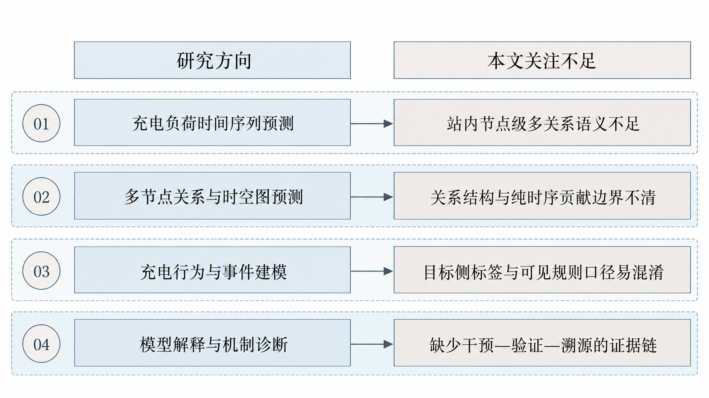

**图1-1 研究方向与本文关注不足的对应关系**  从时间序列预测、多节点关系建模、行为事件建模和机制解释四个方向，归纳本文所关注的站内节点关系语义、结构贡献边界、双事件口径和诊断证据链问题。

本文把定位限定为测量问题：不提出新的图算子，而在同一任务与口径下测量站内关系的条件性价值。

## 1.3 研究目标、主要内容与创新点

1.2.5节的三条空白是同一测量问题的三个侧面：站内关系是否带来可归因的整体误差增量、该增量能否逐类归到具体统计关系、以及结论在何种代理目标与可靠性条件下成立。本节按研究目标、研究内容与创新点的顺序给出回答。

### 1.3.1 研究目标

本文的目标是在公开会话记录重构的站内节点代理负荷任务上，对站内三类统计关系的预测价值作一次可复核的测量。该目标分解为三项。

（1）表示与检验。说明负荷耦合、行为共现、轮廓相似三类关系如何编码为关系图，并在同一任务与口径下检验关系图是否带来可归因的整体误差增量。

（2）分层测量。把整体误差按评价层、标签口径与参数配置分别测量，使“哪个配置更好”的回答可归到具体样本与具体参数，而不依赖“模型整体更强”这一前提。

（3）边界界定。说明上述结论在何种代理目标、数据来源与区间可靠性条件下成立，并把可直接使用的做法与不可外推的部分分开。

三项子目标分别由第3章、第4章与第5章承担：第3章回答增量是否可归因，第4章回答误差由谁构成，第5章回答结论在什么条件下成立。

### 1.3.2 主要研究内容

研究内容对应四部分。

（1）数据与协议：解析会话字段与节点标识，重构15 min代理电量，界定输入可见时点、标签成熟条件和时间切分，分析序列稀疏性与节点异质性，并说明代理目标的构造偏差。

（2）关系增量：构建三类LRE关系图并由MRG-GCN编码；比较节点级与共享门控、JPL自环替换重训、完成时刻截断目标重训及两种代理标签下冻结预测的排序，并在同源第三场站作小规模复核，区分模型表现、组件增量与目标敏感性。

（3）误差诊断：以L1参数替换敏感度、L2受检学生替代性和L3交叉分组误差构成三层证据，区分联合配置依赖、特定替代尝试与误差构成；明确L1受消息尺度影响、L2在结构上不能回答图结构必要性。

（4）可靠性与使用条件：筛查方向性候选，评价独立及滚动区间校准，并以固定预测轨迹和合成约束例说明运行接口。结果限于代理目标、已查看时期和现有计量材料。

四项内容各有对应证据：关系编码与门控检验“站内关系是否带来条件性增量”（JPL自环替换12次配对与同参数门控配对）；交叉分组分解检验“整体误差由哪些样本构成”；代理标签与可靠性分析界定“结论在什么条件下成立”。三者分别回答表示、增量与边界三个问题，共同支撑一个测量结论，而不是一个“全面更强模型”的主张。

### 1.3.3 本文创新点

针对零膨胀节点负荷下整体MAE被零值键主导、且行为特征无法替代历史负荷的问题，本文提出残差化多关系门控图卷积模型：以`load_lag1`为基准、模型预测残差，并以三类关系图编码跨节点信息；在Caltech事件时刻协议上（三种子，2024–2026）整体MAE为0.015704，零值层误差为0.00559，较无图TCN低48.9%，较persistence基线低1.2%。

针对整体误差无法归因到关系类别与样本层级的问题，本文提出分层评价协议（MDP）：以L1参数替换敏感度、L2受检学生替代性与L3交叉分组误差构成三层证据，把关系增量按评价层、标签口径与参数配置分别测量；回溯协议中1.39%的预测键贡献28.10%的绝对误差，交叉分组加权还原差小于$10^{-9}$。

针对关系图增益默认成立、缺少可归因测量的问题，本文提出关系增量的条件性测量方法：以同参数自环替换重训与同参数门控配对逐条剥离关系增量，得到负荷耦合1.82%、轮廓相似1.52%的整体MAE增量，行为共现为0.15%且区间跨零，因而不计为增量。

三项创新点的共同点是把“模型是否更强”改写为“增量能否归因”：按1.2.2节近邻研究已核实的范围，未见在同一任务、同一协议下对站内三类统计关系作相对自环的受控剥离；本文在该任务中实施三类关系的同参数自环替换重训，并报告带校正区间的条件性增量。目标、内容与创新点的对应关系见1.4节图1-3，技术路线见图1-2。

## 1.4 技术路线

图1-2概括本文主线与补充验证。

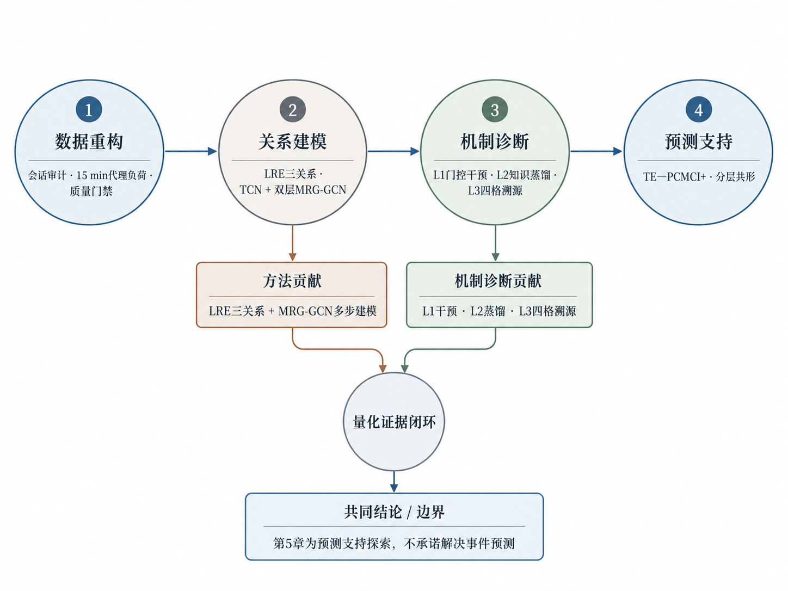

**图1-2 本文总体技术路线与证据主线**  Caltech主线完成代理序列重构、LRE构图、MRG-GCN预测与MDP诊断，JPL重新筛选节点、构图并训练。关系替换、目标敏感性、代理标签排序敏感性与JPL冻结模型复核分别见3.7.2、3.8.4、3.8.5和4.6节。

**图1-3 研究问题与贡献对应关系**  研究对象向下分解为三个研究问题，分别对应关系增量的受控检验、误差构成的交叉分组分解和结论条件的可靠性分析；底部给出证据边界与贡献定位。

1.3.2节的四部分按数据构建（15 min代理负荷重构）、关系增量、误差诊断与可靠性评价的顺序串行推进。文献方法用于定位，未作为本文重跑实验。

## 1.5 论文组织结构

第1章提出研究问题与贡献边界；第2章说明数据、重构和协议；第3章报告模型比较、组件增量与目标敏感性；第4章分析MDP诊断；第5章讨论方向候选、区间可靠性和运行条件；结论归纳证据及限制。事件残差修正与预警比较为已终止探索，不列为贡献。

## 1.6 本章小结

本章将研究问题限定为站内关系增量、完整模型分层表现及诊断结论权限，并在1.3节给出与之一一对应的三项创新点及其证据形式。

# 第2章  充电行为数据与特征分析

本章回答两个问题：充电会话记录如何转化为可建模的节点序列，以及该序列的统计特征如何约束模型与评价。文中先说明数据来源与重构口径，再分析稀疏性、节点异质性与事件窗口，并据此确定建模与评价要求。

## 2.1 数据来源与重构口径

本文采用Caltech公开的ACN-Data单站公开数据（`siteID=2`），含31,424条会话、11个字段，记录接入、断开、充电完成时间和总电量[88]。接入时间范围为2018年4月25日至2021年9月14日，最晚断开时间为2021年9月14日3:05:10；接入、断开时间均可解析，完成时间可解析29,369条。该快照不含连续电流量测，但ACN接口另提供时序数据；完成时间缺失不影响式（2-1）的主目标重构。

原始数据只给出会话总交付电量，不包含可直接用于节点级短期预测的连续功率序列。本文以15 min为固定时间间隔，将每条会话的总交付电量均匀分配至该会话从接入时刻到断开时刻所覆盖的全部时间片。设第\(s\)条会话的总交付电量为\(E_s\)，所属节点为\(i_s\)，覆盖的15 min时间片集合为\(\mathcal{B}_s\)，则节点\(i\)在时间片\(t\)上的节点代理负荷定义为

\[
y_{t,i}=\sum_{s:i_s=i,\,t\in\mathcal{B}_s}\frac{E_s}{|\mathcal{B}_s|}.
\tag{2-1}
\]

式中，\(|\mathcal{B}_s|\)为会话覆盖片数；同一节点片内多条会话的分摊量求和。所得网格覆盖2018年4月25日11:00至2021年9月14日3:15，共118,818个连续15 min时间步。\(y_{t,i}\)称节点代理负荷，单位kWh/15 min；它是分摊电量，不是瞬时或电表实测功率。

10个主节点11,085条会话的代理总量与92,650.017 kWh交付总量守恒，逐节点差小于$10^{-8}$ kWh；这不证明时间分配真实。均匀分摊可能延伸至充电完成后的停留时段并平滑会话内变化，2.1.2节以完成时刻、电流样本和设备上报序列核查。

`siteID=2`场站含55个候选节点；`stationID`、`EVSEID`和`spaceID`各有55个唯一值，前两者逐行一致，并与`spaceID`一一对应。因此本文以`spaceID`（如CA-303）标记节点，不将`stationID`误作场站数或将节点解释为配电母线。图边表示统计联系，不表示电气拓扑。

如图2-1所示，原始会话记录依次转换为模型输入张量；回溯协议中占用率分母与负荷跳变阈值等统计量取自全时期。因此，不能把后续训练期标准化概括为全部预处理与测试时期隔离。

**图2-1 数据重构与数据划分流程**  原始数据含31,424条会话，10个主分析节点对应11,085条会话，均匀分配至覆盖的15 min时间片形成节点代理负荷。节点筛选、z-score参数与冻结阈值由训练期或验证期确定；本图不表示在线电表功率测量。

### 2.1.1 三套评估协议的任务边界

三套协议均以左端时间戳标记15 min片，使用96片历史预测随后4片。最后输入片结束时刻为发布时刻，四个目标片起点为发布时刻及其后15、30、45 min。行为计数按片末可见构造，但数据记录未包含实际上报时间，延迟和丢失率未知；标签也可能在会话结束后才成熟。

Caltech回溯协议用会话最终字段重构历史负荷，故早于发布时刻的时间戳不保证片值当时可见；其0.01376 MAE仅描述该事后回溯任务。事件时刻协议移除旧负荷及派生通道，目标仍是事后代理标签。两协议的输入、切分和测试键不同，不直接合并比较。

事件时刻协议保留原10个节点并对训练、调参、校准和测试窗口留段。旧回溯切分存在少量目标窗或历史窗跨段，不满足完整留窗约定；过去历史进入前段本身不等同未来泄漏。JPL采用独立节点筛选和四段留窗。协议范围汇总于表3-1。

### 2.1.2 分摊支持范围与历史设备记录核查

10节点11,085条会话中，10,399条完成时刻位于接入与断开之间，420条缺失，266条顺序异常；合法记录完成至断开的停留时间中位数为62.67 min。6,967条会话在完成后仍含完整15 min片，均摊规则向其分配28,403.239 kWh，占总电量30.66%。

该比例只表示分摊延伸至记录完成时刻之后的范围；会话重叠使其不能说明节点片内无充电。

仅当`connectionTime <= doneChargingTime <= disconnectTime`时，才以充电完成时刻替代断开时刻作为分摊终点；完成时刻缺失或不满足该区间条件时，回退至`disconnectTime`。替代重构与原重构的总电量均为92,650.017 kWh，最大逐节点守恒差为$4.91\times10^{-10}$ kWh，但对应节点时间片的平均绝对差为0.0477816 kWh/15 min。该值只表示同一批会话在两种标签分配规则下的逐节点时间片平均绝对差，不是模型误差、真实负荷不确定度上限，也不与模型MAE作大小比较。

目标敏感性实验随后在Caltech事件时刻协议的固定测试键上使用这一替代目标重新训练预测模型；预测输入、原图、切分和起点键保持不变，仅依替代目标的新训练前缀重算目标标准化参数。该敏感性结果见3.8.4节。

完成时刻仍不是连续功率测量，替代标签不等于真实负荷。

ACN公开静态快照[88,89]另提供有限设备时序。主10节点各抽取一个2018年5月会话，8条电流记录通过质量校验，仅为已查看的便利样本。CA-303在2020年11月匹配到11次设备上报累计电量序列，共277个共同完整片；节点、月份选择前已查看一条先导会话，故属探索性历史核验而非未见期验证。累计量经线性插值至完整片边界后差分，与两种分摊代理比较；原始高频文件不入库。

对通过校验的8条记录，按15 min片积分电流，再除以会话总积分，得到无量纲片份额。总变差距离为0.0645～0.5957，最大片份额为均匀份额的1.10～4.38倍，说明均摊会压低部分会话的时间集中程度。

8条电流样本没有电压与功率字段，不能换算kWh或估计功率峰值。CA-303虽含设备上报功率和累计电量，但设备型号、固件、计量算法、校准和完整导出程序未确认，不能作为独立电表真值。现有核查只说明代理保留会话总量而近似其时间分配；现有数据也不能确定事件接收延迟。

EPFL Level-3两CCS端口仅作外部形态参照[90]：1,878条会话按端口和首末时间匹配，1,620条满足连续分钟覆盖等质量要求且时长不少于15 min。按接入时刻分片并归一化后，功率积分形态与等时长分配的总变差中位数为0.0736（四分位数0.0308、0.1276）。但积分与会话电量之比中位数为1.1492，累计量首末差比为0.9943，计量边界未明；该外部数据不能校准ACN标签或评价模型精度。

### 2.1.3 JPL另一场站数据与验证口径

JPL协议依据ACN官方普通会话数据独立建张量[88]：33,638条会话、52个`stationID`/`spaceID`一一映射，接入时间至2021年9月14日。按训练边界前已成熟会话筛选10个节点，覆盖11,041条会话。106,096片UTC网格按70%/7.5%/7.5%/15%分为训练、调参、校准和测试；合法原点分别为74,168、7,826、7,828和15,816，96片历史及4片目标均完整留段。

目标仍是接入至断开均摊代理，零值只表示无已记录会话贡献。完成时间缺失2,037条、区间外3,211条；标签成熟时刻取断开与非空完成时间的较晚者。2020年9—10月无记录，仍保留时间网格。两站标识无交集但同属ACN、时期重叠，故JPL检验的是另一场站重新筛选、构图和训练，不是零样本迁移、未来期或实测功率验证。

JPL验证流程汇总见图2-11，点预测比较结果见3.6.3节。

### 2.1.4 代理目标的定义与偏差方向

本文的预测目标是按会话总电量在接入—断开区间内均匀分摊得到的15 min节点代理电量，不是电表计量功率。这一定义有三个直接后果。其一，完成充电后车辆仍可能占用车位，均摊会把电量记在完成之后（见2.1.2节）。其二，偏差方向可判：代理目标把本应集中的功率拉平，使高峰被压低、尾部被抬高；按完成时刻截断的对照在CA-303单节点11次会话、277个共同完整片上给出更低的MAE，但样本只覆盖一个节点和一台设备，计量算法与校准未核实，不能作为计量校准。该偏差（均摊与设备电量的MAE为0.3133 kWh/15 min，截断标签为0.0535）比本文讨论的模型间差异（0.0012—0.0076 kWh/15 min）大1—2个数量级；因此在代理目标上只能比较模型间的相对差异，不能据此判断真实功率下的可辨识性。其三，所有结论只在该构造下成立：第3—5章的模型比较、关系增量与误差分解都以代理电量为对象，换成计量功率需要重建标签并重新验证。

## 2.2 节点纳入条件与数据完整性校验

55个候选节点的记录密度差异较大。筛选门槛在训练前固定，只用训练和验证数据；测试集仅用于描述可评价性。

数据按时间顺序划分为训练集、验证集和测试集，预测原点数量分别为83,103、17,807和17,809（回溯协议），占比约为70%、15%和15%。原点索引所对应的最后输入片左端时间戳范围依次为2018年4月26日10:45至2020年9月8日2:15、2020年9月8日2:30至2021年3月12日14:00，以及2021年3月12日14:15至2021年9月14日2:15；按2.1.1节定义，实际发布时刻为这些时间戳各加15 min。三部分时间连续、互斥且顺序固定；按日历月份计，训练、验证和测试阶段分别涉及30、7和7个自然月。

表2-1列出活跃度、时间覆盖和负荷稳定性六项条件。主分析保留10个节点；较宽松门槛形成15节点候选集合，但尚未重训，不能据此声称节点范围稳健。节点减少主要由验证期接入次数和活跃月份门槛造成。

**表2-1 节点筛选门槛及主分析条件下的未通过数量**

| 筛选条件 | 主分析门槛 | 敏感性门槛 | 主分析条件下未通过节点数 |
|---|---:|---:|---:|
| 训练期接入事件数 | ≥100次 | ≥40次 | 7 |
| 验证期接入事件数 | ≥10次 | ≥5次 | 44 |
| 训练期非零负荷时间片数 | ≥200片 | ≥80片 | 2 |
| 训练期活跃月份比例 | ≥0.50 | ≥0.25 | 7 |
| 验证期活跃月份比例 | ≥0.50 | ≥0.25 | 42 |
| 训练期月度能量变异系数 | ≤2.5 | ≤3.5 | 2 |

联合筛选后10个节点均可在测试期评价；15节点候选中14个可评价。图2-2按三级筛选展示各档节点数：−40为未同时满足敏感性档六项条件，−5为仅达敏感性档、未达主分析档；主分析集合是敏感性集合的子集。

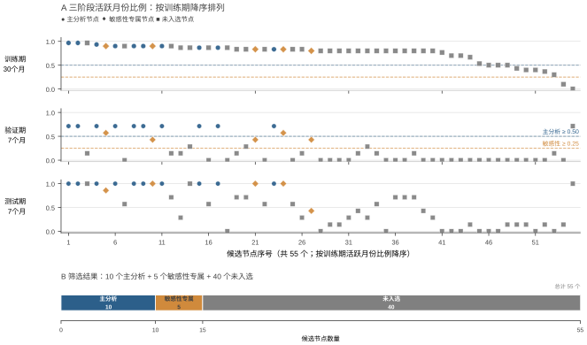

**图2-2 候选节点筛选漏斗**  55个候选节点经两档六项门槛收敛为15个（27.3%，满足敏感性档）与10个（18.2%，纳入主分析），条间标注逐级剔除量与原因。筛选仅用训练期与验证期统计量冻结，测试期不参与；此为全量描述性统计，不含误差棒。

时间片数、时间间隔、标识映射、张量维度、分段边界和节点顺序等9项数据完整性校验均通过；统计筛选不代表物理设施清单完整。

## 2.3 节点负荷统计特征

主分析含10个节点。全量代理负荷均值、标准差和最大值分别为0.0780、0.2186和2.9671 kWh/15 min；非零样本占21.59%，而测试预测键的零目标约占87.25%。因此，序列兼具零值集中与非零部分长尾。

连续四周的节点负荷热力图如图2-3所示。稀疏负荷片段主要随日内时段成组出现，不同节点的持续模式并不一致。图2-5(a)进一步展示三个代表性节点的自相关函数，在96片和672片滞后位置附近均出现局部峰值，分别对应24 h和168 h周期。(b)为2018年5月25日至31日（当地时区）连续672个15 min样本（未重采样）的日内剖面，灰细线为7个单日剖面、蓝粗线为7日平均，右上角标注7日日均电量。由于存在大量并列零值，上述图形用于描述周期性线索，不据此作平稳性或因果判断。

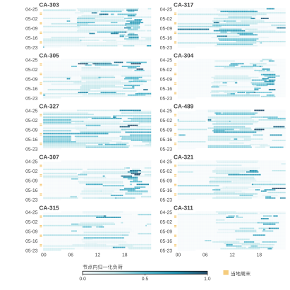

**图2-3 连续四周节点负荷热力图**  颜色为各节点相对自身最大负荷的归一化值，节点按同期累计负荷降序排列，右侧条带为累计负荷相对规模，周末底纹按当地日历对齐。不含误差棒，节点排序不表示物理拓扑。

CA-303 节点 2021 年 6 月的连续 30 天原始负荷曲线见图2-4，用于直观说明强零膨胀与事件驱动形态。

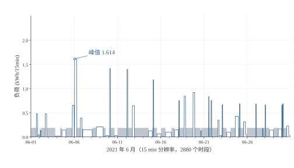

**图2-4 CA-303 节点 2021 年 6 月 30 天负荷曲线**  横轴为 15 min 时段，灰色带为零负荷时段（占该月 62.3%）。2,880 个时段非零率 37.7%，峰值 1.614 kWh/15 min。

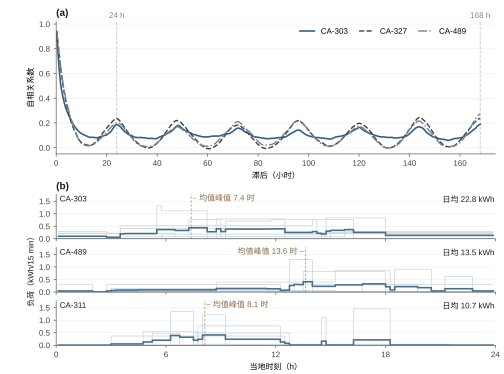

**图2-5 节点代理负荷的时序特性**  (a) 三个代表性节点的样本自相关，虚线标示96片与672片滞后，两个周期位置均为正相关（0.19～0.27）；(b) 三节点连续7日的日内剖面，灰细线为单日、蓝粗线为7日平均。两面板仅描述所选时段的自相关与日内节律，不含误差棒。

表2-2显示节点差异明显：CA-303均值和非零率较高，CA-321均值最低，CA-311非零率最低；非零率相差逾2倍，均值约相差2.35倍，峰均比为22.4—44.4。故模型和误差评价保留节点维度。

**表2-2 主分析节点代理负荷统计**

| 节点 | 均值/(kWh/15 min) | 非零率/% | 最大值/(kWh/15 min) | 标准差/(kWh/15 min) | 峰均比 |
|---|---:|---:|---:|---:|---:|
| CA-303 | 0.1323 | 31.45 | 2.967 | 0.2885 | 22.4 |
| CA-304 | 0.0650 | 15.84 | 2.747 | 0.2188 | 42.2 |
| CA-305 | 0.1078 | 27.40 | 2.849 | 0.2585 | 26.4 |
| CA-307 | 0.0798 | 19.09 | 2.663 | 0.2332 | 33.4 |
| CA-311 | 0.0614 | 14.62 | 2.725 | 0.2059 | 44.4 |
| CA-315 | 0.0684 | 21.27 | 2.803 | 0.1968 | 41.0 |
| CA-317 | 0.0724 | 21.33 | 2.241 | 0.2071 | 30.9 |
| CA-321 | 0.0562 | 17.89 | 1.983 | 0.1662 | 35.3 |
| CA-327 | 0.0735 | 27.46 | 1.761 | 0.1856 | 24.0 |
| CA-489 | 0.0629 | 19.54 | 2.350 | 0.1852 | 37.3 |

三个代表性节点在96片与672片滞后处的自相关系数为0.187至0.273，只说明存在可利用的日、周统计依赖。

三个代表性节点的日内起伏和工作日—周末差异见图2-5(b)，非零节点代理负荷的经验分布见图2-6。两图与表2-2共同说明：多数时间片没有充电活动，但发生充电时的幅度和持续模式具有较大差异。

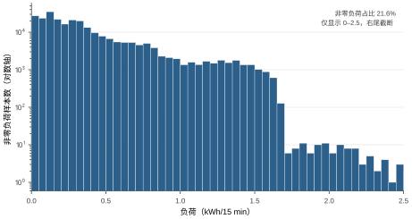

**图2-6 非零节点代理负荷经验分布**  统计对象为10个主分析节点全时段的非零节点代理负荷，横轴单位为kWh/15 min，纵轴采用对数刻度以展示低频右尾。图中为完整样本的经验频数，不含误差棒；横轴显示范围用于突出主要分布区域，不改变表2-2中的全量最大值统计。

## 2.4 事件分数构成与事件窗口统计

为描述会话接入、离站、活跃状态突变和负荷突变共同形成的短时行为变化，本文构造节点级规则事件分数。设节点\(i\)在时间片\(t\)的新接入数、离站数、活跃会话数和节点代理负荷分别为\(a_{t,i}\)、\(d_{t,i}\)、\(c_{t,i}\)和\(y_{t,i}\)，相应分量的训练期标准差为\(\sigma_{a,i}\)、\(\sigma_{d,i}\)、\(\sigma_{\Delta c,i}\)和\(\sigma_{\Delta y,i}\)，则事件分数定义为

\[
q_{t,i}=\frac{a_{t,i}}{\max(\sigma_{a,i},\varepsilon)}+
\frac{d_{t,i}}{\max(\sigma_{d,i},\varepsilon)}+
\frac{|c_{t,i}-c_{t-1,i}|}{\max(\sigma_{\Delta c,i},\varepsilon)}+
\frac{|y_{t,i}-y_{t-1,i}|}{\max(\sigma_{\Delta y,i},\varepsilon)},
\tag{2-2}
\]

式中，\(\varepsilon\)为防止分母为零的极小常数。四个标准差均按节点在训练集上计算，使不同活跃度节点和不同量纲的行为分量能够在同一规则中比较。对于每个节点，在验证集非零事件分数上取95%分位数作为阈值；超过阈值的时间片记为规则触发点，并只向未来扩展2个时间片。阈值和扩展规则一经确定便保持不变，测试集不参与阈值估计，相邻或重叠的触发窗口合并为连续窗口。该规则属于含事后代理负荷差分的回溯诊断，不解释为发布时刻可用的在线触发。完整生成流程见图2-7。

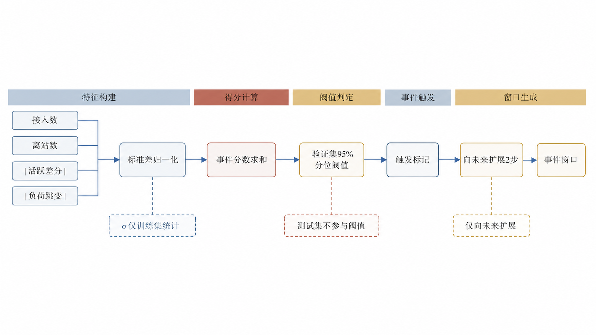

**图2-7 事件分数与冻结规则事件窗口生成流程**  接入、离站、活跃变化和负荷变化四个分量经逐节点标准差归一化后求和，采用验证集95%分位阈值触发，并仅向未来扩展2个时间片。标准差来自训练集，测试集不参与阈值估计。

标签事件时间步的日内分布见图2-8，事件并非在一天内均匀出现。

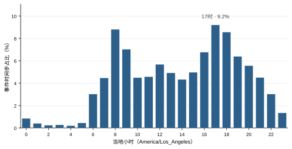

**图2-8 标签事件时间步的日内分布**  118,818个时间步中具有目标侧事件标签的时间步按当地小时汇总，柱高为各小时占全部事件时间步的比例。该图不区分事件类型，柱高不是分类准确率或条件事件概率，且不含误差棒。

事件统计区分两种口径：`target_event`按四个目标片的接入、离站或负荷跳变标签构造，形状为\([S,H,N]\)，仅作事后评价；`rule_trigger`按预测原点的旧冻结规则生成，形状为\([S,N]\)，诊断时广播至四片。测试键中标签事件10,160个（1.426%），规则触发3,060个（0.430%）。后者不代表发布时可用信号；两者虽以相同广播键为分母，定义和时点不同（图2-9）。

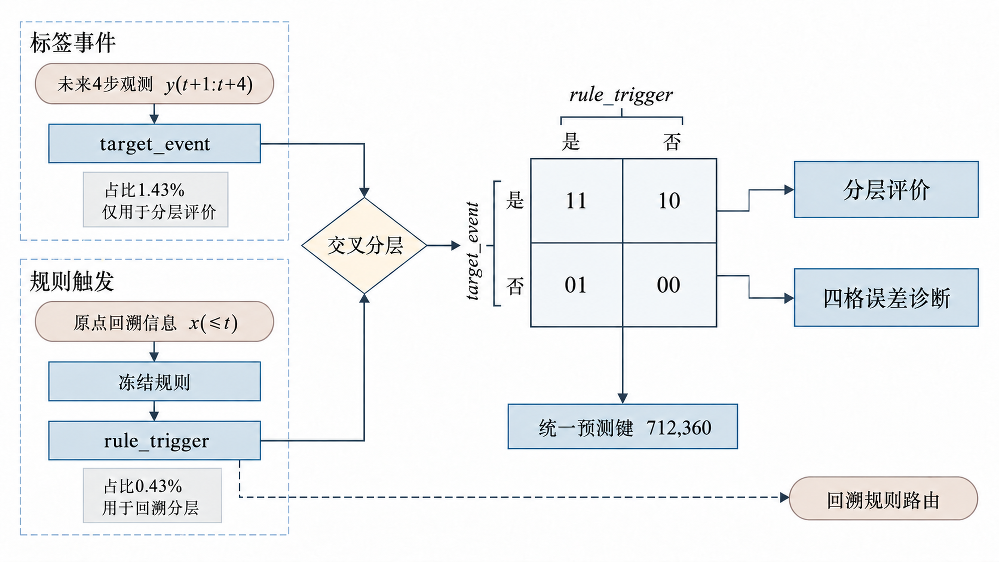

**图2-9 标签事件与冻结规则触发的双口径对比**  `target_event`用于事后评价，旧`rule_trigger`用于回溯分层与规则路由，标签事件不进入规则路由。两者事件占比1.43%与0.43%，均以712,360个测试预测键为分母；旧规则含事后负荷差分，不能解释为实时识别效果。

逐节点冻结阈值介于18.9与32.5之间，验证集触发点占比0.011%—0.056%，前向窗口占比恒为其3倍（0.034%—0.168%，四舍五入），逐节点明细见附录表A-1。测试期规则形成254个连续窗口，其中253个长3片，1个由相邻触发合并为6片。

规则在训练、验证和测试三个数据段内分别执行，因此每段最前面的两个预测起点不会继承上一数据段的触发状态。该处理避免跨划分传递信息，最多影响测试评价键中的80个位置，占712,360个测试预测键的约0.011%，属于保守的边界处理。

## 2.5 特征构成与协议输入

表2-3给出Caltech回溯协议的七项输入：节点代理负荷、新接入会话数、离站会话数、活跃会话数、占用率、需求强度和负荷突变标志。需求强度在当前处理中与节点代理负荷取值一致，活跃会话数与占用率之间也存在确定的比例联系，故这些变量是状态的相关表征，不应被视为相互独立的信息源。

**表2-3 Caltech回溯协议输入特征的全量描述性统计**

| 特征 | 含义 | 非零率/% | 均值 | 最大值 |
|---|---|---:|---:|---:|
| `load` | 节点代理负荷 | 21.589 | 0.0780 | 2.9671 |
| `access_count` | 新接入会话数 | 0.933 | 0.0093 | 2 |
| `departure_count` | 离站会话数 | 0.933 | 0.0093 | 2 |
| `active_count` | 活跃会话数 | 21.589 | 0.2164 | 2 |
| `occupancy_rate` | 占用率 | 21.589 | 0.1082 | 1 |
| `demand_intensity` | 需求强度 | 21.589 | 0.0780 | 2.9671 |
| `load_jump_flag` | 负荷突变标志 | 0.135 | 0.0014 | 1 |

7项特征在全部时间步和节点上展平后的Spearman秩相关系数见图2-10(a)。节点代理负荷、活跃会话数、占用率和需求强度之间相关程度较高。这一结果说明输入同时包含状态表征冗余和低频行为信号，后续需要通过模型对比和消融而非仅凭相关矩阵判断各特征的预测作用。

**图2-10 输入特征结构与周期特征**  (a) 7维输入特征的Spearman秩相关矩阵，由118,818个时间步与10个节点展平计算；(b) 10个节点按星期与小时的平均代理负荷。两面板为全量描述性统计，大量并列零值使系数不可解释为独立贡献，颜色也不表示事件概率。

按星期和小时聚合10个节点代理负荷所得结果见图2-10(b)。后续模型据此选取连续96片、即完整24 h的历史信息作为基本输入窗口，并通过图结构补充同一时段节点之间的统计联系。

回溯输入为\(96\times10\times7\)，输出\(4\times10\)，归一化仅用训练集拟合。事件时刻协议虽同为7通道，但只含接入、离站、活跃计数和当地日历正余弦，不含旧代理负荷及派生特征；二者不可因形状相同而互换输入、冻结模型或结果。

三套协议的输入可见性并不相同，各按自身协议提供历史输入，不表示共用同一通道（逐项汇总见附录表A-2）。回溯协议的节点代理负荷历史为纯历史片、不含目标片，事件时刻与JPL协议不使用该通道；当地日历为确定性构造；接入、离站与活跃计数按协议假设在片末可见，实际到达延迟未核（2.1.3节）。回溯协议的占用率分母含全时期活跃节点数，需求强度与负荷突变阈值取全时期90%分位，因而该协议的若干统计量跨越了测试期，仅用于历史配置复核，不用于事件时刻主比较；事件标签与规则触发为事后构造，仅用于评价，不作输入。

## 2.6 数据特征对建模的启示

稀疏与长尾要求并列报告总体、事件、稳定及非零误差；节点异质性为构图提供动机，但关系增量须由对照检验；标签事件与规则触发错位，需分别评价。JPL协议据此固定输入、训练期筛选与建图、调参选模和共同测试键（图2-11）：96片历史窗与4片目标窗完整留段，四种模型各跑三个种子，以调参集原单位MAE选冻结模型，锁定后每次运行只导出一次测试预测，整体MAE另按24个七日块作配对比较。

**图2-11 JPL固定协议重新拟合验证流程**  输入为接入、离站、活跃计数与当地日历编码，目标为会话电量在接入至断开区间均匀分摊的代理电量。各模型按时间分段训练与校准后冻结，各导出一次测试预测，在632,640个共同预测键上评价。行为计数假定片末可见，实际到达延迟未核实。

## 2.7 本章小结

本章界定会话代理目标、输入可见性和节点筛选。主序列稀疏且节点异质；标签事件与冻结规则触发分别占测试键1.43%和0.43%，用于不同分析。完成时刻截断敏感性见3.8.4节；JPL独立筛选、划分和拟合，不与Caltech预测键合并。

# 第3章  基于多关系门控图卷积的节点短期负荷预测

## 3.1 引言

本章针对第2章所示的稀疏性、周期依赖和节点异质性，构建负荷—行为—轮廓关系编码（load–event–pattern relation encoding，LRE）及多关系门控图卷积网络（multi-relational gated graph convolutional network，MRG-GCN）。模型以TCN编码历史，经关系级权重和节点级门控进行两层图传播，再融合不同深度表示，预测未来1 h节点代理负荷。

本章依次定义任务与模型，报告Caltech事件时刻和JPL重拟合主比较，再呈现回溯、组件及目标敏感性补充。完成时刻截断实验固定Caltech测试键。总体架构见图3-1，传播单元、时间编码与跨层融合分别见图3-2和图3-3。

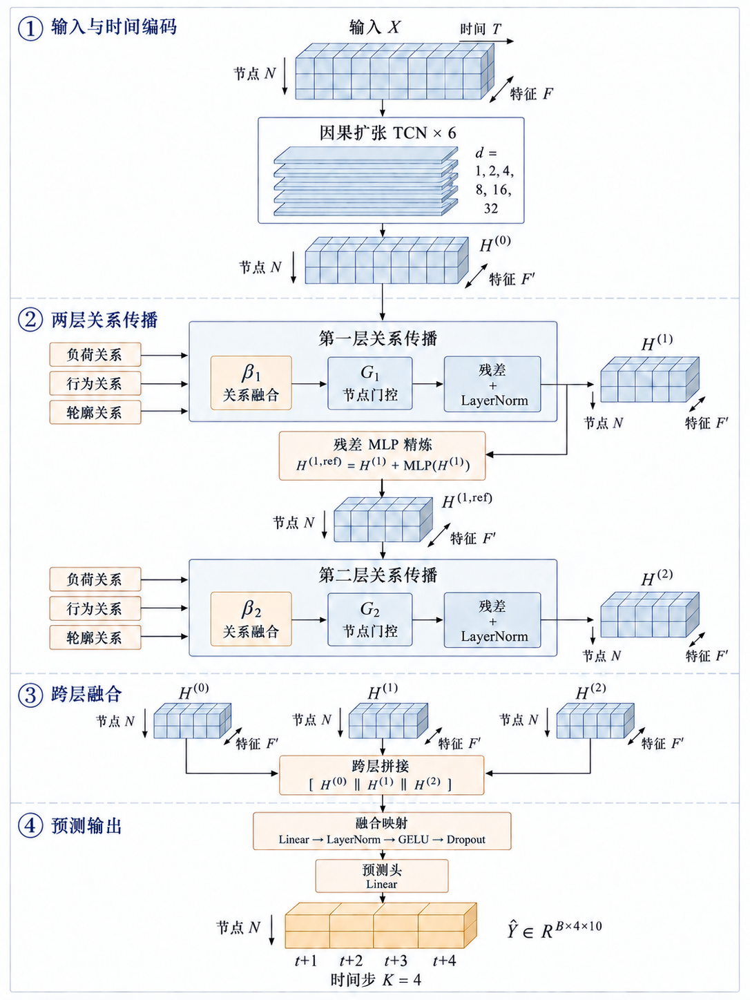

**图3-1 MRG-GCN整体架构**  历史输入依次经过因果扩张TCN、两层多关系传播与残差MLP精炼，原始三层状态经跨层拼接与线性预测头输出未来4个连续15 min目标片。三类固定关系仅由训练集构建；隐藏状态均为[B,N,32]。

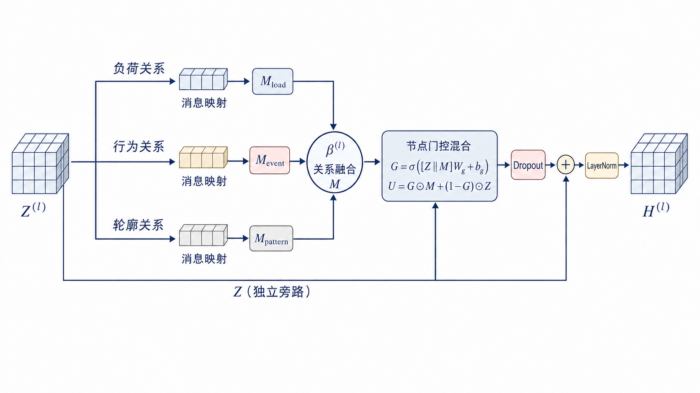

**图3-2 多关系门控传播单元**  三类关系消息经关系级权重融合后，由节点级门控与该层实际输入混合，并通过残差连接与层归一化形成层输出。两层传播单元结构相同、参数独立；第二层实际输入为精炼表示$H^{(1,\mathrm{ref})}$。

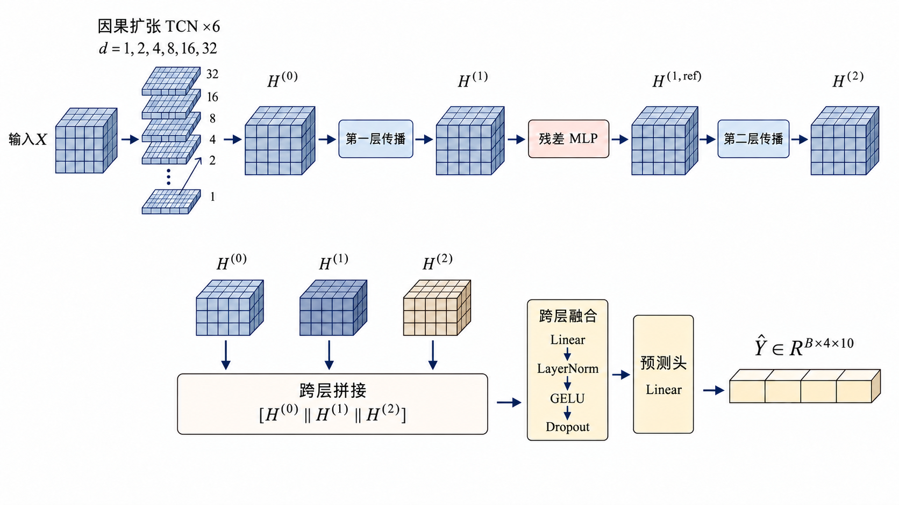

**图3-3 时间编码与跨层融合预测结构**  上部展示时间编码与两层传播，下部以同名状态重复展示拼接输入，不表示新增模型分支。跨层融合使用原始$H^{(0)}$、$H^{(1)}$和$H^{(2)}$，经融合映射与线性预测头得到4个连续15 min目标片的输出；目标片起点按2.1.1节定义。

## 3.2 预测任务形式化定义

设主分析节点集合为$\mathcal{V}=\{v_1,\ldots,v_N\}$，其中$N=10$。令$s_k$为末个输入时间片的左端时间戳，时间片宽度$\Delta t=15$ min，发布时刻为$\tau_o=s_k+\Delta t$。预测输入为索引$k-95$至$k$的96片历史特征：

$$
\mathbf{X}_o\in\mathbb{R}^{H\times N\times F},\qquad H=96,\ F=7, \tag{3-1}
$$

预测目标为未来$P=4$个目标片的节点代理负荷：

$$
\widehat{\mathbf{Y}}_o=f_\theta(\mathbf{X}_o,\mathcal{A}),\qquad
\widehat{\mathbf{Y}}_o,\mathbf{Y}_o\in\mathbb{R}^{P\times N},\ P=4, \tag{3-2}
$$

其中，$\mathcal{A}$为训练集构建的关系矩阵集合，$f_\theta$为待学习模型。模型输出$P=4$个连续目标片$\widehat{\mathbf{Y}}_o=(\hat y_{k+1},\ldots,\hat y_{k+4})$，对应真实值$\mathbf{Y}_o=(y_{k+1},\ldots,y_{k+4})$，覆盖$[\tau_o,\tau_o+60\,\mathrm{min})$。输入为发布前完整24 h；四片起点相对发布时刻依次为0、15、30、45 min。评价键由协议、发布时刻、目标片和节点唯一确定，同协议模型按共同键比较。标准化参数仅由训练集估计；`target_event`和`rule_trigger`不作输入。

## 3.3 场景驱动的LRE三关系图构建

LRE从训练期数据中构建负荷耦合、行为共现和轮廓相似三类无向统计关系。测试数据不参与关系估计。构建与稀疏化流程见图3-4。

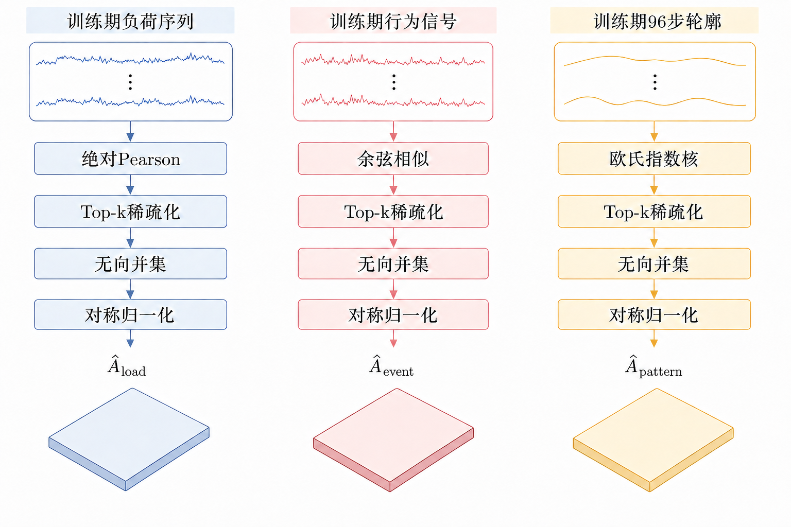

**图3-4 LRE三关系构建流程**  训练期负荷序列、行为信号和96片轮廓分别形成负荷耦合、行为共现和轮廓相似关系，随后经Top-k稀疏化、无向并集和对称归一化得到三类固定邻接矩阵。

### 3.3.1 负荷耦合关系图

设$\mathbf{l}_i\in\mathbb{R}^{T}$为节点$i$的训练期节点代理负荷序列。节点$i$与$j$的负荷耦合强度定义为绝对Pearson相关系数：

$$
A^{\mathrm{load}}_{ij}=\left|
\frac{(\mathbf{l}_i-\bar l_i)^{\mathsf T}(\mathbf{l}_j-\bar l_j)}
{\|\mathbf{l}_i-\bar l_i\|_2\,\|\mathbf{l}_j-\bar l_j\|_2}
\right|. \tag{3-3}
$$

绝对值表示耦合强度，不保留正负方向；任一序列方差为零时，对应权重置零。该关系描述节点负荷在训练期的同步程度，不解释为物理连线或因果联系。

### 3.3.2 行为共现关系图

对节点$i$构造行为序列
$\mathbf{b}_i=\mathbf{x}^{\mathrm{access}}_i+\mathbf{x}^{\mathrm{departure}}_i+|\Delta\mathbf{x}^{\mathrm{active}}_i|$，再以余弦相似度定义行为共现关系：

$$
A^{\mathrm{event}}_{ij}=
\frac{\mathbf{b}_i^{\mathsf T}\mathbf{b}_j}
{\|\mathbf{b}_i\|_2\,\|\mathbf{b}_j\|_2}. \tag{3-4}
$$

分母为零时权重置零。该关系侧重接入、离站与活跃变化在时间上的共同出现，对行为规模差异相对不敏感。

### 3.3.3 轮廓相似关系图

训练序列从数据起点按固定相位切分为96步窗口，对各窗口同一相位位置取均值，得到节点轮廓$\mathbf{p}_i\in\mathbb{R}^{96}$。数据首时刻为11:00，因此这是固定相位的96步窗口轮廓，不是自然日00:00起算的日曲线。记节点轮廓均值为$\bar p_i$，中心化轮廓为$\tilde p_{iq}=p_{iq}-\bar p_i$；以节点对中心化轮廓的均方根距离$d_{ij}$表征形状差异，取所有正距离的中位数$s$为尺度（若无正距离则取1），再以指数核转换为相似度：

$$
\begin{aligned}
\bar p_i&=\frac{1}{96}\sum_{q=1}^{96}p_{iq},\qquad
\tilde p_{iq}=p_{iq}-\bar p_i,\\
d_{ij}&=\sqrt{\frac{1}{96}\sum_{q=1}^{96}\left(\tilde p_{iq}-\tilde p_{jq}\right)^2},\\
A^{\mathrm{pattern}}_{ij}&=\exp\left[-\frac{d_{ij}}{\max(s,10^{-6})}\right],
\end{aligned} \tag{3-5}
$$

式中，$i,j$为节点索引，$u,v$为取中位数时的节点对索引；$q=1,\dots,96$为固定相位序号；$p_{iq}$为节点$i$在第$q$相位的轮廓负荷，上述$p_{iq}$、$\bar p_i$、$\tilde p_{iq}$、$d_{ij}$、$s$及分母下限$10^{-6}$的单位均为kWh/15 min；$A^{\mathrm{pattern}}_{ij}$为无量纲相似权重，取值$(0,1]$。

### 3.3.4 top-k稀疏化与对称归一化

各关系矩阵按行保留权重最大的$k$个非自身邻居，再取$\max(\mathbf A,\mathbf A^{\mathsf T})$形成无向并集。回溯协议冻结$k=3$，事件时刻协议冻结$k=5$；$k=5、7$的其他结果仅为另行登记的稀疏度敏感性，两套Caltech配置不直接比较。加入单位自环后作对称归一化：

$$
\widehat{\mathbf A}_r=\widetilde{\mathbf D}_r^{-1/2}
(\mathbf A_r+\mathbf I)\widetilde{\mathbf D}_r^{-1/2},
\qquad r\in\{\mathrm{load,event,pattern}\}. \tag{3-6}
$$

式中，$\widetilde{\mathbf D}_r$为$\mathbf A_r+\mathbf I$的度矩阵，对角元取该行权重之和。三类关系矩阵见图3-5。它们均为训练期统计关系。

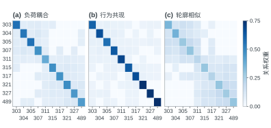

**图3-5 LRE三类站内关系矩阵**  三个面板依次表示负荷耦合、行为共现和轮廓相似关系，并采用统一色阶。矩阵由训练集一次性构建，不含跨种子误差棒。

## 3.4 时间基线：TCN

时间骨干采用TCN[24]。对每个节点独立处理96片历史输入，六层一维卷积的膨胀率依次为$1,2,4,8,16,32$，记卷积核宽度$K_c=3$、层数$L=6$。网络使用因果填充并裁去右侧多余输出，使时刻$t$的表示只依赖$t$及其历史。其感受野为

$$
R=1+(K-1)\sum_{l=0}^{L-1}2^l=1+2(1+2+4+8+16+32)=127, \tag{3-7}
$$

能够覆盖96片历史窗口。每层在通道维执行逐时间步LayerNorm，不跨时间汇总统计量；最终时刻的隐藏状态作为节点初始表示$\mathbf H^{(0)}\in\mathbb{R}^{B\times N\times D}$。主实验取隐藏维$D=32$、dropout为0.1。TCN既作为MRG-GCN的时间编码器，也作为无图基线。

## 3.5 双层多关系门控图卷积网络（MRG-GCN）

### 3.5.1 总体架构

MRG-GCN由时间编码、两层图传播、层间精炼与融合预测组成。TCN输出$\mathbf H^{(0)}$；第一层图卷积得到$\mathbf H^{(1)}$；中间残差MLP生成精炼表示$\mathbf H^{(1,\mathrm{ref})}$，并作为第二层图卷积的输入，得到$\mathbf H^{(2)}$。最后拼接$\mathbf H^{(0)}$、$\mathbf H^{(1)}$和$\mathbf H^{(2)}$，经融合映射预测未来4个目标片的负荷。该结构同时保留纯时序、一阶邻域和二阶传播信息。为统一两层记号，定义$\mathbf Z^{(1)}=\mathbf H^{(0)}$、$\mathbf Z^{(2)}=\mathbf H^{(1,\mathrm{ref})}$，即$\mathbf Z^{(l)}$表示第$l$层传播的实际输入。

### 3.5.2 单关系消息传递

对第$l$层输入$\mathbf Z^{(l)}$，关系$r$的消息为

$$
\mathbf M_r^{(l)}=\widehat{\mathbf A}_r\mathbf Z^{(l)}\mathbf W_r^{(l)}, \tag{3-8}
$$

其中，$\mathbf W_r^{(l)}\in\mathbb{R}^{D\times D}$为关系专属变换矩阵。邻接聚合沿节点维进行，不改变批次维和隐藏维。

### 3.5.3 关系级门控

每层设置独立的未归一化权重参数（logit）$\mathbf a^{(l)}$，经Softmax得到三类关系的全局融合权重：

$$
\beta_r^{(l)}=\frac{\exp(a_r^{(l)})}{\sum_{s=1}^{3}\exp(a_s^{(l)})},\qquad
\mathbf M^{(l)}=\sum_{r=1}^{3}\beta_r^{(l)}\mathbf M_r^{(l)}. \tag{3-9}
$$

$\boldsymbol\beta^{(l)}$在同一层内由全部节点共享，用于表示该层的关系混合偏好。两层参数相互独立，允许不同传播深度采用不同关系组合。

### 3.5.4 节点级门控

关系消息聚合后，模型按样本、节点和特征维计算门值：

$$
\begin{aligned}
\mathbf G^{(l)}&=\sigma\!\left([\mathbf Z^{(l)}\Vert\mathbf M^{(l)}]\mathbf W_g^{(l)}+\mathbf b_g^{(l)}\right),\\
\widetilde{\mathbf H}^{(l)}&=\mathbf G^{(l)}\odot\mathbf M^{(l)}+
(1-\mathbf G^{(l)})\odot\mathbf Z^{(l)}.
\end{aligned} \tag{3-10}
$$

$$
\mathbf H^{(l)}=\operatorname{LayerNorm}\left(\mathbf Z^{(l)}+\operatorname{Dropout}(\widetilde{\mathbf H}^{(l)})\right). \tag{3-11}
$$

关系级$\boldsymbol\beta$与各关系变换共同缩放聚合消息，节点级$\mathbf G$在自身表示和邻域消息间分配门值。$\beta$的数值随关系变换的尺度缩放，不作重要性或因果解释，详见4.2.5节。Caltech回溯协议没有$\mathbf G$的重训练消融；事件时刻协议采用节点级门控，其与同参数共享门控的配对结果见表3-6，回溯协议的五组组合消融见表3-8，其中门控关闭为复合变体，不能单独归因于门变量。

### 3.5.5 关系随机失活

关系随机失活（relation dropout）在训练时按关系类型采样掩码，并对保留关系的$\boldsymbol\beta$重新归一化；若三类关系均被屏蔽，则随机恢复其中一类，以保证消息传播路径非空。该机制只在$p>0$时启用，主模型配置$p=0$，因此不是主结果中的有效正则项；其$p=0.2$和$p=0.4$设置仅用于3.7.2节敏感性检验。

### 3.5.6 逐层关系选择与跨层融合

第一层输出$\mathbf H^{(1)}$经残差MLP精炼后输入第二层，但跨层融合使用原始$\mathbf H^{(1)}$，而非精炼后的$\mathbf H^{(1,\mathrm{ref})}$。最终表示为

$$
\mathbf H^{\mathrm{fuse}}=
\operatorname{Dropout}\!\left(
\operatorname{GELU}\!\left\{
\operatorname{LayerNorm}\!\left[
\mathbf W_f(\mathbf H^{(0)}\Vert\mathbf H^{(1)}\Vert\mathbf H^{(2)})
\right]\right\}\right). \tag{3-12}
$$

预测头将每个节点的融合表示映射为4个目标片。图3-1给出整体数据流，图3-2和图3-3分别展开关系传播单元与跨层融合路径。

### 3.5.7 目标函数与训练策略

训练目标采用标准化空间中的L1损失：

$$
\mathcal L(\theta)=\frac{1}{BPN}\sum_{b=1}^{B}\sum_{p=1}^{P}\sum_{i=1}^{N}
\left|\widehat Y_{bpi}-Y_{bpi}\right|. \tag{3-13}
$$

事件时刻协议及JPL重拟合实验使用标准化L1训练，以调参集原单位MAE选择冻结模型；连续8轮未改善时早停，最多训练60轮。该节实验按冻结时点设计为2024、2025和2026三个随机种子；第3.6节主结果已扩充至2024–2028五种子（见各表标注），口径以表注为准。校准集和测试集不参与选模。回溯协议的历史选模口径另见3.8.3节。

### 3.5.8 节点门控与残差更新的分工

图3-6给出$\boldsymbol\beta$与$\mathbf G$的计算位置。冻结替换只改$\boldsymbol\beta$、关系变换保持原参数，用以检验联合配置的敏感度；节点维门控的增量另见3.7.1节的同参数共享门控对照。

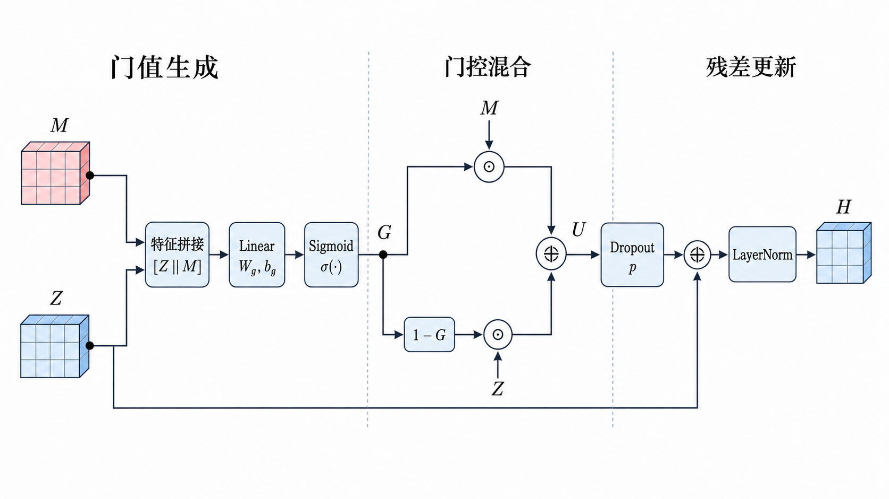

**图3-6 节点门控与残差更新细节**  三类关系消息先形成融合消息$\mathbf M^{(l)}$，再与层输入$\mathbf Z^{(l)}$共同生成节点门值；门控混合后通过残差更新和LayerNorm得到$\mathbf H^{(l)}$。底部身份路径表示输入状态直接参与残差更新，不表示额外的关系边。

### 3.5.9 跨层表示的使用原则

该跨层路径未单独进行重训练消融，不能将整体MAE差异归因于拼接本身。数据流见图3-7。

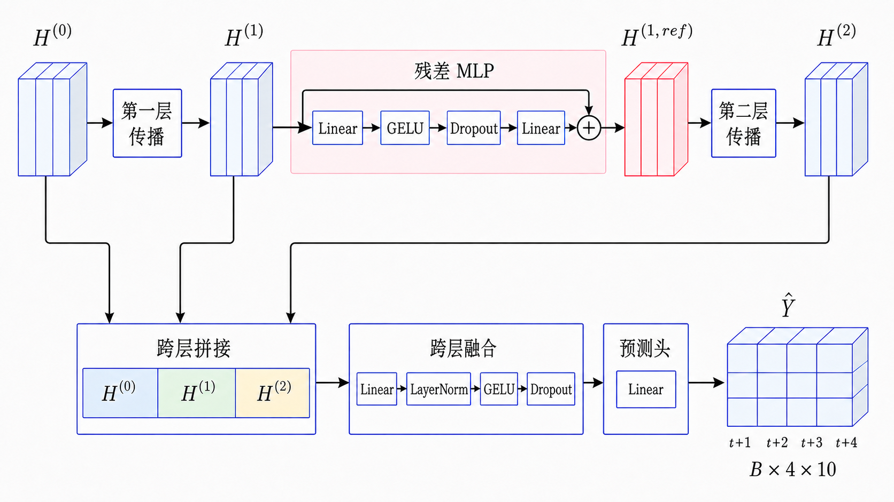

**图3-7 跨层表示路径**  第一层输出$\mathbf H^{(1)}$经残差MLP得到$\mathbf H^{(1,\mathrm{ref})}$后进入第二层传播；跨层拼接仅接收$\mathbf H^{(0)}$、原始$\mathbf H^{(1)}$和$\mathbf H^{(2)}$。图中下方重复的状态块不表示新增模型分支，$\mathbf H^{(1,\mathrm{ref})}$不接入跨层拼接。

## 3.6 主要预测结果与回溯补充

### 3.6.1 评价协议与指标

表3-1列出三套协议及其预测键。Caltech事件时刻与JPL重拟合是主要比较，Caltech回溯结果用于历史配置与MDP诊断；因输入权限、切分和预测键不同，误差仅在协议内比较。

**表3-1 三套协议的任务与评价设置**

| 协议 | 输入与用途 | 主要分析 | 测试预测键 |
|---|---|---|---:|
| Caltech事件时刻 | 行为计数及日历；主要预测比较 | 事件时刻主比较；节点门控与共享门控的配对对照 | 708,560 |
| JPL重新拟合 | 本站行为输入、节点筛选与构图；另一场站比较 | JPL重拟合；关系自环替换的配对对照 | 632,640 |
| Caltech回溯 | 含事后会话代理负荷；历史与诊断补充 | 回溯口径的基线比较与机制诊断 | 712,360 |

注：各协议均用10节点、96片历史预测4个连续15 min目标片，发布与目标起点见2.1.1节。种子是训练重复，预测键是误差单元，时间块描述固定期变化；三者均不是独立场站样本。回溯配置按7∶1.5∶1.5切分；两套行为输入协议另设独立调参、校准段。

完整的训练、预测与分层评价流程见图3-8。主指标为MAE，并辅以RMSE和WAPE：

$$
\operatorname{MAE}=\frac{1}{M}\sum_{m=1}^{M}|\hat y_m-y_m|,\quad
\operatorname{RMSE}=\sqrt{\frac{1}{M}\sum_{m=1}^{M}(\hat y_m-y_m)^2}, \tag{3-14}
$$

$$
\operatorname{WAPE}=\frac{\sum_{m=1}^{M}|\hat y_m-y_m|}{\sum_{m=1}^{M}|y_m|}. \tag{3-15}
$$

MAE和RMSE单位为kWh/15 min，WAPE无量纲。本文不使用MAPE：87.25%的测试键目标为零，MAPE的分母为零而无定义；WAPE以总量为分母，可在零膨胀数据上稳定解释。MAE为主要比较指标；零目标、非零目标及事件MAE用于检验收益分布，RMSE用于检查大误差权衡。事件标签为事后评价标记，分层结果不追认为新的预先设定主终点。

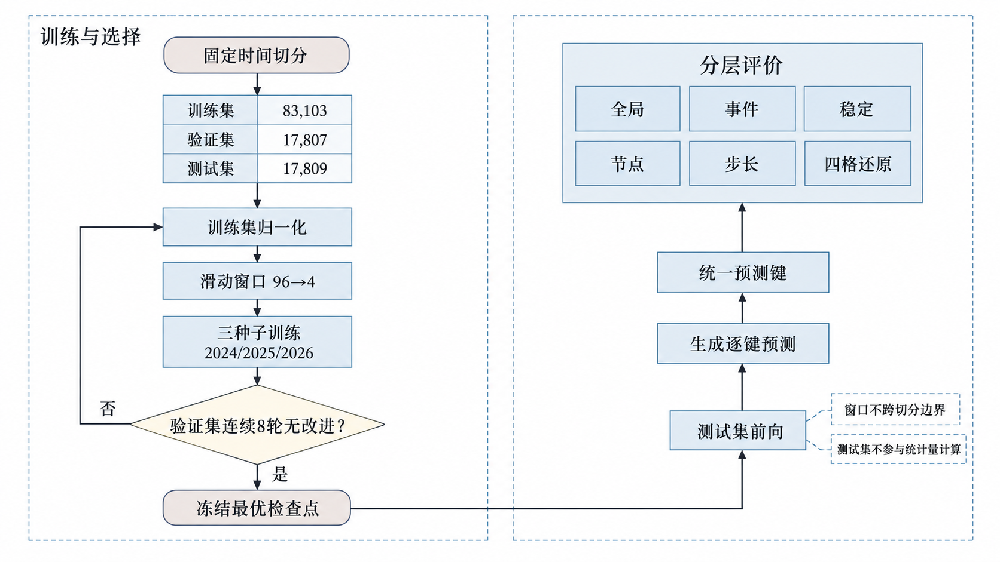

**图3-8 训练—预测—评价流程**  数据按固定时间边界划分后构造96片历史输入与4片目标输出，主结果（八特征残差化配置）为2024–2026三个种子；旧七特征配置的对照为2024–2028五个种子。冻结模型按调参集原单位MAE选取，最多60轮、早停耐心8轮；标准化参数与LRE图由训练集拟合。

### 3.6.2 Caltech事件时刻协议的预测结果

Caltech事件时刻协议以片末可见的接入、离站和活跃计数及当地日历为七通道行为与日历输入，残差化配置另加入上一时刻节点负荷`load_lag1`，构成八通道输入，预测事后会话代理负荷。训练、调参、校准和测试按完整窗口分段：网格共118,818个15 min片，四段分别取[0, 83,198)、[83,198, 92,101)、[92,101, 101,005)与[101,005, 118,818)，对应UTC 2018-04-25 11:00至2020-09-08 02:30、2020-09-08 02:30至2020-12-09 20:15、2020-12-09 20:15至2021-03-12 14:15、2021-03-12 14:15至2021-09-14 03:30。剔除跨段目标与未成熟标签后，四段合法原点分别为83,099、8,803、8,805与17,714个，占比约70.2%、7.4%、7.4%与15.0%；测试段由17,714个原点乘4个目标片、10个节点构成708,560个预测键。调参段比按片计数少1个原点，源于标签成熟条件；回溯协议另用旧三切分的17,809个测试原点，两套协议的键数不可直接相减。该协议不等同于回溯代理输入或实测功率预测。

残差化配置各运行三个种子（2024–2026），表3-2列出其中七个模型，含容量对照、输出头对照与两类朴素基线。容量匹配AGCRN（残差）为事后补充对照，按三种子协议运行、现仅完成seed-2024，列于表3-2并标注；其三种子均值待补，本稿不据此对该基线作完整性结论。主模型参数量为33,902；hidden 32线性头为同一骨干的窄容量对照。参数量不代表训练成本或推理效率。

**表3-2 Caltech事件时刻协议的整体与关键分层误差**

| 模型 | 全局MAE | 零值层MAE | 非零层MAE | 参数量 | 备注 |
|---|---|---:|---:|---:|---|
| MRG-GCN+线性头（本文主模型，hidden 48） | 0.015704 | 0.00559 | 0.08494 | 33,902 | 三种子（2024–2026）均值；八特征含`load_lag1`，预测残差 |
| MRG-GCN+线性头（hidden 32） | 0.016682 | — | — | — | 容量对照；三种子均值 |
| 容量匹配AGCRN（残差） | 0.017489 | — | — | — | 三种子协议；现仅seed-2024完成，其余待补 |
| 残差QMH（QMH头+残差） | 0.027243 | 0.00562 | 0.1167 | 33,902 | 三种子均值；另有五种子口径，两口径不互换 |
| 容量近似TCN（残差） | 0.030709 | — | — | — | 无图对照；三种子均值 |
| Persistence（抄上一步） | 0.015896 | — | — | 0 | 单次确定性计算 |
| 季节朴素（24 h 周期） | 0.078546 | — | — | 0 | 单次确定性计算 |

注：误差单位为kWh/15 min，表内为均值。主模型、hidden 32对照、残差QMH与容量近似TCN（残差）为Caltech事件时刻协议三种子（2024–2026）均值；容量匹配AGCRN按同一三种子协议运行，现仅seed-2024完成、其余种子待补，故该行不作完整性结论；persistence与季节朴素为单次确定性计算、无种子。各行使用708,560个共同测试键，零目标比例87.25%，零值层与非零层依据目标值划分。主模型与残差QMH的零值层MAE为0.000000：残差化后零值键的基准为0、模型未偏离基准。标签事件层不在本表列出。原七特征非残差配置的读数保留于3.6.8节与附录表A-5、A-6、A-7、A-12，仅用于组件诊断，不与本表混用。

七特征非残差配置与八特征残差化配置在同一协议上给出两组不可混用的读数。旧配置下，MRG-GCN的整体MAE为0.03870，较容量近似TCN低16.4%；在其主干上扩展软门控输出头并取λ=2后为0.036326，较MRG-GCN低6.14%，五个配对种子全部同向（单侧Wilcoxon p=0.031；n=5时该检验的最小p即1/32≈0.031，与5/5同向等价）。该配置的输入只有行为计数与日历编码，没有历史负荷，模型只能凭行为与日历重新估计每个键的电量水平，零值键与活跃键共用同一回归容量。

补入上一时刻节点负荷`load_lag1`并改为残差预测后，主模型（MRG-GCN+线性头，hidden 48，33,902参数）只需学习相对基准的偏离：三种子（2024–2026）均值下整体MAE为0.015704，较旧配置低56.8%（0.036326对0.015704）。这是本文最有价值的方法论发现——限制原模型的首要因素不是图结构或输出头，而是输入缺历史负荷。零值层MAE降至0：零值键的基准为0，模型学到不偏离基准；非零层为0.0878。

图结构的作用在残差化后凸显。主模型（有图）较无图的残差TCN（0.030709）低48.9%，明显高于旧配置下MRG-GCN相对TCN的16.4%：当基准项已吸收节点自身的负荷水平后，剩余误差主要由跨节点同步信息解释，图传播的贡献因此可辨。主模型亦较persistence（0.015896，不使用行为与图信息）低1.2%，即在把零值键压回基准之后，整体误差仍略低于直接抄写上一时刻。

输出头的作用在残差化后反转。同一骨干与参数量下，残差QMH为0.027243、非零层0.1167，均高于线性头的0.015704与0.0878（分别高73.5%与32.9%）；QMH的分位网格与软门控以标准化零点为回落目标，而残差化后零值键的正确回落点是基准（残差0），两者不一致，故残差化后QMH引入系统性偏离。主模型因此采用线性输出头，QMH作为输出头对照保留（机制见3.6.7节与3.6.8节）。

容量方面，hidden 32的线性头为0.016682，高于主模型6.2%，窄容量不改变方向；容量匹配AGCRN（残差）当前仅完成seed-2024（0.017489），三种子均值待补，故本稿不据此对该基线作完整性结论。标签事件层不在表3-2中列出，事件时刻的误差构成分析见4.4节。

校准段零目标比例为94.5111%，测试段降至87.2479%，非零目标占比由5.49%升至12.75%。整体MAE随零值比例下降而上升，与非零及事件MAE不同口径。跨段比较须同时报告非零与事件层；JPL测试键零值为72.75%，与Caltech不可互换。

节点门控和关系增量的受控证据见3.7.1与3.7.2节。

### 3.6.3 JPL重拟合协议：另一场站的点预测比较

JPL按2.1.3节的数据与输入协议重新筛选节点、拟合关系图并训练。预先设定的四种配置为MRG-GCN、容量近似TCN、完整AGCRN和同参数共享门控模型，每种使用2024、2025、2026三个种子；事后补充容量匹配AGCRN，同样使用三个种子。

12次预先设定的运行采用统一预算（AdamW、batch 256、60轮、耐心8），未追加超参数搜索；3次容量匹配AGCRN运行沿用相同规则。各模型在15,816个原点、4个目标片和10个节点上评价，共632,640个预测键（表3-3）。

**表3-3 JPL另一场站的点预测比较**

| 模型 | MAE（kWh/15 min） | RMSE（kWh/15 min） | 可训练参数 |
|---|---:|---:|---:|
| MRG-GCN | 0.081067±0.000304 | 0.210353±0.001390 | 32,714 |
| 软门控QMH（本文扩展） | 0.079360±0.000277（五种子0.079685） | 0.207394±0.000866 | 33,902 |
| 容量近似TCN（32,674） | 0.083888±0.000180 | 0.206888±0.000451 | 32,674 |
| AGCRN（完整） | 0.083268±0.000552 | 0.210973±0.002195 | 199,912 |
| AGCRN（容量匹配，事后补充） | 0.082111±0.001079 | 0.208970±0.001886 | 32,764 |
| 共享门控 | 0.083325±0.000713 | 0.211498±0.000730 | 32,714 |

注：数值为2024、2025、2026三个种子的均值±样本标准差；容量近似TCN的五种子均值为0.083764（图3-18(b)所用口径）。参数量为模型可训练参数总数；TCN与MRG-GCN参数量相差0.12%。各配置训练轮数按“实际停止/验证集最佳”列出：MRG-GCN为35/27、33/25、32/24，TCN为19/11、18/10、23/15，完整AGCRN为13/5、13/5、12/4，共享门控为60/59、41/33、56/48。共享门控种子2024在最佳轮次后仅继续1轮即触及60轮上限，8轮耐心值未耗尽；因此相同上限和早停规则不证明各配置已达到相同优化充分度。容量匹配AGCRN的最佳轮次为6、10、5，属事后补充比较；软门控QMH的最佳轮次为46、53、44。软门控QMH与MRG-GCN、完整AGCRN的五种子均值分别为0.079685、0.081011、0.083391。

MRG-GCN三个种子的整体MAE均低于三项预先设定对照；事后补充的容量匹配AGCRN整体MAE为0.082111，高于MRG-GCN约1.27%。在同一协议上补充训练的软门控QMH整体MAE为0.079360（三种子，五种子均值0.079685），较MRG-GCN低2.11%、较完整AGCRN低4.69%，三种子全部同向；按五种子同口径比较（MRG-GCN 0.081011、完整AGCRN 0.083391），QMH分别低1.64%与4.45%，五个种子全部同向——在Caltech的七特征非残差配置上已优于完整AGCRN的输出头结构（整体MAE低3.02%），在JPL重拟合中相对优势更大（JPL 为 ACN 同源场站、已查看测试期、容量匹配 AGCRN 为事后补充对照，泛化结论以此三要素为界）。门控差异另在120轮上限下重训检验，见3.7.1节。

整体MAE及时间块配对比较见图3-9。

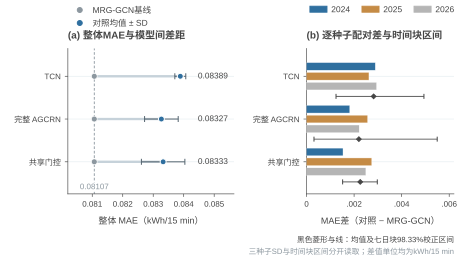

**图3-9 JPL整体MAE与逐种子差值比较**  (a) 四个模型的整体MAE，点为 2024、2025、2026 三种子的单次结果，菱形为三种子均值±样本标准差；(b) 三个基线逐种子MAE减MRG-GCN的差值，横线为均值与预登记区间，正值表示MRG-GCN误差较低。数值与表3-3 同源，差值只作固定测试期内的描述性比较。

**图3-10 AGCRN预算对齐的调参曲线**  完整AGCRN在120轮上限、早停耐心8轮下的调参集标准化MAE，五种子均在第1轮最优、第9轮早停（本图为五种子、耐心8的预算对齐运行；3.6.2节另跑的120轮复核为三种子、耐心15）。粗蓝线为五种子均值，两条细灰线为边界种子，红虚线为早停位置。

旧七特征配置下，MRG-GCN相对容量近似TCN的整体MAE优势主要出现在零目标与稳定窗口；相对完整AGCRN（199,912参数）则整体MAE偏高（0.03870对0.03746）。八特征残差化配置改变了这一排序：主模型（0.015704）较残差TCN（0.030709）低48.9%（3.6.2节、表3-2）。JPL比较支持前一类优势，RMSE、事件和非零目标误差则以TCN更低。

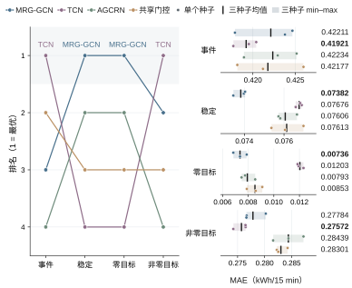

**图3-11 JPL分层MAE比较**  (a)—(d)为标签事件、稳定、零目标与非零目标层的MAE，圆点为三种子均值、粗线为最小—最大值，右上角标注该层最优模型。四层量程不同（事件层0.4162—0.4274，非零层0.2719—0.2895），跨面板比较须依据刻度。

Caltech与JPL同参数门控比较方向一致，但分别受各自协议和预算约束，不合并为跨站效应。统一输入、容量和预算说明见3.8.3节，JPL独立区间校准见5.3.5节。

JPL关系替换训练是另一项补充实验，配置与配对误差见3.7.2节表3-7。其结果用于判断三关系配置中各邻接相对于自环替代的条件性增量，不改变表3-3的整体—分层误差权衡。

### 3.6.4 回溯补充：完整配置与一致性

回溯协议各配置的全局指标见表3-4，其排序见图3-12。

**表3-4 Caltech回溯协议的全局与分层指标对比**

| 模型 | MAE/(kWh/15 min) | MAE标准差 | RMSE/(kWh/15 min) | WAPE | 事件窗口 | 稳定窗口 | 非零负荷 |
|---|---:|---:|---:|---:|---:|---:|---:|
| Persistence | 0.07828 | — | 0.23946 | 1.6270 | 0.4382 | 0.0731 | 0.3640 |
| LightGBM | 0.03758 | — | 0.11998 | 0.7811 | 0.3074 | 0.0337 | 0.1402 |
| XGBoost | 0.03873 | — | 0.12063 | 0.8051 | 0.3084 | 0.0348 | 0.1411 |
| ARIMA | 0.02260 | — | 0.13229 | — | 0.2939 | 0.0187 | 0.0909 |
| MLP | 0.02112 | 0.00019 | 0.10112 | 0.4390 | 0.3114 | 0.0169 | 0.1292 |
| GRU | 0.02965 | 0.00003† | 0.10838 | 0.6162 | 0.3042 | 0.0257 | 0.1274 |
| TCN | 0.02952 | 0.00014 | 0.10831 | 0.6136 | 0.3049 | 0.0255 | 0.1264 |
| **GWN（简化变体）** | 0.01773 | 0.00054 | 0.10023 | 0.3685 | **0.2732** | 0.0140 | **0.0693** |
| AGCRN（简化变体） | 0.02057 | 0.00029 | 0.09820† | 0.4276 | 0.2924 | 0.0166 | 0.0995 |
| AdaptiveGraph | 0.01396 | 0.00017 | 0.09920 | 0.2902 | 0.2763 | 0.0102 | 0.0720 |
| EventResidual（探索记录） | 0.01390 | 0.00015 | 0.09925 | 0.2889 | 0.2760 | 0.0101 | 0.0715 |
| **MRG-GCN（静态图配置）** | 0.01376† | 0.00023 | 0.09918 | 0.2860† | 0.2761 | **0.0100** | 0.0711 |

注：MAE与RMSE单位为kWh/15 min，WAPE无量纲；†标出该列最小值，粗体标出分层三列（事件窗口、稳定窗口、非零负荷）的最小值。随机初始化模型为三种子均值，标准差为$n=3$样本标准差，计算时分母为$n-1$，对应自由度为2；确定性基线标"—"。ARIMA正式结果未提供WAPE。事件与稳定窗口分别含10,160和702,200个预测键；分层列与全局列同源、同一测试键集。

表3-4保留ARIMA[91]等历史配置供追溯；GWN与AGCRN是简化变体，EventResidual仅作探索记录。AdaptiveGraph的三个早期模型在其原始软件与显卡环境下复算一致。由于早期计算环境差异与训练版本标识缺失，本文只复用这些模型的输出，不从头复现其训练。表中MAE仅相差0.00014～0.00020，三种子不足以建立稳定次序；主结论仍以行为输入协议为据。

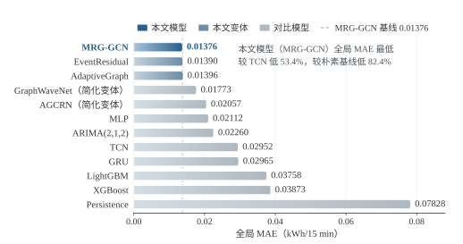

**图3-12 不同模型的全局MAE**  Caltech回溯协议下12种配置按全局MAE升序（0.01376—0.07828 kWh/15 min），灰色虚线为MRG-GCN基线。本文模型最低，较TCN低53.4%、较Persistence低82.4%；随机初始化模型为三种子均值。

由图3-13可见，各模型MAE随目标片向后移动而增加。MRG-GCN在第1至第4个目标片（h1—h4，对应[0,15)、[15,30)、[30,45)、[45,60) min）的MAE分别为0.00432、0.01072、0.01697和0.02302 kWh/15 min。

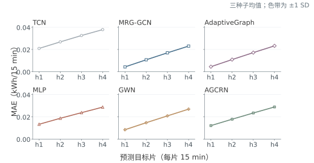

**图3-13 不同模型的逐目标片MAE**  横轴以预测发布时刻为0，依次为四个15 min目标片；曲线为三种子均值，阴影为跨种子标准差。MRG-GCN与AdaptiveGraph几乎重合，末片均值0.0230与0.0232 kWh/15 min，TCN升至0.0378。

以预测键为重采样单元的Bootstrap分析见图3-14，该分析对三种子预测结果进行点级合并。结果可描述大量测试键上的误差差异，但预测键存在时间、节点和种子内相关性，因此95%区间和单侧比例不作为跨种子统计显著性证据。

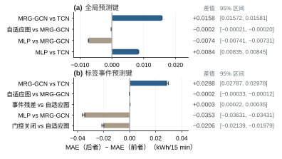

**图3-14 模型误差差的点级Bootstrap**  每行按“前者vs后者”列出比较，条形为MAE(后者)−MAE(前者)，正值表示前者误差更低。误差线为10,000次重采样的95%百分位区间。

对每个共同预测键计算“基线绝对误差−MRG-GCN绝对误差”，按预测原点的UTC日聚合，并在相同键上先取三种子的逐键平均；随后分别以1日和7日为重采样单元进行10,000次有放回百分位Bootstrap。

正值表示MRG-GCN误差较低：相对TCN的平均误差差为0.01576 kWh/15 min，1日块95%区间[0.01517, 0.01640]、187/187块为正，7日块[0.01495, 0.01662]、27/27块为正；相对AdaptiveGraph的平均差仅0.00020（1日块[0.00016, 0.00025]、7日块[0.00015, 0.00026]），但166/187个日块为正、21个日块不为正，故只描述为该测试期内的小幅优势。块级区间与图3-14的点级Bootstrap同源，逐块数值见附录表A-3。

### 3.6.5 回溯补充：分层与节点误差

分层结果见表3-4后三列：依据目标侧标签`target_event`划分事件与稳定窗口，并另行报告非零负荷子集。事件窗口占测试预测键的1.43%，冻结规则触发率0.43%不用于该表分层。

GWN在事件和非零组MAE最低，MRG-GCN在稳定窗口最低；MRG-GCN事件MAE约为稳定窗口的28倍。全局最优因此不等于事件组最优（图3-15）。

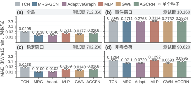

**图3-15 不同评价窗口的MAE**  (a)—(d)为全局、标签事件、稳定与非零负荷四种评价窗口的MAE，柱为三种子均值、点为单个种子，纵轴为对数尺度。各分面顶部标出测试键数，依次为712,360、10,160、702,200与90,820。

MRG-GCN的逐节点MAE以CA-303最高（0.02582）、CA-315最低（0.00616），相差约4.2倍；逐目标片的4个值见3.6.4节正文，逐节点与逐目标片数值见附录表A-4。

该差异受节点负荷幅值影响，故逐节点读数刻画评价难度，不代表节点相对预测质量；六模型逐节点对比见图3-16。

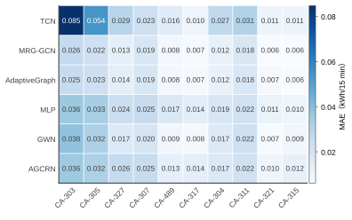

**图3-16 不同模型的逐节点MAE**  热力图为10个节点与6个模型的三种子均值，节点按累计代理负荷降序排列；颜色与数值为同一映射，表示误差大小而非节点间关系。GWN与AGCRN为主实验的简化变体。

回溯配置的可训练参数量为4,068至228,968个；硬件、聚合方式与早停轮次不同，不作跨模型速度比较。受控组件结论见3.7节。

### 3.6.6 第三场站补充验证：ACN Office 1

为检验关系增量是否只出现在Caltech与JPL，另在ACN Office 1上做一次小规模复核。该站共8个车位、1,683条会话，取会话量前5个（02、08、05、03、06）共1,315条；网格为2019年3月25日至2021年9月14日的86,735个15 min片，按70%/7.5%/7.5%/15%划分，训练、调参、校准与测试起点分别为60,619、6,505、6,505与13,006个，测试键260,120个，测试期零值比例91.6%。输入与关系构造沿用前文7通道与三类统计关系，因节点数减半，构图取top_k=2；未做节点活跃度筛选，也未做超参数搜索。

四种配置各跑三个种子，结果见图3-17。MRG-GCN三种子均值为0.016370 kWh/15 min，较容量近似TCN低20.3%、较行为GRU低22.2%，三个种子上均更低；与容量匹配AGCRN相比均值低3.0%，但种子2025上AGCRN更低（0.016574对0.017193），三种子中两个同向、一个反向，幅度不稳定。

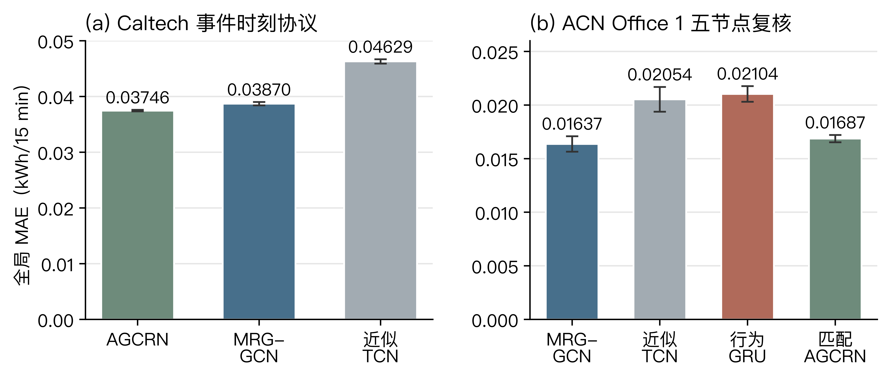

**图3-17 Caltech与ACN Office 1的模型MAE比较**  (a) Caltech事件时刻协议（708,560个测试键，五种子）与(b) ACN Office 1五节点复核（260,120个测试键，三种子）的模型MAE，柱为均值±标准差。(b)另含行为GRU与容量匹配AGCRN。

该站上关系模型相对时序基线的方向与Caltech、JPL一致；MRG-GCN与自适应图AGCRN的差异未达可区分程度。这是同源第三站的小规模复核，不是独立数据家族或未见期验证。

### 3.6.7 软门控输出头

第2章数据诊断指出，节点级负荷预测误差集中于非零（活跃）充电层，且事件时刻协议下活跃时段缺乏显式监督。软门控输出头（QMH）以显式门控分支判别活跃状态，单调分位网格刻画活跃条件下的电量分布，软组合器将二者耦合为最终点预测。

QMH 与两段式（hurdle）模型、零膨胀回归所代表的"显式活跃建模"传统同源[96-98]：经典 hurdle 模型以硬门限判别活跃，活跃概率低于 0.5 即输出硬零[96]；QMH 以连续软组合器替代硬门限，零键回落到标准化零点而非硬零。ZIP/ZINB 以泊松、负二项等参数化混合分布刻画零值过量[97]；QMH 以单调分位网格非参数地刻画活跃条件下的电量分布。MQ-CNN 类分位数输出头按固定分位水平给出全分布[98]；QMH 的查询分位由门控输出动态设定，随活跃概率单调上升（分段定义见下）。门控概率同时决定缩放强度与查询分位，是本方法与上述传统的主要区别。

设共享编码器输出节点嵌入 $h\in\mathbb{R}^d$。门控分支为轻量线性层 $p=\sigma(w_g\cdot h)\in(0,1)$，即该键为活跃事件的概率，仅引入一个向量参数。电量分支为 $K+1=9$ 个单调分位节点 $\hat{Q}=\{\hat{Q}_k\}_{k=0}^{K}$（$K=8$）：对累积 softplus 输出逐级累加并附加非负初值 $z_{\mathrm{init}}\ge 0$，即 $\hat{Q}_k=z_{\mathrm{init}}+\sum_{i\le k}\mathrm{softplus}(u_i)$，保证 $0\le\hat{Q}_0\le\hat{Q}_1\le\cdots\le\hat{Q}_K$ 恒成立；因 $z_{\mathrm{init}}\ge0$，标准化空间分位节点恒非负，该网格刻画的是活跃条件的正电量上侧，非完整分布下半支。两支由软组合器耦合：$g=\min(1,\,p/0.5)$，$\tau(p)=1-1/(2p)$，$\hat{y}=(1-g)\,z_0+g\,\hat{Q}(\tau(p))$，其中 $\hat{Q}(\tau)$ 在网格点间线性插值。组合器使 $p<0.5$ 时 $g=p/0.5$ 线性衰减，避免硬门控的零梯度区；$p\ge 0.5$ 后 $g$ 饱和于 1；查询分位水平取 $\tau(p)=1-1/(2p)$（$p\ge 0.5$），$p<0.5$ 时取 $\tau=0$，整体截断于 $[0,1/2]$；$K=8$ 的分位网格按 $\tau_k=k/(2K)$（$k=0,\dots,8$）在 0 至 1/2 均匀布置。需要指出，$\tau_0=0$ 是网格的下边界而非内点分位水平：该处的 pinball 项不具内点最优；训练中该项权重为 $1/9$，不主导梯度。该映射在 $p=0.5$ 处分段可微；其方向是：活跃置信度越高，查询分位越接近 $\tau=1/2$；越低则越靠近网格下端，与门控缩放 $g$ 一并把预测压向标准化零点。零值键整体回落到标准化原点 $z_0=(0-\mu_n)/\sigma_n$，不再占用回归容量。

目标序列按训练集逐节点均值与标准差作 z-score 标准化：$\tilde{y}=(y-\mu_n)/\sigma_n$，预测经反变换 $\hat y=\tilde{\hat y}\,\sigma_n+\mu_n$ 回原单位后报告。训练目标为$L=\beta\,\frac{1}{K+1}\sum_{k=0}^{K}m\,\ell_{\tau_k}(y,\hat{Q}_k)+c_g\,\mathrm{BCE}(p,z)+\lambda\,\mathrm{L1}(\hat{y},y)$，其中$\ell_{\tau}(y,q)=\max\{\tau(y-q),(\tau-1)(y-q)\}$为pinball损失，$m=\mathbb{1}\{y>0\}$为活跃掩码（分位项只在活跃键上归一化），$\tau_k=k/(2K)$，三项分别为分位损失、门控监督与保真项，其中保真项以L1惩罚点预测偏离、并因$\lambda=2$在最终配置中主导梯度。其中$\beta=0.5$、$\lambda=2$，$z=\mathbb{1}\{y>0\}$为活跃标签。门控由二元交叉熵显式监督。该监督的承重性依赖损失配置：仅靠回归损失塑形 $p$ 时，$p>0.5$ 后 $g$ 饱和、梯度为零，$p$ 无监督漂移，组合器失去校准。系数 $\beta$、门控系数、保真项权重 $\lambda$ 与 $K$ 由调参集选定：敏感性扫描同时记录调参集原单位 MAE 与测试期 MAE，最终配置按调参集 MAE 取最小。以保真项权重为例，$\lambda=0,2,5$ 的调参集 MAE 分别为 0.003518、0.003325、0.003369，$\lambda=2$ 在调参集上亦为最优；$\beta$ 在 {0.5, 2, 4} 上的调参集 MAE 分别为 0.003325、0.003676、0.003753，随 $\beta$ 增大单调上升，故取 0.5。因此最终配置的选择不依赖测试期读数，测试期仅作一次性报告；配对 p 值仍按五种子的验后比较报告，未对敏感性扫描的多重比较作校正。最终配置为 $\beta=0.5$、门控系数 1.0、$\lambda=2$、$K=8$。

### 3.6.8 消融与参数敏感性

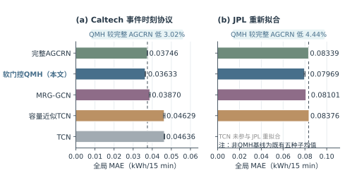

**图3-18 软门控QMH与基线的全局MAE比较**  (a) Caltech事件时刻协议（708,560个测试键，七特征非残差配置，五种子）与(b) JPL重新拟合（632,640个预测键）的全局MAE。JPL侧QMH五种子均值0.079685，较完整AGCRN低4.45%，跨场站反超。

四个模型在测试期事件密集段的逐时段预测见图3-19。

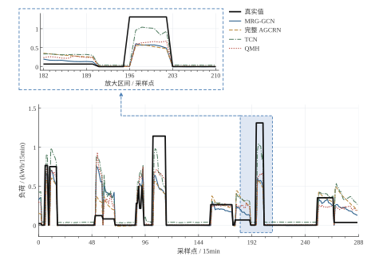

**图3-19 四个模型在 Caltech 事件时刻协议测试期的预测曲线**  主图为 2021-08-11 至 08-13 共 288 个 15 min 时段的真值与四条一步预测（h=1，提前 15 min）；顶部 inset 放大真值峰值区间（采样点 182–210）。窗口 MAE：QMH 0.1104、MRG-GCN 0.1168、完整 AGCRN 0.1187、TCN 0.1405 kWh/15 min。

主结果：在10个主分析节点、708,560个测试键的事件时刻协议上，残差化主模型（MRG-GCN+线性头，hidden 48，33,902参数，八特征含`load_lag1`）取得0.015704全局MAE（三种子，2024–2026均值），零值层为0.00559、非零层为0.08494，较残差TCN低48.9%、较persistence低1.2%（表3-2）。以下消融与参数敏感性均在七特征非残差配置上完成：该配置下λ=2的完整QMH为0.036326（五种子），较MRG-GCN下降6.14%、较完整AGCRN下降3.02%，配对种子5/5同向（单侧Wilcoxon p=0.031），零值层0.002859、非零层0.265308。残差化后同一QMH头为0.027243，高于线性头，故主模型不再采用QMH头；本节读数只用于说明输出头与损失项的内部机制，不构成残差化配置的组件结论，也不与表3-2混用。

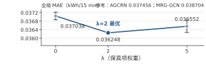

**图3-20 保真项权重 λ 的敏感性**  λ∈{0,2,5} 的全局 MAE（三种子均值±标准差）。曲线为 U 形：λ=2 处最低（0.036248），λ 过小或过大均劣化；三档全部低于完整 AGCRN 的 0.037456 与 MRG-GCN 的 0.038704。

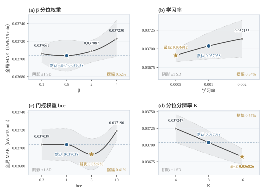

**图3-21 四维参数敏感性**  (a)β、(b)学习率、(c)门控系数、(d)分位分辨率 K，各三种子均值；蓝点为默认配置，金星为各维最优点。阴影为 ±1 SD，缺测点取 ±0.00015。

五个参数的最大摆幅分别为 β 0.52%、学习率 0.34%、门控系数 0.41%、K 0.56% 与 λ 2.13%。前四个参数在各自取值范围内的绝对摆幅均不超过 0.00021，小于 λ=0 完整配置的种子间标准差（0.000280）。β 的默认值 0.5 处于谷底；学习率与门控系数的最小值分别出现在 5×10⁻⁴（0.036912）与 3（0.036930），较默认值低 0.34% 与 0.29%。K 在 4–16 内缓降，K=16 较 K=8 低 0.57%。λ=2 较 λ=0 低 2.13%，是最终采用的取值，继续增大到 5 则回升至 0.036552。λ 的收益属于配置选择而非扰动容差。

**承重消融**（双损失配置：λ=0 行为五种子 2024–2028；λ=2 完整行为五种子、两消融行为三种子 2024–2026）：
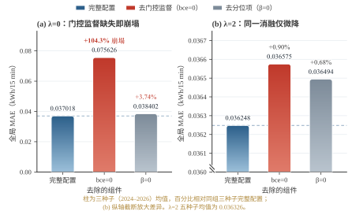

**图3-22 门控监督与分位项的双配置消融**  (a) λ=0：去掉门控监督后全局MAE升至0.075626（+104.3%），去掉分位项升至0.038402（+3.74%）；(b) λ=2：两个消融仅升至0.036575与0.036494。柱为三种子均值，百分比相对同组完整配置。
**表3-5 双损失配置下的组件承重消融**

| 损失配置 | 全局 MAE | 相对同配置完整 QMH |
| --- | --- | --- |
| λ=0 完整 | 0.037018±0.000280 | — |
| λ=0，门控监督系数=0 | 0.075626±0.000464 | +104.3% |
| λ=0，β=0 | 0.038402±0.000030 | +3.74% |
| λ=2 完整（七特征非残差配置） | 0.036326±0.000166 | — |
| λ=2，门控监督系数=0 | 0.036575（三种子） | +0.90% |
| λ=2，β=0 | 0.036494（三种子） | +0.68% |

注：本表六行均在七特征非残差配置上训练（八特征残差化主结果见表3-2）。λ=2 两消融行为三种子均值，逐种子 MAE 为 0.036368/0.036883/0.036474（门控监督系数=0）与 0.036272/0.036764/0.036446（β=0），其相对劣化按同配置三种子完整 QMH 基准 0.036248 计算；因此表中 +0.90% 与 +0.68% 不能由显示的五种子 0.036326 直接复算。六行共用同一网络结构与训练预算，仅损失配置不同。参数敏感性扫描（各三种子2024–2026；$\beta$、学习率、门控系数与$K$四组在$\lambda=0$配置上扫描，锚点0.037038，非最终$\lambda=2$配置）的逐点数值见图3-20与图3-21，保真项权重一行与前四行口径一致，摆幅按max|值−锚点|/锚点计算。$\lambda=0$有两个锚点：三种子0.037038用于摆幅计算、五种子0.037018用于本表消融基准，二者差0.000020，均小于种子标准差；旧七特征非残差配置在$\lambda=2$的五种子均值为0.036326（该配置已由八特征残差化主结果取代，见表3-2），与三种子0.036248种子数不同，并列列出而不互相替代。扫描原表见附录表A-5。

两组配置给出方向相反的承重图景。λ=0 时门控监督绝对承重：去掉后全局 MAE 上升 104.3%（0.075626），差于全部基线（在 MRG-GCN 主干与时序基线中最优者为 MRG-GCN 的 0.038704；完整 AGCRN 与其容量匹配版更低，但非该主干的扩展），亦差于同结构的 λ=2 配置，方差同步放大；去掉分位项劣化 3.74%（0.038402），分位项亦为承重组件。λ=2 时两个组件均只轻微劣化：去掉门控监督为 +0.90%，去掉分位项为 +0.68%。为把输出头本身与损失项的贡献分开，训练了三组补充配置（各五种子），连同完整损失配置共四组，测试MAE与相对MRG-GCN的差分别为：QMH头+纯L1 0.036643（−5.3%）、QMH头+分位项 0.036683（−5.2%）、QMH头+门控监督 0.038402（−0.8%）、QMH头+完整损失 0.036326（−6.14%）。

可见输出头单独即贡献约 5.3 个百分点；分位项单独加入无增益，门控监督单独加入反而劣化，两者同时启用才取得完整的 6.14%。因此 6.14% 中约 5.3 个百分点来自输出头结构本身，其余约 0.87 个百分点来自两项损失成分的联合作用——头结构是主要来源。

机制在于 λ 决定损失的主导项。λ=0 时 pinball 与门控 BCE 主导优化，BCE 是模型得以成立的前提；λ=2 时 L1 保真项主导，两个辅助项退为边际修正：保真项直接把预测拉向观测值，即使门控或分位分支不精确，输出仍被约束在合理范围。

因此 λ=2 的绝对性能更优（0.0363 对 0.0370），但单组件的承重性下降。报告消融时须同时给出损失配置，否则"某组件是否承重"的结论会随 λ 改变。

**推理开销**。五模型在同一设备、batch=1 条件下的单窗口推理时延为：完整AGCRN 36.0 ms、MRG-GCN 2.7 ms、容量近似TCN 2.5 ms、窄容量TCN 1.7 ms、软门控QMH 3.3 ms；QMH五种子集成为 17.7 ms（总参数169,510，仍低于完整AGCRN的199,912）。QMH单模型时延与MRG-GCN同档（慢约22%），较完整AGCRN快约11倍。

## 3.7 组件增量与协议敏感性

本节分别报告同参数门控、关系自环替换、历史子集及组合消融；各实验使用自身协议和基线，不合并排序。

### 3.7.1 同参数节点级门控配对对照

固定门值消融同时改变参数量，故另设同参数节点共享门控：仅将门控线性输出沿节点维取均值后广播，其他骨干、参数量、初始化、输入和训练规则均与节点级门控一致。两组各32,714个参数，在同一GPU服务器上按三个配对种子训练，最多60轮、早停耐心8轮。另以120轮上限和相同耐心值完成Caltech与JPL各6次配对运行。

六次运行在708,560个共同预测键上逐项匹配。表3-6显示节点级门控整体MAE低2.69%，三种子差值方向一致；事件组绝对差为0.001239 kWh/15 min，仍须结合其高误差基线解释。

**表3-6 Caltech事件时刻协议下同参数节点门控配对结果**

| 模型 | 整体MAE | 标签事件MAE | 稳定MAE |
|---|---:|---:|---:|
| 节点级门控 | 0.038677±0.000289 | 0.379462±0.000556 | 0.033698±0.000300 |
| 节点共享门控 | 0.039744±0.000142 | 0.380701±0.000604 | 0.034762±0.000146 |

注：单位为kWh/15 min，均值±样本标准差来自三个配对种子。两组参数量和训练预算上限相同；实际停止轮次分别为节点级门控38/22/22、共享门控60/40/54，最佳轮次分别为30/14/14与52/32/46。Caltech共享门控种子2024在第52轮最优，第60轮同时达到上限和早停耐心8轮；JPL对应运行则在第59轮最优、第60轮因上限结束，耐心尚未耗尽。前者符合既定早停条件，后者存在明确预算截断。配对差支持当前预算和选模规则下的增量。这六次运行单独报告，不替换表3-2中的正式结果。

在120轮训练预算下，Caltech节点门控与共享门控的整体MAE分别为0.038789±0.000262和0.040021±0.000475，节点门控低3.08%；JPL分别为0.080761±0.000416和0.083164±0.001265，低2.89%。两站三个种子均同向，60轮预算下的2.69%和2.71%在延长预算后保持。两站均在120轮内早停：Caltech节点门控与共享门控的最佳轮次分别为17/16/34和46/53/36，JPL分别为31/15/25和58/33/54。该延长预算实验使用相同已查看测试期，不构成独立时期确认。

为考虑时间相关性，以洛杉矶当地发布日构成27个七日块，对种子平均误差差作10,000次配对重采样。七日与一日描述性95%区间分别为[0.000747, 0.001378]和[0.000799, 0.001334] kWh/15 min。该事后区间只描述已查看时期，不含跨站、未见时期或训练种子不确定性。

逐一剔除节点的事后敏感性分析中，十次留一差值均为正：Caltech降幅2.25%～2.89%，JPL为2.13%～3.20%。这不增加独立样本，也非新时期确认。

七日块下，非零组差为0.005305 [0.002869, 0.007861]，事件组为0.001239 [0.000045, 0.002413]；均未作多终点校正。结论限于当前协议和预算。

### 3.7.2 关系路径、关系子集与敏感性

**JPL受控关系替换。** 本节的主检验为同参数自环替换：仅将指定邻接矩阵替换为单位自环并从头重训。该检验复用已查看测试期，属于事后补充分析。结果见表3-7。

**表3-7 JPL三关系图自环替换的配对重训练结果**

| 替换配置 | MAE差（替换−完整） | 完整模型降幅/% | 校正区间 | 同向种子 | 结论 |
|---|---:|---:|---:|---:|---|
| 负荷耦合关系→自环 | 0.001501 | 1.82 | [0.000048, 0.002689] | 3/3 | 支持当前设置下的条件性整体MAE增量 |
| 行为共现关系→自环 | 0.000120 | 0.15 | [-0.000432, 0.000728] | 2/3 | 区间跨零，增量尚不确定 |
| 轮廓相似关系→自环 | 0.001252 | 1.52 | [0.000167, 0.002275] | 3/3 | 支持当前设置下的条件性整体MAE增量 |

注：单位为kWh/15 min。每项保留三关系分支和32,714个参数，仅将指定邻接替为单位自环后重训；每配置3种子，共12次配对运行。MAE差=替换−完整，正值表示完整模型误差较低；降幅以替换配置MAE为分母。区间为固定JPL测试期24个当地七日块、10,000次配对重采样所得的Bonferroni校正98.333%区间。测试期已查看，属事后补充分析。

负荷耦合和轮廓相似关系对应的整体MAE差三种子均为正，Bonferroni校正区间下限均高于零；行为共现关系的区间跨零。因此，前两类关系在本架构、协议和预算下具有相对自环替代的条件性整体增量证据，第三类仍不确定。事件组中，行为或轮廓关系替换后的MAE反而分别低0.005142和0.003677，表明整体改善不必然延伸至事件样本。

事后分层中，自环替换的非零MAE较完整模型高0.004893 kWh/15 min（三种子同向，未作多重校正）。与此同时，完整MRG-GCN在JPL非零MAE为0.277839，高于TCN的0.275718，Caltech两种目标亦然。组件相对自环有价值与完整模型未胜TCN并不矛盾，前者支持关系保留和复核，后者要求按分层指标选模。

旧Caltech回溯协议的关系子集见表3-8中“关系子集”组：单关系配置与三关系基线MAE接近，但删去分支同时改变参数量和传播路径，不能据此识别条件增量。

节点门控以3.7.1节同参数比较为准。top-$k=7$较$k=5$的MAE高4.1%；失活$p=0、0.2、0.4$的MAE差不足0.03%，主模型因此取$p=0$。这些小网格不检验输入长度、15节点范围或规则阈值的稳健性。

事件时刻协议的等权$\beta$重训练略低于完整模型，故不支持学习$\beta$有正向精度净增益。重训练允许关系变换适应等权约束；第4章L1则冻结变换，仅检验既有配置敏感度。

27个当地七日块的事后Bootstrap显示，等宽TCN和自环对照的整体差分别为0.00744 [0.00693, 0.00798]、0.00720 [0.00664, 0.00773] kWh/15 min；等宽TCN事件组差为−0.00638 [−0.00847, −0.00444]。区间未作多终点校正，仅反映固定种子平均后的已查看时期。

该实验对Caltech回溯协议的训练模型仅替换β，保持关系变换及其他参数不变。详细权重、七种替换结果及β与关系变换的共同作用见第4章L1。Caltech事件时刻协议的等权变体重训结果见本节末段。

### 3.7.3 组合配置消融与事件残差探索

多种事件残差实现未达到正式纳入标准，故仅保留为已终止探索记录。无图配置退化最大（+112.9%），但只说明该组合配置中的图路径重要；“门控关闭”同时改变触发、训练和作用范围，其+90.5%不能归因于单一门变量。三种子结果见图3-23。

**表3-8 关系子集、稀疏度与组合结构消融结果**

| 组别 | 配置 | 全局MAE | 相对组内基线 |
|---|---|---:|---|
| 关系子集 | 三关系 | 0.01412 | 组内基线 |
| 关系子集 | 仅负荷 | 0.01415 | 与基线接近 |
| 关系子集 | 仅行为 | 0.01415 | 与基线接近 |
| 关系子集 | 仅轮廓 | 0.01401 | 数值略低 |
| 稀疏度 | top-$k=5$ | 0.01391 | 组内基线 |
| 稀疏度 | top-$k=7$ | 0.01448 | +4.1% |
| 关系随机失活 | $p=0.2$ | 0.01391 | 变化不足0.03% |
| 关系随机失活 | $p=0.4$ | 0.01391 | 变化不足0.03% |
| 组合结构消融 | 完整配置（内部基线） | 0.01390 | — |
| 组合结构消融 | 仅自适应图 | 0.01422 | +2.3% |
| 组合结构消融 | 仅固定图 | 0.01425 | +2.5% |
| 组合结构消融 | 门控关闭（复合变体） | 0.02648 | +90.5% |
| 组合结构消融 | 无图 | 0.02960 | +112.9% |

注：MAE单位为kWh/15 min，均为三种子均值。前三组（关系子集、稀疏度、关系随机失活）为同一实验套件的配对重跑，关系子集以三关系配置0.01412为组内基线，与表3-4的0.01376不同源（相差2.6%）；稀疏度与随机失活另以top-$k=5$和$p=0$为组内基线。后一组（组合结构消融）的内部基线为0.01390，与0.01376亦不同源。各组的"相对组内基线"只在本组内计算，不作跨表比较；表中配置仅用于相对比较。

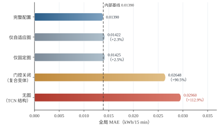

**图3-23 结构消融结果**  五个结构配置的全局MAE（kWh/15 min，三种子均值）：完整配置0.01390、无图0.02960，条端第二行为相对内部基线的Δ%。

回溯协议中有三个不同的“完整模型”读数：表3-4的0.01376（回溯主比较）、表3-8的0.01390（组合结构消融的内部基线）与0.01412（关系子集重跑的内部基线）。三者来自不同运行，不能互换或逐项比较。

### 3.7.4 交叉分组评价的加权还原检查

目标侧标签`target_event`与冻结规则`rule_trigger`按0/1交叉划分为四组，并验证

$$
\operatorname{MAE}_{\mathrm{global}}=
\frac{\sum_{a=0}^{1}\sum_{b=0}^{1}n_{ab}\operatorname{MAE}_{ab}}
{\sum_{a=0}^{1}\sum_{b=0}^{1}n_{ab}}. \tag{3-16}
$$

原正式MRG-GCN三个种子的交叉分组加权还原与全局MAE最大差低于$10^{-9}$，712,360个测试键均被分配。该检查验证算术闭合，不证明机制；误差解释见4.4节。

### 3.7.5 平凡收缩基线与预算对齐检验

为检验整体增益是否只是“更保守的预测”，补两个平凡对照。其一为零预测（所有键取0）；其二为单参数收缩基线：在调参集上拟合$\lambda$，把容量近似TCN的测试预测乘以$\lambda$。$\lambda$在2024、2025、2026三个种子上分别为0.254、0.273、0.273。三种子测试MAE依次为：零预测0.048275、容量近似TCN 0.046345、由调参集拟合$\lambda$的收缩TCN 0.043904、MRG-GCN 0.038901、完整AGCRN 0.037434 kWh/15 min（均为三种子测试集均值，$\lambda\cdot$TCN只增加一个标量参数，其余与容量近似TCN相同），原表见附录表A-6。

收缩使TCN的MAE降低5.3%，但MRG-GCN仍比收缩基线低11.4%，零预测比MRG-GCN差24.1%。因此整体增益不能由零膨胀或输出保守化单独解释；同容量AGCRN仍更低这一事实不变。

预算对齐方面，节点门控与共享门控在相同轮次下的调参MAE差距随轮次缩小（第10、20、30轮分别低43.4%、34.0%、21.6%），但方向不变。

## 3.8 证据综合与适用范围

本章主比较限定于三套协议及其各自的预测键；目标敏感性实验则在已查看的Caltech事件时刻测试键上固定输入、图和切分，单独检验另一代理目标构造下的模型比较。

### 3.8.1 方法组件与目标敏感性证据综合

方法组件的增量读数分散在表3-5、表3-6、表3-7、表3-9与表3-10，各分属回溯、事件时刻与JPL三套协议，不作跨协议合并排序（3.8.2节）；除QMH为五种子外均为三种子，关系行的基线为自环替换，汇总见附录表A-7。节点门控和两类关系的整体增量证据均限于所检协议、预算与基线；负荷关系的非零组差异仍属探索性结果。MDP三层诊断不产生预测增量，其数值见表4-1。基础图卷积、TCN和门控算子沿用已有方法。

### 3.8.2 三套协议的回答范围与比较边界

Caltech回溯、Caltech事件时刻和JPL重拟合分别使用712,360、708,560和632,640个测试预测键。前者比较事后重构序列上的历史配置，后两者比较行为输入条件下的预测；行为输入协议的模型设置见3.6.2—3.6.3节。JPL重新筛选节点、构图和训练，不代表零样本迁移或未来时期验证。

该实验检验固定拓扑下的标签构造敏感性；替代目标下重建图的全流程仍未验证，详见3.8.4节。

### 3.8.3 输入、容量与训练选模预算

主要比较、门控配对与关系替换训练共用同一输入窗口与训练预算，各协议只在输入权限、选模指标和预测键上不同；运行环境与训练配置见下段。

训练用RTX 4090 D与5090、PyTorch 2.8.0；96片历史→4片目标，训练、调参、校准与测试按时间留段；主比较（八特征残差化配置）用三种子（2024—2026）；旧七特征配置的主比较与QMH用五种子（2024—2028）；补充的门控配对、参数敏感性与承重消融按三种子（2024—2026）运行，各表已标注。优化器AdamW，学习率$1\times10^{-3}$，批大小256，上限60轮，早停耐心8，按调参集原单位MAE选模。

回溯配置的七通道输入含代理负荷、占用率、需求强度与跳变标志；两套行为输入协议只含接入、离站、活跃计数及当地日历编码。可训练参数见表3-2与表3-3，其中回溯AdaptiveGraph为35,005个；完整AGCRN的199,912个参数未与MRG-GCN容量匹配。自环替换的四种配置按种子的最佳轮次为22至42轮，停止轮次均未触及60轮上限；该实验未检验更长预算或不同收敛判据，不能单独证明优化已充分收敛。AdaptiveGraph的跨环境复核、选边差异及来源限制见3.6.4节。

**端到端时延预算**。单窗口推理2.5—36.0 ms，远小于15 min预测粒度；毫秒级推理不构成瓶颈，端到端时延主要由特征抽取与数据到达决定，本文未实测。

**部署形态**。主模型对10个节点联合建模，单模型单次前向覆盖全部节点，不按节点独立部署；节点数增加只改变关系图与输入矩阵的宽度，不增加单次推理次数。

**节点扩容与冷启动**。主分析覆盖55个候选节点中的10个，其余未建模；扩容需重建关系图并重训（2.2节15节点集未重训），冷启动兜底策略本文未验证。

两项敏感性实验只替换目标或邻接、沿用既有训练配置与运行环境。自环替换实验的代码版本未受版本库历史差异影响；目标敏感性实验缺少可验证的历史提交记录。

### 3.8.4 完成时刻截断目标敏感性（目标敏感性实验）

目标敏感性实验将分摊终点改为有效完成时刻（缺失或非法时回退至断开时刻），并保持会话电量守恒。输入、原图、切分和预测键固定，仅按新训练前缀重算目标标准化参数；两个近似等参数模型各训练三种子。该分析复用已查看测试期。

表3-9给出替代目标下的整体结果。替代目标下MRG-GCN整体MAE仍低于容量近似TCN，同键误差差为0.008302 kWh/15 min（95%七日块区间[0.007757, 0.008797]，27/27区块为正）。该排序在新目标下保持，但新旧目标的绝对MAE不可直接相减。

替代目标零值比例为94.27%；全局差异仍由零目标组驱动，非零组MRG-GCN MAE高0.013938 kWh/15 min，RMSE则近乎持平并略偏向TCN。沿用原`target_event`所得事件组均值略低，但仅2/3个种子同向；该标签未随目标重建，且未作联合误差贡献分解，故不据此声称稳定改善。

**表3-9 完成时刻截断代理目标下的Caltech测试结果**

| 指标 | MRG-GCN | 容量近似TCN |
|---|---:|---:|
| 可训练参数 | 32,714 | 32,674 |
| 全局MAE | 0.043401±0.000303 | 0.051703±0.000074 |
| RMSE | 0.193411±0.000728 | 0.193320±0.000349 |
| 零目标组MAE | 0.008700 | 0.018353 |
| 非零目标组MAE | 0.614498 | 0.600560 |
| 冻结原事件标签组MAE | 0.480282 | 0.484651 |
| 冻结原非事件组MAE | 0.037018 | 0.045377 |

注：误差单位为kWh/15 min；全局MAE与RMSE为三种子均值±样本标准差，其余为种子平均描述值。共同测试键708,560个，替代目标零值比例94.27%；事件标签仍为原事件时刻协议的冻结分组，未据新目标重建。分析固定原关系图，属于已查看测试期上的目标构造敏感性；新旧目标绝对MAE不直接相减。

### 3.8.5 代理标签定义下的模型排序敏感性

在708,560个Caltech测试键上固定12种配置的预测，仅将均匀分摊标签替换为完成时刻截断标签。会话总电量不变，零值率由87.25%升至94.27%；49,768个正值键变为零，没有反向迁移。逐键绝对差均值为0.033530 kWh/15 min，95分位数为0.266875；这是代理分配差异，不是实测误差。

表3-10分别列出先平均三种子MAE再排序的相关系数与逐种子相关均值。总体排序基本保持，按评价标签定义的非零组排序则更敏感；固定均匀非零键与动态筛选的非零键分母不同。相关系数仅描述已查看期的12种配置。

**表3-10 代理标签定义下的模型排序敏感性**

| 评价口径 | 三种子平均MAE排序的Spearman（先平均MAE再排序） | 逐种子Spearman均值 | 逐种子范围 |
|---|---:|---:|---:|
| 全局MAE | 0.993 | 0.974 | 0.972–0.979 |
| 稳定窗口MAE | 0.993 | 0.974 | 0.965–0.986 |
| 零目标MAE | 0.951 | 0.907 | 0.874–0.965 |
| 固定均匀非零键MAE | 0.671 | 0.671 | 0.629–0.727 |
| 标签事件MAE | 0.559 | 0.324 | 0.007–0.608 |
| 非零目标MAE（按评价标签定义） | 0.420 | 0.000 | −0.112–0.098 |

注：12个配置均在均匀标签上训练；评价时仅替换标签，预测不变。图3-24汇总上述排序相关的逐种子分布。配置级Bootstrap 95%区间为：全局[0.893, 1.000]、非零[−0.199, 0.841]、事件[0.039, 0.786]（重采样单元为12个配置，非种子；非零层区间跨零，不引用点估计作结论）。事件掩码沿用冻结的`target_event`。逐种子范围为三次相关系数的最小值—最大值，不是置信区间。排名与均值均限于已查看Caltech测试期，不代表未见时期或实测功率效度。

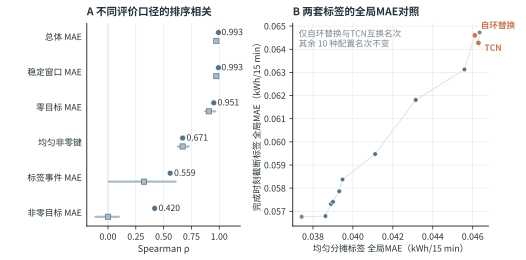

**图3-24 代理标签定义下的模型排序敏感性**  A比较两套标签下的排序相关（圆点为先平均再排序的Spearman），B对照12种配置的全局MAE。排序基本一致，橙色为唯一互换名次的配置（第10、11位）；比较仅基于同一批预测与已查看测试期，不表示代理标签与实测负荷等价。

交叉复评中，MRG-GCN相对容量近似TCN的全局MAE差在四种训练—评价标签组合下均为正（11.44%–16.06%）；节点门控平均优势由均匀标签下的2.69%降至截断标签下的1.65%，种子2024则由+1.73%反转为−0.91%。这些结果不替代新目标重训或未查看时期验证。

## 3.9 本章小结

在七特征非残差配置下，MRG-GCN相对容量近似TCN有16.4%的整体MAE优势，但完整AGCRN与容量匹配AGCRN更低（0.03746与0.03745对0.03870）；扩展软门控输出头并取λ=2后为0.036326（五种子），较完整AGCRN低3.02%。该配置的限制在于输入不含历史负荷：补入`load_lag1`并改为残差预测后，主模型（MRG-GCN+线性头，33,902参数）三种子（2024–2026）整体MAE为0.015704，零值层为0.00559、非零层为0.08494，较无图的残差TCN（0.030709）低48.9%、较persistence（0.015896）低1.2%，较旧配置低56.8%。容量对照hidden 32为0.016682，残差QMH为0.027243，容量匹配AGCRN仅完成seed-2024（0.017489）。节点门控及JPL负荷、轮廓关系有条件性增量证据，行为关系仍不确定；目标敏感性与MDP边界见3.8节和第4章。

本章给出的是一步点预测的能力边界：整体 MAE 可比较，事件层误差高度集中（见4.4节）且预测区间覆盖不足（见5.1节），故点预测可用于排序与筛查，区间输出尚不能支撑运行核查。

# 第4章  分层评价协议（MDP）与误差构成分析

## 4.1 引言：分层评价协议（MDP）的定义与边界

权重分布不能单独解释关系作用或误差来源[80]。本文将三层证据协议（mechanism diagnostic protocol，MDP）分为三层：L1冻结替换关系级$\boldsymbol\beta$，L2检验指定TCN学生能否逼近静态图教师，L3交叉标签事件与规则触发以描述误差构成（图4-1、表4-1）。此处MDP指本文的诊断协议，不指马尔可夫决策过程；三层均不识别现实因果机制。

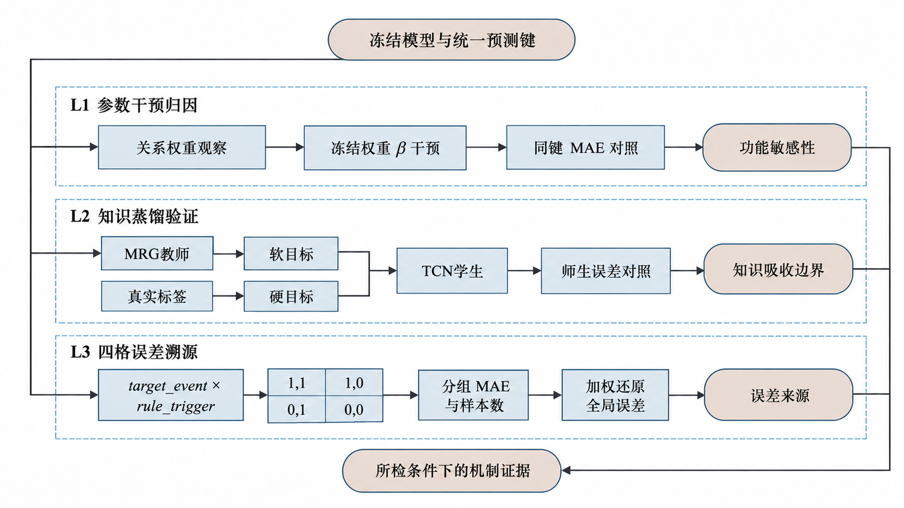

**图4-1 三层证据协议**  L1为关系参数干预，L2为受检学生蒸馏，L3为预定义样本组误差分解。“溯源”仅指描述误差构成，不作因果归因；L2结论限于所检学生、蒸馏目标与权重。

**表4-1 MDP三层诊断的设计与结果**

| 诊断层 | 方法 | 结论 |
|---|---|---|
| L1 参数替换 | 两层$\beta$冻结替换，7种 | 升95.9%—233.6% |
| L2 学生替代 | 静态教师蒸馏至TCN | 未弥合：2.12—2.14倍 |
| L3 误差构成 | 事件×规则交叉分组 | 1.39%键占28.10%误差 |

注：MAE单位kWh/15 min；712,360测试键，2024—2026三种子。

## 4.2 L1参数替换敏感度（PS）：关系分配的功能依赖

### 4.2.1 观察操作

从Caltech回溯模型三个冻结模型提取两层Softmax关系权重$\boldsymbol\beta^{(1)}$、$\boldsymbol\beta^{(2)}$，分别混合负荷、行为和轮廓关系。权重层内共享，不表示逐节点贡献或物理因果强度。

### 4.2.2 干预操作

在相同测试键上保持其他参数不变，只替换两层$\boldsymbol\beta$并前向推理。七种替换包括单关系、等权、层间交换及单层固定，学习值为基线。该内部干预借鉴改变模型单元后观察输出的解释思路[92]，不识别数据生成因果效应。

### 4.2.3 观察证据

第一层三个种子均以行为权重最高；第二层均值最高的是负荷关系，但种子2025中行为权重略高（表4-2、图4-2）。

**表4-2 两层关系级$\boldsymbol\beta$门控权重**

| 层次 | 关系 | 种子2024 | 种子2025 | 种子2026 | 均值 | 样本标准差 |
|---|---|---:|---:|---:|---:|---:|
| GCN1 | 负荷耦合 | 0.3433 | 0.3386 | 0.3481 | 0.3433 | 0.0047 |
| GCN1 | 行为共现 | 0.4053 | 0.4030 | 0.3985 | 0.4022 | 0.0035 |
| GCN1 | 轮廓相似 | 0.2514 | 0.2584 | 0.2534 | 0.2544 | 0.0036 |
| GCN2 | 负荷耦合 | 0.3537 | 0.3465 | 0.3573 | 0.3525 | 0.0055 |
| GCN2 | 行为共现 | 0.3026 | 0.3506 | 0.3133 | 0.3222 | 0.0252 |
| GCN2 | 轮廓相似 | 0.3437 | 0.3029 | 0.3294 | 0.3253 | 0.0207 |

注：数值由三个随机种子的正式模型权重文件提取，标准差为$n=3$样本标准差，分母为$n-1$，对应自由度为2；不进行统计显著性检验。

### 4.2.4 干预证据

图4-3(a)显示，学习值基线的全局MAE为0.01376 kWh/15 min；7种干预的MAE均升高，范围为0.02695至0.04591。最小退化来自“第一层保持学习值、第二层固定为轮廓相似”，退化幅度为95.9%；两层等权和交换两层学习值分别退化143.8%和148.4%。

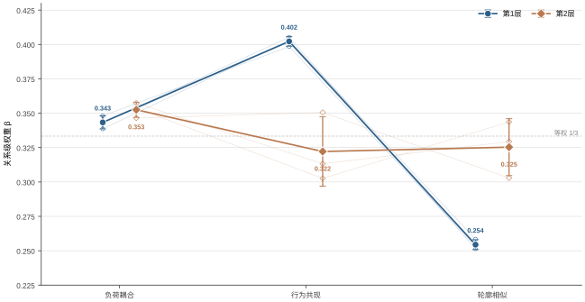

**图4-2 两层关系级β门控权重分布**  静态图配置正式三种子中，空心点表示各随机种子的Softmax权重，实心点与误差棒表示均值±跨种子样本标准差。每层三类固定关系权重之和为1；该图为观察性参数分布，不等同于节点级门控或关系因果效应。

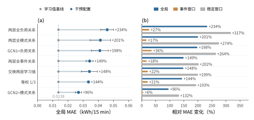

**图4-3 门控参数的干预响应**  (a) 强制替换两层关系级门控$\boldsymbol\beta$后仅作前向推理的结果，中灰点与竖虚线为学习值基线0.01376，蓝点为三种子均值、误差棒为跨种子标准差。(b) 同一批干预在三个窗口上的相对MAE变化，正值表示退化；分层汇总无离散度，故无误差棒。

### 4.2.5 L1判定结论

七种替换均使MAE升高，表明模型对已学的联合配置敏感；$\beta$的独立增益另由3.7.2节的等权β重训检验。消息为$M=\sum_r\beta_rW_r(\widehat A_rH)$。关系变换无偏置、主配置不作关系随机失活，取$\beta'_r=1/3$与$W'_r=3\beta_rW_r$即可保持消息不变。$\beta_r$的幅度需与$W_r$的尺度一并读取。两层等权冻结的退化（143.8%）大于权重本身的相对变化，说明当前配置在训练最优点附近对消息尺度较敏感。该幅度反映功能依赖，不宜用作关系重要性的定量排序；机理分解需针对消息尺度的单独实验。

冻结干预只检验现有配置的依赖程度，因果解释超出L1层范围。

节点门控的增量见表3-6（当前预算下MAE低2.69%），该增量与冻结$\beta$的敏感度分属两类证据。

### 4.2.6 分层敏感度：关系分配干预的样本响应

#### 4.2.6.1 方法与指标

本节在相同冻结模型和七种替换下，补充事件、稳定及逐节点响应。相对变化为：

$$
\Delta\operatorname{MAE}^{(c)}
=\frac{\operatorname{MAE}^{(c)}_{\mathrm{intervention}}
-\operatorname{MAE}^{(c)}_{\mathrm{learned}}}
{\operatorname{MAE}^{(c)}_{\mathrm{learned}}}. \tag{4-1}
$$

其中$c$为总体、事件、稳定窗口或节点。该量描述参数替换敏感度，不等同关系贡献。

#### 4.2.6.2 分层敏感度结果

所有替换在总体、事件和稳定窗口的MAE均高于基线：总体退化95.9%—233.6%，稳定窗口132.1%—316.6%，高于事件窗口的5.5%—35.6%（逐配置数值见图4-3(b)，原表见附录表A-8）；该差异描述响应，不识别其成因。该组替换以学习值为基线、结果汇总三种子，L1与L2分别指第一、第二层，逐种子离散度未保留，故不报告误差棒。

逐节点最大相对退化为CA-327的171.3%至CA-303的409.2%；未对节点差异作独立检验，故不划分固定敏感等级；三个窗口（全局、标签事件、稳定）上的相对变化见图4-3(b)。

#### 4.2.6.3 解释边界

相对变化受基线、节点尺度、事件占比及连接共同影响，不能据此设节点优先级或删关系；重训结果见3.7.2节。

## 4.3 L2受检学生替代性（ST）：指定学生能否逼近教师

### 4.3.1 协议操作

L2以知识蒸馏[93]检验指定纯时序学生能否逼近冻结静态图教师。学生TCN不含图输入，损失为$\mathcal L_1(\hat y_s,y)+\alpha\operatorname{MSE}(\hat y_s,\hat y_t)$；$\alpha=0.1,0.5,1.0,2.0$各训三个种子，按验证集MAE选模。该层检验所设学生与目标，不判断图结构普遍可替代性。

### 4.3.2 诊断实验

四个权重下，学生MAE接近无蒸馏TCN的0.02952，均高于教师0.01376；最低的$\alpha=2.0$仍约为教师的2.1倍（表4-3）。

**表4-3 GCN→TCN知识蒸馏结果**

| 蒸馏权重$\alpha$ | 种子2024 | 种子2025 | 种子2026 | 均值±SD | 相对教师倍数 |
|---:|---:|---:|---:|---:|---:|
| 0.1 | 0.02946 | 0.02938 | 0.02920 | 0.02934±0.00013 | 2.13× |
| 0.5 | 0.02955 | 0.02921 | 0.02918 | 0.02931±0.00021 | 2.13× |
| 1.0 | 0.02957 | 0.02932 | 0.02934 | 0.02941±0.00014 | 2.14× |
| 2.0 | 0.02914 | 0.02925 | 0.02923 | 0.02921±0.00006 | 2.12× |

注：教师（静态图配置）的三种子全局MAE为0.01376，纯TCN无蒸馏基线为0.02952；均值与标准差按3个种子计算。结论限定于给定学生架构、蒸馏目标与$\alpha$范围。

### 4.3.3 L2判定结论

所检设置下蒸馏未弥合差距，但学生缺少邻居输入、参数量与教师不匹配（16,996对32,714），且损失、权重范围和预算均有限，当前结果不能将差距归因于图结构。后续检验须匹配容量、输入、目标和选模预算。

## 4.4 L3误差构成（EC）：全局误差的交叉分组分解

### 4.4.1 协议操作

L3按目标标签`target_event`与冻结规则`rule_trigger`交叉划分为四组，描述误差构成而非因果归因。二者均非分类器预测/真值，不采用混淆矩阵术语；规则还含事后代理负荷差分。

### 4.4.2 诊断实验

L3用静态图配置三种子逐键预测重建交叉分组，样本数在种子间相同；表4-4列出计数和MAE均值±标准差。

**表4-4 两场站原正式MRG-GCN三种子交叉分组误差分解**

| 场站 | 分组 | event | trigger | 样本量 | 占比/% | MAE（均值±SD） | 绝对误差份额/% | 贡献密度$R_g$ |
|---|---|---:|---:|---:|---:|---:|---:|---:|
| Caltech | 标签事件/规则触发 | 1 | 1 | 235 | 0.0330 | 0.21723±0.00598 | 0.5208 | 15.8 |
| Caltech | 标签事件/规则未触发 | 1 | 0 | 9,925 | 1.3933 | 0.27747±0.00098 | 28.0995 | 20.2 |
| Caltech | 非标签事件/规则触发 | 0 | 1 | 2,825 | 0.3966 | 0.07254±0.00591 | 2.0891 | 5.3 |
| Caltech | 非标签事件/规则未触发 | 0 | 0 | 699,375 | 98.1772 | 0.00971±0.00019 | 69.2907 | 0.71 |
| Caltech | 合计 | — | — | 712,360 | 100.0000 | 0.01376±0.00023 | 100.00 | — |
| JPL | 标签事件/规则触发 | 1 | 1 | 831 | 0.1314 | 0.464647±0.010446 | 0.7529 | 5.73 |
| JPL | 标签事件/规则未触发 | 1 | 0 | 12,332 | 1.9493 | 0.419245±0.003322 | 10.0810 | 5.17 |
| JPL | 非标签事件/规则触发 | 0 | 1 | 26,185 | 4.1390 | 0.167867±0.000881 | 8.5708 | 2.07 |
| JPL | 非标签事件/规则未触发 | 0 | 0 | 593,292 | 93.7803 | 0.069670±0.000331 | 80.5953 | 0.86 |

注：各组MAE为三种子均值±样本标准差，样本量为预测键数。绝对误差份额为$C_g$，贡献密度$R_g=C_g/P_g$（份额除以样本占比），仅描述误差集中程度，不解释为风险概率、经济损失或因果强度。表中event、trigger两列分别为`target_event`与`rule_trigger`的0/1取值。原分组RMSE和WAPE未在三种子汇总中重建，故不填入未经核验的数值。Caltech与JPL两分块的上游协议、测试键数与事件标签定义不同，两站之间只比较误差集中格局，不作跨站效应差。JPL分块各格$R_g$由$C_g$与$P_g$直接算得；其预测键数和掩码在三个种子间完全一致，误差份额为各种子“格内绝对误差和／全体绝对误差和”的均值，交叉分组加权MAE还原原正式三种子整体均值0.081067。目标侧事件仅用于事后评价，规则触发是发布原点的既有分组信号，二者不组成同一时刻的事件检测混淆矩阵。

同一交叉分组的样本组成与三种子MAE见图4-4。图4-5的三模型残差密度与图4-6的事件分数分箱仍为种子2024的描述性诊断：事件相关样本的残差分布更宽，强事件分数档的平均绝对误差最高；二者补充样本量—误差关系，但不替代三种子主交叉分组证据。

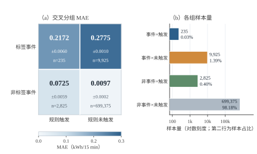

**图4-4 事件标签与规则触发的交叉分组诊断**  (a) 原正式MRG-GCN三种子交叉分组MAE热图，每格为均值、±标准差与样本量n；(b) 四组样本量依次为235、9,925、2,825与699,375，合计712,360个测试预测键。分组沿用回溯协议定义。

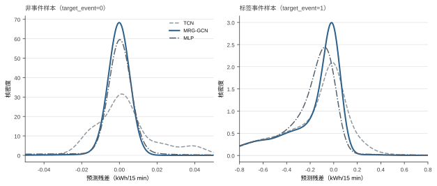

**图4-5 不同模型的残差分布**  曲线为种子2024中TCN、静态图配置和MLP的预测残差密度；左、右面板分别为非事件与事件窗口。该图为描述性比较，不含误差棒。

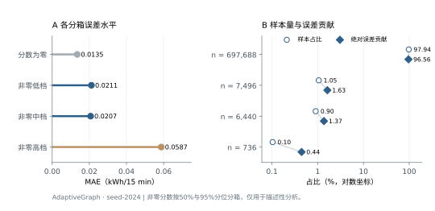

**图4-6 误差与回溯事件分数的关系**  使用AdaptiveGraph种子2024的测试预测键，按旧代理事件分数分为零分数与三个非零组（分界为50%与95%分位）。A为组内MAE，B对照样本占比与绝对误差贡献。零分数不等于目标侧非事件，最高分数组不等于冻结触发组。

### 4.4.3 还原校验

交叉分组诊断以式（3-16）的样本量加权恒等式作有效性检查（$a$、$b$分别为target_event与rule_trigger，$n_{ab}$为格样本量）。原正式MRG-GCN三个种子的加权还原差均小于$10^{-9}$，逐键记录覆盖全部712,360个测试键；三种子交叉分组计数与误差贡献同源数据一致，该还原检验不适用于其他模型。

### 4.4.4 L3判定结论

标签事件/规则未触发格仅占1.3933%的预测键，却贡献28.0995%±0.3654%的绝对误差；非标签事件/规则未触发格占98.1772%，贡献69.2907%±0.2234%。其余两格贡献0.5208%±0.0059%和2.0891%±0.1362%。报告应并列呈现困难格单键误差与常态格总量；误差份额不等于运行风险。

交叉分组恒等还原只验证键分组与算术闭合，不验证因果机制。规则与标签的错位提示回溯分层不能等价替代目标事件；第5章据此检查区间半宽路由与覆盖失配的关系，不将规则触发率解释为在线识别性能。

## 4.5 MDP诊断结果与适用边界

MDP收紧了三项判断：L1反映$\beta$与变换的联合配置敏感度；L2仅说明受检学生未逼近教师；L3要求并列报告困难格单键误差和常态格总误差贡献。相应取舍见表4-5。

这些诊断改变了关系解释、替代性判断和报告重点；诊断指导改模是否提升预测仍待受控验证。

## 4.6 JPL的L1/L3跨场站诊断与适用范围

### 4.6.1 诊断材料与计算口径

为检验诊断能否迁移到另一场站，在JPL重拟合的三个模型及其数据上追加L1/L3；分析为测试已查看后的事后诊断，不训练或改动输入、图、标签、阈值和选模。CPU上重算的结果与原导出的逐键最大差为2.08×10⁻⁶（容差5×10⁻⁶）；24组基线/替换、3组重参数化对照及交叉分组还原结果一致，最大还原差1.39×10⁻¹⁷ kWh/15 min。

L1沿用4.2.2节七种操作，分层结果见表4-5；“近单一关系”主权重99.9909%，并非严格结构删除。L3使用原冻结标签及发布原点规则状态，广播到四个目标片；阈值未重拟合。

### 4.6.2 L1：整体配置敏感度及样本层面差异

**表4-5 JPL冻结关系参数替换的分层结果**

| 配置 | 整体MAE | 标签事件MAE | 稳定MAE | 整体变化/% |
|---|---:|---:|---:|---:|
| 学习值 | 0.081067±0.000304 | 0.422111±0.003682 | 0.073820±0.000324 | — |
| 第一层近负荷；第二层学习值 | 0.103703±0.008997 | 0.453735±0.048255 | 0.096266±0.008235 | 27.92 |
| 第一层学习值；第二层近轮廓 | 0.097843±0.001102 | 0.417682±0.003894 | 0.091047±0.001052 | 20.69 |
| 两层近负荷 | 0.123434±0.022627 | 0.501144±0.041952 | 0.115408±0.022271 | 52.26 |
| 两层近行为 | 0.104072±0.024635 | 0.427197±0.025078 | 0.097206±0.025649 | 28.38 |
| 两层近轮廓 | 0.106241±0.003802 | 0.476894±0.007734 | 0.098365±0.003718 | 31.05 |
| 两层等权 | 0.088149±0.002406 | 0.419897±0.004949 | 0.081100±0.002471 | 8.74 |
| 交换两层学习值 | 0.092807±0.007848 | 0.419053±0.001792 | 0.085875±0.007996 | 14.48 |

注：单位为kWh/15 min，均值±样本标准差来自2024、2025、2026三个种子；整体变化以学习值基线三种子均值为分母。表中替换仅改变冻结模型的两层关系logit，其他参数保持；近单一权重的定义见4.6.1节。不同种子共享同一测试期，标准差不表示跨场站不确定性；本节不作确认性显著性判断。

七种替换的整体MAE在各种子下均升高，均值增幅8.74%～52.26%。但第二层近轮廓、等权及交换配置的事件MAE（0.417682、0.419897、0.419053）低于基线0.422111，与Caltech分层响应不同，表明样本层差异受协议和场站影响。

将两层重参数化为$\beta'_r=1/3$、$W'_r=3\beta_rW_r$后，三种子逐键差为1.55×10⁻⁶、1.55×10⁻⁶和1.20×10⁻⁶，均在容差内。交叉分组误差组成见表4-4的JPL分块。这验证4.2.5节的函数保持关系，但JPL未重训等权模型，也未证明$\beta$独立正增益。

### 4.6.3 L3：困难样本与总误差组成

JPL中标签事件／规则未触发格占1.9493%预测键、贡献10.0810%绝对误差；非标签事件／规则未触发格占93.7803%、贡献80.5953%，故同样需兼顾困难格单键误差与常态格累计误差。Caltech对应困难格贡献28.0995%，但协议不同，不作直接跨站效应比较，也不解释为运行风险。

### 4.6.4 主要结论与剩余验证范围

JPL上的重复诊断表明，既有模型可支持L1配置敏感度与L3误差结构的检验，格间响应与Caltech不同。该分析未覆盖L2或诊断指导改模收益；它也不同于自环替换实验的邻接替换重训。

## 4.7 本章小结

本章把“机制诊断”限定为误差形成机制，给出三层证据，并明确每层能回答与不能回答的问题。

L3是本章可复用的核心。回溯协议712,360个预测键上，交叉分组加权还原差小于$10^{-9}$；1.39%的困难格贡献28.10%的绝对误差，69.3%来自常态格。该分解把“整体误差高”转成“误差集中在哪些键”，可为复验排序与告警阈值研究提供样本构成依据。

L1是参数替换敏感度，不是因果归因。七种冻结β替换使整体MAE升高95.9%—233.6%，但消息对β与关系变换的尺度联合变化不变（取$\beta'_r=1/3$、$W'_r=3\beta_rW_r$时逐键差约$1.55\times10^{-6}$），因此该退化只说明模型依赖训练所得的联合配置；

L2是受检学生替代性，不是图结构必要性检验。四档蒸馏权重下指定TCN学生的MAE为教师的2.12—2.14倍；学生无邻居输入、参数量16,996对32,714，结构上不能回答“图结构能否被时序模型替代”。

由此三条判定规则：门控增量仅在三种子同向时作一般性表述；关系取舍依据重训而非β幅度；交叉分组结论须并列困难格单键误差与常态格总贡献。本章的贡献因此是一套可复用的误差构成测量，而非对关系作用的因果解释。

# 第5章  模型结构与可靠性边界分析

## 5.1 引言

前三章分别建立预测对象、比较模型并分析误差来源。本章进一步考察这些预测关系在方向性检验和区间评价下能支持何种结论，以及将预测用于运行核查还缺少什么条件。本章定位为模型可靠性与应用边界验证，不构成第三项独立预测模型创新。

本章的区间结论在此集中陈述：名义90%区间实测覆盖为回溯协议69.6%（表5-2）、事件时刻协议79.55%（表5-1），事件层仅1.9%—3.87%；14天滚动校准把整体覆盖提至89.01%、事件层提至26.71%（行为分层路径；标准逐节点路径膨胀6.25倍）（表5-1），但区间宽度膨胀至4.47倍，实际可用性有限。故本章结论是：点预测可用，区间预测尚不能直接用于运行核查；“有区间”不等于“区间有用”。

## 5.2 方向性统计候选与结构对照

本节在同一训练段序列上以传递熵（TE）筛查方向候选，并用PCMCI+作条件独立对照（图5-1）。

**图5-1 TE候选生成与PCMCI+条件独立检验流程**  两法使用同一训练期10节点序列；44/32/6为两法均、仅TE、仅PCMCI+达到名义阈值的有向对数，未经多重校正。该对照不构成独立复现，TE候选经家族校正后无一保留。

### 5.2.1 问题与动机

第3章LRE图为无向统计关系，不含时滞。此处检验的假设是：站内节点历史可能包含指向其他节点后续负荷的方向性统计信息；方向只表示先后关系。

### 5.2.2 传递熵方向性检验

采用传递熵（transfer entropy，TE）[82]衡量给定目标历史后，源节点滞后取值对目标当前值提供的条件信息：

$$
\operatorname{TE}_{X\rightarrow Y}(\ell)
=H(Y_t\mid Y_{t-\ell})
-H(Y_t\mid Y_{t-\ell},X_{t-\ell})
=I(X_{t-\ell};Y_t\mid Y_{t-\ell}). \tag{5-1}
$$

对10节点90条有向对，在滞后$\ell\in\{1,2,4\}$下用8分位分箱估计，并对每个“有向对×滞后”作100次循环平移置换。该方法保留部分自相关，但不能排除共同驱动或滞后选择不确定性。检验程序先取三个滞后中的最小置换$p$值，再以$p<0.05$标记候选，检验族为270项；最小可达$p=1/101\approx0.00990$，故名义候选仅作探索。

### 5.2.3 传递熵名义候选与双向读数不对称

90条有向对中76条达到未校正名义阈值；45个无向对中31对双向、14对单向。对双向候选定义描述性读数不对称度

$$
\operatorname{ASYM}_{ij}=
\frac{|\operatorname{TE}_{i\rightarrow j}-\operatorname{TE}_{j\rightarrow i}|}
{\operatorname{TE}_{i\rightarrow j}+\operatorname{TE}_{j\rightarrow i}+\epsilon}, \tag{5-2}
$$

其中$\epsilon$防止分母为零。阈值$\operatorname{ASYM}>0.3$标出20对（44.4%），但两个方向分别选择滞后，故不是共享滞后效应检验。100次置换可分辨的最小$p$为$1/101\approx0.0099$，而270项Bonferroni阈值为$0.05/270\approx1.85\times10^{-4}$，两者相差约53倍，故100次置换下校正后最小$p$只能取1.00，这只是分辨率的算术后果。把置换次数提高到10,000次（$p$下限$1.0\times10^{-4}$，低于上述阈值）重跑后，有3条有向对通过Bonferroni校正（校正$p$均为0.027）：CA-303$\to$CA-311（$\mathrm{TE}=0.003292$，滞后2）、CA-303$\to$CA-317（$\mathrm{TE}=0.003098$，滞后1）、CA-305$\to$CA-307（$\mathrm{TE}=0.001448$，滞后1）；另有5对处于$p_{\mathrm{adj}}=0.054$的临界带。因此原100次置换下的空结果应归因于$p$值分辨率不足，而非方向性效应不存在；提高到阈值以下后候选重现，但数量仍少，图5-2(a)、图5-2(b)提示的方向结构只宜作候选清单而非效应确认。

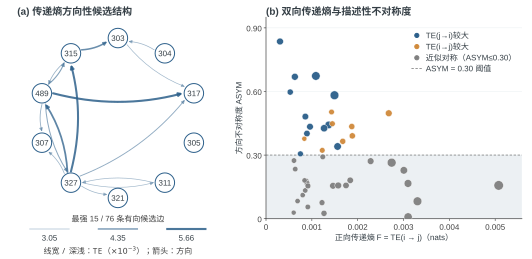

**图5-2 传递熵的方向性候选与不对称度**  (a) 种子2024训练期中TE值较高的15条名义候选边及其与三类关系图的覆盖；(b) 45个无向节点对的正向TE与方向不对称度，虚线为0.30阈值，20对超过阈值。高不对称度集中在弱TE一侧属比值型指标的结构特征，不作显著性检验。

### 5.2.4 有向候选边与统计关系图的互补性

45个无向TE候选对中，33对被至少一类LRE图覆盖，12对未覆盖。覆盖比较统一取top-$k=3$，但对称化后实际边数可能不同；旧回溯主模型为$k=3$，事件时刻协议为$k=5$。TE与负荷、行为、轮廓图的Jaccard系数为0.444、0.489、0.378，Spearman系数分别为0.27、−0.15与0.26（图5-3）；名义阈值76/90、校正0/90，单种子，原表见附录表A-9。该重叠不验证未覆盖候选。

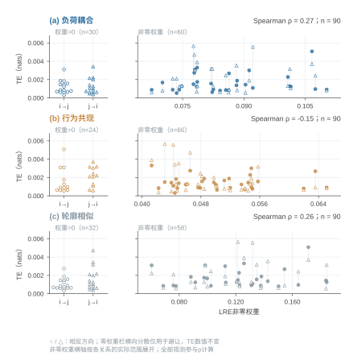

**图5-3 TE与统计关系权重的对应**  90条有向对与三类固定关系权重的Spearman相关见图内。灰叉为TE零值；结果为单种子探索性比较，未经校正。

### 5.2.5 PCMCI+条件独立检验与版本敏感性

PCMCI+[83,84]使用训练段10节点的83,198个原始观测（不同于83,103个预测起点），采用ParCorr、最大滞后4片、$\alpha=0.05$。历史记录中有80个名义滞后单元；按有向对汇总，76条TE候选中44条同时出现，32条未出现；另有14条TE汇总中未见的节点间对（6条仅见于PCMCI+、8条两法均未达），以及10个自回归对，合计90个非对角对有向对。这些均为未校正历史计数，节点对与滞后单元不可混算。图5-4按历史记录绘制。

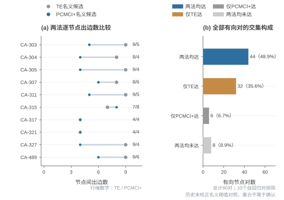

**图5-4 PCMCI+条件独立检验与TE名义候选对照**  (a) 90个非对角有向对的归类矩阵，四类为两法均达、仅TE、仅PCMCI+与均未达阈值，对角线自回归对不计入；(b) 四类计数依次为44、32、6与8。输入为83,198个训练观测，ParCorr、最大滞后4片、$\alpha=0.05$，未作多重校正。

历史PCMCI+缺少完整$p$值矩阵和Tigramite版本，无法追溯校正。当前锁定张量以Tigramite 5.2.10.1重算360个非对角节点对×滞后单元，65个名义显著，Holm校正后22个滞后单元（21个节点对）低于0.05。因与历史80个名义单元不一致，该结果仅作版本敏感性分析，不替换图5-4或历史计数；也不排除共同驱动，不表示物理因果。

### 5.2.6 方向性证据的解释边界与后续检验路径

TE与PCMCI+仅作训练段候选筛查，未回灌MRG-GCN，也不作为因果边。若后续纳入有向关系，须预先固定构图规则并在统一划分、容量、种子及预算下检验；复用已查看时期仍属探索，独立确认需兼容的新时期数据。

## 5.3 事件感知的区间预测：分层共形预测

### 5.3.1 问题与动机

整体点误差不能代表区间可靠性。本节比较Caltech与JPL的独立、滚动和回溯校准，并按标签事件检查覆盖失配[85-87]。

### 5.3.2 分层共形方法

对冻结模型残差$r=|y-\hat y|$，取$\alpha=0.1$构造名义90%区间。独立校准用有限样本顺序统计量，回溯实现保留原经验分位数。标准路径逐节点估计半宽$q_n$；规则分层路径对触发键跨节点共用$q_{\mathrm{trig}}$，未触发键逐节点使用$q_{\mathrm{stable},n}$：

$$
[\hat y-q,\hat y+q],\qquad
q=\begin{cases}
q_{\mathrm{trig}}, & \text{rule\_trigger}=1,\\
q_{\mathrm{stable},n}, & \text{rule\_trigger}=0.
\end{cases} \tag{5-3}
$$

目标侧事件只作评价，标签路由oracle仅作事后参照。图5-5展示旧规则路由：规则含事后代理负荷差分、验证段参与选模，均属历史限制。事件时刻协议与JPL结果见5.3.3—5.3.5节。

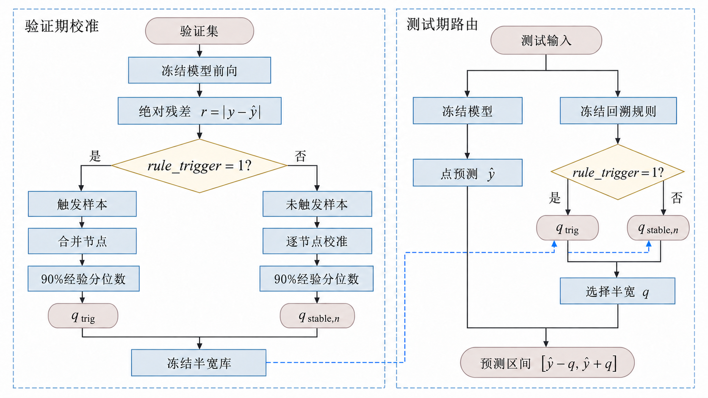

**图5-5 冻结规则路由的分层共形方法**  验证期以冻结预测残差校准，触发层跨节点合并、未触发层逐节点估计90%经验分位数。测试期由旧规则选择半宽$q$并与$\hat y$组成区间。目标侧标签不参与路由，旧规则含事后负荷差分，经验分位数不保证测试覆盖。

### 5.3.3 事件时刻输入协议下的独立校准补充

该分析复用三种子冻结预测，调参、校准与测试窗口及目标片互不重叠，覆盖与区间质量见表5-1前两行，独立校准的完整指标（含稳定覆盖与区间分数）见附录表A-10。半宽取秩$k_g=\lceil(n_g+1)(1-\alpha)\rceil$，$\alpha=0.1$；标准组每节点35,220个校准键，触发组2,964个[86]。独立校准不保证测试覆盖[87]。

两路径整体覆盖均未达90%。行为分层只小幅提高覆盖，却扩大区间；事件覆盖仍低。结果提示路由错位与分布变化并存，未验证实际输入延迟。

### 5.3.4 成熟标签约束下的滚动校准回放

充电需求的区间预测已有基于交通流与需求估计的先例[94]，但区间来源与本文的经验残差不同，覆盖率不可直接比较。局部化与在线重校准的共形方法可在非平稳条件下给出长程平均覆盖保证[95]；本文冻结规则后只报经验覆盖，更保守。滚动回放保持预测、规则和$\alpha=0.1$不变，以成熟历史残差更新半宽。主要窗口14天，28天作敏感性；每日洛杉矶当地零点更新。仅纳入已发布预测、已结束目标片且会话断开后标签成熟的样本，目标片起点须在回看窗内。

表5-1列出逐节点标准路径和行为分层路径；规则仅用于路由。回放遵守标签成熟时间，但测试期已查看且序列与重叠目标相关，不是未见期验证或具有交换性保证的独立实验[86,87]。

**表5-1 事件时刻协议成熟标签滚动校准回放结果**

| 校准方式 | 整体覆盖/% | 事件覆盖/% | 平均宽度 | 区间分数 |
|---|---:|---:|---:|---:|
| 冻结逐节点 | 79.55 | 3.87 | 0.02757 | 0.74551 |
| 冻结行为分层 | 80.04 | 5.92 | 0.03951 | 0.73214 |
| 14天逐节点 | 89.03 | 26.44 | 0.17223 | 0.67844 |
| 14天行为分层 | 89.01 | 26.71 | 0.17649 | 0.66952 |
| 28天逐节点 | 88.83 | 24.99 | 0.15437 | 0.68014 |
| 28天行为分层 | 88.88 | 25.18 | 0.15916 | 0.66979 |

注：三种子均值，同一708,560个测试键；宽度与区间分数单位为kWh/15 min，分数越小越好。14天行为分层整体覆盖为89.01%±0.05%，事件覆盖为26.71%±0.12%，标准差只描述种子波动。窗口固定后报告全部方案，不按测试覆盖挑选最优配置。前两行为事件时刻协议独立校准的冻结方案，由三种子均值±样本标准差给出：标准逐节点整体覆盖79.55%±0.23%、事件覆盖3.87%±0.09%、稳定覆盖80.66%±0.23%、平均宽度0.02757±0.00040、区间分数0.74551±0.00563；行为规则分层为80.04%±0.26%、5.92%±0.15%、81.13%±0.26%、0.03951±0.00037、0.73214±0.00548；其余四行为三种子均值。区间分数为区间宽度加$2/\alpha$倍越出区间的距离，保留原预测及未截零的对称区间端点，本文未按测试覆盖调整半宽。前两行属事件时刻协议独立校准，不能与表5-2相减来估计独立校准的因果收益。

14天更新提高覆盖并降低区间分数，但宽度扩大至4.47倍（行为分层路径；标准逐节点路径更宽）；逐节点路径整体覆盖相近，未见行为分层独有增益。事件覆盖仍不足，测试期已查看，不能宣称可靠事件防护；成熟等待、事件稀疏与规则漏触发尚未分离。

### 5.3.5 JPL既有预测的独立校准补充

JPL复用JPL重拟合三种子冻结预测，按5.3.3节两路径及$\alpha=0.1$校准。半宽仅由313,120个校准键确定，632,640个测试键仅评价；两段原点和目标时刻无交集。该事后分析未按测试覆盖调参。

整体覆盖接近90%，但事件覆盖低于50%，行为分层未提高事件覆盖。结果仅描述已查看时期，不能支持预警或保护动作，业务可接受区间宽度亦未确定。

### 5.3.6 回溯补充：覆盖与路由错位

表5-2显示，标准与规则路由事件覆盖远低于90%。

**表5-2 不同共形口径的经验覆盖率**

| 校准与路由方式 | 整体覆盖率 | 标签事件窗口覆盖率 | 稳定窗口覆盖率 | 解释 |
|---|---:|---:|---:|---|
| 标准共形 | 69.6%±1.7% | 1.9%±0.5% | 70.5%±1.8% | 全局逐节点校准 |
| 规则路由分层共形 | 69.8%±1.7% | 3.9%±0.5% | 70.7%±1.8% | 旧冻结规则回溯路由，覆盖未达标 |
| 标签事件事后参照（oracle） | 70.1%±1.8% | 86.1%±0.0% | 69.9%±1.9% | 标签路由，预测时不可用 |

注：均值和标准差来自2024、2025、2026三种子；覆盖率为测试集经验值，未作有限样本秩修正。

规则触发占0.43%、标签事件占1.43%；3,060个触发键中235个是标签事件。错位可解释部分覆盖不足，仍有残差变化和有限样本影响。

三类覆盖口径见图5-6，触发层半宽相对全局半宽的膨胀见图5-7。规则触发层的统一半宽为0.651±0.005 kWh/15 min，远大于逐节点全局残差半宽。

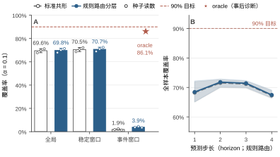

**图5-6 共形覆盖率比较**  A在统一覆盖率坐标下比较全局、稳定窗口与标签事件窗口的标准共形与规则路由分层结果，红星为事件窗口的oracle诊断参照（不可部署），虚线为90%目标；B为规则路由下第1—4片的全样本覆盖率。散点为单种子读数，B中阴影为min–max范围。

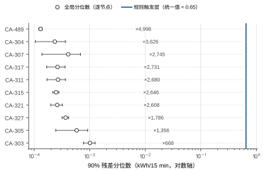

**图5-7 分层残差分位数与区间膨胀**  白点为逐节点全局90%残差分位数（三种子均值±标准差），蓝色竖线为规则触发层的统一分位数（所有节点共享），点与竖线之间的引导线标注触发层相对该节点全局分位数的倍数（三种子均值）。规则未触发层分位数与全局分位数逐节点几乎一致，图中不重复绘制。

规则路由下各节点的平均区间宽度为0.0025—0.0105 kWh/15 min，以CA-303最宽（0.0105±0.0005）、CA-317最窄（0.0025±0.0002）；区间宽度受节点残差与触发层分位数共同影响，不将其解释为节点风险的唯一度量。逐节点分位数与触发层半宽的对应关系见图5-7，逐节点数值见附录表A-11。

### 5.3.7 回溯补充：残差失配诊断

保持原模型、冻结规则和验证期分位数不变，重新前向验证集并复算历史测试预测。三种子的原校准半宽均在浮点容差内复现，各覆盖指标与原汇总的最大差异为0.0064个百分点。新增统计只作事后失效诊断。（表5-3）

**表5-3 冻结区间的覆盖失效诊断**

| 诊断量 | 验证期或标准路径 | 测试期或规则路径 | 解释 |
|---|---:|---:|---|
| 全体绝对残差p50 | 0.000178 | 0.000220 | 测试/验证为1.24倍 |
| 全体绝对残差p90 | 0.000716 | 0.002507 | 测试/验证为3.50倍 |
| 全体绝对残差p95 | 0.000912 | 0.008759 | 测试/验证为9.60倍 |
| 标签事件/触发（235键）覆盖率 | 0.85% | 86.52% | 触发半宽增宽，但该组很少 |
| 标签事件/未触发（9,925键）覆盖率 | 1.95% | 1.95% | 大多数标签事件仍接受窄区间 |
| 非标签事件/触发（2,825键）覆盖率 | 5.83% | 96.07% | 增宽也覆盖非标签事件键 |
| 非标签事件/未触发（699,375键）覆盖率 | 70.80% | 70.63% | 大样本稳定组同样未达目标 |

注：前三行为每种子先跨预测键计算分位数，再取三种子均值，单位kWh/15 min；不是逐节点校准半宽的均值。后四行为相同交叉分组内标准与规则路径的测试经验覆盖率，先逐种子计算再取均值。预测窗口重叠，不作独立样本显著性推断。

交叉分组诊断显示，增宽区间覆盖大多数规则触发键，却未覆盖多数标签事件；规则与标签分组不一致，不能解释为分类漏报或误报。

另一问题是校准失配：测试残差高分位数高于验证期，月度覆盖和事件占比也变化（表5-3）。稀疏分层、节点和目标片汇聚亦影响读数。回溯协议无独立校准段，测试期已查看。

## 5.4 节点负荷预测的决策接口与验证条件

充电运营的日常分析以站点为单位展开，要回答三个问题：站内不同位置的充电量如何变化，需求集中在哪些时段，某时段的高负荷属于常态波动还是异常片段。

第3、4章对应其中的需求分析环节，对象为会话重构的15 min节点代理负荷：第3章比较时序基线与多关系图模型；第4章进一步区分配置敏感度、受检学生替代性和误差构成。Caltech事件时刻协议下（三种子，2024–2026），残差化主模型（MRG-GCN+线性头，八特征含`load_lag1`）整体MAE为0.015704 kWh/15 min，零值层为0.00559、非零层为0.08494；较无图的残差TCN（0.030709）低48.9%，较persistence（0.015896）低1.2%。JPL重拟合中，MRG-GCN整体MAE为0.081067 kWh/15 min，较三项预先设定基线低2.64%—3.36%；JPL侧尚未提供残差化重跑的读数，两站结果不可直接比较。

因此，可向运营分析提供的是方法层面的参考：站内关系的构图方式、某类关系的取舍判断、整体、非零目标和事件分层的误差报告，均可沿用上述同参数对照设置。上述结果的输入为ACN公开会话与设备时序，价格策略、经营收益、利用率与用户满意度尚无对应验证；所需数据条件与运行验证要求见5.4.6节。

跨模型或跨期比较须先对齐标签口径。同一批数据更换标签并重训后，整体MAE可相差约22%（表5-6）。仅有会话记录时，接入—断开均分把平均约44.5%的会话电量记在充电完成之后（会话等权口径），时段分析宜优先采用完成时刻截断或设备上报序列。两种标签下重训得到的模型排序未变（表5-6）；该一致性只适用于本窗口与所检两种模型，其他窗口和模型仍需另行检验。

### 5.4.1 预测量与运行量的对应

本节将10节点预测汇总为容量核查接口。发布时刻$t$对应随后60 min内4个15 min目标片，片起点为$t,t+15,t+30,t+45$ min；首片虽从发布时刻开始，预测量仍为完整片段能量。定义集合代理需求和预测值：

$$
D_{\tau}=\sum_{n\in\mathcal N}y_{\tau,n},\qquad
\widehat D^{(m,s)}_{t,h}=\sum_{n\in\mathcal N}\widehat y^{(m,s)}_{t,h,n}. \tag{5-4}
$$

其中$m、s$表示模型和种子；$D_{\tau}$及$\widehat D_{t,h}$为按接入—断开均分的kWh/15 min代理。除以$\Delta t=0.25$ h可得区间平均代理功率：

$$
\widehat P^{\mathrm{proxy}}_{t,h}=\frac{\widehat D_{t,h}}{\Delta t}=4\widehat D_{t,h}. \tag{5-5}
$$

该换算不恢复片内波动。预测仅覆盖10节点；与全站限额比较前，须经同步计量校准并补入其他节点和非充电负荷。

### 5.4.2 从预测曲线到运行核查

运行核查前须核对时间戳、节点映射、输入可见性和目标片；校准后可与其他负荷、限额及备用裕度合并计算余量：

$$
M_{t,h}=P_{\mathrm{lim}}-P_{\mathrm{other},t,h}-\widehat P^{\mathrm{cal}}_{\mathrm{EV},t,h}-R_{t,h}. \tag{5-6}
$$

各项单位为kW，依次为有功限额、非充电负荷、校准后的全站充电预测和规程裕度。15 min均值不能检验瞬时尖峰、三相不平衡或热约束，正余量不等于安全认证。当前缺少完整运行输入，式（5-6）仅定义接口。

### 5.4.3 固定发布时刻的四目标片算例

为展示预测曲线，按时间顺序选取测试记录中的首个合格代理需求过程，不依据误差挑例。发布时刻为2021年3月16日13:00，过程起点13:45，提前45 min；表5-4列出三个种子的原点预测及离散度，不是集成或区间预测。

**表5-4 固定发布时刻下的节点集合四目标片预测示例**

| 目标片起点 | 目标片起点相对发布时刻/min | 预测代理需求/实际代理需求（kWh/15 min） | 预测/实际区间平均代理功率（kW） |
|---|---:|---:|---:|
| 13:00 | 0 | 0.7624±0.1041 / 0.8080 | 3.05 / 3.23 |
| 13:15 | 15 | 0.7262±0.0894 / 0.8080 | 2.90 / 3.23 |
| 13:30 | 30 | 0.6879±0.0767 / 0.8080 | 2.75 / 3.23 |
| 13:45 | 45 | 0.6548±0.0728 / 1.1505 | 2.62 / 4.60 |

注：预测均值与样本标准差基于3个独立种子；功率为代理电量除以0.25 h所得的区间平均等效值，不是实测功率。目标时间片以左端时刻标记。

预测呈回落趋势，未捕捉13:45的代理需求跃升，末片低估0.4957 kWh/15 min（43.1%）。该案例提示应评价局部低估，不代表实测越限或安全验证。

两场站各评价目标上的误差已分散在前述各表：Caltech残差化主模型的全局/零值/非零层为0.015704/0/0.0878（表3-2）；JPL全局MRG-GCN为0.081067（表3-3）、完整AGCRN为0.083268；JPL非零与标签事件层MRG-GCN为0.277839与0.422111，TCN为0.275718与0.419209。Caltech主模型为三种子（2024–2026）均值、旧七特征配置的对照为五种子均值；JPL为三种子均值；JPL非零与标签事件层仅列出已报告的MRG-GCN与TCN两模型比较，不对其他JPL基线作分层排名。上述均非实测功率误差，选模应兼看整体与分层指标，完整指标见表3-2、表3-3及图3-11，原表见附录表A-12。

图5-8比较8条预定会话的实测电流份额与等片代理份额。样本缺少电压和功率，电流积分不能换算为kW或kWh；该图不评价模型预测。

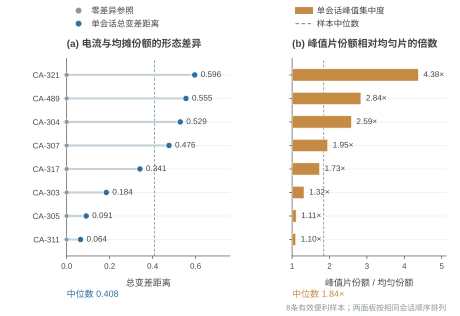

**图5-8 ACN实测电流形态与均匀分摊代理的差异**  A为每条会话归一化片份额的总变差距离，B为最大电流份额与均匀份额之比。每点为预定便利样本中的一条有效会话（8条），虚线为样本中位数。未换算为功率或电量，不作总体推断。

### 5.4.4 同节点历史设备上报电量对照

CA-303在2020年11月共11次会话，设备上报累计电量插值至完整15 min片边界后差分，与两种代理比较，共277个共同完整片。接入—断开均分与完成时刻截断的合并MAE分别为0.313306、0.053501 kWh/15 min；会话等权MAE中位数为0.276653、0.078197。完成终点在10条会话中差异更低，1条相同（仅1片）；总变差中位数分别为0.637684、0.118743。上述差值为代理电量与设备上报电量的对照，不等同模型MAE，不作显著性推断。

图5-9(a)展示已查看的先导会话，(b)呈现498条抽样会话的片份额总变差距离分布。

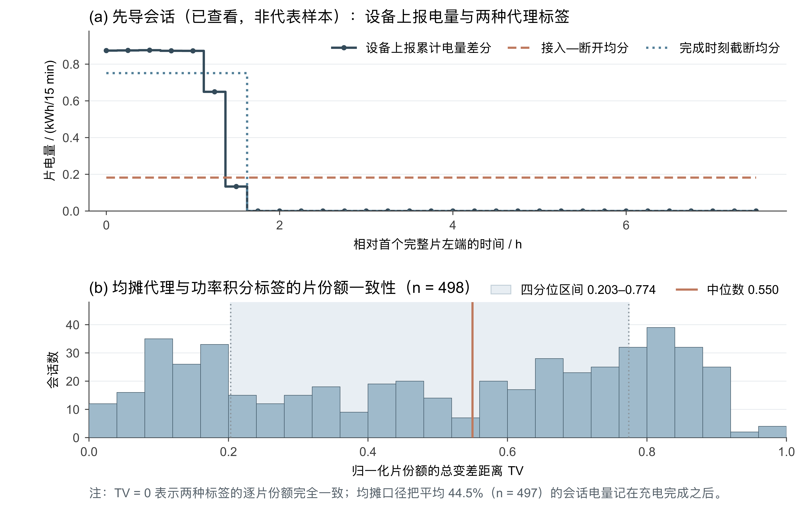

**图5-9 代理标签与设备电量的形态一致性**  (a) CA-303先导会话的设备上报累计电量差分与两种均分标签（0.182、0.751）；(b) 498条抽样会话的片份额总变差距离，中位数0.550。均摊规则把平均44.5%的会话电量记在完成之后，设备上报电量未经独立计量校准。

### 5.4.5 有限时域充电分配与合成决策算例

本节以人工设定的情景演示预测结果如何进入有限时域充电分配，构造如下线性规划。令$p_{j,h}$为车辆$j$在时间片$h$的计划功率，$\pi_h$为单位电量记账价格，目标是在满足车辆请求的前提下降低计划成本：

$$
\min_{\{p_{j,h}\}}\ \sum_{h=1}^{K}\pi_h\Delta t\sum_j p_{j,h}. \tag{5-7}
$$

每辆车具有服务窗、剩余电量需求和功率上限，并满足能量请求及站点容量约束。容量式中的不可调充电基线须经计量校准；若全站预测已含可调车辆，再将同一车辆请求加入会重复计量。当前模块只输出供复核的计划；采用无损、连续功率假设，未建模V2G、三相约束、离散电流、效率和执行偏差。

合成算例设置一辆车在四片内请求1 kWh、功率上限3 kW；不可调充电与其他负荷各1 kW，站点限额6 kW、备用1 kW，价格为4、3、2、1。求解结果见表5-5。

**表5-5 合成四片充电分配的影子计划**

| 项目 | 第1片 | 第2片 | 第3片 | 第4片 |
|---|---:|---:|---:|---:|
| 单位电量记账价格 | 4 | 3 | 2 | 1 |
| 不可调充电/kW | 1 | 1 | 1 | 1 |
| 非充电负荷/kW | 1 | 1 | 1 | 1 |
| 可调车辆功率/kW | 0 | 0 | 1 | 3 |
| 合计计划功率/kW | 2 | 2 | 3 | 5 |

计划满足1 kWh请求，合计功率加备用不超过6 kW，成本为1.25个记账单位；整数网格枚举得到相同最优值。该核验仅说明求解器在合成输入下满足约束；情景参数不取自任何企业运营记录，也不证明预测带来节约。

### 5.4.6 证据边界与应用验证要求

同站证据只有两类：8条电流形态样本和CA-303的11条累计电量序列。后者未校准，也不评价2021测试期预测。设备型号、固件、计量算法、校准与完整导出程序均未确认。本地快照没有保存`userInputs`，源端覆盖范围与更新时间未知；本地缺失不能作为源端无记录的证明。EPFL的限额与功率无法映射到ACN十个节点。

上述比较仍限于代理目标，表5-5只核验合成求解。实测误差评价要求节点映射一致、时间同步、计量边界明确的kW或kWh；运行评价还需要当时可见的请求、限额、其他负荷与电价。现有证据不足以支持现场越限、服务改善或成本节约。

事件层是上述边界中最紧的一处，两条不同来源的证据指向同一结论。第4章的交叉分组分解显示，回溯协议中1.39%的预测键贡献28.10%的绝对误差（见4.4节）；本章的区间评价显示，事件层的实测覆盖远低于名义覆盖率，14天滚动校准后虽有提升仍不足以支撑核查（见5.1节、表5-1）。前者说明事件键的单键误差远高于常态键，后者说明这些键上的预测分布同样未被区间校准捕获，故事件层既难预测，也难给出可靠区间。

可据此确定的是研究设计：后续重复实验应优先检验负荷与轮廓关系；模型比较同时保留全局与活跃片段指标；目标核验优先取得完成时刻附近的独立计量。这些用于安排复验与采数，不是运行控制建议。

### 5.4.7 标签构造敏感性

本文的目标标签由会话电量按接入—断开均分得到。3.8.4节与3.8.5节固定既有预测、只换评价标签；本节重建目标后重新训练。

从2018年5月至2020年12月分层抽取500条，其中498条完成两种构造。归一化片份额的总变差距离中位数为0.550，四分位区间0.203至0.774；逐片平均绝对差中位数0.252 kWh/15 min。均摊把平均44.5%的会话电量记在充电完成之后，该值取可计算尾部电量的497条会话等权平均。2.1.2节的30.66%为10节点全量会话按总电量加权的份额，样本与权重均不同，两值不可互换。功率积分在该时段接近零。抽样会话的功率采样间隔中位数为4 s，远细于15 min片，差异来自分配规则而非采样分辨率；两种标签的形态差异见图5-9(b)。

测试期只能构造半计量标签。Caltech在2021年3月12日至9月14日的十个节点共1,241条会话，1,200条（96.7%）可取到逐会话电流。该数据没有电压采样，按会话总能量反推等效电压，中位数223.8 V，四分位区间221.1至226.0 V；若固定取208 V，能量将低估7.1%。片间形态来自电流积分、电压来自能量匹配，因此仍是半计量；等效电压分布见图5-10。它与均分标签的总变差距离中位数0.504，逐片差中位数0.277 kWh/15 min。把冻结预测放在该标签可用的子集上复评：子集含87,884个键，占测试键的12.4%，并偏向活跃时段。MRG-GCN三种子MAE由0.2814、0.2772、0.2770升至0.4380、0.4368、0.4364，容量近似TCN由0.2766、0.2756、0.2714升至0.4338、0.4348、0.4318。排序未变，量级上升。该比较同时含标签变化与子集选择，只能作为敏感度参考。

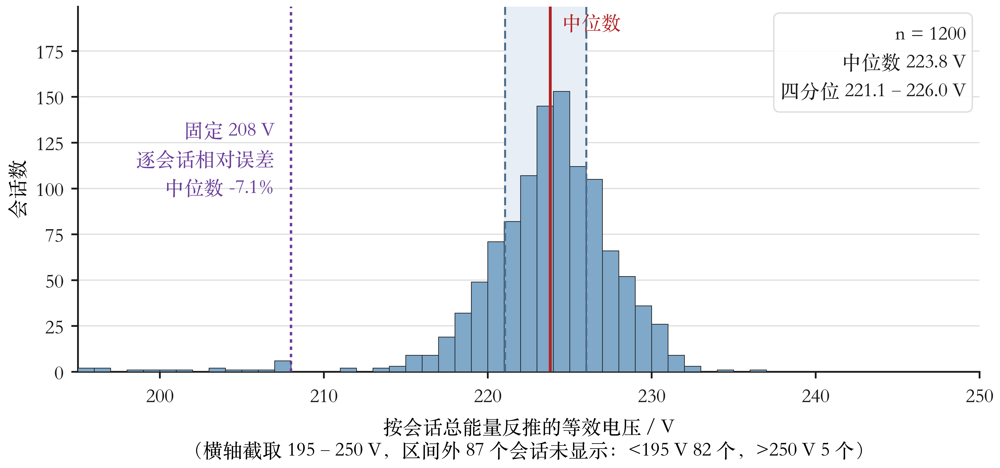

**图5-10 测试期半计量标签的等效电压**  1,200条会话按总能量反推的等效电压分布，中位数223.8 V，四分位区间221.1至226.0 V；轴外另有82条低于195 V的低电量会话，其反推值不稳定，未纳入作图区间。

静态时序止于2020年12月2日，且该站在2020年4月后活跃度骤降，评估窗取2018年4月25日至2020年2月29日。两份数据的特征、关系图与划分一致，训练、调参、校准、测试起点分别为45,302、4,865、4,865与9,724个。功率标签由上报功率片内积分得到。8,566条会话（92.5%）的积分能量与kWhDelivered相对误差不超过5%，予以采用；其余691条回退均分。两标签测试期总能量相差0.4%，目标均值分别为0.071060与0.071379 kWh/15 min，零值比例79.6%与90.3%。

训练协议与正式运行一致：AdamW，学习率1e-3，权重衰减1e-4，批大小256，标准化L1损失，最多60轮，耐心8轮，调参集MAE选模，种子为2024、2025、2026。

结果见表5-6与图5-11。两种标签下MRG-GCN在三个种子上都低于容量近似TCN，三种子均值由0.05191对0.05281（1.71%）变为0.06353对0.06458（1.63%）。排序未变，整体误差上升约22%。

**表5-6 双标签重训的测试期MAE**

| 标签口径 | 种子 | MRG-GCN | 容量近似TCN | 相对优势 |
|---|---|---:|---:|---:|
| 代理 | 2024 | 0.05218 | 0.05283 | 1.23% |
| 代理 | 2025 | 0.05168 | 0.05285 | 2.22% |
| 代理 | 2026 | 0.05186 | 0.05275 | 1.69% |
| 代理 | 三种子均值 | 0.05191 | 0.05281 | 1.71% |
| 功率 | 2024 | 0.06345 | 0.06455 | 1.71% |
| 功率 | 2025 | 0.06328 | 0.06454 | 1.95% |
| 功率 | 2026 | 0.06385 | 0.06465 | 1.23% |
| 功率 | 三种子均值 | 0.06353 | 0.06458 | 1.63% |

注：单位为kWh/15 min；代理指接入—断开均分，功率指设备上报功率积分；相对优势为MRG-GCN的MAE较容量近似TCN低出的比例（分母为容量近似TCN的MAE）；两份数据集除目标外相同，测试起点9,724个；零预测基线为0.07106（代理）与0.07138（功率）。评估窗为2018年4月25日至2020年2月29日，不是论文原测试期，表中数值不与表3-2、表3-3比较。

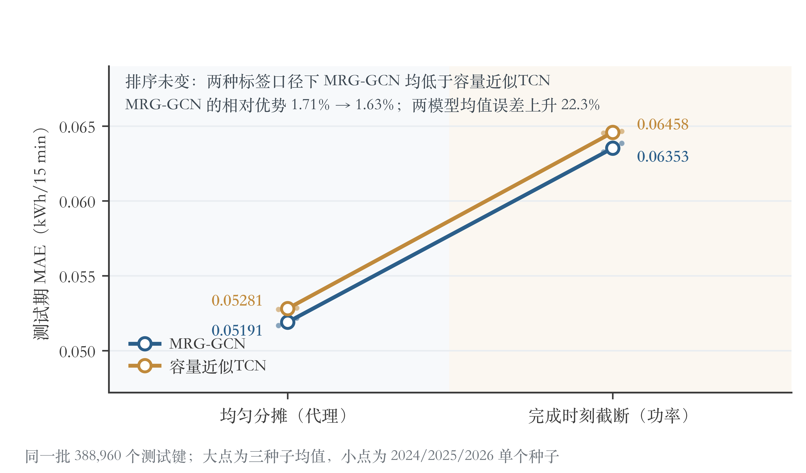

**图5-11 双标签重训的测试期MAE**  同一批388,960个测试键上仅更换标签口径的测试期MAE，蓝为MRG-GCN、赭为容量近似TCN，代理与功率口径均值分别为0.05191与0.06353。两种口径排序不变（相对优势1.71%→1.63%），功率口径只重训了这两个模型。

按事件掩码分层后，排序仍然一致：两种标签与事件、稳定、非零三层交叉共6格，18次种子比较中MRG-GCN每格每种都更低。功率标签非零层的均值差0.00445与该格种子间标准差0.00448相当，方向由三个种子的符号一致支撑，幅度不宜强调；其余五格的差值约为标准差的1.4至3.5倍。事件层混有零标签键（代理288/7,270，功率2,588/7,270），故功率标签事件层MAE较低并不表示事件更易预测。非零集合随标签而变（占测试键20.41%与9.74%），两标签的非零层MAE只能在同格内比较模型。稳定层占测试键的98.13%，整体MAE主要由它决定；事件层单键误差更高，但在平均中被稀释。分层误差与早停轮次见表5-7。

**表5-7 双标签重训的分层误差与早停轮次**

| 标签口径 | 模型 | 非零组MAE | 事件组MAE | 早停轮次 |
|---|---|---:|---:|---:|
| 代理 | MRG-GCN | 0.2386 | 0.3659 | 13.0 |
| 代理 | 容量近似TCN | 0.2411 | 0.3668 | 37.0 |
| 功率 | MRG-GCN | 0.5702 | 0.3344 | 17.7 |
| 功率 | 容量近似TCN | 0.5746 | 0.3392 | 38.0 |

注：MAE单位为kWh/15 min，为三种子均值；分组口径与第3章相同。两种标签的零值比例不同（79.6%与90.3%），两列分层MAE的样本构成不同，不逐项相减，也不代表同一批会话的前后变化。

以MRG-GCN为例，功率标签下非零组MAE上升而事件组下降，零值比例同时由79.6%升至90.3%，说明更多高负荷片在新标签下被压低或归零。两组条件MAE方向不同，且样本构成随标签改变，不能据此推断误差份额向非事件时段转移。

在本窗与当前预算下，可得到三点结论。其一，两种标签下，MRG-GCN与容量近似TCN的三种子排序方向一致；该结果只说明所检窗口与两种模型内的排序一致性。其二，误差的绝对水平依赖标签：整体MAE上升约22%，非零组条件MAE上升而事件组下降；两组只报告条件MAE差异。其三，第3章报告的MAE只对应代理目标，换用其他口径须重新标定。

边界有三条。该窗不是论文原测试期；功率为设备上报，没有独立计量校准，半计量的电压由能量匹配反推，只能复现会话总量；分析只涉及两个模型与三个种子，未做超参数搜索。

主实验与代理标签重训窗口的零值比例与整体增益差异（均为旧七特征配置：前者五种子、增益16.4%；后者2024–2026三种子、增益16.1%）源于种子数与窗口设置，不作直接比较。

同一对模型换窗口后优势显著收敛，说明主实验的16.1%不能直接读作方法在活跃片段上的增益，也说明按整体MAE选型会把零值段的贡献误记为关系建模的贡献。

### 5.4.8 使用条件、准入与价值边界

整体选型可参考全局排序相关0.993（区间[0.893, 1.000]），其依据限于表3-10所列12种配置与已查看测试期。活跃片段评估须并列报告非零与事件分层，0.420与0.559说明这两层排序只在原口径内成立。区间使用以事件覆盖26.71%（表5-1，汇总见5.1节）作事件层参考，该值不构成覆盖保证。运营成本需另由告警频率与现场工时记录评估。

上线准入须同时具备同步计量与到达时间记录、冻结的事件定义、与训练一致的标签口径，以及固定的预算和早停规则。门控增量在Caltech与JPL为2.69%与2.71%，均取自三种子配对，方向判定须逐种子核对。JPL共享门控已有一个种子触及60轮上限，复现时须注明该条件。式（5-6）余量接口、合成线性规划与固定轨迹回放均已具备，与真实运行约束的联合调试仍待开展。

由此形成的后续离线研究顺序包括关系复验、同协议选型与告警阈值校准。关系复验按1.82%与1.52%的增量先检验负荷耦合与轮廓相似，行为共现0.15%跨零，列为观察项。N=10 与 top-k=3/5 使关系图接近稠密，自环替换属强干预；本文的增量读数不宜外推到节点数更多、图更稀疏的场景。容量控制的准入取决于可映射到所评价的十个节点的限额与备用裕度，收益估算还需电价与服务成本记录。

## 5.5 本章小结

本章检验了预测结果用于方向性分析、区间表达和运行核查时的证据边界。TE筛查未留下经家族校正的候选；该结果受置换分辨率限制，不构成方向性效应不存在的证据；区间整体覆盖与事件覆盖差异明显；标签构造检验显示，功率积分标签下重训的排序与均摊标签一致，误差水平上升约22%（同一重建窗、两模型三种子）；固定轨迹和合成线性规划展示了预测接口，但没有验证实际调度效果。

本章其他证据进一步限制用途：Caltech事件覆盖不足，JPL整体区间覆盖接近90%但事件覆盖低于50%。本章证据支持的是关系复验顺序、按评价目标选模和代理目标采数优先级，不支持设备选型、容量控制或收益估算。

# 结  论

## 主要研究结论

本文提出残差化多关系门控图卷积模型（以`load_lag1`为基准、模型只预测残差）与分层评价协议（MDP）两项方法，并在公开会话记录重构的 15 min 节点代理负荷上，就站内三类统计关系的预测价值给出三条条件性结论。

（1）针对零膨胀节点负荷下整体MAE被零值键主导、且行为特征无法替代历史负荷的问题，本文提出残差化多关系门控图卷积模型：以`load_lag1`为基准、模型只预测残差。该模型在Caltech事件时刻协议上整体MAE为0.015704（三种子，2024–2026），零值层误差为0.00559，非零层为0.0878，参数量33,902；较无图TCN低48.9%，较persistence基线低1.2%。新旧对照显示，原七特征非残差配置的整体MAE为0.036326，补入历史负荷并改为残差预测后降低56.8%，故输入缺历史负荷是原模型的根本约束；图结构在残差化架构下贡献48.9%，高于旧配置下的16.4%。非零层仍是数据稀疏下的硬瓶颈，故整体MAE不宜单独作为分层能力的依据。

（2）针对整体误差无法归因到关系类别与样本层级的问题，本文提出分层评价协议（MDP），把关系增量按评价层、标签口径与参数配置分别测量。回溯协议中1.39%的预测键贡献28.10%的绝对误差，交叉分组分解经加权还原校验自洽；冻结预测上替换标签口径后全局排序保持一致，非零层排序只在原口径内成立，故非零层排序不宜单独作为选型依据。

（3）针对关系图增益默认成立、缺少可归因测量的问题，本文提出关系增量的条件性测量方法，以同参数自环替换重训与同参数门控配对逐条关系剥离增量。负荷耦合与轮廓相似分别使整体MAE降低1.82%与1.52%，行为共现的增量区间跨零而不计为增量；该增量限于相同已查看测试期与JPL单站预算，复验顺序据此确定。

统计口径与解释边界：主结果按三种子（2024–2026）均值报告，旧七特征配置的对照以五种子均值±样本标准差与三种子配对差值为基础，配对检验为单侧Wilcoxon，关系子集扫描另作Bonferroni校正；保真项权重按调参集原单位MAE选定，测试期只作一次性报告，上述检验未对敏感性扫描作多重比较校正；区间跨零处只报区间、不引用点估计作结论；JPL为重新筛选与重训而非零样本迁移，非零层改善的显著性受种子数限制。

在证据覆盖的范围内，可直接使用的做法有三项：按评价层分别选型而非只看全局MAE；对关系增量按条件复验而非默认成立；在更换标签口径时重新标定误差水平。其准入条件见5.4.8节。

由此，本文不把整体MAE当作唯一选型依据，不把三站结果外推为跨运营商或未来期泛化，也不把代理电量结论直接用于计量功率场景。

## 研究不足与展望

（1）证据限于ACN同源数据的已查看测试期：JPL与Office 1属同一数据家族，跨数据家族与未见时期的表现均未验证；关系增量的条件性结论还限于JPL单站与60轮预算。

（2）代理目标与设备计量功率的衔接仅完成先导核对，未达可校准级，设备算法与校准链未核实；标签口径由会话均匀分摊改为设备上报功率积分时，误差水平改变约22%（表5-6，重建窗非原测试期、两模型三种子）；非零层改善的显著性亦受种子数限制。

（3）预测区间的实测覆盖严重不足，事件层尚不可用。名义90%区间在回溯与事件时刻协议测试期的实测覆盖分别为69.6%与79.55%，事件层仅1.9%—3.87%；14天滚动校准把整体覆盖提至89.01%、事件层提至26.71%（行为分层路径；标准逐节点路径膨胀6.25倍），但区间宽度膨胀为冻结方案的4.47倍（表5-1），区间尚不能直接用于运行核查。

（4）后续可开展跨数据家族验证、事件层区间校准，并把活跃判定概率用于运行核查；三者均以取得与预测同步的独立计量与输入到达时间记录为前提。式（5-6）余量接口、合成线性规划与固定轨迹回放已完成，与真实运行约束的联合调试仍待开展。

## 数据与代码可用性

数据取自ACN公开会话数据（Caltech单站与JPL场站）及ACN-Data Static设备时序快照，字段定义、节点筛选与四段切分见2.1节；建模代码、训练配置与逐运行指标按固定版本保存，可在不涉及第三方数据许可的前提下按请求提供，原始记录与逐键预测不随论文附送。

# 参考文献

[1] 中国电动汽车充电基础设施促进联盟. 2024年全国电动汽车充换电基础设施运行情况[EB/OL]. (2025-01-23)[2026-10-22]. https://www.evcipa.org.cn/newsinfo/8137834.html.
[2] 陈丽丹, 张尧, FIGUEIREDO A. 电动汽车充放电负荷预测研究综述[J]. 电力系统自动化, 2019, 43(10): 177-197.
[3] 张夏韦, 梁军, 王要强, 等. 电动汽车充电负荷时空分布预测研究综述[J]. 电力建设, 2023, 44(12): 161-173.
[4] 崔一诺, 罗配明, 李攀硕, 等. 电动汽车充放电负荷时-空分布预测研究综述[J]. 电气工程学报, 2026, 21(2): 371-385.
[5] 韩林阳, 叶承晋, 朱超, 等. 高温天气下计及用户意愿的城市充电负荷空间引导策略[J]. 电力系统自动化, 2024, 48(10): 139-150.
[6] 田礼彬. 电动汽车负荷时空预测及有序充放电优化调度[D]. 吉林: 东北电力大学, 2025.
[7] 王哲, 万宝, 凌天晗, 等. 基于谱聚类和LSTM神经网络的电动公交车充电负荷预测方法[J]. 电力建设, 2021, 42(6): 58-66.
[8] 陈闯. 基于图卷积网络及排队论的电动汽车充电负荷预测研究[D]. 深圳: 哈尔滨工业大学(深圳), 2022.
[9] 奚圣宽. 基于深度学习的电动汽车充电桩负荷预测方法研究[D]. 北京: 华北电力大学, 2023.
[10] 黄南天, 孙赫宏, 王圣元, 等. 计及多公共充电站差异化耦合关联的电动汽车充电负荷时-空短期预测[J]. 中国电机工程学报, 2025, 45(4): 1424-1436. DOI: 10.13334/j.0258-8013.pcsee.231589.
[11] 张美霞, 孙铨杰, 杨秀. 考虑多源信息实时交互和用户后悔心理的电动汽车充电负荷预测[J]. 电网技术, 2022, 46(2): 632-641.
[12] 张延宇, 张智铭, 刘春阳, 等. 基于动态自适应图神经网络的电动汽车充电负荷预测[J]. 电力系统自动化, 2024, 48(7): 86-93. DOI: 10.7500/AEPS20230611001.
[13] 黄健, 陈建红, 何剑杰, 等. 基于GCN-LSTM的电动汽车负荷预测方法[J]. 浙江电力, 2024, 43(12): 59-67. DOI: 10.19585/j.zjdl.202412006.
[14] 陈培垠, 方彦军. 基于卡尔曼滤波预测节假日逐点增长率的电力系统短期负荷预测[J]. 武汉大学学报(工学版), 2020, 53(2): 139-144.
[15] 潘良军, 王楷, 赵宏炎, 等. 基于春节影响时期分析的中期负荷智能预测[J]. 智慧电力, 2020, 48(9): 75-80,117.
[16] 陈梓行, 金涛, 郑熙东, 等. 基于新型日期映射法和ISGU混合模型的短期电力负荷预测[J]. 电力系统保护与控制, 2022, 50(15): 72-80.
[17] 巫朝越. 考虑特殊事件影响的单体用户短期负荷预测组合模型[D]. 南京: 东南大学, 2024.
[18] 韩富佳, 王晓辉, 乔骥, 等. 基于人工智能技术的新型电力系统负荷预测研究综述[J]. 中国电机工程学报, 2023, 43(22): 8569-8591.
[19] 黄运有, 詹剑锋. 基于深度学习的短期负荷预测综述[J]. 高技术通讯, 2021, 31(3): 240-248.
[20] KE G, MENG Q, FINLEY T, et al. LightGBM: a highly efficient gradient boosting decision tree[C]//Advances in Neural Information Processing Systems (NeurIPS). 2017: 3146-3154.
[21] CHEN T, GUESTRIN C. XGBoost: a scalable tree boosting system[C]//Proceedings of the 22nd ACM SIGKDD International Conference on Knowledge Discovery and Data Mining. 2016: 785-794.
[22] HOCHREITER S, SCHMIDHUBER J. Long short-term memory[J]. Neural Computation, 1997, 9(8): 1735-1780.
[23] CHO K, VAN MERRIËNBOER B, GULCEHRE C, et al. Learning phrase representations using RNN encoder-decoder for statistical machine translation[C]//Proceedings of EMNLP. 2014: 1724-1734.
[24] BAI S, KOLTER J Z, KOLTUN V. An empirical evaluation of generic convolutional and recurrent networks for sequence modeling[J/OL]. arXiv, 2018[2026-10-22]. https://arxiv.org/abs/1803.01271. DOI: 10.48550/arXiv.1803.01271.
[25] VASWANI A, SHAZEER N, PARMAR N, et al. Attention is all you need[C]//Advances in Neural Information Processing Systems (NeurIPS). 2017: 5998-6008.
[26] 王华彪, 李小勇. 基于融合注意力机制改进双向长短时记忆网络在电动汽车充电负荷中的预测研究[J]. 电网与清洁能源, 2022, 38(6): 104-112.
[27] 王琨, 高敬更, 张勇红, 等. 基于LSTM神经网络的复合变量电动汽车充电负荷预测方法技术研究[J]. 工业仪表与自动化装置, 2019(1): 27-31.
[28] 张昌鸿, 曾祥智. 基于拉丁超立方及CNN-LSTM-ATTENTION的电动汽车负荷预测[J]. 电工技术, 2025(10): 125-129.
[29] 顾玮, 段敬, 张栋, 等. 分时电价下的充电站负荷预测[J]. 计算机应用, 2024, 44(S1): 337-342.
[30] 袁溪, 张邵欣, 张超, 等. 基于Transformer的电动汽车充电站能耗预测研究[J]. 计算机技术与发展, 2025, 35(2): 213-220.
[31] 王强, 毕宇豪, 高超, 等. 融合多方信息的电动汽车充电负荷时空分布预测[J]. 电力建设, 2025, 46(6): 24-37. DOI: 10.12204/j.issn.1000-7229.2025.06.003.
[32] 赵子鋆, 彭清文, 邓铭, 等. 考虑多因素影响与误差修正的充电站负荷预测[J]. 浙江电力, 2024, 43(4): 21-28.
[33] 温子健, 李伟风, 刘泽晖, 等. 基于时间特征分类与误差修正的电动汽车充电负荷预测[J]. 浙江电力, 2026, 45(5): 69-78. DOI: 10.19585/j.zjdl.202605007.
[34] 蒋建东, 韩文轩, 赵云飞, 等. 基于优化VMD二次分解的短期电力负荷预测[J]. 郑州大学学报(工学版), 2026, 47(1): 124-130.
[35] 张翾, 李红月. 基于优化VMD与TCN-ISE-Pyraformer的短期电力负荷预测[J]. 安徽工业大学学报(自然科学版), 2025, 42(3): 263-275. DOI: 10.12415/j.issn.1671-7872.25006.
[36] 韩宇昊, 刘鸿鹏. 基于FMD-LSTM-Bootstrap的电动汽车充电负荷区间预测[J]. 东北电力大学学报, 2025, 45(6): 51-59.
[37] 朱俊丞. 基于深度学习的多时间尺度电动汽车充电负荷预测模型设计[D]. 郑州: 郑州大学, 2020.
[38] 陈勇, 江颖达, 徐刚, 等. 规模化电动汽车充电负荷预测[J]. 电力需求侧管理, 2022, 24(5): 71-77. DOI: 10.3969/j.issn.1009-1831.2022.05.012.
[39] 闫威, 李南, 沈月秀, 等. 基于CNN-GAN与半监督回归的电动汽车充电负荷预测[J]. 浙江电力, 2023, 42(2): 83-89. DOI: 10.19585/j.zjdl.202302011.
[40] 赵伟博, 范旭东, 孙胜博, 等. 电动汽车充电负荷场景化分析与超短期预测方法[J]. 电力信息与通信技术, 2025, 23(2): 28-37. DOI: 10.16543/j.2095-641x.electric.power.ict.2025.02.04.
[41] 毛建斌, 杨少兵, 杨湘彦, 等. 基于有限混合模型的规模化电动汽车充电负荷在线预测方法[J]. 电网技术, 2025, 49(5): 1931-1940. DOI: 10.13335/j.1000-3673.pst.2024.0241.
[42] 吴钉捷, 李晓露. 基于实时出行需求和交通路况的电动汽车充电负荷预测[J]. 电力建设, 2020, 41(8): 57-67. DOI: 10.12204/j.issn.1000-7229.2020.08.008.
[43] 丁乐言, 柯松, 张帆, 等. 考虑出行需求和引导策略的电动汽车充电负荷预测[J]. 电力建设, 2024, 45(6): 10-26. DOI: 10.12204/j.issn.1000-7229.2024.06.002.
[44] 张琳娟, 李文峰, 许长清, 等. 计及充电排队与实时SOC的电动汽车充电负荷时空分布预测[J]. 电力建设, 2025, 46(8): 54-66. DOI: 10.12204/j.issn.1000-7229.2025.08.006.
[45] 李宏伟, 宋玉峰, 李帅兵, 等. 基于ArcGIS路网结构与交通拥挤度分析的电动汽车充电负荷预测方法[J]. 电网技术, 2025, 49(5): 1920-1930. DOI: 10.13335/j.1000-3673.pst.2023.1420.
[46] 葛乐, 陆颖, 王明深, 等. 考虑用户决策更新的电动汽车充换电负荷预测[J]. 浙江电力, 2025, 44(10): 152-164. DOI: 10.19585/j.zjdl.202510013.
[47] KIPF T N, WELLING M. Semi-supervised classification with graph convolutional networks[C]//Proceedings of the 5th International Conference on Learning Representations (ICLR). Toulon, 2017.
[48] VELIČKOVIĆ P, CUCURULL G, CASANOVA A, et al. Graph attention networks[C]//Proceedings of the 6th International Conference on Learning Representations (ICLR). 2018.
[49] SCHLICHTKRULL M, KIPF T N, BLOEM P, et al. Modeling relational data with graph convolutional networks[C]//European Semantic Web Conference (ESWC). 2018: 593-607.
[50] YU B, YIN H, ZHU Z. Spatio-temporal graph convolutional networks: a deep learning framework for traffic forecasting[C]//Proceedings of the 27th International Joint Conference on Artificial Intelligence (IJCAI). 2018: 3634-3640.
[51] WU Z, PAN S, LONG G, et al. Graph WaveNet: deep spatial-temporal graph modeling[C]//Proceedings of the 28th International Joint Conference on Artificial Intelligence (IJCAI). 2019: 1907-1913.
[52] BAI L, YAO L, LI C, et al. Adaptive graph convolutional recurrent network for traffic forecasting[C]//Advances in Neural Information Processing Systems (NeurIPS). 2020: 17804-17815.
[53] 叶宝林, 戴本岙, 张鸣剑, 等. 基于图卷积网络的交通流预测方法综述[J]. 南京信息工程大学学报(自然科学版), 2024, 16(3): 291-310.
[54] 闫佳和, 李红辉, 孙婧, 等. 面向交通流预测的时空图神经网络发展综述[J]. 计算机工程与应用, 2025, 61(22): 1-19.
[55] 李志帅, 吕宜生, 熊刚. 基于图卷积神经网络和注意力机制的短时交通流量预测[J]. 交通工程, 2019, 19(4): 15-19, 28.
[56] 董雷, 陈振平, 韩富佳, 等. 基于图卷积神经网络与K-means聚类的居民用户集群短期负荷预测[J]. 电网技术, 2023, 47(10): 4291-4301.
[57] 张鹏飞, 胡博, 何金松, 等. 基于时空图卷积网络的短期空间负荷预测方法[J]. 电力系统自动化, 2023, 47(13): 78-85.
[58] 吴兴扬, 戴剑丰. 基于多尺度自适应时空图卷积网络与BERT模型的多节点短期负荷预测[J]. 电网技术, 2025, 49(9): 3756-3766. DOI: 10.13335/j.1000-3673.pst.2024.1895.
[59] 张艺涵, 杨萌, 刘军会, 等. 基于时间图卷积网络的短期电力负荷时空预测方法[J]. 电网与清洁能源, 2024, 40(12): 27-35.
[60] 高昆仑, 姚铁锤, 刘思言, 等. 面向电网分析计算的图神经网络技术综述[J]. 电网技术, 2026, 50(3): 909-921.
[61] 赵紫昱, 陈渊睿, 陈霆威, 等. 基于时空图注意力网络的超短期区域负荷预测[J]. 电力系统自动化, 2024, 48(12): 147-155.
[62] 原野, 王海燕, 袁新平, 等. 基于可解释动态图注意力网络的短期电力负荷预测[J]. 计算机应用, 2025, 45(S1): 329-333.
[63] 孟衡, 张涛, 王金, 等. 基于多尺度时空图卷积网络与Transformer融合的多节点短期电力负荷预测方法[J]. 电网技术, 2024, 48(10): 4297-4305. DOI: 10.13335/j.1000-3673.pst.2024.0168.
[64] 贠昕尧. 基于多图融合的电动汽车充电站群负荷时空预测方法研究[D]. 西安: 西安理工大学, 2024.
[65] 王进世. 基于图注意力网络的电动汽车充电站负荷预测方法研究[D]. 兰州: 西北师范大学, 2025.
[66] 王圣元. 基于图神经网络的短期负荷时空预测[D]. 吉林: 东北电力大学, 2023.
[67] HUANG Y, WU S, WANG Z, et al. Causality-aware multi-graph convolutional networks with critical node dynamics for electric vehicle charging station load forecasting[J]. IEEE Transactions on Smart Grid, 2025, 16(4): 3210-3225. DOI: 10.1109/TSG.2025.3570955.
[68] ZHANG L, JIAO Z, ZHAO C. Load probabilistic forecasting for electric vehicle charging station cluster: adaptive multivariate spatiotemporal graph fusion technology[J]. International Journal of Electrical Power & Energy Systems, 2025, 173: 111387. DOI: 10.1016/j.ijepes.2025.111387.
[69] HE J, LIU Q Y, HU Y L, et al. Short-term regional EV charging load forecasting based on GAT and GRU with trip distribution estimation[J]. Applied Energy, 2026, 406: 127262. DOI: 10.1016/j.apenergy.2025.127262.
[70] XIE T, YUN X, ZHANG G, et al. Charging station cluster load prediction: spatiotemporal multi-graph fusion technology[J]. Renewable and Sustainable Energy Reviews, 2024, 206: 114855. DOI: 10.1016/j.rser.2024.114855.
[71] FENG D, LI D, ZHOU Y, et al. STGNet: short-term residential load forecasting with spatial-temporal gated fusion network[J]. Energy Science & Engineering, 2024, 12(3): 541-560. DOI: 10.1002/ese3.1633.
[72] WANG Y, RUI L, MA J, et al. A short-term residential load forecasting scheme based on the multiple correlation-temporal graph neural networks[J]. Applied Soft Computing, 2023, 146: 110629. DOI: 10.1016/j.asoc.2023.110629.
[73] ZHANG T, JIAO W, YU J, et al. Short-term residential load forecasting framework based on spatial-temporal fusion adaptive gated graph convolution networks[J]. IEEE Transactions on Neural Networks and Learning Systems, 2025, 36(9): 17004-17018. DOI: 10.1109/TNNLS.2025.3551778.
[74] LIANG Y. Forecast-time-safe load forecasting for connected and automated EV charging operation: periodicity-aware residual correction on a processed distribution load proxy with public EV charging validation[J]. World Electric Vehicle Journal, 2026, 17(7): 336. DOI: 10.3390/wevj17070336.
[75] 高洪超, 陈启鑫, 雷振, 等. 考虑事件数据的产消者负荷预测方法及极端误差抑制策略[J]. 电力系统自动化, 2023, 47(13): 47-55.
[76] HWANG J, SUH D. PAR-LLM: peak-aware residual LLM over anchor for EV charging station demand[J]. IEEE Access, 2026, 14: 52360-52370. DOI: 10.1109/ACCESS.2026.3679962.
[77] LUNDBERG S M, LEE S I. A unified approach to interpreting model predictions[C]//Advances in Neural Information Processing Systems (NeurIPS). 2017: 4765-4774.
[78] 孙飞虎. 基于注意力机制的配电网电力负荷预测方法研究[D]. 桂林: 桂林电子科技大学, 2025.
[79] JAIN S, WALLACE B C. Attention is not explanation[C]//Proceedings of NAACL-HLT. 2019: 3543-3556.
[80] ARABZADEH V, FRANK R. A four-dimensional analysis of explainable AI in energy forecasting: a domain-specific systematic review[J]. Machine Learning and Knowledge Extraction, 2025, 7(4): 153.
[81] GUASTAVINO S, PIANA M, BENVENUTO F. Bad and good errors: value-weighted skill scores in deep ensemble learning[J]. IEEE Transactions on Neural Networks and Learning Systems, 2024, 35(2): 1993-2002. DOI: 10.1109/TNNLS.2022.3186068.
[82] SCHREIBER T. Measuring information transfer[J]. Physical Review Letters, 2000, 85(2): 461-464.
[83] RUNGE J, NOWACK P, KRETSCHMER M, et al. Detecting and quantifying causal associations in large nonlinear time series datasets[J]. Science Advances, 2019, 5(11): eaau4996.
[84] RUNGE J. Discovering contemporaneous and lagged causal relations in autocorrelated nonlinear time series datasets[C]//Proceedings of the 36th Conference on Uncertainty in Artificial Intelligence (UAI). PMLR, 2020, 124: 1388-1397.
[85] VOVK V, GAMMERMAN A, SHAFER G. Algorithmic learning in a random world[M]. New York: Springer, 2005.
[86] LEI J, G'SELL M, RINALDO A, et al. Distribution-free predictive inference for regression[J]. Journal of the American Statistical Association, 2018, 113(523): 1094-1111.
[87] GIBBS I, CANDÈS E. Adaptive conformal inference under distribution shift[C]//Advances in Neural Information Processing Systems. 2021, 34: 1660-1672.
[88] LEE Z J, LI T, LOW S H. ACN-Data: Analysis and applications of an open EV charging dataset[C]//Proceedings of the Tenth ACM International Conference on Future Energy Systems. New York: ACM, 2019: 139-149. DOI: 10.1145/3307772.3328313.
[89] LI T. ACN-Data Static[EB/OL]. [2026-10-22]. https://github.com/tongxin-li/ACN-Data-Static.
[90] DESL-EPFL. Level 3 electric vehicle charging dataset[DB/OL]. [2026-10-22]. https://github.com/DESL-EPFL/Level-3-EV-charging-dataset.
[91] BOX G E P, JENKINS G M. Time series analysis: forecasting and control[M]. San Francisco: Holden-Day, 1970.
[92] NAM A, CONKLIN H, YANG Y, et al. Causal head gating: a framework for interpreting roles of attention heads in transformers[C]//Advances in Neural Information Processing Systems. 2025, 38.
[93] HINTON G, VINYALS O, DEAN J. Distilling the knowledge in a neural network[C]//NeurIPS 2014 Deep Learning Workshop. 2015.
[94] LI Y, CHAI S, ZHANG X, et al. STPNet: quantifying the uncertainty of EV charging demand via long-term spatiotemporal traffic flow prediction intervals[J]. IEEE Transactions on Intelligent Transportation Systems, 2023, 24(12): 15018-15034. DOI: 10.1109/TITS.2023.3305626.
[95] SHI L, SHEN Z, LYU T. Local online conformal prediction for power load forecasting intervals[J]. Electric Power Systems Research, 2026, 261: 113412. DOI: 10.1016/j.epsr.2026.113412.
[96] CRAGG J G. Some statistical models for limited dependent variables with application to the demand for durable goods[J]. Econometrica, 1971, 39(5): 829-844.
[97] LAMBERT D. Zero-inflated Poisson regression, with an application to defects in manufacturing[J]. Technometrics, 1992, 34(1): 1-14.
[98] WEN R, TORKKOLA K, NARAYANASWAMY B, et al. A multi-horizon quantile recurrent forecaster[J]. arXiv preprint arXiv:1711.11053, 2017.

# 致  谢

三载求学，转瞬即逝。论文搁笔之际，谨向一路给予我帮助与支持的师长、同窗与亲人致以诚挚谢意。

首先感谢我的导师。从选题方向的确定、实验方案的设计，到论文框架的搭建与文字的反复修改，导师始终给予我悉心指导。导师严谨的治学态度、对科研细节的严格要求，以及在我遇到困难时的鼓励与信任，是我完成本文最重要的支撑。这些教诲将伴随我今后的学习与工作。

感谢课题组各位老师在开题、中期检查与预答辩中提出的宝贵意见，使本文的结构与论证得以不断完善。感谢实验室的师兄师姐与同窗好友，在数据整理、代码调试和日常讨论中给予的无私帮助；与你们共同度过的时光，是求学路上宝贵的记忆。

感谢我的父母与家人。多年求学路上，你们始终是我最坚实的后盾，你们的理解、包容与默默支持，让我能够安心完成学业。

最后，感谢在百忙之中评阅本文并提出修改意见的各位专家，感谢所有关心和帮助过我的人。

# 附录A 补充表格

本附录汇集正文精简时下沉的表格，编号与正文表序分离。各表保留原始读数与表注；正文对应位置已给出迁移后的关键数值与解读，两处口径一致。

**表A-1 逐节点冻结规则事件统计**（原编号 2-3；对应正文2.4节）

| 节点 | 验证集非零分数占比/% | 冻结阈值 | 验证集触发点占比/% | 验证集前向窗口占比/% |
|---|---:|---:|---:|---:|
| CA-303 | 0.82 | 18.9 | 0.045 | 0.135 |
| CA-304 | 0.37 | 22.7 | 0.022 | 0.067 |
| CA-305 | 0.61 | 25.5 | 0.034 | 0.101 |
| CA-307 | 0.27 | 29.2 | 0.017 | 0.051 |
| CA-311 | 0.79 | 23.5 | 0.045 | 0.135 |
| CA-315 | 0.20 | 22.1 | 0.011 | 0.034 |
| CA-317 | 0.25 | 32.5 | 0.017 | 0.051 |
| CA-321 | 1.06 | 22.4 | 0.056 | 0.168 |
| CA-327 | 1.04 | 27.7 | 0.056 | 0.168 |
| CA-489 | 0.44 | 24.5 | 0.022 | 0.067 |

注：本表为2.4节逐节点阈值与触发比例的完整明细，正文只引用阈值区间与前向窗口相对触发点占比的倍数关系；三个数据段内规则分别执行，故每段最前两个预测起点不继承上一段的触发状态。

**表A-2 各输入在预测时刻的可见性与来源**（原编号 2-5；对应正文2.5节）

| 输入 | 所属协议 | 预测时刻可见性 | 说明 |
|---|---|---|---|
| 节点代理负荷历史 | 回溯 | 可见 | 历史片，不含目标片；事件时刻/JPL不使用该通道 |
| 当地日历 | 三套协议 | 可见 | 确定性构造 |
| 接入、离站、活跃计数 | 事件时刻/JPL | 协议假设片末可见 | 实际到达延迟未核；见2.1.3节 |
| 占用率分母 | 回溯 | 测试期统计 | 含全时期活跃节点数 |
| 需求强度、负荷突变阈值 | 回溯 | 测试期统计 | 阈值取全时期90%分位 |
| 事件标签、规则触发 | 评价 | 事后构造 | 仅用于评价，不作输入 |

注：前两行按各自协议提供历史输入，不表示三套协议共用同一通道；第三行为协议假设；后三行在回溯协议中由全时期统计构造，仅用于历史配置复核，不用于事件时刻主比较。

**表A-3 主实验时间块误差差的Bootstrap区间**（原编号 3-5；对应正文3.6.4节）

| 对照（基线−MRG-GCN） | 平均误差差 | 1日块95%区间 | 正差块 | 7日块95%区间 | 正差块 |
|---|---:|---:|---:|---:|---:|
| TCN | 0.01576 | [0.01517, 0.01640] | 187/187 | [0.01495, 0.01662] | 27/27 |
| AdaptiveGraph | 0.00020 | [0.00016, 0.00025] | 166/187 | [0.00015, 0.00026] | 27/27 |

注：平均误差差为正表示MRG-GCN误差较低；区间为10,000次有放回百分位Bootstrap的95%区间，重采样单元分别为1日块与7日块；正差块列为该单元下误差差为正的块数。本表为3.6.4节块级分析的完整读数，点级Bootstrap见正文图3-14。

**表A-4 Caltech回溯协议下MRG-GCN目标片区间与逐节点MAE**（原编号 3-7；对应正文3.6.5节）

| 目标片区间（min） | MAE | 节点 | MAE | 节点 | MAE |
|---|---:|---|---:|---|---:|
| h1 [0,15) | 0.00432 | CA-303 | 0.02582 | CA-315 | 0.00616 |
| h2 [15,30) | 0.01072 | CA-304 | 0.01171 | CA-317 | 0.00686 |
| h3 [30,45) | 0.01697 | CA-305 | 0.02234 | CA-321 | 0.00642 |
| h4 [45,60) | 0.02302 | CA-307 | 0.01863 | CA-327 | 0.01318 |
| — | — | CA-311 | 0.01810 | CA-489 | 0.00839 |

注：目标片区间均以预测发布时刻为0，采用左闭右开表示；各MAE单位为kWh/15 min。

**表A-5 参数敏感性扫描**（原编号 3-8；对应正文3.6.8节；各三种子 2024–2026；$\beta$、学习率、门控系数与 $K$ 四组在 $\lambda=0$ 配置上扫描，锚点 0.037038，非最终 $\lambda=2$ 配置）。

| 参数 | 取值 → 全局 MAE（kWh/15 min） |
| --- | --- |
| β | 0.1→0.037061；0.5→0.037038；2→0.037087；4→0.037230 |
| 学习率 | 5×10⁻⁴→0.036912；1×10⁻³→0.037038；2×10⁻³→0.037135 |
| 门控系数 | 0.3→0.037039；1→0.037038；3→0.036930；10→0.037190 |
| 分位分辨率 K | 4→0.037247；8→0.037038；16→0.036826 |
| 保真项权重 λ | 0→0.037038；2→0.036248；5→0.036552 |

注：各扫描点为三种子（2024–2026）均值，锚点为 $\lambda=0$ 配置的 0.037038；下文摆幅按 max|值−锚点|/锚点 计算。保真项权重一行与前四行口径一致（三种子）；主结果采用的 $\lambda=2$ 五种子均值另为 0.036326，两值种子数不同，并列列出而不互相替代；$\lambda=0$ 亦有两个锚点（三种子 0.037038 用于摆幅计算、五种子 0.037018 用于消融基准），二者差 0.000020，均小于种子标准差。

**表A-6 平凡基线与本文模型的测试MAE对照**（原编号 3-14；对应正文3.7.5节）

| 预测器 | 测试MAE/(kWh/15 min) |
| --- | ---: |
| 零预测 | 0.048275 |
| 容量近似TCN | 0.046345 |
| $\lambda\cdot$TCN（$\lambda$由调参集拟合） | 0.043904 |
| MRG-GCN | 0.038901（三种子） |
| 完整AGCRN | 0.037434（三种子） |

注：三种子测试集均值；本表为七特征非残差配置的诊断对照，正文主结果为八特征残差化配置（表3-2）；$\lambda\cdot$TCN只增加一个标量参数，其余与容量近似TCN相同。

**表A-7 方法组件的消融与敏感性结果**（原编号 3-15；对应正文3.8.1节）

| 组件 | 全局MAE | 相对基线 |
|---|---:|---:|
| LRE三关系图 | 0.081067 | −1.82/−0.15/−1.52% |
| 完成时刻截断目标 | 0.043401 | −0.008302 |
| 关系级$\boldsymbol\beta$冻结替换 | 0.01376 | +95.9%—+233.6% |
| 节点级门控$G$ | 0.038677 | −2.69% |
| 软门控输出头QMH | 0.036326 | −3.02% |
| 精炼与跨层融合 | 0.03890 | 跨零 |
| 关系随机失活 | 0.01391 | <0.03% |

注：MAE单位kWh/15 min；本表为七特征非残差配置的组件诊断，不与表3-2的残差化主结果混用；除QMH为五种子外均为三种子；首行依次为负荷、行为、轮廓关系，基线为自环替换。

**表A-8 分层参数干预敏感度**（原编号 4-3；对应正文4.2.6.2节）

| 干预配置 | 全局$\Delta$MAE | 标签事件窗口$\Delta$MAE | 稳定窗口$\Delta$MAE |
|---|---:|---:|---:|
| L1学习值；L2固定轮廓 | +95.9% | +5.5% | +132.1% |
| 两层固定为行为共现 | +149.3% | +17.6% | +202.1% |
| 两层学习值交换 | +148.4% | +21.6% | +199.2% |
| 两层等权 | +143.8% | +21.3% | +192.9% |
| L1固定负荷；L2学习值 | +198.4% | +35.6% | +263.7% |
| 两层固定为轮廓相似 | +200.7% | +17.1% | +274.4% |
| 两层固定为负荷耦合 | +233.6% | +26.6% | +316.6% |

注：L1/L2分别指第一、第二层；以学习值为基线，结果汇总三种子。逐种子离散度未保留，故不报告误差棒。

**表A-9 TE候选与三类统计关系图的覆盖一致性**（原编号 5-1；对应正文5.2.4节）

| 关系类型 | Jaccard系数 | Spearman系数 |
|---|---:|---:|
| 负荷耦合 | 0.444 | 0.27 |
| 行为共现 | 0.489 | −0.15 |
| 轮廓相似 | 0.378 | 0.26 |

注：名义阈值76/90、校正0/90；45对中33对覆盖，$k=3$，单种子。

**表A-10 事件时刻协议独立校准的覆盖与区间质量**（原编号 5-2；对应正文5.3.3节）

| 路径 | 整体覆盖率/% | 事件覆盖率/% | 稳定覆盖率/% | 平均宽度 | 区间分数 |
|---|---:|---:|---:|---:|---:|
| 标准逐节点 | 79.55±0.23 | 3.87±0.09 | 80.66±0.23 | 0.02757±0.00040 | 0.74551±0.00563 |
| 行为规则分层 | 80.04±0.26 | 5.92±0.15 | 81.13±0.26 | 0.03951±0.00037 | 0.73214±0.00548 |

注：三种子均值±样本标准差；测试共708,560键，其中标签事件10,204键。宽度与区间分数单位为kWh/15 min。区间分数为区间宽度加$2/\alpha$倍越出区间的距离，越小越好；保留原预测及未截零的对称区间端点。本文未按测试覆盖调整半宽。该表属于事件时刻协议，不能与表5-2相减来估计独立校准的因果收益。

**表A-11 规则路由分层共形的节点级区间宽度**（原编号 5-5；对应正文5.3.6节）

| 节点 | 区间宽度/(kWh/15 min) |
|---|---:|
| CA-303 | 0.0105±0.0005 |
| CA-311 | 0.0091±0.0001 |
| CA-327 | 0.0091±0.0001 |
| CA-489 | 0.0071±0.0001 |
| CA-321 | 0.0069±0.0002 |
| CA-305 | 0.0064±0.0006 |
| CA-315 | 0.0051±0.0001 |
| CA-304 | 0.0040±0.0002 |
| CA-307 | 0.0028±0.0006 |
| CA-317 | 0.0025±0.0002 |

注：数值为三种子均值±样本标准差。区间宽度受节点残差与规则触发层分位数共同影响，不将其解释为节点风险的唯一度量。

**表A-12 两场站模型在不同代理评价目标上的误差比较**（原编号 5-8；对应正文5.4.3节）

| 场站 | 评价目标 | MRG-GCN MAE | 所列对照模型 | 对照MAE | 较低误差配置 |
|---|---|---:|---|---:|---|
| Caltech | 全局 | 0.03870 | 软门控QMH | 0.03633 | 软门控QMH |
| Caltech | 非零目标 | 0.27668 | 软门控QMH | 0.26531 | 软门控QMH |
| Caltech | 标签事件 | 0.38123 | 容量近似TCN | 0.37465 | 容量近似TCN |
| JPL | 全局 | 0.081067 | 完整AGCRN | 0.083268 | MRG-GCN |
| JPL | 非零目标 | 0.277839 | TCN | 0.275718 | TCN |
| JPL | 标签事件 | 0.422111 | TCN | 0.419209 | TCN |

注：单位为kWh/15 min。Caltech为旧七特征非残差配置的五种子（2024–2028）均值，与表3-2的八特征残差化主结果不同口径；JPL为三种子均值。事件标签仅作事后分层。

# 附录B 符号与缩写说明

本节列出主要符号与缩写，按首见章节排列；同一字母含义不同时分别列出，取值为最终配置。

| 符号 | 含义 | 取值 |
|---|---|---|
| \(K_q\) | 分位网格节点数 | 8 |
| \(\beta\) | 分位项权重 | 0.5 |
| \(\lambda\) | 保真项权重 | 2 |
| \(c_g\) | 门控系数 | 1.0 |
| \(p\) | 活跃概率；3.5.5 节又指失活率 | — |
| \(\tau(p)\) | 查询分位 | — |
| \(\tau_k\) | 分位网格水平 | — |
| \(\hat{Q}_k\) | 分位节点 | — |
| \(z_0\) | 标准化零点 | — |
| \(z_{\mathrm{init}}\) | 网格初值 | — |
| \(m\) | 活跃掩码 | — |
| LRE、MRG-GCN、QMH、MDP | 见正文首次定义处 | — |
| MAE、RMSE、WAPE | 三种误差指标 | — |
| TE | 传递熵 | — |
| ACN | Adaptive Charging Network | — |
| L1–L3 | MDP 三层 | — |
