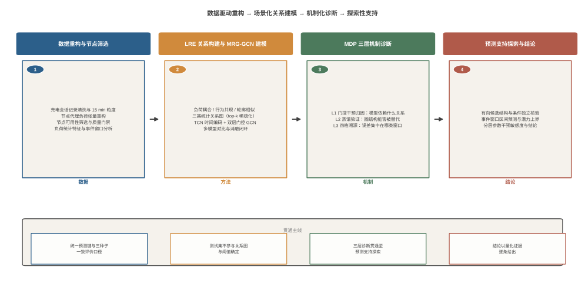

# 基于站内多关系图与机制诊断的充电节点短期负荷预测研究

<!--
唯一正式写作主稿。

使用规则：
1. 现有定稿大纲、章节草稿、实验登记表、术语台账和图注索引仅作为素材与证据来源。
2. 正式正文只写入本文件，不建立 chapter-v1/v2/final 等重复版本；历史由 Git 保存。
3. 临时标记仅使用“待写、待核数字、待补引文、待插图表”四类方括号标记。
4. 每章锁定前清除该章全部临时标记，并完成数字、术语、引文和图表引用审计。
5. 正文内容冻结后再生成学校模板 DOCX；本文件不承担最终分页与版式控制。

写作顺序：第1章 → 第2章 → 第3章 → 第4章 → 第5章 → 结论 → 中英文摘要。
-->

# 摘  要

[待写：全文技术章节和结论锁定后完成。按研究问题、数据与任务、方法、主要结果、机制诊断、探索性分析、研究边界组织。]

关键词：[待写：3～5个关键词，使用全角分号分隔，末尾不加标点]

# Abstract

[待写：依据定稿中文摘要准确翻译，数字、术语、限定词和结论强度与中文摘要一致。]

Keywords: [待写：与中文关键词逐项对应，使用半角分号分隔，末尾不加标点]

# 目  录

[待写：在Word终稿中由标题样式自动生成，显示至三级标题。]

# 第1章  绪论

## 1.1 研究背景与意义

### 1.1.1 电动汽车充电负荷增长与节点级预测需求

在“双碳”目标和新能源汽车产业发展政策的持续推动下，我国电动汽车保有量及配套充电基础设施规模不断扩大。截至2024年底，全国公共充电桩保有量达到357.9万台[85]。充电设施规模增长使电动汽车由分散的小规模用电负荷逐步转变为配电系统中不可忽视的柔性负荷资源。与此同时，用户到达时刻、停留时长、充电需求及设施使用状态具有较强的不确定性，导致充电负荷在时间和空间上呈现随机性、间歇性与不均衡性[1-3]。因此，准确刻画并预测充电负荷，是开展配电容量配置、场站运行管理和有序充电调度的重要基础。

现有研究多以区域、站群或单个充电站的聚合负荷为预测对象，其结果能够支持电网侧调度和站级容量规划，但难以直接回答场站内部各充电节点在未来时段的负荷分配问题[1-2]。对于站内运行而言，不同充电节点的活跃水平、峰值时段和负荷波动并不一致。以节点为粒度的短期预测能够为多桩负荷均衡、局部容量约束识别、设备利用率分析以及有序充放电优化提供更细粒度的信息[17][41]，其空间分辨率更接近场站实际控制与运维对象。

节点级预测也比聚合负荷预测面临更突出的数据困难。多个用户行为在聚合后能够相互平滑，而单个节点通常包含大量零负荷时段和少量突变时段，负荷序列的稀疏性、非平稳性与节点异质性更加明显。若仅依赖单节点历史序列进行外推，模型可能难以充分利用同一场站内其他节点的同步变化和互补信息。由此，如何在明确数据物理口径的前提下刻画站内节点关系，并建立适合稀疏负荷的短期预测方法，构成本文研究的第一个基本问题。

### 1.1.2 离散会话记录与节点代理负荷预测问题

充电运营平台的数据通常以离散会话记录形式保存，每条记录包含充电节点标识、接入时刻、离站时刻和充电电量等字段，而不是连续采样的电表功率序列。基于此类运营数据开展预测时，需要先将会话在统一时间网格上展开或聚合，形成可供时序模型处理的等间隔负荷序列[10][40][43]。本文以15 min为时间粒度，将原始充电会话重构为“时间步—节点”二维序列，并将每个时间片内由会话记录分配得到的能量定义为节点代理负荷。

节点代理负荷与在线电表实测功率具有不同的物理口径。前者是依据会话起止时间和充电电量重构的时间片能量，用于描述节点在离散时间网格上的充电需求；后者则是计量装置对实际功率过程的连续或高频采样。受会话信息粒度、能量分配假设和设备运行状态等因素影响，二者不能直接等同。因此，本文的预测对象始终限定为会话记录重构得到的节点代理负荷，研究结论不外推为对在线电表实测功率的预测结论。

会话重构不仅解决了模型输入的时间对齐问题，也决定了后续研究的统计边界。一方面，节点在无充电会话时对应大量零值，使常用百分比误差指标可能因分母接近零而失真；另一方面，不同节点的会话数量、活跃月份和负荷水平存在明显差异，需要先进行节点可用性筛选和数据质量门禁。基于上述特点，本文将数据重构、节点筛选、评价指标选择和模型设计视为相互关联的研究环节，而不是彼此独立的预处理步骤。

### 1.1.3 站内节点关系建模与事件窗口预测意义

同一场站内的充电节点处于共同的用户到达过程和运行环境中，其负荷变化并非完全相互独立。节点之间可能表现出长期负荷同步、充电行为共同出现以及日内负荷轮廓相似等统计联系[5][16]。图神经网络能够将节点表示与关系结构结合，通过邻居信息传播补充单节点时间序列中缺失的横向信息，因而已被用于充电站群和多节点负荷预测[4-6]。需要强调的是，本文研究的图边由训练期数据统计得到，表示站内节点间的统计交互，而不是配电网电气连接或充电设施物理拓扑。

仅建立图结构仍不足以回答多类关系如何参与预测。负荷耦合、行为共现和轮廓相似反映的是不同层面的关联，若将其简单合并为单一邻接矩阵，各类关系的语义和作用路径将难以区分；若采用固定等权融合，又可能忽略不同传播层和不同节点对关系信息的需求差异。因此，有必要在多关系消息传递基础上引入可学习的关系选择和节点信息保留机制，并通过消融和参数干预判断模型是否真正依赖这些结构，而不能仅依据门控权重的可视化作出解释。

除稳定的周期性变化外，充电节点还会出现由接入、离站、活跃会话变化或负荷跳变构成的稀疏行为变化窗口，本文将其统称为事件窗口，并在第2章进一步区分真实事件标签与冻结规则触发两种统计口径。此类窗口与可提前获知的节假日或特殊日不同[29-31][49]：其发生位置需要根据运行过程中可见的行为信号识别，而且少量高误差样本容易被大量稳定样本稀释。若只报告全局平均误差，模型在这些窗口中的失效程度及其对总体误差的贡献可能无法被准确识别。由此，本文不仅关注预测精度，还关注关系结构的功能依赖、误差来源和事件窗口中的不确定性边界，以形成“预测方法—机制诊断—预测支持探索”的研究主线。

## 1.2 国内外研究现状

### 1.2.1 电动汽车充电负荷时间序列预测

电动汽车充电负荷预测已经形成由统计方法、机器学习方法向深度学习和组合预测方法逐步发展的技术谱系，相关综述对数据来源、影响因素、预测尺度和模型类型进行了系统总结[1-3][35-36]。经典统计方法以ARIMA及其扩展模型为代表，具有结构清晰、参数含义明确等优点，适用于趋势和周期相对稳定的序列，但其线性与平稳性假设难以充分描述用户行为驱动的非线性波动。以LightGBM[59]和XGBoost[60]为代表的集成学习方法能够利用多维人工特征刻画非线性映射，在中小规模数据上具有训练效率优势，但对长时间依赖的利用通常依赖显式滞后特征和特征工程。

随着深度学习在时序预测中的应用，LSTM[57]、GRU[58]、时间卷积网络[53]和Transformer[56]成为充电负荷建模的重要基础。相关研究通过双向循环网络、卷积—循环组合、注意力机制和Transformer结构增强时序特征提取能力[9-14]；另一些工作将分时电价、气象条件、用户意愿和多源交互信息纳入模型输入，以提高对外部扰动的响应能力[13][16-18]。针对负荷序列的非平稳性，分解—预测—重构和误差修正也被广泛用于降低不同频段或不同状态下的预测误差[7-8][27-28]。此外，区间预测开始用于表达点预测之外的不确定性[15]，表明评价目标正由单一平均误差逐步扩展至风险和可靠性刻画。

总体而言，现有时间序列方法为充电负荷预测提供了较成熟的建模工具，但研究对象仍以站级或区域聚合序列为主。对站内单个充电节点而言，负荷零值比例更高、节点间差异更强，单序列模型难以直接利用其他节点提供的横向信息。同时，许多工作主要报告全局预测指标，对模型收益来源及高误差窗口的表现讨论有限。这些特点促使研究进一步从单序列预测转向多节点关系建模与分层评价。

### 1.2.2 多节点负荷与时空图预测

图神经网络为多节点时序预测提供了统一的关系建模框架。GCN[50]通过邻接矩阵上的特征传播聚合邻居信息，GAT[55]进一步以注意力机制学习邻居贡献，RGCN[51]则将消息传递扩展至多关系场景。在时空预测领域，STGCN[54]将图卷积与时间卷积结合，Graph WaveNet[52]通过自适应邻接和扩张卷积联合学习空间与时间依赖，AGCRN[61]使用节点自适应参数和可学习图结构刻画节点异质性。这些方法最初主要用于交通流预测[32-34]，随后被引入居民负荷、区域负荷和多节点短期负荷预测[19-26]。

在电动汽车充电场景中，图模型主要用于描述充电站之间或区域之间的空间联系。国内研究已探索动态自适应图、差异化耦合关系和GCN—循环网络组合等方案[4-6]；学位论文则涉及充电站群多图融合、图注意力预测、负荷时空预测以及图结构与有序充放电联合应用[37-41]。近年的国际研究进一步采用多图或多关系结构，将地理邻近、交通联系、时序相关和自适应关系共同纳入预测模型[64-67][70-71]。这些工作说明，多图融合和自适应关系学习已成为提高多节点负荷表征能力的重要方向，因此本文不能将“使用多关系图”本身作为独立的新颖性主张。

从研究粒度看，上述方法大多以充电站或区域为图节点，关系设计服务于站间空间传播；在本次检索及全文对标范围内，直接以单个场站内部充电节点为图节点，并同时按照负荷耦合、行为共现和日内轮廓构造可区分统计关系的研究相对有限。另一方面，已有多图方法多关注预测性能，较少进一步检验不同关系在不同传播层中的分配是否具有稳定的功能依赖。本文据此将研究重点收敛为“站内节点粒度的关系语义设计、双层门控融合及其机制诊断”，而不是泛化地宣称多图方法本身具有首创性。

### 1.2.3 充电行为特征与事件建模

用户接入、离站、停留和充电需求是形成充电负荷波动的直接行为来源。现有研究通常将相关信息作为一般输入特征，与历史负荷、日期、气象和价格等变量共同送入时序模型[9-10][16-18][43]。对于可提前获知的特殊日期，已有研究通过节假日增长率修正、春节影响期划分、日期映射和特殊事件组合模型等方式改善预测[29-31][49]。这类方法能够利用已知日历信息，但其研究对象与运行过程中临时出现的接入、离站和负荷跳变并不相同。

在非日历事件方面，已有研究开始关注事件数据对极端预测误差的影响[72]，也出现了“基线预测—风险时段识别—选择性残差修正”等事件感知路径[68-69]。这些工作为行为变化时段的专门处理提供了参考，但不同研究对事件的定义、可见信息范围、阈值确定和修正路径差异较大。如果事件判定使用预测时刻之后的信息，或在测试集上重新选择阈值，可能造成信息泄漏；如果事件样本与稳定样本混合评价，又难以判断修正收益究竟来自何种样本。

在所检文献范围内，将充电行为突变窗口同时作为规则识别对象、独立评价单元和误差溯源单元的研究仍较少。尤其是，真实事件标签与部署时可见的规则触发并非同一概念，两者之间的错位会直接限制事件路由和分层区间预测的效果。因此，本文不预设事件机制必然改善点预测，而是通过冻结规则、双口径统计和四格诊断明确可见信息边界，并进一步评估事件窗口中的预测区间表现。

### 1.2.4 模型可解释性与机制诊断

负荷预测模型的解释研究主要包括外部归因和内部信号分析两类路径。外部归因通常利用SHAP[63]等方法衡量输入特征对预测结果的贡献；内部分析则通过注意力权重、门控值或隐状态可视化理解模型的表示过程[25][44]。这类方法能够提供直观线索，但观察到较大的权重并不必然意味着对应组件具有决定性功能。注意力权重与模型实际决策路径之间可能存在偏离[76]，能源预测领域的可解释性综述也指出，解释结果仍需要进一步的稳定性和有效性验证[77]。

为提高解释结论的可检验性，相关领域逐步引入参数干预、知识蒸馏和分层误差分析。参数干预通过替换或屏蔽模型内部组件，比较干预前后的输出变化，从功能角度补充观察式解释[74]；知识蒸馏通过教师输出约束学生模型，为检验结构知识能否由更简单模型吸收提供了操作工具[80]；事件列联与价值加权误差分解则表明，将总体误差按条件拆分有助于识别不同样本的贡献[75]。这些方法分别解决“模型使用了什么”“复杂结构能否被替代”和“误差来自哪里”等问题，但在负荷预测研究中通常分散使用。

基于上述认识，本文将机制解释组织为三层机制诊断协议（Mechanism Diagnosis Protocol，MDP）：首先观察并干预多关系门控分配，其次通过图模型向纯时序模型的知识蒸馏检验所检配置下的师生差距，最后通过事件标签与规则触发形成四格并按样本量还原全局误差。该框架的组成操作均有相应方法基础，本文的工作重点在于将其协议化组合并应用于站内多关系图预测，而不将单项分析工具表述为本文首创。按照本次检索和全文对标结果，尚未见与本文三层操作、判定准则和误差还原纪律完全一致的充电负荷诊断框架，但这一判断仍限定于已检索文献范围。

## 1.3 现有研究不足

综合上述研究现状，现有工作为充电负荷时间建模、多节点关系学习和预测解释提供了较为丰富的方法基础，但针对站内节点级短期预测仍存在以下不足。

（1）站内节点关系的语义化表达不足。现有图预测工作主要服务于站间或区域级空间传播，站内节点场景常采用单一相关关系或直接学习隐式邻接。单一图难以同时保留负荷同步、行为共现和日内轮廓等不同统计语义，而纯自适应图的边权又不易与场站行为含义对应。需要说明的是，多关系表示并不预设每一类关系都必然带来独立性能增益，其价值还需要通过关系子集实验和机制诊断加以检验。

（2）模型解释缺少从观察到验证的完整证据链。现有研究较多使用注意力、门控权重或特征贡献进行观察式解释，常规消融也主要回答移除某个组件后性能是否变化，但较少继续检验学习到的关系分配是否具有功能依赖、图结构知识能否由纯时序模型吸收以及误差能否被严格归属。因而有必要建立包含操作定义、诊断实验和判定准则的协议化分析流程。

（3）事件信息的使用边界尚不清晰。日历事件、真实行为标签和预测时可见规则属于不同信息条件，直接作为输入、用于事后修正或用于预测区间路由也对应不同任务。现有研究对阈值冻结、未来信息隔离、规则触发与真实事件错位及负结果披露的讨论相对有限，容易将事后可用信息得到的上界与可部署性能混为一谈。

（4）全局指标难以反映稀疏事件窗口的误差结构。节点代理负荷包含大量稳定或零负荷样本，少量行为突变窗口的高误差可能被全局平均指标稀释。若缺少事件、稳定和规则触发等分层口径，以及分层结果向全局误差的样本量加权还原，就难以判断模型改进作用于哪些样本，也难以为后续不确定性分析提供可靠依据。

## 1.4 研究目标与主要内容

本文面向单站多充电节点的短期负荷预测问题，以充电会话记录重构得到的节点代理负荷为研究对象，旨在构建能够利用站内多类统计关系的预测模型，并建立与预测模型配套的机制诊断方法。在此基础上，进一步分析方向性候选结构、事件窗口的区间覆盖和门控分配的分层参数干预敏感度。研究目标包括两个层面：一是提高节点代理负荷预测的整体精度；二是以可执行、可复核的诊断流程回答模型依赖何种关系、结构知识能否由简单模型吸收以及全局误差来源于何种样本。第5章的相关工作定位为模型结构分析与预测支持探索，不承诺已经解决事件窗口预测。

围绕上述目标，本文开展以下四方面研究。

（1）充电行为数据重构与特征分析。对原始充电会话记录进行字段审计和节点标识核对，按照15 min粒度重构节点代理负荷；仅依据训练集和验证集完成节点可用性筛选及质量门禁，测试集不参与节点选择。进一步分析节点负荷的稀疏性、异质性、周期性和事件分量，为关系构建、模型输入和分层评价提供数据依据。

（2）站内多关系门控图卷积预测方法。以单站内充电节点为图节点，构建负荷耦合（Load）、行为共现（Event）和轮廓相似（Pattern）三类统计关系，形成LRE三关系图；在时间卷积编码基础上，构建多关系门控图卷积网络（Multi-Relational Gated Graph Convolutional Network，MRG-GCN），通过关系级β门控、节点级G门控、关系dropout和逐层关系选择完成跨节点信息融合。采用统一预测键、三种子（2024、2025、2026）、多模型对比和消融实验评价其预测性能及结构贡献。

（3）三层机制诊断协议。围绕“关系分配是否具有功能依赖、图结构知识能否被纯时序模型吸收、全局误差来自何处”三个问题，构建由L1干预归因、L2蒸馏验证和L3四格溯源组成的机制诊断协议MDP。每一层均给出方法定义、诊断实验和判定准则，并通过样本量加权恒等式核验四格结果能否还原全局误差。

（4）模型结构分析与预测支持探索。采用传递熵和PCMCI+分析统计关系图未表达的方向性候选及条件滞后依赖；采用分层共形方法比较标准路径、冻结规则路由与真实标签oracle事后上界，识别事件窗口的覆盖边界；进一步将门控参数干预扩展到事件、稳定和节点层面，分析不同样本条件下的分层参数干预敏感度。上述结果均按探索性结构发现、经验覆盖或分层参数干预敏感度解释，不升级为物理因果或可部署事件预测结论。

## 1.5 技术路线

本文按照“数据重构与特征分析—多关系图预测—三层机制诊断—结构分析与预测支持探索”的路线开展研究，总体技术路线如图1-1所示。

**图1-1  本文总体技术路线**

第一阶段为数据重构与特征分析。首先对原始会话记录进行字段、时间和节点标识审计，将离散会话按15 min时间片重构为节点代理负荷张量；随后依据训练集和验证集建立节点筛选门槛与质量门禁，冻结10个主分析节点；最后分析负荷稀疏性、节点差异、周期模式、事件四分量及输入特征，为模型设计和评价口径提供依据。

第二阶段为LRE关系构建与MRG-GCN建模。使用训练期统计量分别构建负荷耦合、行为共现和轮廓相似关系图，经top-k稀疏化和对称归一化后形成模型的固定关系输入；使用TCN提取历史窗口的时间表示，再通过双层多关系门控图卷积进行跨节点传播，并由预测头输出未来4个时间步的节点代理负荷。该阶段在统一数据划分、预测键和评价指标下完成传统方法、时序模型、图模型和自适应图对照，并通过结构消融、关系子集和参数干预分析模型组件。

第三阶段为MDP三层机制诊断。L1从已训练模型中提取逐层关系门控权重，并对关系分配实施固定、交换和等权参数干预；L2以MRG-GCN为教师、TCN为学生开展知识蒸馏，检验所检学生架构和蒸馏设置能否弥合师生差距；L3按照真实事件标签与冻结规则触发构建四格，通过样本量加权还原全局MAE，定位事件窗口和稳定窗口对总体误差的贡献。三层结果共同形成本文模型的机制画像。

第四阶段为模型结构分析与预测支持探索。首先采用传递熵和PCMCI+分析节点间方向性候选和条件滞后依赖，考察其与固定统计关系图的互补性；其次采用分层共形预测比较全局校准、冻结规则路由和oracle事后上界，分析事件窗口的经验覆盖率及区间宽度；最后对门控参数干预结果进行窗口和节点分层，刻画不同条件下的分层参数干预敏感度。根据正式实验和探索性分析的证据强度，分别形成研究结论、局限性与后续工作。

## 1.6 论文组织结构

本文正文由五章组成，并在正文之后设置结论、参考文献和附录。各章内容安排如下。

第1章为绪论。本章从电动汽车充电基础设施发展和场站精细化运行需求出发，界定节点代理负荷、站内统计关系和事件窗口的研究边界；围绕充电负荷时间序列预测、多节点时空图预测、充电行为与事件建模以及模型可解释性与机制诊断梳理国内外研究进展，归纳现有研究不足，并说明本文的研究目标、主要内容和技术路线。

第2章为充电行为数据与特征分析。本章说明原始会话数据的字段结构、节点标识关系和15 min代理负荷重构方法，给出节点可用性筛选与质量门禁过程；在冻结主分析节点集合后，从负荷稀疏性、节点异质性、时间周期、事件分量和特征相关性等方面分析数据特征，并据此提出后续图建模、分层评价和区间分析的设计需求。

第3章为基于多关系门控图卷积的节点短期负荷预测。本章形式化定义预测任务，构建由负荷耦合、行为共现和轮廓相似组成的LRE三关系图，并建立MRG-GCN预测模型；随后通过统一协议下的传统方法、时序模型和图模型对比，结合结构消融、门控参数干预、四格诊断及关系子集敏感性分析，评价模型性能并界定各设计组件的证据范围。

第4章为三层机制诊断协议（MDP）与模型可解释性分析。本章按照L1干预归因、L2蒸馏验证和L3四格溯源三个层次组织诊断流程：通过门控权重观察与参数干预分析关系分配的功能依赖，通过图模型向纯时序模型的知识蒸馏检验所检配置下的师生差距，通过样本量加权四格还原定位全局误差来源，最终形成本文模型的机制画像和有边界的判定结论。

第5章为模型结构分析与预测支持探索。本章首先采用传递熵和PCMCI+考察节点间方向性候选及条件滞后依赖与固定统计关系图的互补性；随后研究事件窗口下的分层共形预测，区分冻结规则路由与oracle事后上界；最后对门控参数干预结果进行窗口和节点分层，分析不同条件下的分层参数干预敏感度。本章结果均按探索性结构发现、经验覆盖或分层参数干预敏感度解释，不将其表述为物理因果结论或已经实现的可部署事件预测方法。

结论部分总结全文研究工作及主要发现，说明数据、模型、诊断协议和探索性分析的适用边界，并提出跨站验证、动态关系学习、事件可见信号增强和节点级门控分析等后续研究方向。附录用于保留事件残差修正及其他未达到正文正式纳入标准的探索记录，以保证研究过程可追溯，但不将其作为正文方法贡献。

## 1.7 本章小结

本章围绕站内充电节点短期负荷预测的研究问题完成了研究背景、文献基础和总体方案的论证。首先，从充电基础设施规模增长与场站精细化运行需求出发，说明节点级预测的工程价值，并明确本文研究对象是由离散会话记录重构得到的节点代理负荷，站内图边表示统计交互而非配电网物理拓扑。其次，从时间序列预测、时空图预测、行为与事件建模、模型可解释性与机制诊断四个方面梳理国内外研究进展，指出现有方法在站内关系语义表达、机制证据链、事件信息使用边界和分层误差评价方面仍存在不足。

针对上述问题，本文确立了“预测方法与机制诊断”两条主要贡献线：构建面向站内节点的LRE三关系图和MRG-GCN预测模型，并以L1干预归因、L2蒸馏验证和L3四格溯源组成MDP三层机制诊断协议。在此基础上，第5章进一步开展方向性结构、分层共形和分层参数干预三项预测支持探索。上述内容共同形成“数据重构与特征分析—多关系图预测—三层机制诊断—结构分析与预测支持探索”的技术路线，并为后续各章的具体方法和实验分析奠定基础。

# 第2章  充电行为数据与特征分析

## 2.1 数据来源与重构口径

[待写：数据来源、31,424条会话记录、时间跨度、15 min重构过程、节点代理负荷定义及单位。]

[待插图表：图2-1 数据重构流程；表2-1 数据审计结果。]

## 2.2 节点可用性筛选与质量门禁

[待写：55个候选节点、10个主分析节点、5个敏感性节点；筛选规则仅由训练集和验证集冻结，测试集不参与选择。]

[待插图表：图2-2 节点覆盖率与筛选结果；表2-2 节点筛选门槛。]

## 2.3 节点负荷统计特征

[待写：负荷稀疏性、节点异质性、日内与周内周期、峰均关系和代表节点自相关。]

[待插图表：表2-3 节点统计；表2-4 自相关统计；图2-3、图2-3b、图2-4、图2-5、图2-8。]

## 2.4 事件分数构成与事件窗口统计

[待写：定义access、departure、active_delta、load_delta四分量及逐节点标准差归一化；说明验证集95%分位阈值、因果前向扩展2步和测试集冻结执行。]

[待写：严格区分target_event 1.43%（10,160/712,360，[S,H,N]评价口径）、rule_trigger 0.43%（3,060/712,360，四格与规则路由口径）和逐节点时间片统计。]

[待插图表：表2-6 逐节点事件统计；图2-6、图2-9、图2-10。]

## 2.5 特征构成与输入结构

[待写：7维输入特征，96步历史窗口、10节点、4步预测；训练/验证/测试预测起点83,103/17,807/17,809。]

[待插图表：表2-5 输入特征统计；图2-7 特征相关性矩阵。]

## 2.6 数据特征对建模的启示

[待写：由稀疏性导出分层评价需求，由节点统计耦合导出图建模需求，由事件窗口低占比和高误差导出机制诊断与区间分析需求。]

## 2.7 本章小结

[待写]

# 第3章  基于多关系门控图卷积的节点短期负荷预测

## 3.1 引言

[待写：承接2.6，概述时间建模、站内多关系建模和门控融合三条方法主线。]

## 3.2 预测任务形式化定义

[待写：定义节点集合、输入输出张量、历史窗口、预测步长、预测键和训练目标。]

## 3.3 场景驱动的LRE三关系图构建

### 3.3.1 负荷耦合关系图

[待写：基于训练集节点负荷序列的绝对Pearson相关系数。]

### 3.3.2 行为共现关系图

[待写：基于接入、离站和活跃变化组合信号的余弦相似度。]

### 3.3.3 轮廓相似关系图

[待写：基于96步平均负荷轮廓欧氏距离的指数核。]

### 3.3.4 top-k稀疏化与对称归一化

[待写：先逐行保留top-k，再以maximum(A,Aᵀ)取无向并集并进行对称归一化；说明非零邻居数可能略超k。]

[待插图表：图3-3 三类关系矩阵。]

## 3.4 时间基线：TCN

[待写：因果膨胀卷积、逐时间步LayerNorm和感受野；levels=6时感受野127步覆盖96步历史窗口。]

## 3.5 双层多关系门控图卷积网络（MRG-GCN）

### 3.5.1 总体架构

[待写：输入→TCN→GCN1→特征精炼→GCN2→跨层融合→预测头。]

### 3.5.2 单关系消息传递

[待写：给出邻接加权聚合、逐关系独立变换及张量维度。]

### 3.5.3 关系级门控

[待写：定义逐层独立的Softmax关系融合权重β，区分关系选择与固定权重。]

### 3.5.4 节点级门控

[待写：定义节点级G门控及自身信息与邻居消息的自适应保留。]

### 3.5.5 关系dropout

[待写：训练期随机屏蔽关系类型并重归一化；准确披露“至少保留一个关系”的实现。]

### 3.5.6 逐层关系选择与跨层融合

[待写：说明GCN1/GCN2关系参数独立及H0/H1/H2的skip fusion。]

### 3.5.7 目标函数与训练策略

[待写：L1损失、三随机种子、早停和训练配置；披露验证集兼用于阈值拟合和早停选择。]

### 3.5.8 与现有方法的区别

[待写：分别对照RGCN、Graph WaveNet、AGCRN及充电负荷单关系图方法，限定创新边界。]

[待插图表：图3-2 门控融合层架构。]

## 3.6 对比实验

### 3.6.1 实验协议

[待写：数据划分、统一预测键、评价指标、三种子、不确定性口径和12个对比模型。]

### 3.6.2 全局指标对比

[待写：以表3-1为唯一数字源；头部模型差异与种子噪声同级时不得称“显著优于”。]

[待插图表：表3-1 全局指标；图3-1 模型全局MAE；图3-6 点级pooled Bootstrap描述性差异。]

### 3.6.3 分层指标对比

[待写：全局、事件、稳定和非零负荷口径。]

[待插图表：表3-2 分层指标；图3-8 分窗口MAE。]

### 3.6.4 节点与预测步长分析

[待写]

[待插图表：表3-3 节点与步长明细；图3-4 逐步长MAE；图3-9 逐节点MAE；图3-11 事件窗口预测示例。]

### 3.6.5 模型效率分析

[待写：参数量、训练时间、推理时间和模型容量边界。]

[待插图表：表3-4 效率对比。]

### 3.6.6 事件机制消融与归因

[待写：正文仅简要披露事件残差修正四种实现未达到正式纳入标准，完整记录置于附录A；不将负结果包装为正文贡献。]

[待插图表：图3-5 训练曲线；图3-7 自适应图混合权重收敛。]

## 3.7 消融实验

### 3.7.1 结构消融

[待写：以消融套件完整配置0.01390为基线；明确“门控关闭”为联合训练复合变体，不能作单变量解释。]

[待插图表：表3-5 结构消融；图3-10 机制消融。]

### 3.7.2 门控参数干预

[待写：学习值基线与7种固定、交换、等权干预；和第4章L1保持定义一致。]

### 3.7.3 四格诊断

[待写：target_event × rule_trigger四格及样本量加权还原，承接第4章L3。]

### 3.7.4 关系子集与敏感性

[待写：单关系约等于三关系，不宣称三类关系均有独立正增量；准确披露top-k和relation dropout的正式实验范围。]

## 3.8 方法自创性总结

[待写：使用表3-6汇总LRE三关系图、关系级β门控、节点级G门控、关系dropout、逐层关系选择与三层诊断协议的定义、实现和证据。]

[待插图表：表3-6 方法设计组件与证据对照。]

## 3.9 本章小结

[待写]

# 第4章  三层机制诊断协议（MDP）与模型可解释性分析

## 4.1 引言：MDP协议的定义与设计原则

[待写：定义MDP及IA→DV→FET三层递进结构；每层均包含方法定义、诊断实验和判定准则。]

[待插图表：图4-1 三层机制诊断框架。]

## 4.2 L1干预归因层（IA）：模型到底用了哪类关系

### 4.2.1 观察操作

[待写：从三种子已训练checkpoint提取两层关系权重β。]

### 4.2.2 干预操作

[待写：强制赋值关系logits并进行仅前向推理的参数干预敏感性分析。]

### 4.2.3 观察证据

[待写：GCN1的event权重主序跨种子可复现；GCN2的load主导仅为三种子均值口径，并披露seed-2025次序互换。]

### 4.2.4 干预证据

[待写：7种干预组合加1个学习值基线，共8种配置；报告三种子均值和标准差。]

[待插图表：表4-2 β门控权重；图4-2 门控参数干预。]

### 4.2.5 L1判定结论

[待写：表述为模型对所学习关系分配存在功能依赖；参数干预不等同于数据层面因果识别，也不声称覆盖全权重空间。]

## 4.3 L2蒸馏验证层（DV）：图结构能被纯时序模型替代吗

### 4.3.1 协议操作

[待写：教师为StaticGraph、学生为TCN，α∈{0.1,0.5,1.0,2.0}，4组设置×3种子。]

### 4.3.2 诊断实验

[待写：比较教师、无蒸馏学生及不同α下学生的全局MAE。]

[待插图表：图4-3 GCN→TCN知识蒸馏。]

### 4.3.3 L2判定结论

[待写：限定为所检学生架构、蒸馏目标和α范围内未弥合师生差距，不作全称“不可替代”表述。]

## 4.4 L3四格溯源层（FET）：全局误差来自哪里

### 4.4.1 协议操作

[待写：定义target_event与rule_trigger及四格划分；两者不是预测标签与分类器输出，不使用误报、漏报等分类术语。]

### 4.4.2 诊断实验

[待写：事件窗口MAE约为稳定窗口28倍，事件样本占比1.43%，解释全局指标稀释现象。]

### 4.4.3 还原校验

[待写：给出四格MAE按样本量加权还原全局MAE的公式，容差不超过1e-9。]

[待插图表：表4-3 四格明细；图4-4 四格诊断；图4-5 残差分布；图4-6 误差与事件强度。]

### 4.4.4 L3判定结论

[待写]

## 4.5 协议总结：MDP机制画像与可复用性

[待写：汇总三层操作、证据、判定准则和结论；只声明框架已在本文MRG-GCN上验证，跨模型复现列入未来工作。]

[待插图表：表4-1 机制画像汇总。]

# 第5章  模型结构分析与预测支持探索

## 5.1 引言

[待写：由第4章诊断结果引出方向性结构、分层区间和分层参数敏感度三项探索；明确本章不承诺解决事件预测。]

[待插图表：图5-1 探索技术路线。]

## 5.2 从统计相关到有向信息流：关系图方向性分析

### 5.2.1 问题与动机

[待写：第3章固定统计图为无向对称关系，不能表达方向信息。]

### 5.2.2 传递熵方向性检验

[待写：90条有向边、3个滞后、100次循环平移置换；名义显著、未做多重比较校正。]

### 5.2.3 传递熵存在性与方向不对称证据

[待写：76/90条候选边、20/45对方向不对称；方向性候选不等同于因果边。]

[待插图表：图5-2 传递熵方向性候选；图5-3 方向不对称性。]

### 5.2.4 有向候选边与统计关系图的互补性

[待写：报告Jaccard重叠范围和统计图未覆盖候选，避免“独有因果信息”等表述。]

[待插图表：表5-1 候选边与统计图覆盖；图5-8 传递熵与统计关系一致性。]

### 5.2.5 PCMCI+条件独立核验与结构发现定位

[待写：80条名义显著滞后依赖边、44/76确认、16条PCMCI+独有边；统一定位为条件滞后依赖结构发现。]

[待插图表：图5-2b PCMCI+验证网络。]

## 5.3 事件感知的区间预测：分层共形预测

### 5.3.1 问题与动机

[待写：点预测不提供不确定性范围，事件窗口误差远高于稳定窗口。]

### 5.3.2 分层共形方法

[待写：事件层全局分位数、稳定层逐节点分位数；区分冻结规则路由与使用真实标签的oracle事后上界。]

### 5.3.3 覆盖率与区间宽度结果

[待写：标准共形事件覆盖1.9%、规则路由3.9%、oracle事后上界86.1%；均为经验覆盖率，未做有限样本秩修正。]

[待插图表：表5-2 分层覆盖率；表5-3 逐节点覆盖率；图5-4、图5-5、图5-7。]

### 5.3.4 分布漂移与覆盖保证边界

[待写：解释覆盖偏离、可见规则信号局限和ACI未来工作。]

## 5.4 门控分配的分层参数干预敏感度

### 5.4.1 问题与动机

[待写：将第4章L1的全局参数干预扩展到事件、稳定和节点条件。]

### 5.4.2 分层参数干预方法

[待写：7种干预组合×3种子×全局/事件/稳定/节点；不使用CATE或严格因果效应术语。]

### 5.4.3 分层敏感度结果

[待写：学习值在所检组合中表现最佳；准确报告全局、事件、稳定和节点层面的相对变化。]

[待插图表：表5-4 参数干预汇总；图5-6 分层参数干预敏感度。]

### 5.4.4 分层参数干预结论

[待写]

## 5.5 本章小结

[待写：使用表5-5汇总三个探索问题、操作、主要观察和结论边界。]

[待插图表：表5-5 第5章探索结果汇总。]

# 结  论

## 研究工作总结

[待写：按数据、方法、诊断、探索四条工作线概括，不重复堆叠全部实验数字。]

## 主要研究结论

[待写：形成三条有证据链的结论——预测方法、机制诊断、方向性与分层预测支持探索。]

## 研究局限

[待写：单站10节点、代理负荷、固定统计关系、事件样本有限、规则路由覆盖受限、验证集双重用途、Bootstrap依赖边界、TE/PCMCI+未多重校正。]

## 研究展望

[待写：跨站验证、动态关系、方向性候选融入预测、可部署事件路由与分层共形、节点级G门控暴露与可视化。]

# 致  谢

[待写：由作者在终稿阶段填写。]

# 参考文献

[待写：正文完成后，将 `references-draft.md` 中核验条目按正文首次出现顺序重排，并统一为GB/T 7714—2015顺序编码制。]

# 在读期间发表的学术论文与研究成果

[待写：由作者提供正式成果信息；无内容时按学院要求处理。]

# 附  录

## 附录A 事件残差修正及未纳入正文路线的探索记录

### A.1 探索动机与判定标准

[待写：来源 `appendix-a-event-residual-exploration.md`。]

### A.2 事件残差修正的四种实现口径

[待写]

### A.3 三种子实验结果

[待写]

### A.4 探索结论

[待写：说明相关路线未达到预设正式纳入标准，不作为正文方法贡献；完整结果和终止依据保留供追溯。]

### A.5 其他未纳入正文路线的追溯说明

[待写：SG-EXP-007、011、012、014、015、016；只记录执行口径、结果和终止依据，不以“只记录赢”等内部原则表述。]
