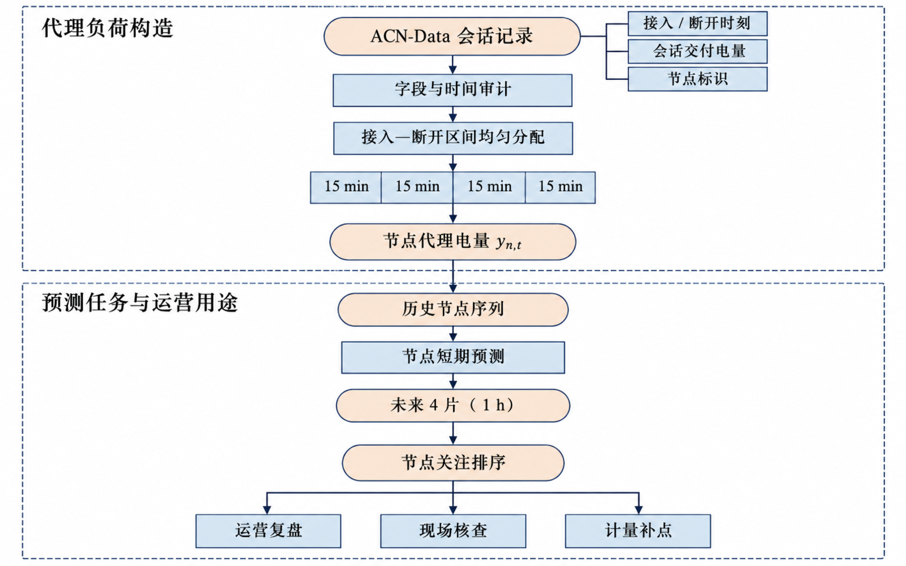
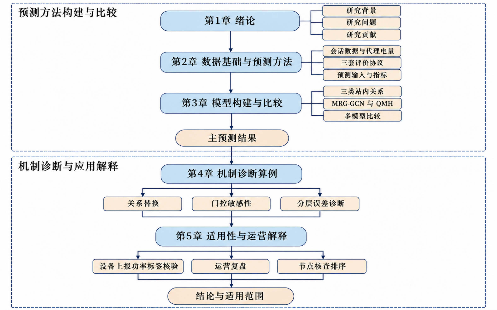
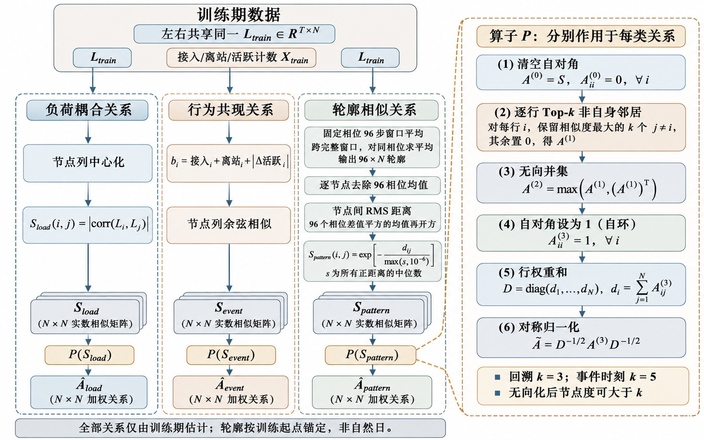
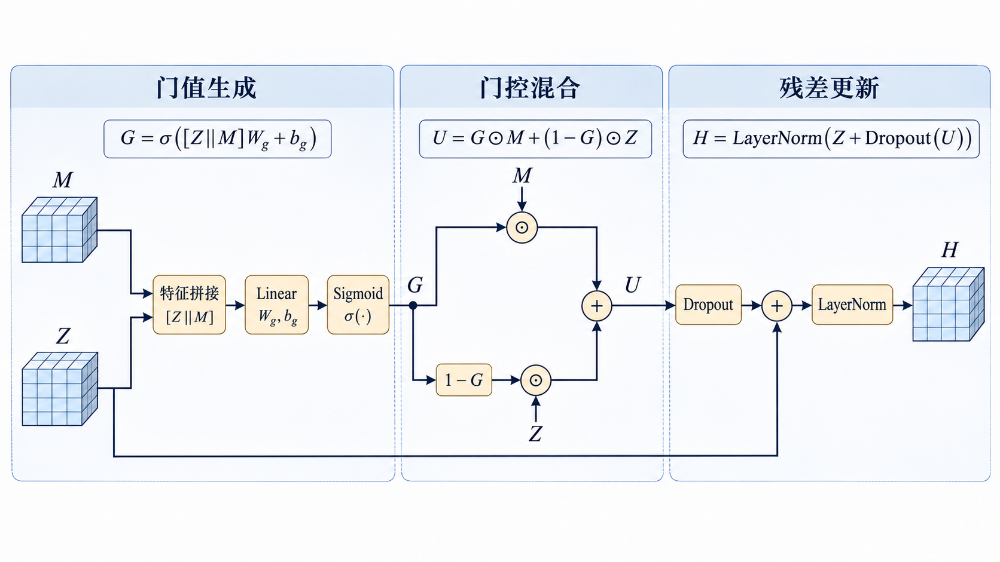
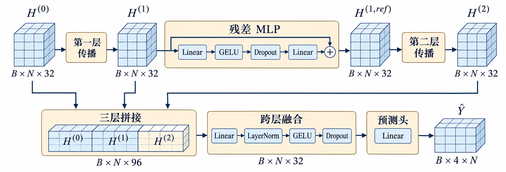

# 基于站内多关系图与机制诊断的充电节点短期负荷预测研究

# 摘  要

本文面向具有会话记录的充电场站，研究站内节点的短期负荷预测与运营解释。以会话总电量按接入—断开区间均分得到的15 min节点代理电量为预测目标，使用过去96片预测未来4片（1 h），刻画未来时段的节点需求差异。

针对站内节点联系与零膨胀目标，本文构建负荷耦合、行为共现和轮廓相似三类关系图，采用多关系门控图卷积网络（MRG-GCN）编码节点联系，并设计软门控动态分位输出头（Quantile-Mix Head，QMH）联合表征活跃概率与条件电量。通过同参数关系替换、共享门控配对和跨场站重拟合检验组件增量，再以分层误差、标签敏感性和区间覆盖分析解释预测结果。

在Caltech事件时刻协议上，QMH五种子整体MAE为0.036326±0.000166 kWh/15 min，在表3-1所列对照中最低，较完整AGCRN低3.02%。在真值至少三个节点活跃的事后筛选实例（13,536个）中，节点排序Spearman为0.6662，top-3全中率为32.36%，高于固定占比分配基线的0.1956和5.20%。优势随评价目标变化：非零层MAE点估计为0.265308，略低于完整AGCRN的0.26674；事件层则由容量近似TCN取得较低MAE（0.37465，QMH为0.376346）。JPL同参数自环替换显示，负荷耦合与轮廓相似分别带来1.82%和1.52%的整体MAE增益；行为共现增益为0.15%，区间跨零。误差分解显示，回溯协议中1.39%的预测键贡献28.10%的绝对误差。

研究表明，软门控动态分位输出有助于降低零膨胀代理目标的整体误差，负荷耦合与轮廓关系提供了可由受控对照检验的预测增量；分层评价进一步揭示整体精度、事件误差与节点排序之间的差异。所形成的预测与诊断方法可支持会话数据的运营复盘、节点核查和计量补点排序；实测功率预测与现场调度评价需结合同步计量和运行约束。

关键词：充电节点短期负荷预测；代理电量；零膨胀；受控对照；误差分解；使用边界

# Abstract

This thesis investigates short-term node-level load forecasting and operational interpretation for charging stations with session records. The target is 15-minute proxy energy obtained by allocating each session’s delivered energy uniformly between connection and disconnection. Using 96 historical bins to predict the next four bins (one hour), the task characterizes differences in future demand across nodes and time periods.

Load coupling, behavioral co-occurrence and profile similarity are represented as three graphs and encoded by a multi-relational gated graph convolutional network (MRG-GCN). A soft-gated Quantile-Mix Head (QMH) jointly represents activity probability and conditional energy through a dynamic quantile query. Same-parameter relation replacements, shared-gate comparisons and cross-station refitting evaluate component contributions; stratified errors, label sensitivity and interval coverage explain the resulting forecasts.

On the Caltech event-timestamp protocol, QMH achieves a five-seed aggregate MAE of 0.036326±0.000166 kWh/15 min, below all seven baselines in Table 3-1 and 3.02% below the full AGCRN. Among 13,536 instances with at least three active nodes, mean Spearman node-ranking correlation is 0.6662 and top-3 exact accuracy is 32.36%, compared with 0.1956 and 5.20% for fixed-share allocation. Performance depends on the evaluation target: QMH nonzero-target MAE is 0.265308, slightly below the full AGCRN's 0.26674, while the capacity-matched TCN has the lowest event MAE (0.37465 versus 0.376346 for QMH). On JPL, same-parameter self-loop replacement indicates aggregate-MAE gains of 1.82% for load coupling and 1.52% for profile similarity; the 0.15% behavioral-relation estimate has an interval crossing zero. Error decomposition further shows that 1.39% of keys account for 28.10% of absolute error in the retrospective protocol.

The results show that soft-gated dynamic quantile output reduces aggregate error for the zero-inflated proxy target, while controlled comparisons identify predictive contributions from load coupling and profile similarity. Stratified evaluation distinguishes aggregate accuracy, event errors and node ranking. The forecasting and diagnostic methods support session-based operational review and priorities for node inspection and additional metering. Measured-power forecasting and field dispatch evaluation require synchronized measurements and operating constraints.

Keywords: short-term charging-node load forecasting; proxy energy; zero inflation; controlled comparison; error decomposition; scope of use

# 目  录

# 第1章  绪论

## 1.1 研究背景与意义

截至2024年底，全国公共充电桩达357.9万台[1]。车辆到达、停留和充电需求的差异，使场站负荷呈现间歇性与空间不均衡性[2-4]。区域或整站预测可支持宏观规划，却难以揭示站内位置之间的需求差异[2,3]；节点级短期分析则可补充站内需求信息[5,6]。

运营平台通常记录节点、接入与断开时刻及会话交付电量，连续功率序列未必完整。本文将会话电量按接入—断开时长分配至15 min时间片，并在节点内汇总为代理电量序列[7-9]。模型使用过去96片预测未来4片（1 h）；序列总量与会话交付电量守恒，片内形状由均分规则确定。

站内节点可能存在负荷同步、行为共现和日内轮廓相似等统计联系[10,11]，图模型可利用这些关系补充单节点历史[10,12,13]。本文据此检验三类统计关系对节点预测的增量，并结合整体、非零目标与事件层结果判断增量出现的评价范围。接入、离站、活跃变化和负荷跳变构成的事件窗口[14-17]，也为观察模型在不同运行片段中的误差提供了切分依据。

研究结果面向基于会话记录的运营复盘，用于整理未来时段值得优先关注的节点，为现场核查和计量补点提供排序参考。场景与预测任务的关系见图1-1。

**图1-1 站内节点短期代理负荷预测任务与运营应用场景**  会话交付电量按接入—断开区间分配为节点代理电量，模型预测未来1 h并形成节点关注顺序，供运营复盘、现场核查和计量补点参考。图中时间片和节点排序均为示意。

本文研究路线与证据安排见图1-2。

## 1.2 国内外研究现状

### 1.2.1 电动汽车充电负荷时间序列预测

充电负荷预测已从统计模型、机器学习发展至深度时序、组合和概率方法[2-4,18,19]。ARIMA适于相对稳定的趋势周期，LightGBM与XGBoost可拟合人工特征的非线性关系[20,21]；LSTM、GRU、TCN和Transformer则用于提取长短期依赖[22-25]。既有研究还结合循环卷积、注意力、外部因素、分解重构与区间预测，处理行为扰动与非平稳性[5,7,11,26-36]。

近期工作引入多尺度建模、半监督学习、场景聚类、在线辨识，以及出行、引导、排队、SOC和路网等行为变量[37-46]，丰富了区域与站群预测方法。本文进一步聚焦同一场站内的充电节点：其序列更稀疏、节点异质性更强，行为信息也受片末可见条件约束，因此需要同时评价关系增量及其样本层分布。

上述研究多以整体误差作为模型取舍与精度报告的依据[2-4,18,19,24]。本文按零值、非零目标与事件标签分层评价，考察零目标占多数时整体误差能否呈现不同样本层的模型差异。

### 1.2.2 多节点负荷与时空图预测

GCN[47]、GAT[48]和RGCN[49]分别提供邻居聚合、注意力和多关系传播基础；STGCN[50]、Graph WaveNet[51]、AGCRN[52]等进一步结合时间建模或节点自适应参数，已用于交通[53-55]、居民及区域负荷预测[56-63]。EV负荷研究也采用站群多图、区域建模和概率预测[6,8,64-70]。近邻研究可按图节点类型归为站间图、住宅用户图与会话重构三类；与本文任务最接近的会话代理残差方法另见1.2.3节。

站间图预测以充电站为图节点，节点关系多取地理、交通或数据驱动的关联。黄健等[13]以地域关系连接城市站点，用GCN-LSTM预测站间负荷。张延宇等[12]构造时空与自适应关系，结合多头注意力、Chebyshev卷积和多尺度时间卷积；研究报告两套数据与Palo Alto四类场景。黄南天等[10]以Rapid-MIC和动态图连接多座公共充电站，用AST-GCN结合节点参数与GRU预测。Xie等[70]以距离、交通网络和密度构造多图，用MGAT-MIC-LSTM融合多图与外部因素，报告西安10站、30 min分辨率及2021年7—9月数据。Huang等[67]在Palo Alto、Boulder和韩国站群开展小时级预测，以因果感知动态图构建CAGLM、CRGLM并结合时间融合；作者稿报告27/40/14站、72 h输入、3/6/12 h预测、7:1:2切分和5次初始化。

住宅用户图预测以个体或聚合用户为节点。Feng等[71]通过自适应邻居和时间相似图构建边，结合节点自适应GCN、自适应图门控和BiGRU预测住宅个体与聚合负荷，并在三套数据上与六个基线比较。Wang等[72]以Pearson相关和传递熵建图，用多图GCN-LSTM预测住宅用户负荷。Zhang等[73]以时空融合图连接住宅用户，采用门控图卷积与门控TCN构成STFGCN。

会话重构研究以交易记录重建负荷序列，与本文任务最接近。Liang[74]在Boulder交易重构EV负荷上比较直接预测与残差校正，具体指标差异见1.2.3节。

上述研究将多类图结构用于站群和用户负荷预测，为单场站节点建模提供了方法参照[64-73]。

### 1.2.3 充电行为特征与事件建模

用户接入、离站、停留和充电需求是充电负荷波动的直接行为来源，现有研究通常将其与历史负荷、日期、气象和价格一并送入时序模型[5,7,9,11,26,31]。针对可提前获知的特殊日期，已有研究通过节假日增长率修正、春节影响期划分、日期映射和特殊事件组合模型改善预测[14-17]；这类方法利用已知日历信息，对象仍不同于运行中临时出现的接入、离站与负荷跳变。

非日历事件研究关注运行扰动与极端误差[75]。Hwang与Suh[76]以锚点模型为基线，用语言模型修正EV充电需求的峰值残差，并在Urban EV逐时数据（120个分区）及三个预测步长上与图、序列和树模型比较。会话重构负荷的残差预测[74]见下文。

Liang[74]以持续性预测为锚点，使用预测时可见的滞后、滚动和周期特征修正残差；Persistence/Seasonal在sMAPE和正负荷MAPE上最优，Direct-HistGBR在MAE和WAPE上最优，PARC-ExtraTrees在RMSE和R²上最优。与会话残差预测不同，本文聚焦单场站内关系增量，并用MDP分别分析配置敏感度、指定学生替代性和分层误差。两项研究的任务粒度、预测时距与评价协议不同。

本文区分目标侧标签事件与冻结规则触发：前者用于事后分层评价，后者用于回溯规则路由和诊断。旧规则中的代理负荷差分依赖会话最终字段，因此仅作为回溯诊断量；事件窗口用于误差分层、误差溯源及区间表现评价。

### 1.2.4 模型可解释性与机制诊断

现有解释研究主要分析SHAP等外部归因，以及注意力、门控和隐状态等模型内部信号[62,77-80]；事件价值加权评分[81]按样本重要性汇总误差。本文以关系替换、指定学生对照和事件标签—规则触发交叉分组，分别检验配置敏感度、学生替代结果与误差构成。

传递熵[82]与PCMCI+[83,84]用于训练段的节点方向性筛查并形成关系候选；共形预测[85,86]及分布漂移下的自适应共形[87]用于评价冻结规则下的经验区间覆盖。两类方法分别提供方向性线索与区间表现，补充点预测误差分析。

### 1.2.5 研究空白与本文定位

据此，本文聚焦三个可在同一预测任务内检验的问题。

（1）多关系建模的条件性增量。现有研究通常报告含图配置的整体误差，难以区分增量来自哪一类关系或样本层。本文采用同参数自环替换重训，并按样本层核查误差变化。

（2）零膨胀目标下的模型选型。整体误差对每个测试键等权；零值占多数时，整体排序可能掩盖非零目标和事件层的模型差异。本文通过分层误差构成与冻结预测排序比较不同评价层。

（3）预测表现与机制判断的衔接。整体误差、关系替换和样本误差构成回答不同问题，需要在共同协议下解释。本文结合同参数配对、指定学生蒸馏与交叉分组，分别评价配置敏感度、学生替代结果与误差构成。

三个研究问题依次为：软门控分位输出能否改善零膨胀节点目标的预测；三类站内关系分别贡献多少增量；整体改善对应哪些样本层、标签口径和可靠性条件。第3章通过模型与受控关系对照回答前两项，第4—5章以机制诊断和设备记录回答第三项，研究框架见图1-2。

站群与用户图预测[10,12,13,67,70-73]、零膨胀或hurdle模型[88,89]及分位输出头[90]的六维对照见表1-1。会话重构近邻[74]已在1.2.2—1.2.3节单独比较。

**表1-1 近邻研究类型与本文的差异对照**

| 研究类型 | 节点与预测对象 | 主要建模方式 | 与本文的比较位置 |
|---|---|---|---|
| 站群与用户图预测[10,12,13,67,70-73] | 多站点或住宅用户负荷 | 地理、相似或自适应关系 | 1.2.2节；站内关系替换见3.5节 |
| 零膨胀与hurdle模型[88,89] | 零值与正值混合目标 | 活跃判定或参数化混合分布 | QMH映射与输出头消融见3.3、3.4.3节 |
| 分位预测模型[90] | 多时距条件分位 | 分位损失与固定分位输出 | 动态分位查询与权重对照见3.4.3节 |
| 本文 | 单场站节点15 min代理电量 | MRG-GCN与软门控动态分位输出 | 主预测、关系增量、分层误差与标签敏感性 |

注：各组表示本章综述的研究类型，具体方法与数据范围以所引文献为准；本文以站内节点为图节点，并以同参数关系替换及分层结果评价关系贡献。会话重构近邻[74]另见1.2.2—1.2.3节。

本文围绕节点预测、关系增量和结果解释组织方法与实验：QMH处理零膨胀目标，同参数对照测量关系贡献，分层诊断与设备记录核验说明预测结果的使用条件。

## 1.3 研究目标、主要内容与创新点

1.2.5节提出的三个问题分别对应研究目标、研究内容和本文贡献。

### 1.3.1 研究目标

本文面向公开会话记录重构的站内节点代理负荷，研究预测方法、关系贡献与结果解释。研究目标分为以下三项。

（1）表示与检验。说明负荷耦合、行为共现、轮廓相似三类关系如何编码为关系图，并在同一任务与口径下检验关系图是否带来可归因的整体误差增量。

（2）分层测量。按评价层、标签口径与参数配置分别测量整体误差，识别模型差异对应的样本层与参数设置。

（3）适用范围。界定上述结论对应的代理目标、数据来源与区间可靠性条件，并分别说明运营复盘与现场调度所需的证据。

第2章建立统一的数据与评价基础；第3章完成预测方法比较和关系增量测量；第4章分析配置响应与误差构成，第5章结合设备记录和区间覆盖检验使用条件。

### 1.3.2 主要研究内容

研究内容对应四部分。

（1）数据与协议：解析会话字段与节点标识，重构15 min代理电量，界定输入可见时点、标签成熟条件和时间切分，分析序列稀疏性与节点异质性，并说明代理目标的构造偏差。

（2）关系增量：构建三类LRE关系图并由MRG-GCN编码；比较节点级与共享门控、JPL自环替换重训、完成时刻截断目标重训及两种代理标签下冻结预测的排序，并在同源第三场站作小规模复核。

（3）误差诊断：以L1参数替换敏感度、L2受检学生替代性和L3交叉分组误差构成三层证据，分别描述联合配置响应、指定替代尝试与误差构成。L1受消息尺度影响，L2评价指定学生在既定输入与预算下的表现。

（4）可靠性与使用条件：筛查方向性候选，评价独立及滚动区间校准，并以固定预测轨迹和合成约束例说明运行接口。

### 1.3.3 本文创新点

本文贡献沿方法设计、评价方法与实证结果三个层次展开。

**第一层：面向零膨胀节点目标的软门控动态分位输出头。** QMH以活跃概率同时控制输出缩放和分位查询：概率低于0.5时连续缩放输出，高于0.5后缩放饱和，并从9个单调分位节点生成条件电量估计。与硬阈值hurdle输出[88]、参数化混合分布[89]和固定分位输出[90]相比，该设计把活跃判断与条件电量估计连接为统一映射。Caltech主协议上，与MRG-GCN组合的整体MAE为0.036326，较完整AGCRN低3.02%；输出头组件与保真项权重的对照见3.4.3节。

**第二层：参数保持的关系增量受控测量。** JPL关系替换重训每次只将一类关系替换为自环，三关系分支、32,714个参数和训练规则不变，共12次配对运行；同参数门控对照只将节点门控输出替换为共享门控。负荷耦合与轮廓相似分别降低整体MAE 1.82%和1.52%，行为共现为0.15%且区间跨零；节点门控优势随训练预算和场站变化。该设计把模型差异分解为可比较的组件增量。

**第三层：连接预测改善、误差构成与标签口径的分层评价。** MDP依次评价关系参数替换响应、指定学生替代结果和交叉分组误差构成，把整体误差差异定位到配置与样本层。回溯协议中1.39%的键贡献28.10%的绝对误差；固定预测更换评价标签后，全局配置排序相关为0.993，非零层为0.420且区间跨零。设备上报序列核验进一步区分标签构造差异与模型预测误差，使结果解释与数据条件对应。

## 1.4 技术路线

全文按“研究问题—数据与任务—模型与比较—机制诊断—适用性分析”递进。各章研究对象、主要方法和结论出口见图1-2。

**图1-2 全文研究框架**  按章节呈现研究问题、数据与预测基础、模型构建和比较、机制诊断算例、设备核验及运营解释之间的递进关系。

## 1.5 论文组织结构

第1章提出研究问题；第2章建立数据、任务与节点关系依据；第3章构建多关系门控模型并完成站内算例；第4章检验跨协议、跨场站和标签变化下的预测结果；第5章诊断模型组件响应与误差构成；第6章评价区间可靠性、数据条件和运营核查接口；结论逐项归纳研究发现与适用范围。

## 1.6 本章小结

本章从会话数据可用性和站内节点差异出发，提出零膨胀目标预测、关系增量测量与结果解释三个问题，并给出相应方法和实验安排。第2章据此建立代理目标、输入可见性、节点筛选及评价协议，为后续模型比较提供共同基础。

# 第2章  基于多源运行数据的预测任务定义与节点关系分析

本章先说明会话记录如何转化为节点序列，再分析序列特征及其对建模和评价的影响。数据来源与重构口径见2.1节，稀疏性、节点异质性和事件窗口分析据此确定后续的模型输入与评价要求。

## 2.1 数据来源与重构口径

本文采用Caltech公开的ACN-Data单站公开数据（`siteID=2`)，含31,424条会话、11个字段，记录接入、断开、充电完成时间和总电量[91]。接入时间范围为2018年4月25日至2021年9月14日，最晚断开时间为2021年9月14日3:05:10；接入、断开时间均可解析，完成时间可解析29,369条。该快照不含连续电流量测，另有ACN接口时序数据。

原始数据只给出会话总交付电量，不含连续功率序列。本文以15 min为固定间隔，把每条会话的总交付电量均匀分配至接入到断开覆盖的全部时间片。设第\(s\)条会话的总交付电量为\(E_s\)，所属节点为\(i_s\)，覆盖的15 min时间片集合为\(\mathcal{B}_s\)，则节点\(i\)在时间片\(t\)上的节点代理负荷定义为

\[
e_{s,t}=\frac{E_s}{|\mathcal{B}_s|}\,\mathbf{1}(t\in\mathcal{B}_s),\qquad
y_{t,i}=\sum_{s:i_s=i}e_{s,t},\qquad
\sum_{t\in\mathcal{B}_s}e_{s,t}=E_s.
\tag{2-1}
\]

式中，\(|\mathcal{B}_s|\)为与该会话相交的15 min片数，每片获得相同的会话电量份额；最后一式表明每条会话的分摊总量守恒。所得网格覆盖2018年4月25日11:00至2021年9月14日3:15，共118,818个连续时间步。\(y_{t,i}\)为节点代理电量，单位kWh/15 min。

10个主节点11,085条会话的代理总量与92,650.017 kWh交付总量守恒，逐节点差小于$10^{-8}$ kWh。该核验确认电量总和一致；时间分配仍由均匀分摊规则决定，可能延伸至充电完成后的停留时段并平滑会话内变化。2.1.2节进一步以完成时刻、电流样本和设备上报序列分析这一差异。

`siteID=2`场站含55个候选节点；`stationID`、`EVSEID`和`spaceID`各有55个唯一值，前两者逐行一致，并与`spaceID`一一对应。因此本文以`spaceID`（如CA-303）标记节点，不将`stationID`误作场站数或将节点解释为配电母线。图边表示统计联系，不表示电气拓扑。

原始会话记录向模型输入张量的转换流程见图2-1。回溯协议的占用率分母和负荷跳变阈值由全时期统计量计算，因此这两项统计覆盖训练与测试阶段；标准化参数按对应协议计算。

**图2-1 数据重构与数据划分流程**  原始数据含31,424条会话，10个主分析节点对应11,085条会话，均匀分配至覆盖的15 min时间片形成节点代理负荷。节点筛选、z-score参数与冻结阈值由训练期或验证期确定。

### 2.1.1 三套评估协议的任务边界

三套协议均以左端时间戳标记15 min片，使用96片历史预测随后4片。最后输入片结束时刻为发布时刻，四个目标片起点为发布时刻及其后15、30、45 min。行为计数按片末可见构造，但数据记录未包含实际上报时间，延迟和丢失率未知；标签也可能在会话结束后才成熟。

Caltech回溯协议用会话最终字段重构历史负荷，故早于发布时刻的时间戳不保证片值当时可见；其0.01376 MAE仅描述该事后回溯任务。事件时刻协议移除旧负荷及派生通道，目标仍是事后代理标签。两协议的输入、切分和测试键不同，不直接合并比较。

事件时刻协议保留原10个节点并对训练、调参、校准和测试窗口留段。旧回溯切分存在少量目标窗或历史窗跨段，不满足完整留窗约定；过去历史进入前段本身不等同未来泄漏。JPL采用独立节点筛选和四段留窗。协议范围与各协议的预测键数见3.4.1节。

### 2.1.2 分摊支持范围与历史设备记录核查

10节点11,085条会话中，10,399条完成时刻位于接入与断开之间，420条缺失，266条顺序异常；合法记录完成至断开的停留时间中位数为62.67 min。6,967条会话在完成后仍含完整15 min片，均摊规则向其分配28,403.239 kWh，占总电量30.66%。

仅当`connectionTime <= doneChargingTime <= disconnectTime`时才以完成时刻替代断开时刻作为分摊终点，否则回退至`disconnectTime`。两种重构的总电量均为92,650.017 kWh，最大逐节点守恒差为$4.91\times10^{-10}$ kWh，但对应节点时间片的平均绝对差为0.0477816 kWh/15 min。

目标敏感性实验随后在事件时刻协议的固定测试键上用该替代目标重训，输入、原图、切分和起点键不变，仅按新训练前缀重算目标标准化参数（4.3.4节）。

ACN-Data Static公开快照[91,92]另提供有限设备时序。主10节点各抽取一条2018年5月会话，8条电流记录通过质量校验，属便利样本；CA-303在2020年11月匹配到11条设备上报累计电量序列，插值至完整片边界后差分，形成277个共同完整片，用于比较两种分摊代理。

对通过校验的8条记录，按15 min片积分电流，再除以会话总积分，得到无量纲片份额。总变差距离为0.0645～0.5957，最大片份额为均匀份额的1.10～4.38倍，说明均摊会压低部分会话的时间集中程度。

8条电流样本没有电压与功率字段，不能换算kWh或估计功率峰值；CA-303的设备型号、固件、计量算法与校准未确认。现有核查表明代理保留会话总量而近似其时间分配。

EPFL Level-3两CCS端口作外部形态参照[93]：1,878条会话按端口和首末时间匹配，1,620条满足连续分钟覆盖等质量要求且时长不少于15 min。按接入时刻分片并归一化后，功率积分形态与等时长分配的总变差中位数为0.0736（四分位数0.0308、0.1276），但积分与会话电量之比中位数为1.1492、累计量首末差比为0.9943，计量边界未明。

### 2.1.3 JPL另一场站数据与验证口径

JPL协议依据ACN官方普通会话数据独立建张量[91]：33,638条会话、52个`stationID`/`spaceID`一一映射，接入时间至2021年9月14日。按训练边界前已成熟会话筛选10个节点，覆盖11,041条会话。106,096片UTC网格按70%/7.5%/7.5%/15%分为训练、调参、校准和测试；合法原点分别为74,168、7,826、7,828和15,816，96片历史及4片目标均完整留段。

目标仍是接入至断开均摊代理，零值只表示无已记录会话贡献。完成时间缺失2,037条、区间外3,211条；标签成熟时刻取断开与非空完成时间的较晚者。2020年9—10月无记录，仍保留时间网格。两站标识无交集但同属ACN、时期重叠，故JPL检验的是另一场站重新筛选、构图和训练。

JPL验证流程与点预测比较结果见4.2.1节。

### 2.1.4 代理目标的定义与偏差方向

会话重构近邻[74]以Boulder交易记录估计会话平均功率，并按充电时段汇总为15 min负荷；本文以ACN单站`spaceID`为节点，将会话交付电量均分到接入至断开期间覆盖的15 min片。两者采用不同的时间范围和预测粒度，比较重点在于重构假设的差异；本文代理电量与设备上报序列的对应关系由2.1.2节和第5章的设备记录核验。

接入—断开均分保留每次会话总电量，但会平滑会话内波动，并可能把电量分配到充电完成后的停留时段。有效完成时刻截断对照和设备上报序列的核查结果见2.1.2节、6.3.4节和4.3.6节；后续模型指标均对应本节定义的代理电量。

## 2.2 节点纳入条件与数据完整性校验

55个候选节点的记录密度差异较大。筛选门槛在训练前固定，只用训练和验证数据；测试集仅用于描述可评价性。

数据按时间顺序划分为训练集、验证集和测试集，预测原点数量分别为83,103、17,807和17,809（回溯协议），占比约为70%、15%和15%。原点索引所对应的最后输入片左端时间戳范围依次为2018年4月26日10:45至2020年9月8日2:15、2020年9月8日2:30至2021年3月12日14:00，以及2021年3月12日14:15至2021年9月14日2:15；实际发布时刻为这些时间戳各加15 min（2.1.1节）。三部分时间连续、互斥且顺序固定；按日历月份计，训练、验证和测试阶段分别涉及30、7和7个自然月。

节点筛选的六项活跃度、时间覆盖与负荷稳定性条件见表2-1。主分析保留10个节点；较宽松门槛形成的15节点候选集尚未重训，节点范围结论以主分析集合为准。节点减少主要由验证期接入次数和活跃月份门槛造成。

**表2-1 节点筛选门槛及主分析条件下的未通过数量**

| 筛选条件 | 主分析门槛 | 敏感性门槛 | 主分析条件下未通过节点数 |
|---|---:|---:|---:|
| 训练期接入事件数 | ≥100次 | ≥40次 | 7 |
| 验证期接入事件数 | ≥10次 | ≥5次 | 44 |
| 训练期非零负荷时间片数 | ≥200片 | ≥80片 | 2 |
| 训练期活跃月份比例 | ≥0.50 | ≥0.25 | 7 |
| 验证期活跃月份比例 | ≥0.50 | ≥0.25 | 42 |
| 训练期月度能量变异系数 | ≤2.5 | ≤3.3 | 2 |

联合筛选后，主分析保留10个节点，敏感性集合包含15个候选节点，其中14个可在测试期评价。各项门槛及未通过数量见表2-1；筛选仅依据训练期与验证期统计量。

时间片数、时间间隔、标识映射、张量维度、分段边界和节点顺序等9项数据完整性校验均通过。筛选结果限定于公开数据中可识别的候选节点。

## 2.3 节点负荷统计特征

主分析含10个节点。全量代理负荷均值、标准差和最大值分别为0.0780、0.2186和2.9671 kWh/15 min；非零样本占21.59%，而测试预测键的零目标约占87.25%。因此，序列兼具零值集中与非零部分长尾。

连续四周的稀疏片段主要按日内时段成组出现，节点间持续模式不同（图2-2）。图2-4(a)中，三个代表性节点在96片和672片滞后处的自相关为0.187—0.273，对应24 h和168 h周期；(b)展示2018年5月25日至31日（当地时区）连续672个15 min样本（未重采样）的日内剖面，灰细线为7个单日剖面、蓝粗线为7日平均。大量并列零值使这些图形主要反映周期性线索。

**图2-2 连续四周节点负荷热力图**  每个小图对应一个节点，行表示当地日期，列表示日内15 min时刻；首末日期为部分观测日，金色短条标示周末。颜色为节点内最大值归一化负荷，各节点按同期累计电量降序排列。节点排序不表示物理拓扑。

CA-303 节点 2021 年 6 月的连续 30 天原始负荷曲线见图2-3，用于直观说明强零膨胀与事件驱动形态。

**图2-3 CA-303 节点 2021 年 6 月 30 天负荷曲线**  横轴为 15 min 时段，灰色带为零负荷时段（占该月 62.3%）。2,880 个时段非零率 37.7%，峰值 1.614 kWh/15 min。

**图2-4 节点代理负荷的时序特性**  (a) 三个代表性节点的样本自相关，虚线标示96片与672片滞后，两个周期位置均为正相关（0.19～0.27）；(b) 三节点连续7日的日内剖面，灰细线为单日、蓝粗线为7日平均。

节点均值与非零率差异明显（表2-2）：CA-303均值和非零率较高，CA-321均值最低，CA-311非零率最低；非零率相差逾2倍，均值约相差2.35倍，峰均比为22.4—44.4。故模型和误差评价保留节点维度。

**表2-2 主分析节点代理负荷统计**

| 节点 | 均值/(kWh/15 min) | 非零率/% | 最大值/(kWh/15 min) | 标准差/(kWh/15 min) | 峰均比 |
|---|---:|---:|---:|---:|---:|
| CA-303 | 0.1323 | 31.45 | 2.967 | 0.2885 | 22.4 |
| CA-304 | 0.0650 | 15.84 | 2.747 | 0.2188 | 42.2 |
| CA-305 | 0.1078 | 27.40 | 2.849 | 0.2585 | 26.4 |
| CA-307 | 0.0798 | 19.09 | 2.663 | 0.2332 | 33.4 |
| CA-311 | 0.0614 | 14.62 | 2.725 | 0.2059 | 44.4 |
| CA-315 | 0.0684 | 21.27 | 2.803 | 0.1968 | 41.0 |
| CA-317 | 0.0724 | 21.33 | 2.241 | 0.2071 | 30.9 |
| CA-321 | 0.0562 | 17.89 | 1.983 | 0.1662 | 35.3 |
| CA-327 | 0.0735 | 27.46 | 1.761 | 0.1856 | 24.0 |
| CA-489 | 0.0629 | 19.54 | 2.350 | 0.1852 | 37.3 |

日内剖面（图2-4(b)）与非零负荷分布（图2-5）相互补充；结合表2-2可见，多数时间片为零，非零时段的幅度和持续模式存在节点差异。

**图2-5 非零节点代理负荷经验分布**  统计对象为10个主分析节点全时段的非零节点代理负荷，横轴单位为kWh/15 min，纵轴采用对数刻度以展示低频右尾。横轴显示范围用于突出主要分布区域。

## 2.4 事件分数构成与事件窗口统计

为描述会话接入、离站、活跃状态突变和负荷突变共同形成的短时行为变化，本文构造节点级规则事件分数。设节点\(i\)在时间片\(t\)的新接入数、离站数、活跃会话数和节点代理负荷分别为\(a_{t,i}\)、\(d_{t,i}\)、\(c_{t,i}\)和\(y_{t,i}\)，相应分量的训练期标准差为\(\sigma_{a,i}\)、\(\sigma_{d,i}\)、\(\sigma_{\Delta c,i}\)和\(\sigma_{\Delta y,i}\)，则事件分数定义为

\[
q_{t,i}=\frac{a_{t,i}}{\max(\sigma_{a,i},\varepsilon)}+
\frac{d_{t,i}}{\max(\sigma_{d,i},\varepsilon)}+
\frac{|c_{t,i}-c_{t-1,i}|}{\max(\sigma_{\Delta c,i},\varepsilon)}+
\frac{|y_{t,i}-y_{t-1,i}|}{\max(\sigma_{\Delta y,i},\varepsilon)},
\tag{2-2}
\]

式中，\(\varepsilon\)为防止分母为零的极小常数。四个标准差均按节点在训练集上计算，使不同活跃度与量纲的分量可在同一规则中比较。对每个节点，在验证集非零事件分数上取95%分位数作阈值，超过阈值的时间片记为触发点，只向未来扩展2个时间片，相邻或重叠窗口合并；阈值与扩展规则确定后保持不变，测试集不参与估计。该规则含事后代理负荷差分，属回溯诊断，不解释为在线触发（图2-6）。

标签事件在各日内时段的占比存在差异，见图2-6。

**图2-6 标签事件时间步的日内分布**  118,818个时间步中具有目标侧事件标签的时间步按当地小时汇总，柱高为各小时占全部事件时间步的比例。该图不区分事件类型。

事件统计区分两种口径：`target_event`按四个目标片的接入、离站或负荷跳变标签构造，形状为\([S,H,N]\)，仅作事后评价；`rule_trigger`按预测原点的旧冻结规则生成，形状为\([S,N]\)，诊断时广播至四片。测试键中标签事件10,160个（1.426%），规则触发3,060个（0.430%）。两者以相同广播键为分母，分别对应目标片标签与预测原点规则（图2-7）。

**图2-7 标签事件与冻结规则触发的双口径对比**  `target_event`用于事后评价，旧`rule_trigger`用于回溯分层与规则路由，标签事件不进入规则路由。两者事件占比1.43%与0.43%，均以712,360个测试预测键为分母。

逐节点冻结阈值介于18.9与32.5之间，验证集触发点占比0.011%—0.056%，前向窗口占比恒为其3倍（0.034%—0.168%，四舍五入）。测试期规则形成254个连续窗口，其中253个长3片，1个由相邻触发合并为6片。

规则在三个数据段内分别执行，故每段最前面的两个预测起点不继承上一数据段的触发状态。该处理避免跨划分传递信息，最多影响80个位置，占712,360个测试预测键的约0.011%。

## 2.5 特征构成与协议输入

Caltech回溯协议的七项输入见表2-3。需求强度在当前处理中与节点代理负荷取值一致，活跃会话数与占用率之间也存在确定的比例联系，故这些变量是同一状态的相关表征。

**表2-3 Caltech回溯协议输入特征的全量描述性统计**

| 特征 | 含义 | 非零率/% | 均值 | 最大值 |
|---|---|---:|---:|---:|
| `load` | 节点代理负荷 | 21.589 | 0.0780 | 2.9671 |
| `access_count` | 新接入会话数 | 0.933 | 0.0093 | 2 |
| `departure_count` | 离站会话数 | 0.933 | 0.0093 | 2 |
| `active_count` | 活跃会话数 | 21.589 | 0.2164 | 2 |
| `occupancy_rate` | 占用率 | 21.589 | 0.1082 | 1 |
| `demand_intensity` | 需求强度 | 21.589 | 0.0780 | 2.9671 |
| `load_jump_flag` | 负荷突变标志 | 0.135 | 0.0014 | 1 |

7项特征的Spearman秩相关在节点代理负荷、活跃会话数、占用率和需求强度之间较高，说明输入同时含状态表征冗余与低频行为信号，需以模型对比和消融而非相关矩阵判断各特征的预测作用。

按星期和小时聚合10个节点代理负荷后，日内与周内周期清晰。后续模型据此选取连续96片、即完整24 h的历史信息作为基本输入窗口，并通过图结构补充同一时段节点之间的统计联系。

回溯输入为\(96\times10\times7\)，输出\(4\times10\)，归一化仅用训练集拟合。事件时刻协议虽同为7通道，但只含接入、离站、活跃计数和当地日历正余弦，不含旧代理负荷及派生特征；两种协议的通道语义不同，输入、冻结模型与结果均按各自协议处理。

三套协议的输入可见性不同，各按自身协议提供历史输入。回溯协议的节点代理负荷历史为纯历史片、不含目标片，事件时刻与JPL协议不使用该通道；当地日历为确定性构造；接入、离站与活跃计数按协议假设在片末可见，实际到达延迟未核（2.1.3节）。回溯协议的占用率分母含全时期活跃节点数，需求强度与负荷突变阈值取全时期90%分位，故若干统计量跨越测试期，仅用于历史配置复核；事件标签与规则触发为事后构造，不作输入。

## 2.6 预测任务与输入输出定义

设主分析节点集合为$\mathcal{V}=\{v_1,\ldots,v_N\}$，其中$N=10$。令$s_k$为末个输入时间片的左端时间戳，时间片宽度$\Delta t=15$ min，发布时刻为$\tau_o=s_k+\Delta t$。预测输入为索引$k-95$至$k$的96片历史特征：

$$
\mathbf{X}_o\in\mathbb{R}^{H\times N\times F},\qquad H=96,\ F=7, \tag{2-3}
$$

预测目标为未来$P=4$个目标片的节点代理负荷：

$$
\widehat{\mathbf{Y}}_o=f_\theta(\mathbf{X}_o,\mathcal{A}),\qquad
\widehat{\mathbf{Y}}_o,\mathbf{Y}_o\in\mathbb{R}^{P\times N},\ P=4, \tag{2-4}
$$

其中，$\mathcal{A}$为训练集构建的关系矩阵集合，$f_\theta$为待学习模型。输出$P=4$个连续目标片$\widehat{\mathbf{Y}}_o=(\hat y_{k+1},\ldots,\hat y_{k+4})$对应真值$\mathbf{Y}_o=(y_{k+1},\ldots,y_{k+4})$，覆盖$[\tau_o,\tau_o+60\,\mathrm{min})$；输入为发布前完整24 h，四片起点相对发布时刻依次为0、15、30、45 min。评价键由协议、发布时刻、目标片和节点唯一确定，同协议模型按共同键比较；标准化参数仅由训练集估计，`target_event`和`rule_trigger`不作输入。

## 2.7 时间序列基线：TCN

时间骨干采用TCN[24]。对每个节点独立处理96片历史输入，六层一维卷积的膨胀率依次为$1,2,4,8,16,32$，记卷积核宽度$K_c=3$、层数$L=6$。网络使用因果填充并裁去右侧多余输出，使时刻$t$的表示只依赖$t$及其历史。其感受野为

$$
R=1+(K-1)\sum_{l=0}^{L-1}2^l=1+2(1+2+4+8+16+32)=127, \tag{2-5}
$$

能够覆盖96片历史窗口。每层在通道维执行逐时间步LayerNorm，不跨时间汇总统计量；最终时刻的隐藏状态作为节点初始表示$\mathbf H^{(0)}\in\mathbb{R}^{B\times N\times D}$。主实验取隐藏维$D=32$、dropout为0.1。TCN既作为MRG-GCN的时间编码器，也作为无图基线。

## 2.8 数据特征对模型设计的启示

稀疏与长尾要求并列报告总体、事件、稳定及非零误差；节点异质性为构图提供动机，但关系增量须由对照检验；标签事件与规则触发错位，需分别评价。JPL协议据此固定输入、训练期筛选与建图、调参选模和共同测试键，按调参集原单位MAE冻结模型。

## 2.9 基于方向性统计检验的节点关系算例分析

本节在同一训练段序列上以传递熵（TE）筛查方向候选，并用PCMCI+作条件独立对照（图2-8）。

**图2-8 TE候选生成与PCMCI+条件独立检验流程**  两法使用同一训练期10节点序列；44/32/6为两法均、仅TE、仅PCMCI+达到名义阈值的有向对数，未经多重校正。TE候选经家族校正后无一保留。

### 2.9.1 问题与动机

第3章LRE图为无向统计关系，不含时滞。此处检验的假设是：站内节点历史可能包含指向其他节点后续负荷的方向性统计信息。

### 2.9.2 传递熵方向性检验

采用传递熵（transfer entropy，TE）[82]衡量给定目标历史后，源节点滞后取值对目标当前值提供的条件信息：

$$
\operatorname{TE}_{X\rightarrow Y}(\ell)
=H(Y_t\mid Y_{t-\ell})
-H(Y_t\mid Y_{t-\ell},X_{t-\ell})
=I(X_{t-\ell};Y_t\mid Y_{t-\ell}). \tag{2-6}
$$

对10节点90条有向对，在滞后$\ell\in\{1,2,4\}$下用8分位分箱估计，并对每个“有向对×滞后”作100次循环平移置换，取三个滞后中的最小置换$p$值并以$p<0.05$标记候选；检验族为270项，最小可达$p=1/101\approx0.00990$。

### 2.9.3 传递熵名义候选与双向读数不对称

90条有向对中76条达到未校正名义阈值；45个无向对中31对双向、14对单向。对双向候选定义不对称度

$$
\operatorname{ASYM}_{ij}=
\frac{|\operatorname{TE}_{i\rightarrow j}-\operatorname{TE}_{j\rightarrow i}|}
{\operatorname{TE}_{i\rightarrow j}+\operatorname{TE}_{j\rightarrow i}+\epsilon}, \tag{2-7}
$$

其中$\epsilon$防止分母为零。阈值$\operatorname{ASYM}>0.3$标出20对（44.4%）。100次置换的最小可分辨$p$为$1/101\approx0.0099$，而270项Bonferroni阈值为$0.05/270\approx1.85\times10^{-4}$，两者相差约53倍，校正后最小$p$只能取1.00。把置换次数提高到10,000次（$p$下限$1.0\times10^{-4}$）重跑后，有3条有向对通过Bonferroni校正（校正$p$均为0.027）：CA-303$\to$CA-311（$\mathrm{TE}=0.003292$，滞后2）、CA-303$\to$CA-317（$\mathrm{TE}=0.003098$，滞后1）、CA-305$\to$CA-307（$\mathrm{TE}=0.001448$，滞后1）；另有5对处于$p_{\mathrm{adj}}=0.054$的临界带。故原空结果源于$p$值分辨率不足，图2-9的方向结构作候选清单。

**图2-9 传递熵的方向性候选与不对称度**  (a) 种子2024训练期中TE值较高的15条名义候选边及其与三类关系图的覆盖；(b) 45个无向节点对的正向TE与方向不对称度，虚线为0.30阈值，20对超过阈值。

### 2.9.4 有向候选边与统计关系图的互补性

45个无向TE候选对中，33对被至少一类LRE图覆盖，12对未覆盖。覆盖比较取top-$k=3$（旧回溯主模型$k=3$、事件时刻协议$k=5$，对称化后边数不同）。TE与负荷、行为、轮廓图的Jaccard系数为0.444、0.489、0.378，Spearman系数分别为0.27、−0.15与0.26（图2-10）；名义阈值76/90、校正0/90，均为单种子读数。图2-10将零权重观测放入独立方向栏，将非零权重按各关系的实际范围展开；圆点和三角表示相反方向，非零区的细线连接同一无序节点对。零权重栏仅在类别横轴上错开重叠符号，TE数值和全部观测的相关系数计算均不变。

**图2-10 TE与统计关系权重的对应**  上、中、下分别为负荷耦合、行为共现与轮廓相似关系。每行左栏为零关系权重观测，按两个方向分组并仅在类别横轴上错开符号；右栏为非零权重与TE的对应，横轴按各关系的实际范围独立展开，三行TE纵轴相同。圆形与三角形表示相反方向，非零区细线连接同一节点对。各行完整保留90个有向观测，Spearman相关均由未扰动的原始数值计算。

### 2.9.5 PCMCI+条件独立检验与版本敏感性

PCMCI+[83,84]使用训练段10节点的83,198个原始观测（不同于83,103个预测起点），采用ParCorr、最大滞后4片、$\alpha=0.05$。历史记录中有80个名义滞后单元；按有向对汇总，76条TE候选中44条同时出现、32条未出现，另有14条TE汇总中未见的节点间对（6条仅见于PCMCI+、8条两法均未达）及10个自回归对，合计90个非对角有向对，均为未校正历史计数。图2-11按历史记录绘制。

**图2-11 PCMCI+条件独立检验与TE名义候选对照**  (a) 10个节点各自的非自回归出边数，灰点为TE名义候选、蓝点为PCMCI+名义候选，行端为两者计数；点间连线辅助比较，不表示误差区间。(b) 90个非对角有向对的交集构成，两法均达、仅TE达、仅PCMCI+达与两法均未达的计数为44、32、6与8，百分比以90为分母。TE与PCMCI+各有76与50个非对角有向候选。结果为未经多重校正的历史名义阈值对照，不把重合解释为统计确认；10个自回归对排除。PCMCI+输入为83,198个训练观测，ParCorr、最大滞后4片、$\alpha=0.05$。

历史PCMCI+缺完整$p$值矩阵和Tigramite版本。当前锁定张量以Tigramite 5.2.10.1重算360个非对角节点对×滞后单元，65个名义显著，Holm校正后22个滞后单元（21个节点对）低于0.05。

### 2.9.6 方向性证据的解释边界与后续检验路径

TE与PCMCI+未回灌MRG-GCN；若后续纳入有向关系，须预先固定构图规则并在统一划分、容量、种子及预算下检验。

## 2.10 本章小结

本章完成节点数据构建、目标与输入协议定义、数据特征及方向性关系分析。统计关系用于提出建模候选，其方向性读数不等同因果关系。训练期关系和输入可见性约束为第3章多关系图构建提供依据。

# 第3章  基于多关系门控图卷积的站内节点负荷预测模型

## 3.1 引言

第2章形成了节点数据、预测任务和关系分析依据。本章据此构建LRE三关系图与MRG-GCN，并以Caltech站内任务检验预测和组件效果。跨协议、跨场站及目标口径验证统一在第4章展开。

**图3-1 MRG-GCN整体架构**  历史输入依次经过因果扩张TCN、两层多关系传播与残差MLP精炼，原始三层状态经跨层拼接与线性预测头输出未来4个连续15 min目标片。三类固定关系仅由训练集构建；隐藏状态均为[B,N,32]。

**图3-2 多关系门控传播单元**  三类关系消息经关系级权重融合后，由节点级门控与该层实际输入混合，并通过残差连接与层归一化形成层输出。两层传播单元结构相同、参数独立；第二层实际输入为精炼表示$H^{(1,\mathrm{ref})}$。

**图3-3 时间编码与跨层融合预测结构**  上部展示时间编码与两层传播，下部以同名状态重复展示拼接输入。跨层融合使用原始$H^{(0)}$、$H^{(1)}$和$H^{(2)}$，经融合映射与线性预测头得到4个连续15 min目标片的输出；目标片起点按2.1.1节定义。

## 3.2 场景驱动的LRE三关系图构建
LRE从训练期数据中构建负荷耦合、行为共现和轮廓相似三类无向统计关系。测试数据不参与关系估计。构建与稀疏化流程见图3-4。

**图3-4 LRE三关系构建流程**  共同训练数据中的同一节点代理负荷矩阵分别用于负荷耦合与固定相位轮廓构建，接入、离站和活跃计数用于行为共现构建。三张原始相似矩阵分别经过算子P形成三张独立加权关系；右侧展开P中的非自身Top-k筛选、无向化、自环与度归一化。矩阵仅以符号表示，不填充任意示意权重。

### 3.2.1 负荷耦合关系图
设$\mathbf{l}_i\in\mathbb{R}^{T}$为节点$i$的训练期节点代理负荷序列。节点$i$与$j$的负荷耦合强度定义为绝对Pearson相关系数：

$$
A^{\mathrm{load}}_{ij}=\left|
\frac{(\mathbf{l}_i-\bar l_i)^{\mathsf T}(\mathbf{l}_j-\bar l_j)}
{\|\mathbf{l}_i-\bar l_i\|_2\,\|\mathbf{l}_j-\bar l_j\|_2}
\right|. \tag{3-1}
$$

绝对值表示耦合强度，不保留正负方向；任一序列方差为零时，对应权重置零。该关系描述节点负荷在训练期的同步程度，不解释为物理连线或因果联系。

### 3.2.2 行为共现关系图
对节点$i$构造行为序列
$\mathbf{b}_i=\mathbf{x}^{\mathrm{access}}_i+\mathbf{x}^{\mathrm{departure}}_i+|\Delta\mathbf{x}^{\mathrm{active}}_i|$，再以余弦相似度定义行为共现关系：

$$
A^{\mathrm{event}}_{ij}=
\frac{\mathbf{b}_i^{\mathsf T}\mathbf{b}_j}
{\|\mathbf{b}_i\|_2\,\|\mathbf{b}_j\|_2}. \tag{3-2}
$$

分母为零时权重置零。该关系侧重接入、离站与活跃变化在时间上的共同出现，对行为规模差异相对不敏感。

### 3.2.3 轮廓相似关系图
训练序列从数据起点按固定相位切分为96步窗口，对各窗口同一相位位置取均值，得到节点轮廓$\mathbf{p}_i\in\mathbb{R}^{96}$。数据首时刻为11:00，故为固定相位轮廓，非自然日00:00起算的日曲线。记节点轮廓均值为$\bar p_i$，中心化轮廓为$\tilde p_{iq}=p_{iq}-\bar p_i$；以节点对中心化轮廓的均方根距离$d_{ij}$表征形状差异，取所有正距离的中位数$s$为尺度（若无正距离则取1），再以指数核转换为相似度：

$$
\begin{aligned}
\bar p_i&=\frac{1}{96}\sum_{q=1}^{96}p_{iq},\qquad
\tilde p_{iq}=p_{iq}-\bar p_i,\\
d_{ij}&=\sqrt{\frac{1}{96}\sum_{q=1}^{96}\left(\tilde p_{iq}-\tilde p_{jq}\right)^2},\\
A^{\mathrm{pattern}}_{ij}&=\exp\left[-\frac{d_{ij}}{\max(s,10^{-6})}\right],
\end{aligned} \tag{3-3}
$$

式中，$i,j$为节点索引，$u,v$为取中位数时的节点对索引；$q=1,\dots,96$为固定相位序号；$p_{iq}$为节点$i$在第$q$相位的轮廓负荷，上述$p_{iq}$、$\bar p_i$、$\tilde p_{iq}$、$d_{ij}$、$s$及分母下限$10^{-6}$的单位均为kWh/15 min；$A^{\mathrm{pattern}}_{ij}$为无量纲相似权重，取值$(0,1]$。

### 3.2.4 top-k稀疏化与对称归一化
图3-4中的$S_r$表示原始相似矩阵；下述$\mathbf A_r$表示无自环的稀疏关系，$\mathbf A_r+\mathbf I$表示含单位自环的归一化输入。清空自对角后，各关系矩阵按行保留权重最大的$k$个非自身邻居，再取$\max(\mathbf A,\mathbf A^{\mathsf T})$形成无向并集。回溯协议冻结$k=3$，事件时刻协议冻结$k=5$；$k=5、7$的其他结果仅为另行登记的稀疏度敏感性，两套Caltech配置不直接比较。加入单位自环后作对称归一化：

$$
\widehat{\mathbf A}_r=\widetilde{\mathbf D}_r^{-1/2}
(\mathbf A_r+\mathbf I)\widetilde{\mathbf D}_r^{-1/2},
\qquad r\in\{\mathrm{load,event,pattern}\}. \tag{3-4}
$$

式中，$\widetilde{\mathbf D}_r$为$\mathbf A_r+\mathbf I$的度矩阵，对角元取该行权重之和。三类关系矩阵见图3-5。它们均为训练期统计关系。

**图3-5 LRE三类站内关系矩阵**  三个面板依次表示负荷耦合、行为共现和轮廓相似关系，并采用统一色阶。矩阵由训练集一次性构建。

## 3.3 双层多关系门控图卷积网络（MRG-GCN）
### 3.3.1 总体架构
MRG-GCN由时间编码、两层图传播、层间精炼与融合预测组成。TCN输出$\mathbf H^{(0)}$；第一层图卷积得到$\mathbf H^{(1)}$；中间残差MLP生成精炼表示$\mathbf H^{(1,\mathrm{ref})}$并作为第二层输入，得到$\mathbf H^{(2)}$。最后拼接$\mathbf H^{(0)}$、$\mathbf H^{(1)}$和$\mathbf H^{(2)}$，经融合映射预测未来4个目标片，同时保留纯时序、一阶邻域和二阶传播信息。为统一记号，定义$\mathbf Z^{(1)}=\mathbf H^{(0)}$、$\mathbf Z^{(2)}=\mathbf H^{(1,\mathrm{ref})}$，即$\mathbf Z^{(l)}$为第$l$层传播的实际输入。

### 3.3.2 单关系消息传递
对第$l$层输入$\mathbf Z^{(l)}$，关系$r$的消息为

$$
\mathbf M_r^{(l)}=\widehat{\mathbf A}_r\mathbf Z^{(l)}\mathbf W_r^{(l)}, \tag{3-5}
$$

其中，$\mathbf W_r^{(l)}\in\mathbb{R}^{D\times D}$为关系专属变换矩阵。邻接聚合沿节点维进行，不改变批次维和隐藏维。

### 3.3.3 关系级门控
每层设置独立的未归一化权重参数（logit）$\mathbf a^{(l)}$，经Softmax得到三类关系的全局融合权重：

$$
\beta_r^{(l)}=\frac{\exp(a_r^{(l)})}{\sum_{s=1}^{3}\exp(a_s^{(l)})},\qquad
\mathbf M^{(l)}=\sum_{r=1}^{3}\beta_r^{(l)}\mathbf M_r^{(l)}. \tag{3-6}
$$

$\boldsymbol\beta^{(l)}$在同一层内由全部节点共享，用于表示该层的关系混合偏好。两层参数相互独立，允许不同传播深度采用不同关系组合。

### 3.3.4 节点级门控
关系消息聚合后，模型按样本、节点和特征维计算门值：

$$
\begin{aligned}
\mathbf G^{(l)}&=\sigma\!\left([\mathbf Z^{(l)}\Vert\mathbf M^{(l)}]\mathbf W_g^{(l)}+\mathbf b_g^{(l)}\right),\\
\widetilde{\mathbf H}^{(l)}&=\mathbf G^{(l)}\odot\mathbf M^{(l)}+
(1-\mathbf G^{(l)})\odot\mathbf Z^{(l)}.
\end{aligned} \tag{3-7}
$$

$$
\mathbf H^{(l)}=\operatorname{LayerNorm}\left(\mathbf Z^{(l)}+\operatorname{Dropout}(\widetilde{\mathbf H}^{(l)})\right). \tag{3-8}
$$

关系级$\boldsymbol\beta$与各关系变换共同缩放聚合消息，节点级$\mathbf G$在自身表示与邻域消息间分配门值；$\beta$的数值随关系变换尺度缩放，反映功能依赖，详见5.2.5节。Caltech回溯协议未对$\mathbf G$进行单变量重训练；事件时刻协议的节点级门控与同参数共享门控配对结果见表3-3，回溯协议的五组组合消融见表3-5。门控关闭同时改变触发、训练和作用范围，其结果反映复合变体的整体差异。

### 3.3.5 关系随机失活
关系随机失活（relation dropout）在训练时按关系类型采样掩码，并对保留关系的$\boldsymbol\beta$重新归一化；若三类均被屏蔽则随机恢复其中一类，以保证传播路径非空。该机制只在$p>0$时启用；主模型取$p=0$，未启用关系随机失活，$p=0.2$和$p=0.4$用于3.5.3节敏感性检验。

### 3.3.6 逐层关系选择与跨层融合
第一层输出$\mathbf H^{(1)}$经残差MLP精炼后输入第二层，但跨层融合使用原始$\mathbf H^{(1)}$，而非精炼后的$\mathbf H^{(1,\mathrm{ref})}$。最终表示为

$$
\mathbf H^{\mathrm{fuse}}=
\operatorname{Dropout}\!\left(
\operatorname{GELU}\!\left\{
\operatorname{LayerNorm}\!\left[
\mathbf W_f(\mathbf H^{(0)}\Vert\mathbf H^{(1)}\Vert\mathbf H^{(2)})
\right]\right\}\right). \tag{3-9}
$$

预测头将每个节点的融合表示映射为4个目标片。图3-1给出整体数据流，图3-2和图3-3分别展开关系传播单元与跨层融合路径。

### 3.3.7 目标函数与训练策略
训练目标采用标准化空间中的L1损失：

$$
\mathcal L(\theta)=\frac{1}{BPN}\sum_{b=1}^{B}\sum_{p=1}^{P}\sum_{i=1}^{N}
\left|\widehat Y_{bpi}-Y_{bpi}\right|. \tag{3-10}
$$

事件时刻协议及JPL重拟合实验使用标准化L1训练，以调参集原单位MAE选择冻结模型，连续8轮未改善时早停、最多训练60轮。该实验按冻结时点设计为2024、2025和2026三个随机种子；3.4节主结果已扩充至2024–2028五种子（见各表标注），口径以表注为准。校准集和测试集不参与选模；回溯协议的历史选模口径另见4.3.3节。

### 3.3.8 节点门控与残差更新的分工
关系级权重$\boldsymbol\beta$与节点门控$\mathbf G$的计算位置见图3-6。冻结替换只改$\boldsymbol\beta$、关系变换保持原参数，用以检验联合配置的敏感度；节点维门控的增量另见3.5.2节的同参数共享门控对照。

**图3-6 节点门控与残差更新细节**  三类关系消息先形成融合消息$\mathbf M^{(l)}$，再与层输入$\mathbf Z^{(l)}$共同生成节点门值；门控混合后通过残差更新和LayerNorm得到$\mathbf H^{(l)}$。底部身份路径表示输入状态直接参与残差更新。

### 3.3.9 跨层表示的使用原则
该跨层路径未单独进行重训练消融，整体MAE差异不能归因于拼接本身（图3-7）。

**图3-7 跨层表示路径**  第一层输出$\mathbf H^{(1)}$经残差MLP得到$\mathbf H^{(1,\mathrm{ref})}$后进入第二层传播；跨层拼接仅接收$\mathbf H^{(0)}$、原始$\mathbf H^{(1)}$和$\mathbf H^{(2)}$。$\mathbf H^{(1,\mathrm{ref})}$不接入跨层拼接。

## 3.4 基于站内任务的训练与预测评价

### 3.4.1 评价协议与指标
三套协议均以10节点、96片历史预测4片（2.1.1节），各自承担不同分析任务。Caltech事件时刻协议使用片末可见行为计数和当地日历，测试键708,560个；JPL以本站行为输入和独立筛选图重新拟合，预测键632,640个；Caltech回溯协议包含事后会话代理负荷，预测键712,360个，用于历史配置比较与MDP诊断。种子、预测键和时间块分别描述训练随机性、逐键误差和时间块波动；场站范围由各协议的数据定义。

完整的训练、预测与分层评价流程见图3-8。主指标为MAE，并辅以RMSE和WAPE：

$$
\operatorname{MAE}=\frac{1}{M}\sum_{m=1}^{M}|\hat y_m-y_m|,\quad
\operatorname{RMSE}=\sqrt{\frac{1}{M}\sum_{m=1}^{M}(\hat y_m-y_m)^2}, \tag{3-11}
$$

$$
\operatorname{WAPE}=\frac{\sum_{m=1}^{M}|\hat y_m-y_m|}{\sum_{m=1}^{M}|y_m|}. \tag{3-12}
$$

MAE和RMSE单位为kWh/15 min，WAPE无量纲。本文不使用MAPE：87.25%的测试键目标为零，MAPE的分母为零而无定义；WAPE以总量为分母，可在零膨胀数据上稳定解释。MAE为主要比较指标；零目标、非零目标及事件MAE用于检验收益分布，RMSE用于检查大误差权衡。事件标签为事后评价标记，分层结果不追认为新的预先设定主终点。

**图3-8 训练—预测—评价流程**  数据按固定时间边界划分后构造96片历史输入与4片目标输出，主结果为2024–2028五个种子（早期补充为三种子）。冻结模型按调参集原单位MAE选取，最多60轮、早停耐心8轮；标准化参数与LRE图由训练集拟合。

### 3.4.2 Caltech事件时刻协议的预测结果
Caltech事件时刻协议以片末可见的接入、离站和活跃计数及当地日历为七通道输入，预测事后会话代理负荷。训练、调参、校准和测试按完整窗口分段：网格共118,818个15 min片，四段分别取[0, 83,198)、[83,198, 92,101)、[92,101, 101,005)与[101,005, 118,818)，对应UTC 2018-04-25 11:00至2020-09-08 02:30、2020-09-08 02:30至2020-12-09 20:15、2020-12-09 20:15至2021-03-12 14:15、2021-03-12 14:15至2021-09-14 03:30。剔除跨段目标与未成熟标签后，四段合法原点分别为83,099、8,803、8,805与17,714个，占比约70.2%、7.4%、7.4%与15.0%；测试段由17,714个原点乘4个目标片、10个节点构成708,560个预测键。调参段比按片计数少1个原点，源于标签成熟条件；回溯协议另用旧三切分的17,809个测试原点，键数不可直接相减。

12种配置（含消融）各运行5个种子（2024–2028），表3-1列出其中8个主要模型。容量匹配AGCRN为事后补充对照，列于表3-1（Caltech五种子）；行为GRU在事件时刻协议下为三种子，在JPL与ACN Office 1上的结果见表4-1与4.2.4节。容量近似TCN与本文模型的参数量分别为32,674和32,714，相差0.12%；完整AGCRN为199,912个参数。

**表3-1 Caltech事件时刻协议的整体与关键分层误差**

| 模型 | 全局MAE | 零目标MAE | 非零目标MAE | 标签事件MAE | 参数量 |
|---|---:|---:|---:|---:|---:|
| 完整AGCRN | 0.03746±0.00014 | 0.00394±0.00007 | 0.26674±0.00090 | 0.37722±0.00129 | 199,912 |
| MRG-GCN | 0.03870±0.00030 | 0.00392±0.00023 | 0.27668±0.00213 | 0.38123±0.00081 | 32,714 |
| 软门控QMH（本文扩展） | 0.036326±0.000166 | 0.002859±0.000098 | 0.265308±0.000963 | 0.376346±0.000569 | 33,902 |
| 容量匹配AGCRN | 0.03745±0.00015 | 0.00369±0.00015 | 0.26847±0.00081 | 0.37762±0.00142 | 32,764 |
| 容量近似TCN | 0.04629±0.00039 | 0.01310±0.00010 | 0.27337±0.00282 | 0.37465±0.00162 | 32,674 |
| TCN | 0.04636±0.00017 | 0.01311±0.00011 | 0.27386±0.00160 | 0.37510±0.00069 | 16,996 |
| GRU（行为序列） | 0.045837±0.000075 | 0.01305±0.00014 | 0.27369±0.00142 | 0.37542±0.00088 | — |
| 季节朴素（24 h 周期） | 0.078546 | — | — | — | 0 |

注：误差单位为kWh/15 min，五种种子（2024–2028）均值±样本标准差。表内八种模型使用708,560个共同测试键（GRU为三种子，季节朴素为单次确定性预测、无种子）；零目标与非零目标依据目标值划分，标签事件依据冻结`target_event`划分，两种分组可重叠。零目标比例87.25%。预算见4.3.3节。表内两档TCN容量不同：容量近似TCN（32,674参数）为MRG-GCN的主对照，窄容量TCN（16,996参数）为原TCN基线。

QMH在表3-1所列对照中整体MAE最低，为0.036326±0.000166，较完整AGCRN低3.02%；五个配对种子均显示QMH误差较低；以完整AGCRN−QMH为配对差，精确Wilcoxon单侧p=0.03125、双侧p=0.0625（双侧未达0.05），参数量约为完整AGCRN的1/5.9。零值层MAE为0.002859，较λ=0下降20.8%；非零层MAE点估计略低于完整AGCRN（0.265308对0.26674）。事件层则由容量近似TCN取得最低MAE（0.37465，QMH为0.376346）。各层相对改善见附录A表A-3。

节点排序进一步刻画多节点活跃时的需求集中位置。在真值至少三个节点活跃的13,536个事后筛选实例中，QMH的Spearman为0.6662、top-3全中率为32.36%，高于整站预测加固定占比分配的0.1956和5.20%；该筛选条件仅用于评价。五种子波动及其余排序指标见表4-7。

QMH相较十个独立TCN模型的全站MAE低6.5%，参数总量少89.6%（33,902对326,740）；该比较说明联合预测的模型规模优势。

校准段零目标比例为94.5111%，测试段降至87.2479%，非零目标占比由5.49%升至12.75%。整体MAE随零值比例下降而上升，与非零及事件MAE不同口径。跨段比较须同时报告非零与事件层；JPL测试键零值为72.75%，与Caltech不可互换。

### 3.4.3 软门控输出头
第2章数据诊断指出，节点级负荷预测误差集中于非零（活跃）充电层，且事件时刻协议下活跃时段缺乏显式监督。软门控输出头（QMH）以显式门控分支判别活跃状态，以单调分位网格刻画活跃条件下的电量分布，并由软组合器耦合为最终点预测。

QMH与两段式（hurdle）模型、零膨胀回归所代表的“显式活跃建模”传统同源[88-90]：部分hurdle实现以固定阈值硬门控判别活跃，活跃概率低于0.5即输出硬零[88]；ZIP/ZINB以泊松、负二项等参数化混合分布刻画零值过量[89]；MQ-CNN类分位数输出头按固定分位水平给出全分布[90]。QMH以连续软组合器替代硬门限（零键回落到标准化零点），以单调分位网格非参数刻画活跃条件的电量分布，查询分位由门控输出动态设定并随活跃概率单调上升。门控概率同时决定缩放强度与查询分位，是本方法与上述传统的主要区别。

设共享编码器输出节点嵌入 $h\in\mathbb{R}^d$。门控分支为轻量线性层，输出该键为活跃事件的概率，仅引入一个向量参数：

$$
p=\sigma(w_g\cdot h)\in(0,1), \tag{3-13}
$$

电量分支为 $K+1=9$ 个单调分位节点 $\hat{Q}=\{\hat{Q}_k\}_{k=0}^{K}$（$K=8$）：对累积 softplus 输出逐级累加并附加非负初值 $z_{\mathrm{init}}\ge 0$，即

$$
\hat{Q}_k=z_{\mathrm{init}}+\sum_{i\le k}\mathrm{softplus}(u_i),\qquad
0\le\hat{Q}_0\le\hat{Q}_1\le\cdots\le\hat{Q}_K, \tag{3-14}
$$

该链式约束恒成立；因 $z_{\mathrm{init}}\ge0$，标准化空间分位节点恒非负，该网格覆盖活跃目标在标准化空间中的上侧分位；由于活跃目标可低于节点均值（标准化后为负），该约束是一种有意的近似。两支由软组合器耦合：

$$
g=\min(1,\,p/0.5),\qquad \tau(p)=1-1/(2p), \tag{3-15}
$$

$$
\hat{y}=(1-g)\,z_0+g\,\hat{Q}(\tau(p)), \tag{3-16}
$$

其中 $\hat{Q}(\tau)$ 在网格点间线性插值。组合器在 $p<0.5$ 时按 $g=p/0.5$ 线性衰减，避免硬门控的零梯度区，$p\ge0.5$ 后 $g$ 饱和于 1；查询分位截断于 $[0,1/2]$，$K=8$ 的网格按 $\tau_k=k/(2K)$ 在 0 至 1/2 均匀布置。$\tau_0=0$ 是网格下边界，该处 pinball 项权重为 $1/9$。该映射在 $p=0.5$ 处连续但不可微（$g$ 的左导数为 2、右导数为 0）：活跃置信度越高，查询分位越接近 $\tau=1/2$，越低则靠近网格下端，与 $g$ 一并把预测压向标准化零点。零值键整体回落到标准化原点 $z_0=(0-\mu_n)/\sigma_n$，不再占用回归容量。

目标序列按训练集逐节点均值与标准差作 z-score 标准化：$\tilde{y}=(y-\mu_n)/\sigma_n$，预测经反变换 $\hat y=\tilde{\hat y}\,\sigma_n+\mu_n$ 回原单位后报告。训练目标为

$$
L=\beta\,\frac{1}{K+1}\sum_{k=0}^{K}m\,\ell_{\tau_k}(y,\hat{Q}_k)
+c_g\,\mathrm{BCE}(p,z)+\lambda\,\mathrm{L1}(\hat{y},y), \tag{3-17}
$$

其中$\ell_{\tau}(y,q)=\max\{\tau(y-q),(\tau-1)(y-q)\}$为pinball损失，$m=\mathbb{1}\{y>0\}$为活跃掩码（分位项只在活跃键上归一化），$\tau_k=k/(2K)$，三项分别为分位损失、门控监督与保真项，其中保真项以L1惩罚点预测偏离、并因$\lambda=2$在最终配置中主导梯度。其中$\beta=0.5$、$\lambda=2$，$z=\mathbb{1}\{y>0\}$为活跃标签。门控由二元交叉熵显式监督。系数 $\beta$、门控系数、保真项权重 $\lambda$ 与 $K$ 的取值依据调参集，但各维度扫描口径不同：学习率、门控系数与 $K$ 的敏感性扫描在 $\lambda=0$ 配置上进行（三种子锚点 0.037038，见3.5.1节与附录A表A-1），扫描曲线最小值分别出现在学习率 \(5\times10^{-4}\)、门控系数 3 与 $K=16$；最终 $\lambda=2$ 配置沿用默认的学习率 \(1\times10^{-3}\)、门控系数 1.0 与 $K=8$，上述三个维度未在 $\lambda=2$ 下重新扫描。敏感性扫描同时记录调参集原单位 MAE 与测试期 MAE；据调参集 MAE 取最小的是 $\lambda$（在 $\{0,2,5\}$ 上）与 $\beta$（在 $\{0.5,2,4\}$ 上）；$K$ 取默认分辨率 8，$K=16$ 在 $\lambda=0$ 扫描中低 0.57%，该差异未在 $\lambda=2$ 配置下复核，故不替换。以保真项权重为例，$\lambda=0,2,5$ 的调参集 MAE 分别为 0.003518、0.003325、0.003369，$\lambda=2$ 在调参集上亦为最优；$\beta$ 在 {0.5, 2, 4} 上的调参集 MAE 分别为 0.003325、0.003676、0.003753，随 $\beta$ 增大单调上升，故取 0.5。因此最终配置的选择不依赖测试期读数，测试期仅作一次性报告；配对 p 值仍按五种子的验后比较报告，未对敏感性扫描的多重比较作校正。最终配置为 $\beta=0.5$、门控系数 1.0、$\lambda=2$、$K=8$。

**调参段代表性与选参偏向。** 调参集 MAE 与测试期 MAE 相差一个数量级（$\lambda$ 三档为0.0033与0.036量级），原因是两段的活跃占比不同：调参段8,803个原点、4个目标片与10个节点共352,120个键，其逐键真值中非零键占比实测为1.41%，测试段为12.75%，校准段为5.49%。两段分布不同，故按调参集原单位 MAE 选参时零值层权重偏高，选参可能偏向零值层；调参集 MAE 只用于同一段内的配置排序，不与该段的测试期 MAE 比较幅度。就 $\lambda\in\{0,2,5\}$ 而言，调参集 MAE 为0.003518、0.003325、0.003369（$\lambda=2$ 最小），测试期为0.037018（五种子）、0.036326（五种子）、0.036552（三种子），$\lambda=2$ 仍最小，两段的相对次序同向，本次选参未因该分布差异改变选档；该同向性只说明次序一致，不表示测试期分布已被调参段代表。

## 3.5 基于组件对照的算例分析

### 3.5.1 消融与参数敏感性

**图3-9 软门控QMH与基线的全局MAE比较**  (a) Caltech事件时刻协议（708,560个测试键，五种子）与(b) JPL重新拟合（632,640个预测键）的全局MAE。JPL侧QMH五种子均值0.079685，较完整AGCRN低4.44%，跨场站反超。

四个模型在测试期事件密集段的逐时段预测见图3-10。

**图3-10 四个模型在 Caltech 事件时刻协议测试期的预测曲线**  主图为 2021-08-11 至 08-13 共 288 个 15 min 时段的真值与四条一步预测（h=1，提前 15 min）；顶部 inset 放大真值峰值区间（采样点 182–210）。窗口 MAE：QMH 0.1104、MRG-GCN 0.1168、完整 AGCRN 0.1187、TCN 0.1405 kWh/15 min。

主结果：在10个主分析节点、708,560个测试键的事件时刻协议上，QMH（33,902参数，$\lambda=2$）取得0.036326±0.000166全局MAE，较MRG-GCN下降6.14%，较完整AGCRN下降3.02%；与完整AGCRN的配对差5/5为正（完整AGCRN−QMH为0.000830–0.001478；精确Wilcoxon单侧p=0.03125、双侧p=0.0625，双侧未达0.05），即以约17%的参数量优于完整模型，MAE亦低于容量近似TCN（0.046290）与窄容量TCN（0.046359）。QMH参数规模与MRG-GCN相当（33,902对32,714），说明增益来自输出头而非容量扩充；零值层0.002859±0.000098、非零层0.265308±0.000963，较$\lambda=0$的0.003610下降20.8%。

**图3-11 保真项权重 λ 的敏感性**  λ∈{0,2,5} 的全局 MAE（三种子均值±标准差）。曲线为 U 形：λ=2 处最低（0.036248），λ 过小或过大均劣化；三档全部低于完整 AGCRN 的 0.037456 与 MRG-GCN 的 0.038704。

**图3-12 四维参数敏感性**  (a)β、(b)学习率、(c)门控系数、(d)分位分辨率 K，各三种子均值；蓝点为默认配置，金星为各维最优点。阴影为 ±1 SD，仅对具备三种子记录的扫描点绘制；无三种子记录的扫描点只画均值点。

五个参数的最大摆幅分别为 β 0.52%、学习率 0.34%、门控系数 0.41%、K 0.56% 与 λ 2.13%。前四个参数在各自取值范围内的绝对摆幅均不超过 0.00021，小于 λ=0 完整配置的种子间标准差（0.000280）。β 的默认值 0.5 处于谷底；学习率与门控系数的最小值分别出现在 5×10⁻⁴（0.036912）与 3（0.036930），较默认值低 0.34% 与 0.29%。K 在 4–16 内缓降，K=16 较 K=8 低 0.57%。λ=2 较 λ=0 低 2.13%，是最终采用的取值，继续增大到 5 则回升至 0.036552。λ 的收益属于配置选择而非扰动容差。

双损失配置下的承重消融见图3-13和表3-2：λ=0行为五种子（2024–2028）；λ=2完整行为五种子、两项消融行为三种子（2024–2026）。

**图3-13 门控监督与分位项的双配置消融**  (a) λ=0：去掉门控监督后全局MAE升至0.075626（+104.3%），去掉分位项升至0.038402（+3.74%）；(b) λ=2：两个消融仅升至0.036575与0.036494。柱为三种子均值，百分比相对同组完整配置。
**表3-2 双损失配置下的组件承重消融**

| 损失配置 | 全局 MAE | 相对同配置完整 QMH |
| --- | --- | --- |
| λ=0 完整 | 0.037018±0.000280 | — |
| λ=0，门控监督系数=0 | 0.075626±0.000464 | +104.3% |
| λ=0，β=0 | 0.038402±0.000030 | +3.74% |
| λ=2 完整 | 0.036326±0.000166 | — |
| λ=2，门控监督系数=0 | 0.036575 | +0.90% |
| λ=2，β=0 | 0.036494 | +0.68% |

注：λ=2 两消融行为三种子均值，逐种子 MAE 为 0.036368/0.036883/0.036474（门控监督系数=0）与 0.036272/0.036764/0.036446（β=0），其相对劣化按同配置三种子完整 QMH 基准 0.036248 计算；因此表中 +0.90% 与 +0.68% 不能由显示的五种子 0.036326 直接复算。六行共用同一网络结构与训练预算，仅损失配置不同。参数敏感性扫描（各三种子，四组在$\lambda=0$配置上扫描，锚点0.037038）的逐点数值见图3-11与图3-12，摆幅按max|值−锚点|/锚点计算。$\lambda=0$有两个锚点：三种子0.037038用于摆幅计算、五种子0.037018用于本表消融基准，二者差0.000020，均小于种子标准差；主结果采用的$\lambda=2$五种子均值另为0.036326，与三种子0.036248种子数不同，并列列出而不互相替代。扫描原表

两组配置给出方向相反的承重图景。λ=0时门控监督绝对承重：去掉后全局MAE上升104.3%（0.075626），差于全部基线（MRG-GCN主干与时序基线中最优者为MRG-GCN的0.038704），方差同步放大；去掉分位项劣化3.74%（0.038402）。λ=2时两个组件均只轻微劣化：去掉门控监督为+0.90%，去掉分位项为+0.68%。为把输出头与损失项的贡献分开，另训三组补充配置（各五种子），与完整损失配置共同比较：QMH头+纯L1 0.036643（−5.3%）、QMH头+分位项 0.036683（−5.2%）、QMH头+门控监督 0.038402（−0.8%）、QMH头+完整损失 0.036326（−6.14%）。

可见该组合的增益来自输出头与两项损失成分的共同作用：分位项单独加入无增益，门控监督单独加入反而劣化。

机制在于λ决定损失的主导项：λ=0时pinball与门控BCE主导优化，BCE是模型成立的前提；λ=2时L1保真项主导，两个辅助项退为边际修正，即使门控或分位分支不精确，输出仍被约束在合理范围。

λ=2 的绝对性能更优（0.0363 对 0.0370），但单组件承重性下降，报告消融须同时给出损失配置。

**推理开销**。同设备、batch=1 下单窗口推理时延为：完整AGCRN 36.0 ms、MRG-GCN 2.7 ms、容量近似TCN 2.5 ms、窄容量TCN 1.7 ms、软门控QMH 3.2 ms；QMH五种子集成为 17.7 ms（总参数169,510，仍低于完整AGCRN的199,912）。QMH单模型时延与MRG-GCN同档（慢约22%），较完整AGCRN快约11倍。

### 3.5.2 同参数节点级门控配对对照
固定门值消融同时改变参数量，故另设同参数节点共享门控：仅将门控线性输出沿节点维取均值后广播，其余骨干、参数量、初始化、输入和训练规则不变。两组各32,714个参数、三个配对种子、最多60轮、耐心8轮；另以120轮上限完成Caltech与JPL各6次配对运行。

六次运行在708,560个共同预测键上逐项匹配。表3-3显示节点级门控整体MAE低2.69%差值方向一致；事件组绝对差为0.001239 kWh/15 min，仍须结合其高误差基线解释。

**表3-3 Caltech事件时刻协议下同参数节点门控配对结果**

| 模型 | 整体MAE | 标签事件MAE | 稳定MAE |
|---|---:|---:|---:|
| 节点级门控 | 0.038677±0.000289 | 0.379462±0.000556 | 0.033698±0.000300 |
| 节点共享门控 | 0.039744±0.000142 | 0.380701±0.000604 | 0.034762±0.000146 |

注：单位为kWh/15 min，均值±样本标准差来自三个配对种子。两组参数量和训练预算上限相同；实际停止轮次分别为节点级门控38/22/22、共享门控60/40/54，最佳轮次分别为30/14/14与52/32/46。Caltech共享门控种子2024在第52轮最优，第60轮同时达到上限和早停耐心8轮；JPL对应运行则在第59轮最优、第60轮因上限结束，耐心尚未耗尽。前者符合既定早停条件，后者存在明确预算截断。配对差支持当前预算和选模规则下的增量。

在120轮预算下，Caltech节点门控与共享门控的整体MAE分别为0.038789±0.000262和0.040021±0.000475，节点门控低3.08%；JPL分别为0.080761±0.000416和0.083164±0.001265，低2.89%。两站三个种子均同向，60轮预算下的2.69%和2.71%在延长预算后保持；两站均在120轮内早停（最佳轮次Caltech为17/16/34与46/53/36，JPL为31/15/25与58/33/54）。

为考虑时间相关性，以洛杉矶当地发布日构成27个七日块，对种子平均误差差作10,000次配对重采样，七日与一日描述性95%区间分别为[0.000747, 0.001378]和[0.000799, 0.001334] kWh/15 min。

逐一剔除节点的事后敏感性分析中，十次留一差值均为正：Caltech降幅2.25%～2.89%，JPL为2.13%～3.20%。

七日块下，非零组差为0.005305 [0.002869, 0.007861]，事件组为0.001239 [0.000045, 0.002413]；均未作多终点校正。结论限于当前协议和预算。

### 3.5.3 关系路径、关系子集与敏感性
**JPL受控关系替换。** 本节的主检验为同参数自环替换：仅将指定邻接矩阵替换为单位自环并从头重训。结果见表3-4。

**表3-4 JPL三关系图自环替换的配对重训练结果**

| 替换关系 | MAE差（替换−完整） | 完整模型降幅/% | 校正区间 | 同向种子 |
|---|---:|---:|---:|---:|
| 负荷耦合→自环 | 0.001501 | 1.82 | [0.000048, 0.002689] | 3/3 |
| 行为共现→自环 | 0.000120 | 0.15 | [-0.000432, 0.000728] | 2/3 |
| 轮廓相似→自环 | 0.001252 | 1.52 | [0.000167, 0.002275] | 3/3 |

注：单位为kWh/15 min。每次仅将指定邻接替为单位自环，三关系分支和32,714个参数保持不变；每配置3种子，共12次配对运行。MAE差=替换−完整，正值表示完整模型误差较低；区间为JPL测试期24个当地七日块的10,000次配对重采样Bonferroni校正98.333%区间。该比较使用已查看测试期，属事后分析。

负荷耦合和轮廓相似关系对应的整体MAE差三种子均为正，Bonferroni校正区间下限均高于零；行为共现关系的区间跨零。因此，前两类关系在本架构、协议和预算下具有相对自环替代的条件性整体增量证据，第三类仍不确定。事件组中，行为或轮廓关系替换后的MAE反而分别低0.005142和0.003677，表明整体改善不必然延伸至事件样本。

事后分层中，自环替换的非零MAE较完整模型高0.004893 kWh/15 min（三种子同向，未作多重校正）。完整MRG-GCN在JPL非零MAE为0.277839，高于TCN的0.275718，Caltech两种目标亦然。这些结果分别说明关系相对自环的条件性增量，以及模型在非零层的选型次序；模型选择应并列查看各分层指标。

旧Caltech回溯协议的关系子集见表3-5中“关系子集”组：单关系配置与三关系基线MAE接近。该关系子集比较反映参数量与传播路径共同变化下的配置差异；单一关系的条件增量由同参数自环替换实验估计（表3-4）。

节点门控以3.5.2节同参数比较为准。top-$k=7$较$k=5$的MAE高4.1%；失活$p=0、0.2、0.4$的MAE差不足0.03%，主模型因此取$p=0$。这些小网格不检验输入长度、15节点范围或规则阈值的稳健性。

事件时刻协议的等权$\beta$重训练略低于完整模型，故不支持学习$\beta$有正向精度净增益。重训练允许关系变换适应等权约束；第4章L1则冻结变换，仅检验既有配置敏感度。

27个当地七日块的事后Bootstrap显示，等宽TCN和自环对照的整体差分别为0.00744 [0.00693, 0.00798]、0.00720 [0.00664, 0.00773] kWh/15 min；等宽TCN事件组差为−0.00638 [−0.00847, −0.00444]。

### 3.5.4 结构配置与组件比较
多种事件残差实现未达正式纳入标准，仅保留为已终止探索记录。无图配置退化最大（+112.9%），表明该组合配置中的图路径重要；“门控关闭”同时改变触发、训练和作用范围，是一个复合配置，其全局MAE上升90.5%。三种子结果见图3-14。

**表3-5 关系子集、稀疏度与组合结构消融结果**

| 组别 | 配置 | 全局MAE | 相对组内基线 |
|---|---|---:|---|
| 关系子集 | 三关系 | 0.01412 | 组内基线 |
| 关系子集 | 仅负荷 | 0.01415 | 与基线接近 |
| 关系子集 | 仅行为 | 0.01415 | 与基线接近 |
| 关系子集 | 仅轮廓 | 0.01401 | 数值略低 |
| 稀疏度 | top-$k=5$ | 0.01391 | 组内基线 |
| 稀疏度 | top-$k=7$ | 0.01448 | +4.1% |
| 关系随机失活 | $p=0.2$ | 0.01391 | 变化不足0.03% |
| 关系随机失活 | $p=0.4$ | 0.01391 | 变化不足0.03% |
| 组合结构消融 | 完整配置（内部基线） | 0.01390 | — |
| 组合结构消融 | 仅自适应图 | 0.01422 | +2.3% |
| 组合结构消融 | 仅固定图 | 0.01425 | +2.5% |
| 组合结构消融 | 门控关闭（复合变体） | 0.02648 | +90.5% |
| 组合结构消融 | 无图 | 0.02960 | +112.9% |

注：MAE单位为kWh/15 min，均为三种子均值。前三组（关系子集、稀疏度、关系随机失活）为同一实验套件的配对重跑，关系子集以三关系配置0.01412为组内基线，与表4-2的0.01376不同源（相差2.6%）；稀疏度与随机失活另以top-$k=5$和$p=0$为组内基线。后一组（组合结构消融）的内部基线为0.01390，与0.01376亦不同源。各组的"相对组内基线"只在本组内计算。

**图3-14 结构消融结果**  五个结构配置的全局MAE（kWh/15 min）：完整配置0.01390、无图0.02960，条端第二行为相对内部基线的Δ%。

回溯协议中有三个不同的“完整模型”读数：表4-2的0.01376（回溯主比较）、表3-5的0.01390（组合结构消融的内部基线）与0.01412（关系子集重跑的内部基线）。三者来自不同运行，不能互换或逐项比较。

## 3.6 本章小结

本章将节点关系转化为LRE图与门控传播结构，并在Caltech事件时刻任务中比较整体、非零目标和事件层误差。组件对照用于判断门控、关系路径和输出头的作用；不同评价层的表现分别解释。第4章进一步检验这些发现对预测协议、场站和目标定义的依赖。

# 第4章  基于多预测场景的模型验证与适用性比较

## 4.1 引言

第3章建立了站内预测模型及核心比较。本章以预测协议、场站、目标定义和训练预算作为场景变化，检查模型结论的稳定性。各场景按自身输入、划分和评价键报告结果，不将不兼容协议下的误差直接排序。

## 4.2 基于不同协议与场站的算例分析

### 4.2.1 JPL重拟合协议：另一场站的点预测比较
JPL按2.1.3节的数据与输入协议重新筛选节点、拟合关系图并训练。预先设定的四种配置为MRG-GCN、容量近似TCN、完整AGCRN和同参数共享门控模型，每种使用2024、2025、2026三个种子；事后补充容量匹配AGCRN，同样使用三个种子。

12次预先设定的运行采用统一预算（AdamW、batch 256、60轮、耐心8），未追加超参数搜索；3次容量匹配AGCRN运行沿用相同规则。各模型在15,816个原点、4个目标片和10个节点上评价，共632,640个预测键（表4-1）。

**表4-1 JPL另一场站的点预测比较**

| 模型 | MAE（kWh/15 min） | RMSE（kWh/15 min） | 可训练参数 |
|---|---:|---:|---:|
| MRG-GCN | 0.081067±0.000304 | 0.210353±0.001390 | 32,714 |
| 软门控QMH（本文扩展） | 0.079360±0.000277（五种子0.079685） | 0.207394±0.000866 | 33,902 |
| 容量近似TCN（32,674） | 0.083888±0.000180 | 0.206888±0.000451 | 32,674 |
| AGCRN（完整） | 0.083268±0.000552 | 0.210973±0.002195 | 199,912 |
| AGCRN（容量匹配，事后补充） | 0.082111±0.001079 | 0.208970±0.001886 | 32,764 |
| 共享门控 | 0.083325±0.000713 | 0.211498±0.000730 | 32,714 |

注：数值为2024、2025、2026三个种子的均值±样本标准差；容量近似TCN的五种子均值为0.083764（图3-9(b)所用口径）。参数量为模型可训练参数总数；TCN与MRG-GCN参数量相差0.12%。各配置训练轮数按“实际停止/验证集最佳”列出：MRG-GCN为35/27、33/25、32/24，TCN为19/11、18/10、23/15，完整AGCRN为13/5、13/5、12/4，共享门控为60/59、41/33、56/48。共享门控种子2024在最佳轮次后仅继续1轮即触及60轮上限、耐心未耗尽。容量匹配AGCRN的最佳轮次为6、10、5，属事后补充比较；软门控QMH的最佳轮次为46、53、44。

MRG-GCN三个种子的整体MAE均低于三项预先设定对照；事后补充的容量匹配AGCRN整体MAE为0.082111，高于MRG-GCN约1.27%。软门控QMH整体MAE为0.079360（三种子，五种子均值0.079685），较MRG-GCN低2.11%、较完整AGCRN低4.69%全部同向；按五种子同口径比较（MRG-GCN 0.081011、完整AGCRN 0.083390），QMH分别低1.64%与4.44%，五个种子全部同向。在Caltech上已优于完整AGCRN的输出头结构（整体MAE低3.02%），在JPL重拟合中相对优势更大（JPL为ACN同源场站、已查看测试期、容量匹配AGCRN为事后补充对照，泛化结论以此三要素为界）。门控差异另在120轮上限下重训检验，见3.5.2节。

整体MAE及时间块配对比较见图4-1。

**图4-1 JPL整体MAE与逐种子差值比较**  (a) 三个对照与MRG-GCN的整体MAE比较，灰点与竖虚线为MRG-GCN三种子均值0.081067，蓝点及误差棒为各对照的三种子均值与样本标准差。(b) 蓝、赭黄与灰条分别为2024、2025、2026种子的配对MAE差（对照−MRG-GCN），正值表示MRG-GCN误差较低；每组条形下方的黑色菱形及横线为总体差值及24个七日块、10,000次配对重采样的Bonferroni校正98.333%百分位区间。种子SD与时间块区间分别解释，数值与表4-1同源。

MRG-GCN相较容量近似TCN的整体MAE优势主要出现在零目标与稳定窗口（图4-2）；相对完整AGCRN（199,912参数）则整体MAE偏高（0.03870对0.03746）。JPL的整体MAE比较与该结果相符，而RMSE、事件和非零目标误差仍由TCN取得较低值。

**图4-2 JPL分层MAE比较**  (a)—(d)为标签事件、稳定、零目标与非零目标层的MAE，圆点为三种子均值、粗线为最小—最大值，右上角标注该层最优模型。四层量程不同（事件层0.4162—0.4274，非零层0.2719—0.2895）。

Caltech与JPL同参数门控比较方向一致，但分别受各自协议和预算约束，不合并为跨站效应。统一输入、容量和预算说明见4.3.3节，JPL独立区间校准见6.2.3节。

JPL关系替换训练是另一项补充实验，配置与配对误差见3.5.3节表3-4，用于判断三关系配置中各邻接相对自环替代的条件性增量，不改变表4-1的整体—分层误差权衡。

### 4.2.2 回溯协议下的完整配置结果
回溯协议各配置的全局指标见表4-2，其排序见图4-3。

**表4-2 Caltech回溯协议的全局与分层指标对比**

| 模型 | MAE±SD | RMSE | WAPE | 事件MAE | 稳定MAE | 非零MAE |
|---|---:|---:|---:|---:|---:|---:|
| Persistence | 0.07828 | 0.23946 | 1.6270 | 0.4382 | 0.0731 | 0.3640 |
| LightGBM | 0.03758 | 0.11998 | 0.7811 | 0.3074 | 0.0337 | 0.1402 |
| XGBoost | 0.03873 | 0.12063 | 0.8051 | 0.3084 | 0.0348 | 0.1411 |
| ARIMA | 0.02260 | 0.13229 | — | 0.2939 | 0.0187 | 0.0909 |
| MLP | 0.02112±0.00019 | 0.10112 | 0.4390 | 0.3114 | 0.0169 | 0.1292 |
| GRU | 0.02965±0.00003† | 0.10838 | 0.6162 | 0.3042 | 0.0257 | 0.1274 |
| TCN | 0.02952±0.00014 | 0.10831 | 0.6136 | 0.3049 | 0.0255 | 0.1264 |
| **GWN（简化）** | 0.01773±0.00054 | 0.10023 | 0.3685 | **0.2732** | 0.0140 | **0.0693** |
| AGCRN（简化） | 0.02057±0.00029 | 0.09820† | 0.4276 | 0.2924 | 0.0166 | 0.0995 |
| AdaptiveGraph | 0.01396±0.00017 | 0.09920 | 0.2902 | 0.2763 | 0.0102 | 0.0720 |
| EventResidual（探索） | 0.01390±0.00015 | 0.09925 | 0.2889 | 0.2760 | 0.0101 | 0.0715 |
| **MRG-GCN（静态图）** | 0.01376†±0.00023 | 0.09918 | 0.2860† | 0.2761 | **0.0100** | 0.0711 |

注：MAE与RMSE单位为kWh/15 min，WAPE无量纲；†标出该列最小值，粗体标出分层三列（事件窗口、稳定窗口、非零负荷）的最小值。随机初始化模型为三种子均值，标准差为$n=3$样本标准差，计算时分母为$n-1$，对应自由度为2；确定性基线标"—"。ARIMA正式结果未提供WAPE。事件与稳定窗口分别含10,160和702,200个预测键；分层列与全局列同源、同一测试键集。

ARIMA[94]等历史配置保留于表4-2以供追溯；GWN与AGCRN是简化变体，EventResidual仅作探索记录。AdaptiveGraph的三个早期模型在其原始软件与显卡环境下复算一致；因早期环境与训练版本差异，本文只复用其输出，不从头复现训练。表中MAE仅相差0.00014～0.00020不足以建立稳定次序，主结论仍以行为输入协议为据。

**图4-3 不同模型的全局MAE**  Caltech回溯协议下12种配置按全局MAE升序（0.01376—0.07828 kWh/15 min），灰色虚线为MRG-GCN基线。本文模型最低，较TCN低53.4%；该表“Persistence”行为24 h季节复制（0.07828），与表3-1的季节朴素（0.078546）属同一类规则；随机初始化模型为三种子均值。

由图4-4可见，各模型MAE随目标片向后移动而增加。MRG-GCN在第1至第4个目标片（h1—h4，对应[0,15)、[15,30)、[30,45)、[45,60) min）的MAE分别为0.00432、0.01072、0.01697和0.02302 kWh/15 min。

**图4-4 不同模型的逐目标片MAE**  横轴以预测发布时刻为0，依次为四个15 min目标片；曲线为三种子均值，阴影为跨种子标准差。MRG-GCN与AdaptiveGraph几乎重合，末片均值0.0230与0.0232 kWh/15 min，TCN升至0.0378。

以预测键为重采样单元的Bootstrap分析见图4-5，该分析对三种子预测作点级合并。结果描述大量测试键上的误差差异，95%区间与单侧比例为单种子方向性观察。

**图4-5 模型误差差的点级Bootstrap**  每行按“前者vs后者”列出比较，条形为MAE(后者)−MAE(前者)，正值表示前者误差更低。误差线为10,000次重采样的95%百分位区间。

对每个共同预测键计算“基线绝对误差−MRG-GCN绝对误差”，按预测原点的UTC日聚合，并在相同键上先取逐键平均；随后分别以1日和7日为重采样单元进行10,000次有放回百分位Bootstrap。

正值表示MRG-GCN误差较低。相对TCN的平均差为0.01576 kWh/15 min，1日块区间为[0.01517, 0.01640]（187/187块为正），7日块区间为[0.01495, 0.01662]（27/27块为正）。相对AdaptiveGraph的平均差为0.00020，1日、7日块区间分别为[0.00016, 0.00025]和[0.00015, 0.00026]；187个日块中166个为正，差异幅度较小。块级与图4-5的点级Bootstrap基于同一测试期，逐块数值见附录。

### 4.2.3 回溯协议下的分层与节点误差
分层结果见表4-2后三列：依据目标侧标签`target_event`划分事件与稳定窗口，并另行报告非零负荷子集；事件窗口占测试预测键的1.43%。

GWN在事件和非零组MAE最低，MRG-GCN在稳定窗口最低；MRG-GCN事件MAE约为稳定窗口的28倍，说明总体选型与事件层选型对应不同评价目标（图4-6）。

**图4-6 不同评价窗口的MAE**  (a)—(d)为全局、标签事件、稳定与非零负荷四种评价窗口的MAE，柱为三种子均值、点为单个种子，纵轴为对数尺度。各分面顶部标出测试键数，依次为712,360、10,160、702,200与90,820。

MRG-GCN的逐节点MAE以CA-303最高（0.02582）、CA-315最低（0.00616），相差约4.2倍；逐目标片的4个值见4.2.2节正文，逐节点与逐目标片数值见附录。

该差异受节点负荷幅值影响，逐节点读数刻画评价难度；六模型逐节点对比见图4-7。

**图4-7 不同模型的逐节点MAE**  热力图为10个节点与6个模型的三种子均值，节点按累计代理负荷降序排列；颜色与数值为同一映射，表示误差大小而非节点间关系。GWN与AGCRN为主实验的简化变体。

回溯配置的可训练参数量为4,068至228,968个；硬件、聚合方式与早停轮次不同。受控组件结论见3.5节。

### 4.2.4 第三场站补充验证：ACN Office 1
为检验关系增量是否只出现在Caltech与JPL，另在ACN Office 1上做一次小规模复核。该站共8个车位、1,683条会话，取会话量前5个（02、08、05、03、06）共1,315条；网格为2019年3月25日至2021年9月14日的86,735个15 min片，按70%/7.5%/7.5%/15%划分，训练、调参、校准与测试起点分别为60,619、6,505、6,505与13,006个，测试键260,120个，测试期零值比例91.6%。输入与关系构造沿用7通道与三类统计关系，因节点数减半取top_k=2；未做活跃度筛选与超参数搜索。

四种配置各跑三个种子，结果见图4-8。MRG-GCN为0.016370 kWh/15 min，较容量近似TCN低20.3%、较行为GRU低22.2%，三个种子上均更低；与容量匹配AGCRN相比均值低3.0%，但种子2025上AGCRN更低（0.016574对0.017193）中两个同向、一个反向，幅度不稳定。

**图4-8 Caltech与ACN Office 1的模型MAE比较**  (a) Caltech事件时刻协议（708,560个测试键，五种子）与(b) ACN Office 1五节点复核（260,120个测试键，三种子）的模型MAE，柱为均值±标准差。(b)另含行为GRU与容量匹配AGCRN。

该站上关系模型相对时序基线的方向与Caltech、JPL一致；MRG-GCN与自适应图AGCRN的差异未达可区分程度。这是同源第三站的小规模复核。

## 4.3 基于标签与预算变化的敏感性分析

### 4.3.1 收缩基线与门控预算比较
为检验整体增益是否只是“更保守的预测”，补两个平凡对照：零预测（所有键取0）与单参数收缩基线（在调参集上拟合$\lambda$，把容量近似TCN的测试预测乘以$\lambda$）。$\lambda$在2024、2025、2026三个种子上分别为0.254、0.273、0.273。三种子测试MAE依次为：零预测0.048275、容量近似TCN 0.046345、收缩TCN 0.043904、MRG-GCN 0.038901、完整AGCRN 0.037434 kWh/15 min（均为三种子测试集均值，$\lambda\cdot$TCN只增加一个标量参数），原表见附录。

收缩使TCN的MAE降低5.3%，MRG-GCN仍比收缩基线低11.4%，零预测则比MRG-GCN高24.1%。完整AGCRN的MAE仍低于MRG-GCN；这组结果同时表明，简单收缩可降低TCN误差，模型整体排序也随架构而变化。

预算对齐方面，节点门控与共享门控在相同轮次下的调参MAE差距随轮次缩小（第10、20、30轮分别低43.4%、34.0%、21.6%），但方向不变。

另有一类输入条件不同的对照，即先预测整站总量、再按固定占比分配到节点；它回答节点级建模是否必要，见4.4.1节。

### 4.3.2 三套协议的回答范围与比较边界
Caltech回溯、Caltech事件时刻和JPL重拟合分别使用712,360、708,560和632,640个测试预测键；行为输入协议的模型设置见3.4.2—4.2.1节；JPL重新筛选节点、构图和训练。

### 4.3.3 输入、容量与训练选模预算
训练用RTX 4090 D与5090、PyTorch 2.8.0；主比较与QMH用五种子（2024—2028），补充的门控配对、参数敏感性与承重消融按三种子（2024—2026）运行。优化器AdamW，学习率$1\times10^{-3}$，批大小256，上限60轮，早停耐心8，按调参集原单位MAE选模；调参段与测试段的活跃占比不同，按调参集选参的偏向与实测占比见3.4.3节。

回溯配置的七通道输入含代理负荷、占用率、需求强度与跳变标志，两套行为输入协议只含接入、离站、活跃计数及当地日历编码。可训练参数见表3-1与表4-1，其中回溯AdaptiveGraph为35,005个；完整AGCRN的199,912个参数未与MRG-GCN容量匹配。自环替换的四种配置按种子的最佳轮次为22至42轮，停止轮次均未触及60轮上限。AdaptiveGraph的跨环境复核、选边差异及来源限制见4.2.2节。

**端到端时延预算**。单窗口推理2.5—36.0 ms，远小于15 min预测粒度；毫秒级推理占端到端时延的一小部分，端到端时延主要由特征抽取与数据到达决定，本文未实测。

**部署形态**。主模型对10个节点联合建模，单模型单次前向覆盖全部节点，不按节点独立部署；节点数增加只改变关系图与输入矩阵的宽度，不增加单次推理次数。

**节点扩容与冷启动**。主分析覆盖55个候选节点中的10个，其余未建模；扩容需重建关系图并重训（2.2节15节点集未重训），冷启动兜底策略本文未验证。

### 4.3.4 完成时刻截断目标下的模型比较
目标敏感性实验将分摊终点改为有效完成时刻（缺失或非法时回退至断开时刻），并保持会话电量守恒。输入、原图、切分和预测键固定，仅按新训练前缀重算目标标准化参数；两个近似等参数模型各训练三种子，该分析复用该期。

替代目标下的整体结果见表4-3。MRG-GCN整体MAE仍低于容量近似TCN，同键误差差为0.008302 kWh/15 min（95%七日块区间[0.007757, 0.008797]，27/27区块为正）；排序在新目标下保持同向。两种目标的绝对MAE对应不同标签定义，分别解释。

替代目标零值比例为94.27%；全局差异仍由零目标组驱动，非零组MRG-GCN MAE高0.013938 kWh/15 min，RMSE近乎持平并略偏向TCN。沿用原`target_event`所得事件组均值略低，但仅2/3个种子同向，且该标签未随目标重建，故不据此声称稳定改善。

**表4-3 完成时刻截断代理目标下的Caltech测试结果**

| 指标 | MRG-GCN | 容量近似TCN |
|---|---:|---:|
| 可训练参数 | 32,714 | 32,674 |
| 全局MAE | 0.043401±0.000303 | 0.051703±0.000074 |
| RMSE | 0.193411±0.000728 | 0.193320±0.000349 |
| 零目标组MAE | 0.008700 | 0.018353 |
| 非零目标组MAE | 0.614498 | 0.600560 |
| 冻结原事件标签组MAE | 0.480282 | 0.484651 |
| 冻结原非事件组MAE | 0.037018 | 0.045377 |

注：误差单位为kWh/15 min；全局MAE与RMSE为三种子均值±样本标准差，其余为种子平均描述值。共同测试键708,560个，替代目标零值比例94.27%；事件标签仍为原事件时刻协议的冻结分组，未据新目标重建。

### 4.3.5 标签口径变化下的模型排序
在708,560个Caltech测试键上固定12种配置的预测，仅将均匀分摊标签替换为完成时刻截断标签。会话总电量不变，零值率由87.25%升至94.27%，49,768个正值键变为零，没有反向迁移；逐键绝对差均值为0.033530 kWh/15 min，95分位数为0.266875。

排序相关结果见表4-4，排序相关与配置级全局MAE的对照见图4-9。总体相关系数由三种子MAE均值排序后计算，逐种子相关另列均值。总体排序基本保持，按评价标签定义的非零组排序则更敏感，且固定均匀非零键与动态筛选的非零键分母不同；相关系数仅描述已查看期的12种配置。

**表4-4 代理标签定义下的模型排序敏感性**

| 评价口径 | 三种子平均MAE排序的Spearman（先平均MAE再排序） | 逐种子Spearman均值 | 逐种子范围 |
|---|---:|---:|---:|
| 全局MAE | 0.993 | 0.974 | 0.972–0.979 |
| 稳定窗口MAE | 0.993 | 0.974 | 0.965–0.986 |
| 零目标MAE | 0.951 | 0.907 | 0.874–0.965 |
| 固定均匀非零键MAE | 0.671 | 0.671 | 0.629–0.727 |
| 标签事件MAE | 0.559 | 0.324 | 0.007–0.608 |
| 非零目标MAE（按评价标签定义） | 0.420 | 0.000 | −0.112–0.098 |

注：12个配置均在均匀标签上训练；评价时仅替换标签，预测不变。配置级Bootstrap 95%区间为：全局[0.893, 1.000]、非零[−0.199, 0.841]、事件[0.039, 0.786]（重采样单元为12个配置，非种子）。事件掩码沿用冻结的`target_event`。逐种子范围为三次相关系数的最小值—最大值。排名与均值均限于已查看Caltech测试期。

**图4-9 代理标签定义下的模型排序敏感性**  A比较两套标签下的排序相关（圆点为先平均再排序的Spearman），B对照12种配置的全局MAE。排序基本一致，橙色为唯一互换名次的配置（第10、11位）；比较仅基于同一批预测与该期，不表示代理标签与实测负荷等价。

交叉复评中，MRG-GCN相对容量近似TCN的全局MAE差在四种训练—评价标签组合下均为正（11.44%–16.06%）；节点门控平均优势由均匀标签下的2.69%降至截断标签下的1.65%，种子2024则由+1.73%反转为−0.91%。

### 4.3.6 基于双标签重训的目标敏感性分析

本文的目标标签由会话电量按接入—断开均分得到。4.3.4节与4.3.5节固定既有预测、只换评价标签；本节重建目标后重新训练。

从2018年5月至2020年12月分层抽取500条，其中498条完成两种构造。归一化片份额的总变差距离中位数为0.550，四分位区间0.203至0.774；逐片平均绝对差中位数0.252 kWh/15 min。均摊把平均44.5%的会话电量记在充电完成之后，该值取可计算尾部电量的497条会话等权平均；2.1.2节的30.66%为10节点全量会话按总电量加权的份额。抽样会话的功率采样间隔中位数为4 s，远细于15 min片，差异来自分配规则而非采样分辨率（图6-5(b)）。

测试期可用电流构造半计量标签。Caltech在2021年3月12日至9月14日的十个节点共1,241条会话，其中1,200条（96.7%）可取得逐会话电流。数据未记录同期电压，本文依据会话总能量反推等效电压，中位数为223.8 V，四分位区间为221.1至226.0 V；若固定采用208 V，能量将低估7.1%。标签片间形态由电流积分确定，总能量由等效电压匹配，因此按半计量口径评价（图4-10）。该标签与均分标签的总变差距离中位数为0.504，逐片差中位数为0.277 kWh/15 min。

在标签可用子集上复评冻结预测，共87,884个键，占测试键的12.4%，该子集偏向活跃时段。MRG-GCN三种子MAE由0.2814、0.2772、0.2770升至0.4380、0.4368、0.4364；容量近似TCN由0.2766、0.2756、0.2714升至0.4338、0.4348、0.4318。模型排序保持一致，误差水平上升；该复评同时反映标签定义与可用样本构成的变化。

**图4-10 测试期半计量标签的等效电压**  1,200条会话按总能量反推的等效电压分布，中位数223.8 V，四分位区间221.1至226.0 V；轴外另有82条低于195 V的低电量会话，其反推值不稳定，未纳入作图区间。

静态时序止于2020年12月2日，且该站在2020年4月后活跃度骤降，评估窗取2018年4月25日至2020年2月29日。两份数据的特征、关系图与划分一致，训练、调参、校准、测试起点分别为45,302、4,865、4,865与9,724个。功率标签由上报功率片内积分得到：8,566条会话（92.5%）的积分能量与kWhDelivered相对误差不超过5%，予以采用，其余691条回退均分。两标签测试期总能量相差0.4%，目标均值分别为0.071060与0.071379 kWh/15 min，零值比例79.6%与90.3%。

训练协议与正式运行一致：AdamW，学习率1e-3，权重衰减1e-4，批大小256，标准化L1损失，最多60轮，耐心8轮，调参集MAE选模，种子为2024、2025、2026。

结果见表4-5与图4-11。两种标签下MRG-GCN在三个种子上都低于容量近似TCN由0.05191对0.05281（1.71%）变为0.06353对0.06458（1.63%）。排序未变，整体误差上升约22%。

**表4-5 双标签重训的测试期MAE**

| 标签口径 | 种子 | MRG-GCN | 容量近似TCN | 相对优势 |
|---|---|---:|---:|---:|
| 代理 | 2024 | 0.05218 | 0.05283 | 1.23% |
| 代理 | 2025 | 0.05168 | 0.05285 | 2.22% |
| 代理 | 2026 | 0.05186 | 0.05275 | 1.69% |
| 代理 |  | 0.05191 | 0.05281 | 1.71% |
| 功率 | 2024 | 0.06345 | 0.06455 | 1.71% |
| 功率 | 2025 | 0.06328 | 0.06454 | 1.95% |
| 功率 | 2026 | 0.06385 | 0.06465 | 1.23% |
| 功率 |  | 0.06353 | 0.06458 | 1.63% |

注：单位为kWh/15 min；代理指接入—断开均分，功率指设备上报功率积分；相对优势为MRG-GCN的MAE较容量近似TCN低出的比例（分母为容量近似TCN的MAE）。两份数据集除目标外相同，测试起点9,724个；零预测基线为0.07106（代理）与0.07138（功率）。评估窗为2018年4月25日至2020年2月29日，本表用于该重建窗口内的模型比较，与主测试期结果分别解读。

**图4-11 双标签重训的测试期MAE**  同一批388,960个测试键上仅更换标签口径的测试期MAE，蓝为MRG-GCN、赭为容量近似TCN，代理与功率口径均值分别为0.05191与0.06353。两种口径排序不变（相对优势1.71%→1.63%）。

按事件掩码分层后，两种标签下的模型排序一致：事件、稳定、非零三层共6格，18次种子比较中MRG-GCN每格均低于容量近似TCN。功率标签非零层的均值差为0.00445，与该格种子间标准差0.00448相当；三个种子的差值方向一致。其余五格的差值约为标准差的1.4至3.3倍。

事件层包含零标签键（代理288/7,270，功率2,588/7,270），因此该层MAE同时受零值占比影响。非零集合随标签变化，分别占测试键的20.41%和9.74%；非零层MAE按各标签口径分别解释。稳定层占98.13%，对整体MAE贡献最大。分层误差与早停轮次（kWh/15 min）为：代理标签下MRG-GCN非零组与事件组为0.2386和0.3659，容量近似TCN为0.2411和0.3668，早停13.0和37.0轮；功率标签下MRG-GCN为0.5702和0.3344，容量近似TCN为0.5746和0.3392，早停17.7和38.0轮。两种标签形成不同样本集合，分层MAE不作跨标签逐项相减。

以MRG-GCN为例，功率标签下非零组MAE上升、事件组MAE下降，零值比例由79.6%升至90.3%。这些变化表明标签重建同时改变了目标值分布和样本分层构成。

在该重建窗口中，MRG-GCN与容量近似TCN在两种标签下保持相同排序，标签变化后整体MAE上升约22%，非零层MAE上升而事件层MAE下降。第3章报告均摊代理目标，本节比较设备上报功率积分标签；该窗口位于主模型训练时期，功率字段尚无独立校准资料，结果对应两个模型、三个种子和当前参数设置。主实验的五种子整体增益为16.4%，本节三种子增益为1.71%，分别对应主测试期和本节重建窗口。

## 4.4 基于整站分配的预测范式对照

### 4.4.1 范式对照：整站总量预测加固定占比分配
前述模型直接预测10个节点。为比较节点级预测与“先预测整站总量、再按固定占比分配”的方案，本文构造范式基线：整站总量取96步（24 h）季节朴素，即 $\hat S(t)=S(t-96)$，其中 $S$ 为同一15 min片10个节点真值之和；节点占比取校准（calibration）段各节点电量占整站电量之比，构成10维向量、和为1（最低为CA-315的0.015、最高为CA-327的0.245）；基线预测为 $\hat y_{o,h,n}=\hat S_{o,h}\cdot \mathrm{share}_n$。占比、滞后长度与退化规则均不取自测试段真值；该基线无拟合参数，不涉及随机种子。

测试段首个合法原点的严格96步滞后缺失于预测文件覆盖范围。受影响的96个原点占17,714个的0.542%（3,840个预测键），基线改用可得的最近同相4片，实际滞后为100–195步；其表现未优于严格24 h滞后基线。仅保留严格滞后的子集含17,618个原点、704,720个键，MAE为0.074837；全体MAE为0.074523，二者相差0.42%。

该范式的全局、分组与误差分解结果见表4-6。

**表4-6 整站总量预测加固定占比分配的范式对照**

| 模型 | 全局MAE | 零目标MAE | 非零目标MAE | 标签事件MAE |
|---|---:|---:|---:|---:|
| 整站＋固定占比 | 0.074523 | 0.038018 | 0.324282 | 0.403875 |
| oracle（总量取真值） | 0.065906 | 0.032828 | 0.292221 | 0.364130 |
| QMH（λ=2，主模型） | 0.036326±0.000166 | 0.002859±0.000098 | 0.265308±0.000963 | 0.376346±0.000569 |
| QMH（λ=0，逐键齐备） | 0.037018±0.000280 | 0.003610±0.000155 | 0.265593±0.001239 | 0.375831±0.001166 |

注：单位为kWh/15 min，四行共用708,560个测试键。第一行是24 h季节朴素整站总量乘校准段固定占比；第二行以真实整站总量替代预测值，仅作误差分解。前两行是确定性构造，后两行是五种子均值±标准差；第三行使用恢复的λ=2逐键预测与干净真值，四项MAE与表3-1一致。零值、非零和事件分组可重叠。

**该范式的不可约误差。** 第二行把整站总量换成真值、占比仍取校准段的固定向量，全局MAE为0.065906，比表3-1主模型的0.036326高81.4%，且高于表3-1中各学习型模型（0.036326–0.04636）。整站总量预测误差只贡献0.074523−0.065906=0.008617，误差主要来自“全站共用一组固定占比”的分配假设；逐节点、逐时段更新占比才可改变这一误差下限。整站总量季节朴素MAE为0.48245 kWh/15 min（70,856个片）；按校准段固定占比分配后的全局误差为0.074523，低于表3-1节点级季节朴素的0.078546。

**节点分辨能力。** 固定占比在全部节点上同乘一个常数，故其预测排序与实例无关：70,856个实例中只出现2种预测排序，其中1种为整站总量为0时的全零并列，即实际只有1种非退化次序；主模型五个种子平均为8,532种。在真值至少3个节点活跃的13,536个实例上，固定占比的节点排序Spearman均值为0.1956，主模型为0.6662。

**表4-7 节点分辨能力（真值活跃节点不少于3个的13,536个实例）**

| 指标 | 整站预测＋固定占比 | 软门控QMH |
|---|---:|---:|
| 节点排序Spearman均值 | 0.1956 | 0.6662 |
| top-3全中率 | 5.20% | 32.36% |
| 真值top-3被预测top-3覆盖的比例 | 45.32% | 69.33% |
| 活跃节点漏判率（真值>0、预测恰为0） | 10.00% | 0.00% |

注：Spearman按每个（原点，目标片）内10节点的预测与真值排序计算，剔除真值排序退化实例。右列为五种子均值：Spearman为0.6662±0.0031（范围0.6623–0.6701），top-3全中率为32.36%±0.63个百分点（31.75%–33.30%），覆盖率为69.33%±0.28个百分点（69.05%–69.71%），活跃节点漏判率五种子均为0。该子集含13,536个共同实例，均来自708,560个测试键；左列为确定性基线。

在全部70,856个实例上，固定占比的top-3全中率为0.3845，高于主模型的0.2035；真值top-3被预测top-3覆盖的比例分别为0.7239和0.6978。该结果主要受低活跃实例影响：57,320个实例（80.9%）的真值活跃节点不超过2个，top-3排序受零值并列与稳定次序支配，固定占比的常数排序因而可能偶然命中。为评价模型区分多个活跃节点的能力，表4-7另报告活跃节点不少于3个的子集；两种口径均予保留。

整站总量预测加固定占比分配的全局MAE为表3-1主模型的2.05倍；即使整站总量预测无误，其误差下限0.065906仍高于表3-1中所有学习型模型。在Caltech事件时刻协议的测试键和本文占比估计段上，固定占比分配未能反映节点与时段差异；用于其他场站或估计时段时，应重新估计占比。

## 4.5 基于多场景证据的综合评价

### 4.5.1 方法组件与目标敏感性证据综合
方法组件的增量读数分散在表3-2、表3-3、表3-4、表4-3与表4-4，各分属回溯、事件时刻与JPL三套协议（4.3.2节）；除QMH为五种子外均为三种子，关系行的基线为自环替换。负荷关系的非零组差异仍属探索性结果；MDP三层诊断不产生预测增量，其数值见表5-1；基础图卷积、TCN和门控算子沿用已有方法。

## 4.6 本章小结

本章将跨场站比较与标签、预算敏感性分别评价，明确结果成立的场景条件。整体误差排名不能代替非零和事件层结论；固定预测换标签与更换目标重训也回答不同问题。第5章在这些结果基础上诊断关系配置响应及误差来源。

# 第5章  基于多层证据的模型机制诊断与误差分析

## 5.1 基于MDP的机制诊断算例设计

本章将MDP用于四类诊断算例。L1冻结替换关系级$\boldsymbol\beta$，观察模型对联合配置的响应；L2以指定TCN学生替代静态图教师，检验该学生设置下的逼近结果；L3交叉标签事件与规则触发，分解各组误差构成；最后在JPL冻结预测上复核L1和L3。四类算例分别对应配置响应、指定替代结果、误差来源和跨场站诊断，设计与结果见图5-1、表5-1。

**图5-1 三层证据协议**  L1为关系参数干预，L2为受检学生蒸馏，L3为预定义样本组误差分解。“溯源”指描述误差构成；L2结论限于所检学生、蒸馏目标与权重。

**表5-1 MDP三层诊断的设计与结果**

| 诊断层 | 方法 | 结论 |
|---|---|---|
| L1 参数替换 | 两层$\beta$冻结替换，7种 | 升95.9%—233.6% |
| L2 学生替代 | 静态教师蒸馏至TCN | 未弥合：2.12—2.14倍 |
| L3 误差构成 | 事件×规则交叉分组 | 1.39%键占28.10%误差 |

注：MAE单位kWh/15 min；712,360测试键，2024—2026三种子。

## 5.2 基于关系参数替换的敏感性算例

### 5.2.1 观察操作

从Caltech回溯模型三个冻结模型提取两层Softmax关系权重$\boldsymbol\beta^{(1)}$、$\boldsymbol\beta^{(2)}$，分别混合负荷、行为和轮廓关系。权重层内共享，不表示逐节点贡献或物理因果强度。

### 5.2.2 干预操作

在相同测试键上保持其他参数不变，只替换两层$\boldsymbol\beta$并前向推理；七种替换包括单关系、等权、层间交换及单层固定，学习值为基线。该内部干预借鉴改变模型单元后观察输出的思路[95]，用于测量模型输出对关系参数的敏感度；数据生成层面的因果效应需由外部干预或可识别设计支持。

### 5.2.3 观察证据

第一层三个种子均以行为权重最高：负荷耦合0.3433/0.3386/0.3481（均值0.3433±0.0047）、行为共现0.4053/0.4030/0.3985（0.4022±0.0035）、轮廓相似0.2514/0.2584/0.2534（0.2544±0.0036）。第二层均值最高的是负荷关系，为0.3537/0.3465/0.3573（0.3525±0.0055），行为共现0.3026/0.3506/0.3133（0.3222±0.0252）与轮廓相似0.3437/0.3029/0.3294（0.3253±0.0207）次之，但种子2025中行为权重0.3506略高于负荷关系的0.3465（图5-2）。三列依次为种子2024/2025/2026，标准差为$n=3$样本标准差（分母$n-1$，自由度2），每层三类权重之和为1。

### 5.2.4 干预证据

学习值基线的全局MAE为0.01376 kWh/15 min（图5-3(a)）；7种干预的MAE均升高，范围为0.02695至0.04591。最小退化来自“第一层保持学习值、第二层固定为轮廓相似”，退化幅度为95.9%；两层等权和交换两层学习值分别退化143.8%和148.4%。

**图5-2 两层关系级β门控权重分布**  静态图配置正式三种子中，空心点表示各随机种子的Softmax权重，实心点与误差棒表示均值±跨种子样本标准差。每层三类固定关系权重之和为1。

**图5-3 门控参数的干预响应**  (a) 强制替换两层关系级门控$\boldsymbol\beta$后仅作前向推理的结果，中灰点与竖虚线为学习值基线0.01376，蓝点为三种子均值、误差棒为跨种子标准差。(b) 同一批干预在三个窗口上的相对MAE变化，正值表示退化。

### 5.2.5 L1判定结论

七种替换均使MAE升高，表明模型对已学的联合配置敏感；$\beta$的独立增益另由3.5.3节的等权β重训检验。消息为$M=\sum_r\beta_rW_r(\widehat A_rH)$：关系变换无偏置、主配置不作关系随机失活，取$\beta'_r=1/3$与$W'_r=3\beta_rW_r$即可保持消息不变，故$\beta_r$的幅度需与$W_r$的尺度一并读取。两层等权冻结的退化（143.8%）高于权重本身的相对变化，说明当前配置对消息尺度较敏感；这一结果反映特定参数化下的功能依赖，不用于跨关系重要性排序。关系增量依据3.5.3节的同参数重训练结果判定。

节点门控的增量见表3-3（当前预算下MAE低2.69%），与冻结$\beta$的敏感度分属两类证据。

### 5.2.6 分层敏感度：关系分配干预的样本响应

**方法与指标**

为比较七种关系权重替换对总体、事件、稳定窗口及不同节点的影响，以下报告相对MAE变化：

$$
\Delta\operatorname{MAE}^{(c)}
=\frac{\operatorname{MAE}^{(c)}_{\mathrm{intervention}}
-\operatorname{MAE}^{(c)}_{\mathrm{learned}}}
{\operatorname{MAE}^{(c)}_{\mathrm{learned}}}. \tag{5-1}
$$

其中$c$为总体、事件、稳定窗口或节点。

**分层敏感度结果**

所有替换在总体、事件和稳定窗口的MAE均高于基线：总体退化95.9%—233.6%，稳定窗口132.1%—316.6%，高于事件窗口的5.5%—35.6%（逐配置数值见图5-3(b)，原表见附录）。该组替换以学习值为基线、结果汇总三种子。

逐节点最大相对退化为CA-327的171.3%至CA-303的409.2%；三个窗口（全局、标签事件、稳定）上的相对变化见图5-3(b)。

**结果解释**

重训结果见3.5.3节。

## 5.3 基于学生模型替代的蒸馏算例

### 5.3.1 协议操作

L2以知识蒸馏[96]检验指定纯时序学生能否逼近冻结静态图教师。学生TCN不含图输入，损失为$\mathcal L_1(\hat y_s,y)+\alpha\operatorname{MSE}(\hat y_s,\hat y_t)$；$\alpha=0.1,0.5,1.0,2.0$各训三个种子，按验证集MAE选模。

### 5.3.2 诊断实验

四个权重下学生MAE接近无蒸馏TCN的0.02952，均高于教师0.01376。$\alpha=0.1、0.5、1.0、2.0$的±标准差依次为0.02934±0.00013、0.02931±0.00021、0.02941±0.00014与0.02921±0.00006，逐种子值（2024/2025/2026）为0.02946/0.02938/0.02920、0.02955/0.02921/0.02918、0.02957/0.02932/0.02934与0.02914/0.02925/0.02923，对应教师的2.13、2.13、2.14与2.12倍；最低的$\alpha=2.0$仍约为2.1倍。均值与标准差按3个种子计算，结论限定于给定学生架构、蒸馏目标与$\alpha$范围。

### 5.3.3 L2判定结论

所检设置下蒸馏未弥合差距；学生缺少邻居输入、参数量与教师不匹配（16,996对32,714），后续检验须匹配容量、输入、目标和选模预算。

## 5.4 基于交叉分组的误差构成算例

### 5.4.1 协议操作

L3按目标标签`target_event`与冻结规则`rule_trigger`交叉划分为四组，描述误差构成。前者是事后标签，后者是回溯规则状态；交叉表呈现两种分组的对应关系，而非分类器的预测—真值混淆矩阵。交叉分组MAE按样本量加权还原全局MAE：

$$
\operatorname{MAE}_{\mathrm{global}}=
\frac{\sum_{a=0}^{1}\sum_{b=0}^{1}n_{ab}\operatorname{MAE}_{ab}}{\sum_{a=0}^{1}\sum_{b=0}^{1}n_{ab}}. \tag{5-2}
$$

其中$a$、$b$分别表示`target_event`与`rule_trigger`的0/1状态，$n_{ab}$为对应格的样本量。规则信号含事后代理负荷差分。

### 5.4.2 诊断实验

L3用静态图配置三种子逐键预测重建交叉分组，样本数在种子间相同；表5-2列出计数和MAE均值±标准差。

**表5-2 两场站原正式MRG-GCN三种子交叉分组误差分解**

| 场站 | 分组 | 样本量 | 占比/% | MAE（均值±SD） | 绝对误差份额/% | 贡献密度$R_g$ |
|---|---|---:|---:|---:|---:|---:|
| Caltech | 标签事件/规则触发 | 235 | 0.0330 | 0.21723±0.00598 | 0.5208 | 15.8 |
| Caltech | 标签事件/规则未触发 | 9,925 | 1.3933 | 0.27747±0.00098 | 28.0995 | 20.2 |
| Caltech | 非标签事件/规则触发 | 2,825 | 0.3966 | 0.07254±0.00591 | 2.0891 | 5.3 |
| Caltech | 非标签事件/规则未触发 | 699,375 | 98.1772 | 0.00971±0.00019 | 69.2907 | 0.71 |
| Caltech | 合计 | 712,360 | 100.0000 | 0.01376±0.00023 | 100.00 | — |
| JPL | 标签事件/规则触发 | 831 | 0.1314 | 0.464647±0.010446 | 0.7529 | 5.73 |
| JPL | 标签事件/规则未触发 | 12,332 | 1.9493 | 0.419245±0.003322 | 10.0810 | 5.17 |
| JPL | 非标签事件/规则触发 | 26,185 | 4.1390 | 0.167867±0.000881 | 8.5708 | 2.07 |
| JPL | 非标签事件/规则未触发 | 593,292 | 93.7803 | 0.069670±0.000331 | 80.5953 | 0.86 |

注：各组MAE为三种子均值±样本标准差，样本量为预测键数。绝对误差份额为$C_g$，贡献密度$R_g=C_g/P_g$（份额除以样本占比）。表中event、trigger两列分别为`target_event`与`rule_trigger`的0/1取值。Caltech与JPL两分块的上游协议、测试键数与事件标签定义不同，两站之间只比较误差集中格局。JPL分块各格$R_g$由$C_g$与$P_g$直接算得；其预测键数和掩码在三个种子间完全一致，误差份额为各种子“格内绝对误差和／全体绝对误差和”的均值，交叉分组加权MAE还原原正式三种子整体均值0.081067。目标侧事件仅用于事后评价，规则触发是发布原点的既有分组信号，二者不组成同一时刻的事件检测混淆矩阵。

交叉分组的样本组成与三种子MAE另见图5-4，可同时比较各组占比和误差水平。

**图5-4 事件标签与规则触发的交叉分组诊断**  (a) 原正式MRG-GCN三种子交叉分组MAE热图，每格为均值、±标准差与样本量n；(b) 四组样本量依次为235、9,925、2,825与699,375，合计712,360个测试预测键。分组沿用回溯协议定义。

交叉分组结果显示误差集中在哪类样本；残差分布则进一步呈现不同模型在事件与非事件窗口中的误差形态。图5-5以种子2024为例比较TCN、静态图配置和MLP，图5-6再按旧代理事件分数分组，观察误差随分数变化的趋势。

**图5-5 不同模型的残差分布**  曲线为种子2024中TCN、静态图配置和MLP的预测残差密度；左、右面板分别为非事件与事件窗口。

**图5-6 误差与回溯事件分数的关系**  使用AdaptiveGraph种子2024的测试预测键，按旧代理事件分数分为零分数与三个非零组（分界为50%与95%分位）。A为组内MAE，B对照样本占比与绝对误差贡献。

### 5.4.3 还原校验

交叉分组诊断以式（5-2）的样本量加权恒等式作有效性检查（$a$、$b$分别为target_event与rule_trigger，$n_{ab}$为格样本量）。原正式MRG-GCN三个种子的加权还原差均小于$10^{-9}$，逐键记录覆盖全部712,360个测试键。

### 5.4.4 L3判定结论

标签事件/规则未触发格占1.3933%的预测键，贡献28.0995%±0.3654%的绝对误差；非标签事件/规则未触发格占98.1772%，贡献69.2907%±0.2234%。其余两格分别贡献0.5208%±0.0059%和2.0891%±0.1362%。这组结果刻画预测误差构成；运行风险还需结合设备容量与潜在后果评价。

规则与标签的错位提示回溯分层不能等价替代目标事件，第5章据此检查区间半宽路由与覆盖失配的关系。

## 5.5 基于JPL重拟合的跨场站诊断算例

### 5.5.1 诊断材料与计算口径

JPL三种模型的冻结预测用于L1/L3诊断。该诊断基于已查看测试期的冻结预测作事后分析；模型输入、关系图、标签和阈值均沿用原设置，诊断结果不进入训练或选模。CPU复算与原导出的逐键最大差为2.08×10⁻⁶（容差5×10⁻⁶）；24组基线/替换、3组重参数化对照及交叉分组还原均一致，最大还原差为1.39×10⁻¹⁷ kWh/15 min。

L1沿用5.2.2节七种操作，分层结果见表5-3；“近单一关系”主权重99.9909%，并非严格结构删除。L3使用原冻结标签及发布原点规则状态，广播到四个目标片；阈值未重拟合。

### 5.5.2 L1：整体配置敏感度及样本层面差异

**表5-3 JPL冻结关系参数替换的分层结果**

| 配置 | 整体MAE | 标签事件MAE | 稳定MAE | 整体变化/% |
|---|---:|---:|---:|---:|
| 学习值 | 0.081067±0.000304 | 0.422111±0.003682 | 0.073820±0.000324 | — |
| 第一层近负荷；第二层学习值 | 0.103703±0.008997 | 0.453735±0.048255 | 0.096266±0.008235 | 27.92 |
| 第一层学习值；第二层近轮廓 | 0.097843±0.001102 | 0.417682±0.003894 | 0.091047±0.001052 | 20.69 |
| 两层近负荷 | 0.123434±0.022627 | 0.501144±0.041952 | 0.115408±0.022271 | 52.26 |
| 两层近行为 | 0.104072±0.024635 | 0.427197±0.025078 | 0.097206±0.025649 | 28.38 |
| 两层近轮廓 | 0.106241±0.003802 | 0.476894±0.007734 | 0.098365±0.003718 | 31.05 |
| 两层等权 | 0.088149±0.002406 | 0.419897±0.004949 | 0.081100±0.002471 | 8.74 |
| 交换两层学习值 | 0.092807±0.007848 | 0.419053±0.001792 | 0.085875±0.007996 | 14.48 |

注：单位为kWh/15 min，均值±样本标准差来自2024、2025、2026三个种子；整体变化以学习值基线三种子均值为分母。表中替换仅改变冻结模型的两层关系logit，其他参数保持；近单一权重的定义见5.5.1节。不同种子共享同一测试期，标准差不表示跨场站不确定性。

七种替换的整体MAE在各种子下均升高，均值增幅8.74%～52.26%。但第二层近轮廓、等权及交换配置的事件MAE（0.417682、0.419897、0.419053）低于基线0.422111，与Caltech分层响应不同，表明样本层差异受协议和场站影响。

将两层重参数化为$\beta'_r=1/3$、$W'_r=3\beta_rW_r$后逐键差为1.55×10⁻⁶、1.55×10⁻⁶和1.20×10⁻⁶，均在容差内。交叉分组误差组成见表5-2的JPL分块。这验证5.2.5节的函数保持关系，JPL未重训等权模型。

### 5.5.3 L3：困难样本与总误差组成

JPL中标签事件／规则未触发格占1.9493%预测键、贡献10.0810%绝对误差；非标签事件／规则未触发格占93.7803%、贡献80.5953%，故同样需兼顾困难格单键误差与常态格累计误差。Caltech对应困难格贡献28.0995%，协议不同。

### 5.5.4 主要结论与剩余验证范围

JPL复核进一步支持L1配置敏感度与L3误差结构分析，且格间响应与Caltech不同；L2学生替代和诊断指导改模收益仍待后续检验。

## 5.6 基于三层证据的诊断算例综合分析

MDP把三类证据转成不同的模型判断：L1说明预测对关系参数的联合配置敏感，关系贡献仍以重训练替换结果判定；L2回答指定TCN学生能否逼近当前教师；L3显示少量事件键可能承担较多总误差，应与常态键的累计误差并列报告。由此，整体MAE用于总体选型，分层误差用于识别适用目标，关系保留依据受控替换而非权重大小。三层证据的对应关系见表5-2。

## 5.7 本章小结

本章依次检验模型内部配置、指定学生替代和误差构成。L1表明冻结关系参数替换会改变预测，但联合缩放可保持消息不变，因此关系增量以同参数重训练的结果为准。L2中指定TCN学生的MAE为教师的2.12—2.14倍，结论限于该学生的输入、容量和蒸馏设置。L3在712,360个回溯预测键上通过加权还原校验；其中1.39%的困难键贡献28.10%的绝对误差，常态键贡献69.3%。

三层诊断把总体比较展开为配置响应、学生替代结果和误差来源。关系取舍以第3章同参数重训为依据，冻结替换用于分析模型敏感度；样本核查则同时考虑困难键的单键误差和常态键的总误差贡献。第5章进一步结合设备记录、方向性筛查和经验覆盖，分析这些结果对应的数据条件与运营用途。

# 第6章  基于预测可靠性与数据条件的适用性及运营解释

## 6.1 引言

第3章回答模型表现与关系增量，第4章分析配置响应和误差构成。本章结合方向性统计、区间预测、设备记录和运行情景，界定节点预测的适用范围及其进入运营复盘的条件。

名义90%区间在回溯与事件时刻协议上的实测覆盖分别为69.6%和79.55%，事件层覆盖为1.9%—5.92%（表6-1、表6-2）。14天滚动校准将整体覆盖提高至89.01%、事件层提高至26.71%，标准逐节点区间宽度为冻结方案的4.47倍、路径膨胀6.25倍（表6-1）。这些结果界定了点预测复盘与区间运行核查的不同证据要求。

## 6.2 基于分层共形预测的区间可靠性评价

### 6.2.1 问题与动机

点预测误差衡量预测值偏差，区间覆盖衡量不确定性校准。本节比较Caltech与JPL的独立、滚动和回溯校准，并按标签事件分析覆盖表现[85-87]。

### 6.2.2 分层共形方法

对冻结模型残差$r=|y-\hat y|$，取$\alpha=0.1$构造名义90%区间。独立校准用有限样本顺序统计量，回溯实现保留原经验分位数。标准路径逐节点估计半宽$q_n$；规则分层路径对触发键跨节点共用$q_{\mathrm{trig}}$，未触发键逐节点使用$q_{\mathrm{stable},n}$：

$$
[\hat y-q,\hat y+q],\qquad
q=\begin{cases}
q_{\mathrm{trig}}, & \text{rule\_trigger}=1,\\
q_{\mathrm{stable},n}, & \text{rule\_trigger}=0.
\end{cases} \tag{6-1}
$$

目标侧事件只作评价，标签路由oracle仅作事后参照。图6-1展示旧规则路由：规则含事后代理负荷差分、验证段参与选模，均属历史限制。事件时刻协议与JPL结果见5.3.2—6.2.3节。

**图6-1 冻结规则路由的分层共形方法**  验证期以冻结预测残差校准，触发层跨节点合并、未触发层逐节点估计90%经验分位数。测试期由旧规则选择半宽$q$并与$\hat y$组成区间。目标侧标签不参与路由，旧规则含事后负荷差分。

### 6.2.3 事件时刻输入协议下的独立校准补充

该分析复用三种子冻结预测，调参、校准与测试窗口及目标片互不重叠，覆盖与区间质量见表6-1前两行，完整指标半宽取秩$k_g=\lceil(n_g+1)(1-\alpha)\rceil$，半宽取该秩对应的残差次序统计量$\hat q_g=r_{(k_g)}$（$r_{(1)}\le\cdots\le r_{(n_g)}$为校准残差升序），置信水平$\alpha=0.1$；标准组每节点35,220个校准键，触发组2,964个[86]。独立校准不保证测试覆盖[87]。

两路径整体覆盖均未达90%。行为分层只小幅提高覆盖，却扩大区间；事件覆盖仍低。

### 6.2.4 成熟标签约束下的滚动校准回放

充电需求的区间预测已有基于交通流与需求估计的先例[97]，局部化与在线重校准的共形方法可在非平稳条件下给出长程平均覆盖保证[98]；二者区间来源与本文的经验残差不同，覆盖率口径不同，本文冻结规则后只报经验覆盖。回放保持预测、规则和$\alpha=0.1$不变，以成熟历史残差更新半宽，主要窗口14天、28天，每日洛杉矶当地零点更新；仅纳入已发布、目标片已结束且标签成熟的样本，目标片起点须在回看窗内。

逐节点标准路径与行为分层路径的结果见表6-1，规则仅用于路由。回放遵守标签成熟时间，但测试期已查看、序列与重叠目标相关，不具交换性保证[86,87]。

**表6-1 事件时刻协议成熟标签滚动校准回放结果**

| 校准方式 | 整体覆盖/% | 事件覆盖/% | 平均宽度 | 区间分数 |
|---|---:|---:|---:|---:|
| 冻结逐节点 | 79.55 | 3.87 | 0.02757 | 0.74551 |
| 冻结行为分层 | 80.04 | 5.92 | 0.03951 | 0.73214 |
| 14天逐节点 | 89.03 | 26.44 | 0.17223 | 0.67844 |
| 14天行为分层 | 89.01 | 26.71 | 0.17649 | 0.66952 |
| 28天逐节点 | 88.83 | 24.99 | 0.15437 | 0.68014 |
| 28天行为分层 | 88.88 | 25.18 | 0.15916 | 0.66979 |

注：三种子均值，同一708,560个测试键；宽度与区间分数单位为kWh/15 min，分数越小越好。14天行为分层整体覆盖为89.01%±0.05%，事件覆盖为26.71%±0.12%，标准差只描述种子波动。窗口固定后报告全部方案。前两行为事件时刻协议独立校准的冻结方案，由三种子均值±样本标准差给出：标准逐节点整体覆盖79.55%±0.23%、事件覆盖3.87%±0.09%、稳定覆盖80.66%±0.23%、平均宽度0.02757±0.00040、区间分数0.74551±0.00563；行为规则分层为80.04%±0.26%、5.92%±0.15%、81.13%±0.26%、0.03951±0.00037、0.73214±0.00548；其余四行为三种子均值。区间分数为区间宽度加$2/\alpha$倍越出区间的距离，保留原预测及未截零的对称区间端点，本文未按测试覆盖调整半宽。前两行属事件时刻协议独立校准，与表6-2口径不同。

14天更新提高覆盖并降低区间分数，但宽度扩大至4.47倍（行为分层路径；标准逐节点路径更宽）；逐节点路径整体覆盖相近，行为分层未显示额外增益。事件覆盖率仍低于名义水平；成熟等待、事件稀疏与规则漏触发的影响尚未分开估计。

### 6.2.5 JPL既有预测的独立校准补充

JPL复用重拟合三种子冻结预测，按6.2.2节两路径及$\alpha=0.1$校准。半宽由313,120个校准键确定，632,640个测试键仅评价。

整体覆盖接近90%，但事件覆盖低于50%，行为分层未提高事件覆盖。结果仅描述已查看时期。业务可接受区间宽度亦未确定。

### 6.2.6 事件路由与覆盖错位

标准路径与规则路由的事件覆盖率均远低于90%（表6-2）。

**表6-2 不同共形口径的经验覆盖率**

| 校准与路由方式 | 整体覆盖率 | 标签事件窗口覆盖率 | 稳定窗口覆盖率 | 解释 |
|---|---:|---:|---:|---|
| 标准共形 | 69.6%±1.7% | 1.9%±0.5% | 70.5%±1.8% | 全局逐节点校准 |
| 规则路由分层共形 | 69.8%±1.7% | 3.7%±0.5% | 70.7%±1.8% | 旧冻结规则回溯路由，覆盖未达标 |
| 标签事件事后参照（oracle） | 70.1%±1.8% | 86.1%±0.0% | 69.9%±1.9% | 标签路由，预测时不可用 |

注：均值和标准差来自2024、2025、2026三种子；覆盖率为测试集经验值。

规则触发占0.43%、标签事件占1.43%；3,060个触发键中235个是标签事件。错位可解释部分覆盖不足，仍有残差变化和有限样本影响。

三类覆盖口径见图6-2，触发层半宽相对全局半宽的膨胀见图6-3。规则触发层的统一半宽为0.651±0.005 kWh/15 min，是规则触发层（占0.43%的键）跨节点合并校准、在原单位上度量的半宽，量级上远大于逐节点全局残差半宽（1.0×10⁻⁴—1.3×10⁻³ kWh/15 min）。该0.651是半宽而非平均宽度，且只作用于触发键；表6-1的0.02757是全部测试键上的平均区间宽度（逐节点半宽的两倍按测试键平均），并属事件时刻协议的独立校准口径。触发层半宽与全样本平均区间宽度对应不同的校准层级和统计分母，应分别解释。

**图6-2 共形覆盖率比较**  A在统一覆盖率坐标下比较全局、稳定窗口与标签事件窗口的标准共形与规则路由分层结果，红星为事件窗口的oracle诊断参照，虚线为90%目标；B为规则路由下第1—4片的全样本覆盖率。散点为单种子读数。

**图6-3 分层残差分位数与区间膨胀**  白点为逐节点全局90%残差分位数（三种子均值±标准差），蓝色竖线为规则触发层的统一分位数（所有节点共享），点与竖线之间的引导线标注触发层相对该节点全局分位数的倍数。

规则路由下各节点的平均区间宽度为0.0025—0.0105 kWh/15 min，以CA-303最宽（0.0105±0.0005）、CA-317最窄（0.0025±0.0002）。对应关系见图6-3，逐节点数值见附录。

### 6.2.7 残差分布与区间失配

保持原模型、冻结规则和验证期分位数不变，重新前向验证集并复算历史测试预测：原校准半宽均在浮点容差内复现，各覆盖指标与原汇总的最大差异为0.0064个百分点。（表6-3）。

**表6-3 冻结区间的覆盖失效诊断**

| 诊断量 | 验证期或标准路径 | 测试期或规则路径 | 解释 |
|---|---:|---:|---|
| 全体绝对残差p50 | 0.000178 | 0.000220 | 测试/验证为1.24倍 |
| 全体绝对残差p90 | 0.000716 | 0.002507 | 测试/验证为3.50倍 |
| 全体绝对残差p95 | 0.000912 | 0.008759 | 测试/验证为9.60倍 |
| 标签事件/触发（235键）覆盖率 | 0.85% | 86.52% | 触发半宽增宽，但该组很少 |
| 标签事件/未触发（9,925键）覆盖率 | 1.95% | 1.95% | 大多数标签事件仍接受窄区间 |
| 非标签事件/触发（2,825键）覆盖率 | 5.83% | 96.07% | 增宽也覆盖非标签事件键 |
| 非标签事件/未触发（699,375键）覆盖率 | 70.80% | 70.63% | 大样本稳定组同样未达目标 |

注：前三行为每种子先跨预测键计算分位数，再取三种子均值，单位kWh/15 min；不是逐节点校准半宽的均值。后四行为相同交叉分组内标准与规则路径的测试经验覆盖率，先逐种子计算再取均值。

交叉分组诊断显示，增宽区间覆盖大多数规则触发键，却未覆盖多数标签事件；规则与标签分组不一致。

校准失配同样存在：测试残差高分位数高于验证期，月度覆盖和事件占比也变化（表6-3）；稀疏分层、节点和目标片汇聚亦影响读数。

## 6.3 基于节点预测的运营核查算例分析

模型输出未来1 h内10个节点、4个时间片的代理电量预测，可形成“节点—时段”关注顺序，供运营复盘、现场核查和计量补点参考。全局MAE为0.036326 kWh/15 min；在真值至少三个节点为正的13,536个测试实例中，QMH节点排序Spearman为0.6662、top-3全中率为32.36%，高于固定占比分配基线的0.1956和5.20%。后两项描述多节点活跃时的相对排序能力，实际复盘可对全部发布时刻生成排序。

基于会话数据的运营复盘和核查排序是当前结果可直接支持的用途。容量告警、价格调整和充电分配还需同步计量、设备容量、其他负荷、电价及车辆约束；第5.4.1—6.3.6节给出相应接口与算例。

### 6.3.1 预测量与场站运行量的对应

本节将10节点预测汇总为容量核查接口。发布时刻$t$对应随后60 min内4个15 min目标片，片起点为$t,t+15,t+30,t+45$ min；首片虽从发布时刻开始，预测量仍为完整片段能量。定义集合代理需求和预测值：

$$
D_{\tau}=\sum_{n\in\mathcal N}y_{\tau,n},\qquad
\widehat D^{(m,s)}_{t,h}=\sum_{n\in\mathcal N}\widehat y^{(m,s)}_{t,h,n}. \tag{6-2}
$$

其中$m、s$表示模型和种子；$D_{\tau}$及$\widehat D_{t,h}$为按接入—断开均分的kWh/15 min代理。除以$\Delta t=0.25$ h可得区间平均代理功率：

$$
\widehat P^{\mathrm{proxy}}_{t,h}=\frac{\widehat D_{t,h}}{\Delta t}=4\widehat D_{t,h}. \tag{6-3}
$$

该换算不恢复片内波动。预测仅覆盖10节点；与全站限额比较前，须经同步计量校准并补入其他节点和非充电负荷。

### 6.3.2 预测结果进入运营核查的流程

运行核查前须核对时间戳、节点映射、输入可见性和目标片；校准后可与其他负荷、限额及备用裕度合并计算余量：

$$
M_{t,h}=P_{\mathrm{lim}}-P_{\mathrm{other},t,h}-\widehat P^{\mathrm{cal}}_{\mathrm{EV},t,h}-R_{t,h}. \tag{6-4}
$$

各项单位为kW，依次为有功限额、非充电负荷、校准后的全站充电预测和规程裕度。15 min均值刻画片段平均水平；瞬时尖峰与热约束需更高时间分辨率及设备运行数据。式（6-4）给出余量核查接口，应用时需接入完整运行数据。

### 6.3.3 固定发布时刻的四目标片示例

为展示预测曲线，按时间顺序选取测试记录中的首个合格代理需求过程，不依据误差挑例。发布时刻为2021年3月16日13:00，过程起点13:45，提前45 min。四个目标片（片起点13:00、13:15、13:30、13:45，相对发布时刻0、15、30、45 min）的三个种子原点预测依次为0.7624±0.1041、0.7262±0.0894、0.6879±0.0767与0.6548±0.0728 kWh/15 min，对应实际代理需求0.8080、0.8080、0.8080与1.1505 kWh/15 min，即区间平均代理功率3.05/2.90/2.75/2.62 kW对3.23/3.23/3.23/4.60 kW。功率为代理电量除以0.25 h的区间平均等效值；数值为三个种子的原点预测及离散度，不是集成或区间预测。

预测呈回落趋势，未捕捉13:45的代理需求跃升，末片低估0.4957 kWh/15 min（43.1%）。该案例提示应评价局部低估。

两场站各评价目标上的误差已分散在前述各表：Caltech全局/非零/标签事件为0.03870/0.27668/0.38123（表3-1，其中QMH为0.03633/0.26531，事件层以容量近似TCN的0.37465最低）；JPL全局MRG-GCN为0.081067（表4-1）、完整AGCRN为0.083268，非零与标签事件层MRG-GCN为0.277839与0.422111、TCN为0.275718与0.419209。Caltech为五种子（2024–2028）均值；JPL分层仅列MRG-GCN与TCN两模型。上述均非实测功率误差，选模应兼看整体与分层指标（表3-1、表4-1及图4-2）。

8条预定会话的实测电流份额与等片代理份额对比见图6-4。8条样本仅有电流记录，图6-4比较实测电流份额与均匀分摊代理份额，用于展示代理标签的片间分配差异；由于缺少同期电压和功率，不能由电流积分换算kW或kWh。

**图6-4 ACN实测电流形态与均匀分摊代理的差异**  (a) 各会话电流积分片份额与均匀片份额的总变差距离，灰点为零差异参照，蓝点为会话读数，浅线辅助比较；(b) 最大电流片份额与同会话均匀片份额之比，条形从1倍参照起算。两图按总变差距离降序排列并保持相同会话顺序，每个节点编号对应一条有效会话；8条会话来自预定便利样本，虚线为样本中位数，不作总体推断。

### 6.3.4 基于设备上报功率的代理标签核验

CA-303在2020年11月共11次会话，设备上报累计电量插值至完整15 min片边界后差分，与两种代理比较，共277个共同完整片。接入—断开均分与完成时刻截断的合并MAE分别为0.313306、0.053501 kWh/15 min；会话等权MAE中位数为0.276653、0.078197；完成终点在10条会话中差异更低、1条相同（仅1片）；总变差中位数分别为0.637684、0.118743。

已查看先导会话的片份额见图6-5(a)；图6-5(b)展示498条抽样会话的片份额总变差距离分布。

**图6-5 代理标签与设备电量的形态一致性**  (a) CA-303先导会话的设备上报累计电量差分与两种均分标签（0.182、0.751）；(b) 498条抽样会话的片份额总变差距离，中位数0.550。均摊规则把平均44.5%的会话电量记在完成之后。

ACN-Data Static设备功率核验覆盖2018年5—6月，处于主模型训练时期。按表2-2的10个节点，采用每条会话相邻采样间隔中位数的3倍或60 s（取较大值）作为积分缺口阈值下限，并要求覆盖率不低于95%。548条会话的逐节点宏平均MAE由均分标签的0.142595降至完成时刻截断标签的0.076790 kWh/15 min，下降46.15%。缺口阈值下限设为30、60、120 s时，降幅分别为46.12%、46.15%和46.13%；扩展至52节点高覆盖样本（n=1,795）时，降幅为48.56%。

累计电量差分通道的高覆盖样本（n=1,015）降幅为4.98%；在功率和累计电量共同高覆盖的807条会话中，两种参考序列的降幅分别为4.67%和4.70%。两通道取自同一设备导出，样本覆盖不同，作为同源设备记录的两种构造分别报告。

在2018年5—6月训练期窗口内，完成时刻截断标签更接近设备上报功率积分序列。该结果评价标签形态；4.3.6节通过双标签重训考察目标变化后的模型误差与排序。

另以2018年5月1日至6月11日的固定60 s缺口规则开展探索性扩展核验。该扩展记设备累计电量差分为参考A、设备功率积分为参考B；多尺度分析按B的覆盖率筛样、以A计算误差。在52节点、1,794条高覆盖会话上，15、30、60 min节点宏平均MAE降幅分别为48.76%、44.17%和38.32%，表明截断相对均分的改善随时间粒度变化。此处固定缺口规则与前述自适应缺口规则分别报告。

扩展核验按节点配对重抽样1,000,000次，52节点A、B参考下均分减截断的平均MAE差分别为0.039371与0.040200 kWh/15 min，95% percentile区间为[0.031963, 0.047307]与[0.032921, 0.047872]；10个主节点的B参考差为0.065805，区间为[0.048808, 0.083698]。节点配对差剔除零差后，52节点两组各有51个正差，10节点有10个正差；在配对单元独立的假设下，精确双侧符号检验的原始p值分别为8.88×10⁻¹⁶、8.88×10⁻¹⁶和0.001953。与会话TVD符号检验组成的四项检验族经Holm校正后，这三项p值分别为2.66×10⁻¹⁵、2.66×10⁻¹⁵和0.001953。以上为独立配对假设下的名义检验，尚未处理同站节点间的依赖。

会话TVD估计量为两种标签各自样本中位数之差0.221819；按2,335条会话重抽样1,000,000次所得95% percentile区间为[0.201102, 0.246516]。另以逐会话配对差作精确双侧符号检验：剔除零差后n′=1,345，1,344正、1负，原始p<10⁻³⁰⁰；与三项节点级检验组成四项Holm检验族，校正p仍<10⁻³⁰⁰。该检验针对逐会话差的中位数，与两样本中位数之差的区间估计对象不同；检验依赖配对单元独立假设，跨节点依赖未处理。单一全站聚合序列按日块重抽样200,000次，15 min MAE差为0.738381 kWh/片，区间为[0.631127, 0.849103]，无自然配对单元，不作检验。Bootstrap区间用于估计不确定性，不构成假设检验。

### 6.3.5 基于有限时域的充电分配算例

本节以人工设定的情景演示预测结果如何进入有限时域充电分配，构造如下线性规划。令$p_{j,h}$为车辆$j$在时间片$h$的计划功率，$\pi_h$为单位电量记账价格，目标是在满足车辆请求的前提下降低计划成本：

$$
\min_{\{p_{j,h}\}}\ \sum_{h=1}^{K}\pi_h\Delta t\sum_j p_{j,h}. \tag{6-5}
$$

每辆车具有服务窗、剩余电量需求和功率上限，并满足能量请求及站点容量约束。不可调充电基线应经计量校准；若全站预测已包含可调车辆，容量核查时应扣除相同车辆请求，避免重复计量。线性规划输出供复核的计划，基于无损、连续功率假设；V2G、三相约束、离散电流与执行偏差需另行纳入。

合成算例设置一辆车在四片内请求1 kWh、功率上限3 kW；不可调充电与其他负荷各1 kW，站点限额6 kW、备用1 kW，价格为4、3、2、1。求解结果见表6-4。

**表6-4 合成四片充电分配的影子计划**

| 项目 | 第1片 | 第2片 | 第3片 | 第4片 |
|---|---:|---:|---:|---:|
| 单位电量记账价格 | 4 | 3 | 2 | 1 |
| 不可调充电/kW | 1 | 1 | 1 | 1 |
| 非充电负荷/kW | 1 | 1 | 1 | 1 |
| 可调车辆功率/kW | 0 | 0 | 1 | 3 |
| 合计计划功率/kW | 2 | 2 | 3 | 5 |

计划满足1 kWh请求，合计功率加备用不超过6 kW，成本为1.25个记账单位，整数网格枚举得到相同最优值。该核验说明求解器在合成输入下满足约束；情景参数不取自任何企业运营记录。

### 6.3.6 基于数据覆盖的评价条件

同站设备记录提供了不同层次的证据：2018年5—6月十个主节点的设备上报功率积分与代理标签对照（6.3.4节）、2018—2020年静态时序上的双标签重训（4.3.6节）、2021测试期的电流形态样本，以及CA-303单节点11次会话的累计电量先导记录（6.3.4节）。其中2018年功率核验处于主模型训练时期，双标签实验使用另一历史切分；两者分别检验标签形态和目标敏感性。

2019年覆盖普查显示，十个研究节点共有3,780条与该年重叠的会话，成功取得3,756条功率时序文件（99.37%）。候选测试段（2019年8月15日至29日）中，13,257/13,440个节点时间片达到全覆盖（q100）；缺失目标由掩码排除，不作插补。该时段已完成覆盖与汇总标签审查，适用于掩码式、目标特定的回溯时间留出评价。由于测试期数据已查看，该结果用于说明数据重建可行性；未见时期的泛化表现仍需独立验证。逐节点掩码评价需在训练流程中支持观测掩码，并重新估计训练期尺度参数与关系图，再冻结验证、测试规则。

2021年逐会话电流记录可用于刻画电流形态；形成该测试期的计量功率序列仍需同期电压记录。运营回放还需预测发布时可见的请求、设备限额、其他负荷和电价。当前结果支持运营复盘和现场核查候选排序；容量告警仍需以计量功率序列和预定阈值开展回放评价，尤其应关注事件层误差与区间覆盖。

### 6.3.7 应用条件

当前结果适用于会话代理电量的节点排序与运营复盘。进一步用于实测负荷核查，需补齐主测试期同步功率、电量和节点映射；进一步评估告警或调度，还需实际容量、其他负荷、价格、服务需求与车辆约束，并按发布时可见信息回放。后续验证可先比较关系取舍和模型排序，再评估预测是否改变现场检查、计量补点或调度决策。

## 6.4 本章小结

本章围绕预测结果的使用条件，完成方向性筛查、区间覆盖、设备标签核验和运行接口分析。10,000次置换后有3条TE有向对通过Bonferroni校正（校正$p=0.027$），为关系复验提供候选；冻结区间的总体覆盖与事件覆盖存在差异，提示校准应按目标样本层评价。设备上报序列与两种均分标签的对照定位了完成后占桩引起的分配差异；同一重建窗口内，两模型三种子的双标签重训保持模型排序，整体误差上升约22%。固定预测轨迹和合成线性规划连接节点预测与余量核查、充电分配接口，为后续结合真实运行约束开展回放评价提供基础。

# 结  论

## 主要研究结论

本文围绕会话记录重构的15 min节点代理电量，完成软门控分位预测、同参数关系增量测量和分层结果解释，得到以下结论。

（1）Caltech事件时刻主协议上，MRG-GCN+QMH在表3-1所列对照中整体MAE最低（0.036326±0.000166），较完整AGCRN低3.02%；以完整AGCRN−QMH为配对差，五个种子均为正，精确Wilcoxon单侧p=0.03125、双侧p=0.0625（双侧未达0.05）；参数量约为完整AGCRN的1/5.9，整体改善主要来自零值层。非零层MAE点估计略低于完整AGCRN（0.265308对0.26674），而事件层由容量近似TCN取得最低值（0.37465，QMH为0.376346）。MRG-GCN主干单独运行的整体MAE仍高于完整和容量匹配AGCRN（0.03870对0.03746和0.03745）。在真值至少三个节点活跃的13,536个事后筛选实例中，QMH节点排序Spearman为0.6662，top-3全中率为32.36%，均高于固定占比分配基线。

（2）参数保持的关系替换使三类关系的贡献可以分别比较。JPL负荷耦合与轮廓相似分别带来1.82%和1.52%的整体MAE改善；行为共现的0.15%估计区间跨零。三类统计联系在预测中的作用存在差异，负荷耦合与轮廓相似是后续关系配置与跨站复验的优先对象。

（3）分层诊断揭示整体误差改善的样本来源及标签依赖性。回溯协议中1.39%的预测键贡献28.10%的绝对误差；替换评价标签后，全局配置排序相关为0.993，非零层为0.420且区间跨零。设备上报功率积分标签下，两模型三种子的重训排序保持一致，整体误差水平上升约22%。因此，预测方法比较应同时呈现整体、非零目标和事件层指标，并区分标签构造差异与模型误差。

应用上，整体误差、活跃节点排序和事件误差应按使用目标分别读取；代理电量结果可用于运营复盘与核查排序。功率告警或调度评价还需同步计量和运行约束数据。

## 研究不足与展望

（1）现有跨站证据覆盖ACN数据家族内的Caltech、JPL与Office 1；关系增量复核来自JPL单站和60轮预算。后续需在其他数据家族与未见时期检验跨域稳定性，并扩展JPL关系实验预算。

（2）代理目标与设备计量功率的衔接已有先导核对，设备算法与校准链仍需补齐；标签改为设备上报功率积分后，误差水平改变约22%（表4-5，重建窗非原测试期、两模型三种子）。

（3）冻结区间的实测覆盖低于名义90%：名义90%区间在回溯与事件时刻协议测试期的实测覆盖分别为69.6%与79.55%，事件层覆盖仅1.9%—5.92%（回溯协议标准共形1.9%、规则路由分层共形3.7%；事件时刻协议冻结逐节点3.87%、冻结行为分层5.92%；表6-1、表6-2）；14天滚动校准把整体覆盖提至89.01%、事件层提至26.71%（标准逐节点路径膨胀6.25倍），但宽度膨胀为冻结方案的4.47倍（表6-1）。

（4）后续可开展跨数据家族验证、事件层区间校准与活跃判定概率的运行核查，均以同步的独立计量与输入到达时间记录为前提；式（6-4）余量接口、合成线性规划与固定轨迹回放已完成，与真实运行约束的联合调试待开展。

## 数据与代码可用性

数据取自ACN公开会话数据（Caltech单站与JPL场站）及ACN-Data Static设备时序快照，字段定义、节点筛选与四段切分见2.1节；建模代码、训练配置与逐运行指标按固定版本保存，可在不涉及第三方数据许可的前提下按请求提供，原始记录与逐键预测不随论文附送。

# 参考文献

[1] 中国电动汽车充电基础设施促进联盟. 2024年全国电动汽车充换电基础设施运行情况[EB/OL]. (2025-01-23)[2026-10-22]. https://www.evcipa.org.cn/newsinfo/8137834.html.
[2] 陈丽丹, 张尧, FIGUEIREDO A. 电动汽车充放电负荷预测研究综述[J]. 电力系统自动化, 2019, 43(10): 177-197.
[3] 张夏韦, 梁军, 王要强, 等. 电动汽车充电负荷时空分布预测研究综述[J]. 电力建设, 2023, 44(12): 161-173.
[4] 崔一诺, 罗配明, 李攀硕, 等. 电动汽车充放电负荷时-空分布预测研究综述[J]. 电气工程学报, 2026, 21(2): 371-385.
[5] 韩林阳, 叶承晋, 朱超, 等. 高温天气下计及用户意愿的城市充电负荷空间引导策略[J]. 电力系统自动化, 2024, 48(10): 139-150.
[6] 田礼彬. 电动汽车负荷时空预测及有序充放电优化调度[D]. 吉林: 东北电力大学, 2025.
[7] 王哲, 万宝, 凌天晗, 等. 基于谱聚类和LSTM神经网络的电动公交车充电负荷预测方法[J]. 电力建设, 2021, 42(6): 58-66.
[8] 陈闯. 基于图卷积网络及排队论的电动汽车充电负荷预测研究[D]. 深圳: 哈尔滨工业大学(深圳), 2022.
[9] 奚圣宽. 基于深度学习的电动汽车充电桩负荷预测方法研究[D]. 北京: 华北电力大学, 2023.
[10] 黄南天, 孙赫宏, 王圣元, 等. 计及多公共充电站差异化耦合关联的电动汽车充电负荷时-空短期预测[J]. 中国电机工程学报, 2025, 45(4): 1424-1436. DOI: 10.13334/j.0258-8013.pcsee.231589.
[11] 张美霞, 孙铨杰, 杨秀. 考虑多源信息实时交互和用户后悔心理的电动汽车充电负荷预测[J]. 电网技术, 2022, 46(2): 632-641.
[12] 张延宇, 张智铭, 刘春阳, 等. 基于动态自适应图神经网络的电动汽车充电负荷预测[J]. 电力系统自动化, 2024, 48(7): 86-93. DOI: 10.7500/AEPS20230611001.
[13] 黄健, 陈建红, 何剑杰, 等. 基于GCN-LSTM的电动汽车负荷预测方法[J]. 浙江电力, 2024, 43(12): 59-67. DOI: 10.19585/j.zjdl.202412006.
[14] 陈培垠, 方彦军. 基于卡尔曼滤波预测节假日逐点增长率的电力系统短期负荷预测[J]. 武汉大学学报(工学版), 2020, 53(2): 139-144.
[15] 潘良军, 王楷, 赵宏炎, 等. 基于春节影响时期分析的中期负荷智能预测[J]. 智慧电力, 2020, 48(9): 75-80,117.
[16] 陈梓行, 金涛, 郑熙东, 等. 基于新型日期映射法和ISGU混合模型的短期电力负荷预测[J]. 电力系统保护与控制, 2022, 50(15): 72-80.
[17] 巫朝越. 考虑特殊事件影响的单体用户短期负荷预测组合模型[D]. 南京: 东南大学, 2024.
[18] 韩富佳, 王晓辉, 乔骥, 等. 基于人工智能技术的新型电力系统负荷预测研究综述[J]. 中国电机工程学报, 2023, 43(22): 8569-8591.
[19] 黄运有, 詹剑锋. 基于深度学习的短期负荷预测综述[J]. 高技术通讯, 2021, 31(3): 240-248.
[20] KE G, MENG Q, FINLEY T, et al. LightGBM: a highly efficient gradient boosting decision tree[C]//Advances in Neural Information Processing Systems (NeurIPS). 2017: 3146-3154.
[21] CHEN T, GUESTRIN C. XGBoost: a scalable tree boosting system[C]//Proceedings of the 22nd ACM SIGKDD International Conference on Knowledge Discovery and Data Mining. 2016: 785-794.
[22] HOCHREITER S, SCHMIDHUBER J. Long short-term memory[J]. Neural Computation, 1997, 9(8): 1735-1780.
[23] CHO K, VAN MERRIËNBOER B, GULCEHRE C, et al. Learning phrase representations using RNN encoder-decoder for statistical machine translation[C]//Proceedings of EMNLP. 2014: 1724-1734.
[24] BAI S, KOLTER J Z, KOLTUN V. An empirical evaluation of generic convolutional and recurrent networks for sequence modeling[J/OL]. arXiv, 2018[2026-10-22]. https://arxiv.org/abs/1803.01271. DOI: 10.48550/arXiv.1803.01271.
[25] VASWANI A, SHAZEER N, PARMAR N, et al. Attention is all you need[C]//Advances in Neural Information Processing Systems (NeurIPS). 2017: 5998-6008.
[26] 王华彪, 李小勇. 基于融合注意力机制改进双向长短时记忆网络在电动汽车充电负荷中的预测研究[J]. 电网与清洁能源, 2022, 38(6): 104-112.
[27] 王琨, 高敬更, 张勇红, 等. 基于LSTM神经网络的复合变量电动汽车充电负荷预测方法技术研究[J]. 工业仪表与自动化装置, 2019(1): 27-31.
[28] 张昌鸿, 曾祥智. 基于拉丁超立方及CNN-LSTM-ATTENTION的电动汽车负荷预测[J]. 电工技术, 2025(10): 125-129.
[29] 顾玮, 段敬, 张栋, 等. 分时电价下的充电站负荷预测[J]. 计算机应用, 2024, 44(S1): 337-342.
[30] 袁溪, 张邵欣, 张超, 等. 基于Transformer的电动汽车充电站能耗预测研究[J]. 计算机技术与发展, 2025, 35(2): 213-220.
[31] 王强, 毕宇豪, 高超, 等. 融合多方信息的电动汽车充电负荷时空分布预测[J]. 电力建设, 2025, 46(6): 24-37. DOI: 10.12204/j.issn.1000-7229.2025.06.003.
[32] 赵子鋆, 彭清文, 邓铭, 等. 考虑多因素影响与误差修正的充电站负荷预测[J]. 浙江电力, 2024, 43(4): 21-28.
[33] 温子健, 李伟风, 刘泽晖, 等. 基于时间特征分类与误差修正的电动汽车充电负荷预测[J]. 浙江电力, 2026, 45(5): 69-78. DOI: 10.19585/j.zjdl.202605007.
[34] 蒋建东, 韩文轩, 赵云飞, 等. 基于优化VMD二次分解的短期电力负荷预测[J]. 郑州大学学报(工学版), 2026, 47(1): 124-130.
[35] 张翾, 李红月. 基于优化VMD与TCN-ISE-Pyraformer的短期电力负荷预测[J]. 安徽工业大学学报(自然科学版), 2025, 42(3): 263-275. DOI: 10.12415/j.issn.1671-7872.25006.
[36] 韩宇昊, 刘鸿鹏. 基于FMD-LSTM-Bootstrap的电动汽车充电负荷区间预测[J]. 东北电力大学学报, 2025, 45(6): 51-59.
[37] 朱俊丞. 基于深度学习的多时间尺度电动汽车充电负荷预测模型设计[D]. 郑州: 郑州大学, 2020.
[38] 陈勇, 江颖达, 徐刚, 等. 规模化电动汽车充电负荷预测[J]. 电力需求侧管理, 2022, 24(5): 71-77. DOI: 10.3969/j.issn.1009-1831.2022.05.012.
[39] 闫威, 李南, 沈月秀, 等. 基于CNN-GAN与半监督回归的电动汽车充电负荷预测[J]. 浙江电力, 2023, 42(2): 83-89. DOI: 10.19585/j.zjdl.202302011.
[40] 赵伟博, 范旭东, 孙胜博, 等. 电动汽车充电负荷场景化分析与超短期预测方法[J]. 电力信息与通信技术, 2025, 23(2): 28-37. DOI: 10.16543/j.2095-641x.electric.power.ict.2025.02.04.
[41] 毛建斌, 杨少兵, 杨湘彦, 等. 基于有限混合模型的规模化电动汽车充电负荷在线预测方法[J]. 电网技术, 2025, 49(5): 1931-1940. DOI: 10.13335/j.1000-3673.pst.2024.0241.
[42] 吴钉捷, 李晓露. 基于实时出行需求和交通路况的电动汽车充电负荷预测[J]. 电力建设, 2020, 41(8): 57-67. DOI: 10.12204/j.issn.1000-7229.2020.08.008.
[43] 丁乐言, 柯松, 张帆, 等. 考虑出行需求和引导策略的电动汽车充电负荷预测[J]. 电力建设, 2024, 45(6): 10-26. DOI: 10.12204/j.issn.1000-7229.2024.06.002.
[44] 张琳娟, 李文峰, 许长清, 等. 计及充电排队与实时SOC的电动汽车充电负荷时空分布预测[J]. 电力建设, 2025, 46(8): 54-66. DOI: 10.12204/j.issn.1000-7229.2025.08.006.
[45] 李宏伟, 宋玉峰, 李帅兵, 等. 基于ArcGIS路网结构与交通拥挤度分析的电动汽车充电负荷预测方法[J]. 电网技术, 2025, 49(5): 1920-1930. DOI: 10.13335/j.1000-3673.pst.2023.1420.
[46] 葛乐, 陆颖, 王明深, 等. 考虑用户决策更新的电动汽车充换电负荷预测[J]. 浙江电力, 2025, 44(10): 152-164. DOI: 10.19585/j.zjdl.202510013.
[47] KIPF T N, WELLING M. Semi-supervised classification with graph convolutional networks[C]//Proceedings of the 5th International Conference on Learning Representations (ICLR). Toulon, 2017.
[48] VELIČKOVIĆ P, CUCURULL G, CASANOVA A, et al. Graph attention networks[C]//Proceedings of the 6th International Conference on Learning Representations (ICLR). 2018.
[49] SCHLICHTKRULL M, KIPF T N, BLOEM P, et al. Modeling relational data with graph convolutional networks[C]//European Semantic Web Conference (ESWC). 2018: 593-607.
[50] YU B, YIN H, ZHU Z. Spatio-temporal graph convolutional networks: a deep learning framework for traffic forecasting[C]//Proceedings of the 27th International Joint Conference on Artificial Intelligence (IJCAI). 2018: 3634-3640.
[51] WU Z, PAN S, LONG G, et al. Graph WaveNet: deep spatial-temporal graph modeling[C]//Proceedings of the 28th International Joint Conference on Artificial Intelligence (IJCAI). 2019: 1907-1913.
[52] BAI L, YAO L, LI C, et al. Adaptive graph convolutional recurrent network for traffic forecasting[C]//Advances in Neural Information Processing Systems (NeurIPS). 2020: 17804-17815.
[53] 叶宝林, 戴本岙, 张鸣剑, 等. 基于图卷积网络的交通流预测方法综述[J]. 南京信息工程大学学报(自然科学版), 2024, 16(3): 291-310.
[54] 闫佳和, 李红辉, 孙婧, 等. 面向交通流预测的时空图神经网络发展综述[J]. 计算机工程与应用, 2025, 61(22): 1-19.
[55] 李志帅, 吕宜生, 熊刚. 基于图卷积神经网络和注意力机制的短时交通流量预测[J]. 交通工程, 2019, 19(4): 15-19, 28.
[56] 董雷, 陈振平, 韩富佳, 等. 基于图卷积神经网络与K-means聚类的居民用户集群短期负荷预测[J]. 电网技术, 2023, 47(10): 4291-4301.
[57] 张鹏飞, 胡博, 何金松, 等. 基于时空图卷积网络的短期空间负荷预测方法[J]. 电力系统自动化, 2023, 47(13): 78-85.
[58] 吴兴扬, 戴剑丰. 基于多尺度自适应时空图卷积网络与BERT模型的多节点短期负荷预测[J]. 电网技术, 2025, 49(9): 3756-3766. DOI: 10.13335/j.1000-3673.pst.2024.1895.
[59] 张艺涵, 杨萌, 刘军会, 等. 基于时间图卷积网络的短期电力负荷时空预测方法[J]. 电网与清洁能源, 2024, 40(12): 27-35.
[60] 高昆仑, 姚铁锤, 刘思言, 等. 面向电网分析计算的图神经网络技术综述[J]. 电网技术, 2026, 50(3): 909-921.
[61] 赵紫昱, 陈渊睿, 陈霆威, 等. 基于时空图注意力网络的超短期区域负荷预测[J]. 电力系统自动化, 2024, 48(12): 147-155.
[62] 原野, 王海燕, 袁新平, 等. 基于可解释动态图注意力网络的短期电力负荷预测[J]. 计算机应用, 2025, 45(S1): 329-333.
[63] 孟衡, 张涛, 王金, 等. 基于多尺度时空图卷积网络与Transformer融合的多节点短期电力负荷预测方法[J]. 电网技术, 2024, 48(10): 4297-4305. DOI: 10.13335/j.1000-3673.pst.2024.0168.
[64] 贠昕尧. 基于多图融合的电动汽车充电站群负荷时空预测方法研究[D]. 西安: 西安理工大学, 2024.
[65] 王进世. 基于图注意力网络的电动汽车充电站负荷预测方法研究[D]. 兰州: 西北师范大学, 2025.
[66] 王圣元. 基于图神经网络的短期负荷时空预测[D]. 吉林: 东北电力大学, 2023.
[67] HUANG Y, WU S, WANG Z, et al. Causality-aware multi-graph convolutional networks with critical node dynamics for electric vehicle charging station load forecasting[J]. IEEE Transactions on Smart Grid, 2025, 16(4): 3210-3225. DOI: 10.1109/TSG.2025.3570955.
[68] ZHANG L, JIAO Z, ZHAO C. Load probabilistic forecasting for electric vehicle charging station cluster: adaptive multivariate spatiotemporal graph fusion technology[J]. International Journal of Electrical Power & Energy Systems, 2025, 173: 111387. DOI: 10.1016/j.ijepes.2025.111387.
[69] HE J, LIU Q Y, HU Y L, et al. Short-term regional EV charging load forecasting based on GAT and GRU with trip distribution estimation[J]. Applied Energy, 2026, 406: 127262. DOI: 10.1016/j.apenergy.2025.127262.
[70] XIE T, YUN X, ZHANG G, et al. Charging station cluster load prediction: spatiotemporal multi-graph fusion technology[J]. Renewable and Sustainable Energy Reviews, 2024, 206: 114855. DOI: 10.1016/j.rser.2024.114855.
[71] FENG D, LI D, ZHOU Y, et al. STGNet: short-term residential load forecasting with spatial-temporal gated fusion network[J]. Energy Science & Engineering, 2024, 12(3): 541-560. DOI: 10.1002/ese3.1633.
[72] WANG Y, RUI L, MA J, et al. A short-term residential load forecasting scheme based on the multiple correlation-temporal graph neural networks[J]. Applied Soft Computing, 2023, 146: 110629. DOI: 10.1016/j.asoc.2023.110629.
[73] ZHANG T, JIAO W, YU J, et al. Short-term residential load forecasting framework based on spatial-temporal fusion adaptive gated graph convolution networks[J]. IEEE Transactions on Neural Networks and Learning Systems, 2025, 36(9): 17004-17018. DOI: 10.1109/TNNLS.2025.3551778.
[74] LIANG Y. Forecast-time-safe load forecasting for connected and automated EV charging operation: periodicity-aware residual correction on a processed distribution load proxy with public EV charging validation[J]. World Electric Vehicle Journal, 2026, 17(7): 336. DOI: 10.3390/wevj17070336.
[75] 高洪超, 陈启鑫, 雷振, 等. 考虑事件数据的产消者负荷预测方法及极端误差抑制策略[J]. 电力系统自动化, 2023, 47(13): 47-55.
[76] HWANG J, SUH D. PAR-LLM: peak-aware residual LLM over anchor for EV charging station demand[J]. IEEE Access, 2026, 14: 52360-52370. DOI: 10.1109/ACCESS.2026.3679962.
[77] LUNDBERG S M, LEE S I. A unified approach to interpreting model predictions[C]//Advances in Neural Information Processing Systems (NeurIPS). 2017: 4765-4774.
[78] 孙飞虎. 基于注意力机制的配电网电力负荷预测方法研究[D]. 桂林: 桂林电子科技大学, 2025.
[79] JAIN S, WALLACE B C. Attention is not explanation[C]//Proceedings of NAACL-HLT. 2019: 3543-3556.
[80] ARABZADEH V, FRANK R. A four-dimensional analysis of explainable AI in energy forecasting: a domain-specific systematic review[J]. Machine Learning and Knowledge Extraction, 2025, 7(4): 153.
[81] GUASTAVINO S, PIANA M, BENVENUTO F. Bad and good errors: value-weighted skill scores in deep ensemble learning[J]. IEEE Transactions on Neural Networks and Learning Systems, 2024, 35(2): 1993-2002. DOI: 10.1109/TNNLS.2022.3186068.
[82] SCHREIBER T. Measuring information transfer[J]. Physical Review Letters, 2000, 85(2): 461-464.
[83] RUNGE J, NOWACK P, KRETSCHMER M, et al. Detecting and quantifying causal associations in large nonlinear time series datasets[J]. Science Advances, 2019, 5(11): eaau4996.
[84] RUNGE J. Discovering contemporaneous and lagged causal relations in autocorrelated nonlinear time series datasets[C]//Proceedings of the 36th Conference on Uncertainty in Artificial Intelligence (UAI). PMLR, 2020, 124: 1388-1397.
[85] VOVK V, GAMMERMAN A, SHAFER G. Algorithmic learning in a random world[M]. New York: Springer, 2005.
[86] LEI J, G'SELL M, RINALDO A, et al. Distribution-free predictive inference for regression[J]. Journal of the American Statistical Association, 2018, 113(523): 1094-1111.
[87] GIBBS I, CANDÈS E. Adaptive conformal inference under distribution shift[C]//Advances in Neural Information Processing Systems. 2021, 34: 1660-1672.
[88] CRAGG J G. Some statistical models for limited dependent variables with application to the demand for durable goods[J]. Econometrica, 1971, 39(5): 829-844.
[89] LAMBERT D. Zero-inflated Poisson regression, with an application to defects in manufacturing[J]. Technometrics, 1992, 34(1): 1-14.
[90] WEN R, TORKKOLA K, NARAYANASWAMY B, et al. A multi-horizon quantile recurrent forecaster[J]. arXiv preprint arXiv:1711.11053, 2017.
[91] LEE Z J, LI T, LOW S H. ACN-Data: Analysis and applications of an open EV charging dataset[C]//Proceedings of the Tenth ACM International Conference on Future Energy Systems. New York: ACM, 2019: 139-149. DOI: 10.1145/3307772.3328313.
[92] LI T. ACN-Data Static[EB/OL]. [2026-10-22]. https://github.com/tongxin-li/ACN-Data-Static.
[93] DESL-EPFL. Level 3 electric vehicle charging dataset[DB/OL]. [2026-10-22]. https://github.com/DESL-EPFL/Level-3-EV-charging-dataset.
[94] BOX G E P, JENKINS G M. Time series analysis: forecasting and control[M]. San Francisco: Holden-Day, 1970.
[95] NAM A, CONKLIN H, YANG Y, et al. Causal head gating: a framework for interpreting roles of attention heads in transformers[C]//Advances in Neural Information Processing Systems. 2025, 38.
[96] HINTON G, VINYALS O, DEAN J. Distilling the knowledge in a neural network[C]//NeurIPS 2014 Deep Learning Workshop. 2015.
[97] LI Y, CHAI S, ZHANG X, et al. STPNet: quantifying the uncertainty of EV charging demand via long-term spatiotemporal traffic flow prediction intervals[J]. IEEE Transactions on Intelligent Transportation Systems, 2023, 24(12): 15018-15034. DOI: 10.1109/TITS.2023.3305626.
[98] SHI L, SHEN Z, LYU T. Local online conformal prediction for power load forecasting intervals[J]. Electric Power Systems Research, 2026, 261: 113412. DOI: 10.1016/j.epsr.2026.113412.

# 致  谢

三载求学，转瞬即逝。论文搁笔之际，谨向一路给予我帮助与支持的师长、同窗与亲人致以诚挚谢意。

首先感谢我的导师。从选题方向的确定、实验方案的设计，到论文框架的搭建与文字的反复修改，导师始终给予我悉心指导。导师严谨的治学态度、对科研细节的严格要求，以及在我遇到困难时的鼓励与信任，是我完成本文最重要的支撑。这些教诲将伴随我今后的学习与工作。

感谢课题组各位老师在开题、中期检查与预答辩中提出的宝贵意见，使本文的结构与论证得以不断完善。感谢实验室的师兄师姐与同窗好友，在数据整理、代码调试和日常讨论中给予的无私帮助；与你们共同度过的时光，是求学路上宝贵的记忆。

感谢我的父母与家人。多年求学路上，你们始终是我最坚实的后盾，你们的理解、包容与默默支持，让我能够安心完成学业。

最后，感谢在百忙之中评阅本文并提出修改意见的各位专家，感谢所有关心和帮助过我的人。

# 在读期间发表的学术论文及研究成果

（待补）

# 附录A 补充表格

本附录汇集正文精简时下沉的表格，编号与正文表序分离。各表保留原始读数与表注；正文对应位置已给出迁移后的关键数值与解读，两处口径一致。

**表A-1 参数敏感性扫描**（原编号 3-8；对应正文3.5.1节；各三种子 2024–2026；$\beta$、学习率、门控系数与 $K$ 四组在 $\lambda=0$ 配置上扫描，锚点 0.037038，非最终 $\lambda=2$ 配置）。

| 参数 | 取值 → 全局 MAE（kWh/15 min） |
| --- | --- |
| β | 0.1→0.037061；0.5→0.037038；2→0.037087；4→0.037230 |
| 学习率 | 5×10⁻⁴→0.036912；1×10⁻³→0.037038；2×10⁻³→0.037135 |
| 门控系数 | 0.3→0.037039；1→0.037038；3→0.036930；10→0.037190 |
| 分位分辨率 K | 4→0.037247；8→0.037038；16→0.036826 |
| 保真项权重 λ | 0→0.037038；2→0.036248；5→0.036552 |

注：各扫描点为三种子均值，锚点为 $\lambda=0$ 配置的 0.037038；下文摆幅按 max|值−锚点|/锚点 计算。$\lambda=2$ 五种子均值 0.036326 与三种子值种子数不同，并列列出。

**表A-2 事件时刻协议独立校准的覆盖与区间质量**（原编号 5-2；对应正文6.2.2节）

| 路径 | 整体覆盖率/% | 事件覆盖率/% | 稳定覆盖率/% | 平均宽度 | 区间分数 |
|---|---:|---:|---:|---:|---:|
| 标准逐节点 | 79.55±0.23 | 3.87±0.09 | 80.66±0.23 | 0.02757±0.00040 | 0.74551±0.00563 |
| 行为规则分层 | 80.04±0.26 | 5.92±0.15 | 81.13±0.26 | 0.03951±0.00037 | 0.73214±0.00548 |

注：三种子均值±样本标准差；测试共708,560键，其中标签事件10,204键。宽度与区间分数单位为kWh/15 min，区间分数越小越好。该表属于事件时刻协议，与表6-2口径不同。

**表A-3 零值层与非零层拆解的口径与份额**

表A-3汇总QMH相对不同基线的分层误差改善。贡献比例随对照基线变化，结合表3-1的零值占比与各层MAE解释。

| 对照基线 | 评价量 | 结果 |
|---|---|---|
| 容量近似TCN | 零值层占全局净改善 | 约89.7%；零值层贡献0.008935，全局净改善0.009964 |
| 未扩展MRG-GCN与完整AGCRN | 整体MAE | 0.03870与0.03746；完整AGCRN较低 |
| 完整AGCRN | QMH非零层MAE | 0.265308对0.26674，低0.54%；4/5种子同向 |
| 完整AGCRN | 非零层配对种子检验 | 精确Wilcoxon单侧p=0.0625、双侧p=0.125（4/5种子差为正） |
| MRG-GCN | 零值／非零层改善贡献 | 39%／61% |
| 完整AGCRN | 零值／非零层改善贡献 | 83%／16% |
| λ=0 | 零值层改善贡献 | 95% |

注：改善贡献为该样本层的加权MAE差占整体净MAE差的比例；39%／61%、83%／16%和95%为归档取整读数。零值层相对完整AGCRN及λ=0贡献较大，相对MRG-GCN则由非零层贡献较多。种子级配对差定义为完整AGCRN MAE减QMH MAE；整体MAE差5/5为正，精确Wilcoxon单侧p=0.03125、双侧p=0.0625；非零层差4/5为正，单侧p=0.0625、双侧p=0.125。检验未作多重校正，按探索性结果解释；本表贡献比例用于说明误差构成。

# 附录B 符号与缩写说明

本节列出主要符号与缩写，按首见章节排列；同一字母含义不同时分别列出，取值为最终配置。

| 符号 | 含义 | 取值 |
|---|---|---|
| \(K\) | 分位网格最大索引（节点总数为 \(K+1=9\)） | 8 |
| \(\beta\) | 分位项权重 | 0.5 |
| \(\lambda\) | 保真项权重 | 2 |
| \(c_g\) | 门控系数 | 1.0 |
| \(p\) | 活跃概率；3.3.5 节又指失活率 | — |
| \(\tau(p)\) | 查询分位 | — |
| \(\tau_k\) | 分位网格水平 | — |
| \(\hat{Q}_k\) | 分位节点 | — |
| \(z_0\) | 标准化零点 | — |
| \(z_{\mathrm{init}}\) | 网格初值 | — |
| \(m\) | 活跃掩码 | — |
| LRE、MRG-GCN、QMH、MDP | 见正文首次定义处 | — |
| MAE、RMSE、WAPE | 三种误差指标 | — |
| TE | 传递熵 | — |
| ACN | Adaptive Charging Network | — |
| L1–L3 | MDP 三层 | — |
